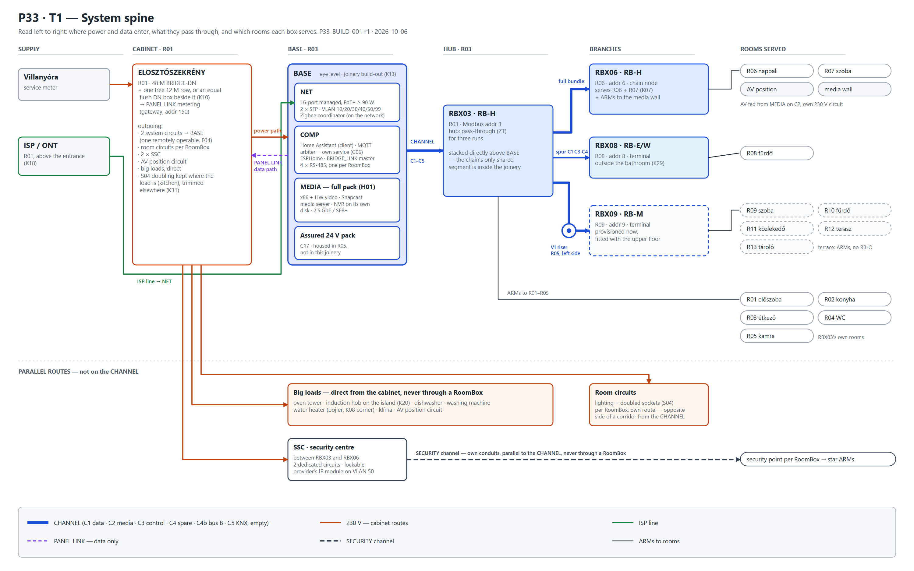
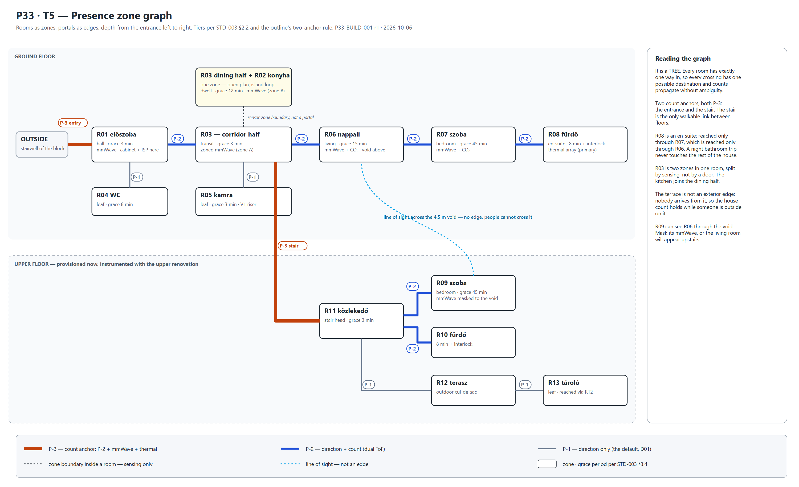
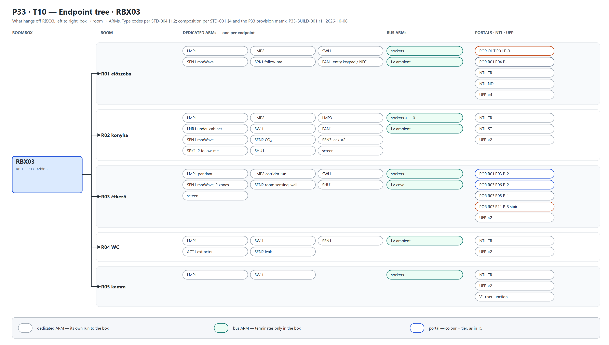
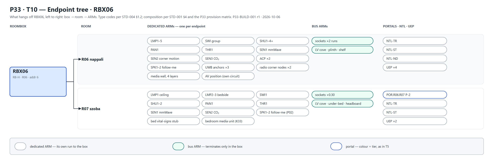
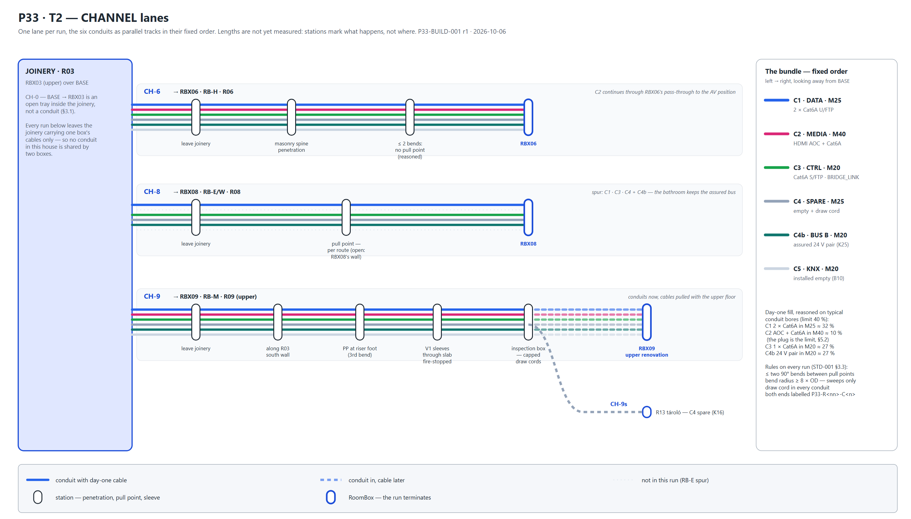
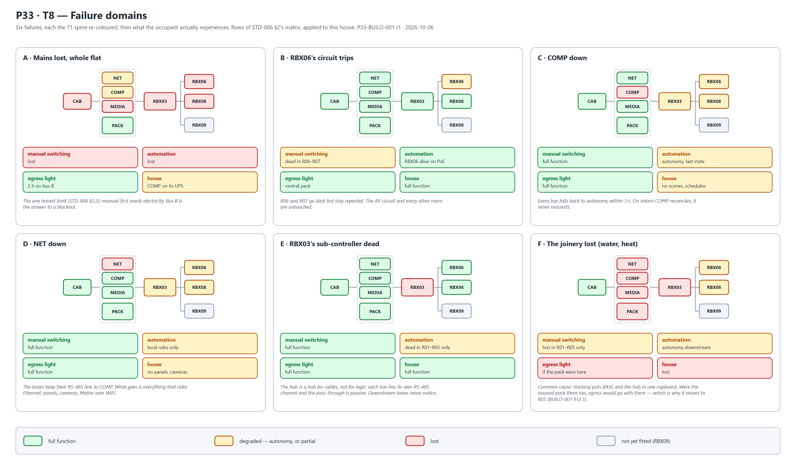

# CLA-BUILD-001 — Topology and Hardware Composition

**Doc:** CLA-BUILD-001 · r1 · 2026-10-06 · English · views T1 · T2 · T3 · T5 · T8 · T10
**Closes:** U22, the hardware composition of the CLA instance. It is also the first time all eight
standards meet one real dwelling.
**Built on:** BRIDGE-OUTLINE-001 r2 §4 · CLA-D1 r3 (round K) · STD-001 · 004 · 005 · 007
**De-identified.** The room geometry and client documents stay in `07_CLA/` on this PC. This file
carries topology and composition only.

> **What this document is for.** It is the **topology first**: which element feeds which, in what
> order, through what. Hardware is fixed at the level of **class and role** — RB-H, a 16-port PoE+
> switch, a full MEDIA pack. **Product selection and the per-ARM schedule are deferred to
> CLA-BUILD-002**, which can then be checked against this topology rather than invented beside it.

---

## 1. The instance at a glance

**Thirteen rooms on two floors; four RoomBoxes; one BASE.** The upper floor is provisioned now and
fitted later. It will not be renovated until the ground floor is finished (K05).

| Box | Class | Sits in | Modbus | Serves | Reached |
|---|---|---|---|---|---|
| **RBX03** | **RB-H** | R03 étkező | **3** | R01 R02 R03 R04 R05 | direct from BASE, stacked above it |
| **RBX06** | **RB-H** | R06 nappali | **6** | R06 R07 + the media wall / AV position | chained from RBX03 |
| **RBX08** | **RB-E/W** | R08 fürdő | **8** | R08 | chained from RBX03 · terminal |
| **RBX09** | **RB-M** | R09 upper room | **9** | R09 R10 R11 R12 R13 | chained from RBX03 through the **V1 riser** · terminal |

**Names are keyed to rooms (K19).** Reference, room and address are one number, so no lookup
table exists to go stale. The chain-order names RBX01–04 are retired before any label was printed,
which was the last cheap moment to change them.

**Lamp ARMs, one per lamp:** RBX03 **9** · RBX06 **8** · RBX08 **2** · RBX09 **7** — **26 in total**,
the figure the DALI argument in the outline already absorbed.

---

## 2. T1 — the system spine, left to right



The same, in text, for the terminal and for diffs:

```
 SUPPLY          CABINET · R01                 BASE · R03 (eye level)        HUB · R03          BRANCHES                       ROOMS
 ─────────       ─────────────────────         ──────────────────────        ───────────        ──────────────────────         ──────────────────────
 villanyóra ───► ELOSZTÓSZEKRÉNY ── power ───► ┌ NET    16p PoE+     ┐
                 48 M + 12 M row ·· PANEL ···► │ COMP   HA · arbiter │ ═CH═► RBX03 RB-H ═╦═CH══► RBX06 RB-H     ─► R06 · R07 · AV/media wall
 ISP / ONT ──────────────── ISP line ────────► │ MEDIA  full pack    │      addr 3      ╠═spur═► RBX08 RB-E/W   ─► R08
 (R01, K18)                 LINK (data only)   └ assured 24 V pack   ┘      ZT ×3       ╚═CH══► (V1) ═► RBX09 RB-M ─► R09 · R10 · R11 · R12 · R13
                    │                                                           └── ARMs ─────────────────────────► R01 · R02 · R03 · R04 · R05
                    │
 PARALLEL           ├── one 230 V circuit per RoomBox ── own route, opposite side of a corridor from the CHANNEL
 ROUTES             ├── big loads, direct ── oven tower · induction hob (island) · dishwasher · washing machine · bojler · klíma · AV
                    └── SSC ×2 ── SSC ══ SECURITY channel (own conduits) ══► security point per RoomBox
```

**How to read it.** Everything travels left to right, and **only the blue spine is the CHANNEL**.
The lower lanes are the routes that never touch it — the most commonly misunderstood fact in the
whole design, so the figure keeps them physically separate on the page.

---

## 3. Three things the topology reveals

These came out of drawing it. They are written down because each changes something.

### 3.1 Stacking BASE under the hub collapses the chain's shared segment into joinery

A physical chain with a logical star means the hub box carries **every downstream box's uplink
through its pass-through zone**. Between a remote BASE and the hub, that is a shared segment
carrying four rooms' cables in one bundle — the one place in a chain where conduit fill becomes a
problem.

**With BASE directly beneath RBX03, that segment no longer exists as a conduit.** It is a cable
tray inside one piece of joinery, open-fronted and serviceable. Every CHANNEL run leaving the
joinery carries **one box's cables only**. This is a good result of K13 that nobody asked for, and
worth preserving: if BASE ever moves, the fill problem comes back.

### 3.2 …and it puts BASE's heat into the hub's air intake

**A caution, flagged once.** BASE dissipates **70–110 W** (ARCH-002's budget). RoomBoxes breathe
**in at the bottom and out at the top** (STD-001 §2.2), and Z5 — the sensor shelf — sits in the
intake air *by design*, so it reads the room. Stacked naively, RBX03 inhales BASE's exhaust:
its thermal margin shrinks, and its temperature and humidity sensors report the cabinet rather
than the room.

**Building it as asked, under three conditions:**

1. **Two compartments in the joinery** with a solid horizontal baffle between them.
2. **BASE exhausts forward** through its own top slot in the joinery front, below the baffle —
   never upward into RBX03.
3. **RBX03's room sensing moves out of the box**: a `SEN` ARM to a wall point in R03 away from
   the joinery. The in-box Z5 shelf stays for internal monitoring only.

This is **reasoned, not measured**. The commissioning check is STD-001 §8's ΔT test on RBX03 with
BASE at full load; if RBX03 exceeds ΔT 25 K, B17's fan fallback applies to the BASE compartment,
not the RoomBox.

### 3.3 Three Thread border routers in one cabinet is one border router

STD-005 §5's reference places **two border routers at BASE and one at RoomBox 1**, to spread
redundancy. In CLA, RoomBox 1 *is* stacked on BASE, so all three would sit within half a metre of
each other — the redundancy STD-005 asked for, without the spatial diversity that made it worth
having.

**Correction for this instance, decided (K30):** two border routers at BASE, the third at **RBX06** — the far end
of the ground floor and directly under the void, so it also reaches up towards the upper floor
before RBX09 exists. When the upper floor is fitted, review whether it moves to RBX09.

---

## 4. Node composition

Class and role. Products in BUILD-002.

### 4.1 BASE — R03, eye level, joinery build-out

| Layer | Composition | From |
|---|---|---|
| **NET** | 16-port managed switch, PoE+ (802.3at), **≥ 90 W** budget, 2 × SFP · Zigbee coordinator, network-attached | STD-005 §2, §5 |
| **COMP** | Home Assistant as a client · **arbiter as its own service** · MQTT broker · ESPHome · BRIDGE_LINK master with **4 × RS-485**, one channel per RoomBox · two Thread border routers (§3.3) | G06 · STD-004 §3 · STD-005 §5 |
| **MEDIA** | **Full pack**: low-power x86 with hardware video · NVMe system + library bays · **NVR on its own surveillance disk** · Snapcast server · media server · 2.5 GbE / SFP+ uplink | H01 · STD-007 §7 |
| **Assured supply** | central 24 V bus B pack + **backup connector slot** — **in R05 beside V1, not in this joinery** (§12.1) | C17 |
| **Supply** | 2 system circuits from the cabinet, one through a remotely operable breaker (K31) | F04 · STD-001 §4.2 |

**The protocol masters attach to the network, never by USB to COMP** (ARCH-002 §4.2). That is
what lets MEDIA leave this joinery later — K10 says it may — without a redesign.

### 4.2 The RoomBoxes

| | RBX03 | RBX06 | RBX08 | RBX09 |
|---|---|---|---|---|
| **Class** | RB-H 600 × 600 × 120 | RB-H 600 × 600 × 120 | RB-E/W, RB-M envelope — outside the bathroom (K29), so no IP44 | RB-M 400 × 500 × 110 |
| **Role** | hub · ZT for 3 runs | chain node · media wall | terminal, wet | terminal, upper floor |
| **PSU** | 150 W, 24 V rail | 150 W | per RB-M | per RB-M |
| **Room switch** | wide-DC 12–57 V, PoE+ injecting, 8-port | same, ≈ 63 W injection (2 APs + panel + camera position) | 5-port | 5–8-port |
| **Sub-controller** | BRIDGE_LINK node 3 + PoE backup path from NET | node 6 | node 8 | node 9 |
| **Z4 radios** | Zigbee router · Thread router · BLE proxy | the same + **Thread border router** (§3.3) | Zigbee router · BLE proxy | the same as RBX03, fitted later |
| **Actuation** | ζ/η bistables for **9** lamps · shutters per R02/R03 | **8** lamps · shutters R06 (4+) and R07 (2) | **2** lamps · extractor | **7** lamps · 2 shutters |
| **Thermal class** | 70 W design max — **see §3.2** | 70 W | 40 W | 40 W |

**RB-H buys modules, not heat.** RBX06 went from RB-L to RB-H because it now serves two rooms and
the media wall (K07). That raises usable modules from 27 to 33, but **RB-L and RB-H share the same
70 W thermal ceiling** (STD-001 §2.6). Eight lamps, six or more shutter motors and a 63 W PoE
injection is the heaviest box in the house. The module count and the dissipation are BUILD-002's
first check, before anything is bought.

### 4.3 Positions that are not RoomBoxes

| Position | Composition |
|---|---|
| **Elosztószekrény** (R01) | 48 M BRIDGE-DN + **one free 12 M row, or an equal flush DN box beside it** (K10) — the PANEL LINK home: galvanically isolated circuit metering, smart breakers, the metering gateway (address 150) |
| **AV position** (R06 media wall) | ventilated joinery void, **own 230 V circuit**, HDMI + eARC to the screen, fed from MEDIA on **C2** through RBX06's pass-through · the media-wall cable route of STD-007 §5.3 |
| **SSC** | between RBX03 and RBX06 · 2 dedicated circuits · lockable · the provider's IP module on **VLAN 50** only |
| **V1 riser** (R05, left side) | the CHANNEL bundle in sleeves through the slab, fire-stopped · inspection box at the top of the kamra · draw cords in everything · **built now** |

---

## 5. The CHANNEL runs

| Run | From → to | Conduits | Notes |
|---|---|---|---|
| **CH-0** | BASE → RBX03 | — | **inside the joinery** (§3.1). No conduit |
| **CH-6** | RBX03 → RBX06 | full bundle **C1 · C2 · C3 · C4 · C4b · C5** | one penetration of the masonry spine. C2 carries the AV feed on to the media wall |
| **CH-8** | RBX03 → RBX08 | **spur C1 · C3 · C4 · C4b** | RB-E terminal, no screen (STD-001 §5). **C4b added (K25)** so the bathroom keeps the assured bus. Keep it clear of the wet-wall zone |
| **CH-9** | RBX03 → V1 → RBX09 | full bundle | **provisioned now, terminated later.** A full bundle because the riser can never be reopened cheaply, whatever the upper floor turns out to need |
| **CH-9s** | V1 junction → R13 tároló | **C4** spare | from the junction, not from RBX09, so RBX09 stays truly terminal (K16) |

**The bundle order never varies** (STD-001 §3.1): C1 · C2 · C3 · C4 · C4b · C5, left to right
looking away from BASE, in every run and at every pull point.

---

## 6. Addressing and the network

| | Allocation |
|---|---|
| **BRIDGE_LINK** | RBX03 = **3** · RBX06 = **6** · RBX08 = **8** · RBX09 = **9** · PANEL LINK gateway = **150** · BASE service node = **151**. One RS-485 channel per RoomBox, so **one node per channel** against a limit of eight — the 400 ms timing budget is not in play |
| **VLANs** | 10 Trusted · 20 IoT + Audio · 30 Cameras · 40 Guest · 50 Security · 99 Management (STD-004 §2.2) |
| **IP plan** | `10.33.<vlan>.0/24` |
| **NET ports** | ONT · COMP · MEDIA · NVR · PANEL LINK gateway · SSC module · 4 RoomBox uplinks = **10 of 16**. If each sub-controller's PoE backup takes its own port on the second Cat6A in C1, **14 of 16** — still inside, but that is the number to watch |

---

## 7. Presence anchors this topology implies

- **Two P-3 count anchors**: the entrance door (`CLA.POR.OUT.R01`) and the **stair**
  (`CLA.POR.R03.R11`). The stair's ground-floor end can be instrumented now, from RBX03. Its upper
  end waits for the upper floor.
- **The void is a line of sight, not a portal.** People cannot cross it, so the zone graph gets no
  edge. Sensors can see across it, so **R09's mmWave needs a mask** towards the railing — or it
  will report the living room.
- **R03 remains two zones** (dwell and transit), per outline §4.3.

---

## 8. T5 — the presence zone graph



**Depth from the entrance runs left to right.** Ground floor above, the upper floor below, joined
only by the stair.

**The graph is a tree.** Every room has exactly one way in. That is unusual and valuable: every
crossing has one possible destination, so counts propagate without ambiguity, and a leaf room's
occupancy follows from its single portal alone. The island loop does not break it, because the
loop lies inside one zone.

**R08 is an en-suite (K21).** Its only door opens from its side section — the K08 corner — into
R07, which is itself reached only from R06. So the bathroom sits at the end of a three-room branch:
R03 → R06 → R07 → R08. Two consequences:

- **A night bathroom trip never touches the rest of the house.** The bedroom's 45-minute grace and
  the bathroom's interlock interact only with each other, which is the quiet case the design
  wants.
- **The follow-me inversion becomes visible.** R08 has a follow-me pair, and since P02 so does R07,
  so the branch is covered end to end. Before P02, a stream would have skipped the one room on the
  way.

**Tiers, as drawn.** P-3 on the two count anchors — the entrance and the stair. P-2 on R03's two
doors (to R01 and R06), on every bedroom and bathroom door, and on the stair head's doors upstairs.
P-1 on the leaves where direction suffices: the WC, the kamra, the terrace, the store.

**Two zones in R03, and the kitchen joins one of them.** The dining half and R02 are one dwell
zone, since the island loop makes the open edge permanent (D09). The corridor half is a transit
zone. The boundary between them is drawn by zoned mmWave, not by a portal.

**The terrace is not an exterior edge.** Nobody arrives from it, so it is a zone like any other,
and the house count holds while someone stands outside on it.

> **R03's doorways are P-2 (K26).** Outline §4.3 had argued for P-3 there. The tree structure
> narrows the gap: in a tree a crossing cannot be misattributed between branches, only miscounted.
> **Revisit only if commissioning shows abreast crossings at R01↔R03** — the portal ARM is the same
> either way, so an upgrade is a fit-out change, not a construction one.

---

## 9. T3 — the power topology


**Three independent supply trees, read row by row.** 230 V from the cabinet; the **assured 24 V
bus** from the central pack at BASE; and the **PoE backup path** from NET to every sub-controller.
Each row ends in what still works when that cabinet way trips. That column is the manual-first
doctrine stated per circuit.

**What it shows:**

- **No single cabinet way removes control of a room.** A RoomBox's lighting way trips; its lamps
  go dark, but its sub-controller stays alive on PoE and its egress light and NTL-TR stay alive on
  bus B. The room can still report what happened.
- **BASE has two ways and needs one (K31).** The second is remotely operable (F04), so the system
  can be power-cycled without reaching the cabinet.
- **Big loads never meet a RoomBox.** Their failures are their own.

**Way count: 24**, each a one-module RCBO — 5 system, 12 RoomBox, 7 big-load. They fit rows 1–3
on either supply, and row 4 is the PANEL LINK row. The derivation, the S04 trim and the supply
calculation are in **§14**.

> **A gap T3 exposed, now closed: the assured bus rides C4b (K25).** Bus B runs from the central
> pack to every RoomBox, but the CHANNEL had no conduit for it — LV is "made in each RoomBox" and
> does not travel the CHANNEL. **C4b** was the M20 spare reserved for a DALI pair. No DALI is
> fitted in v1, so the bus can take it; it is in every run, and the bundle order does not change.
> **The DALI reservation moves to C5 while KNX is not taken, otherwise to C4** — STD-001 §3.1 and
> STD-002 §10 are amended to match, and RBX08's spur gains C4b (§5).

---

## 10. T10 — the endpoint trees

One sheet per RoomBox, read box → room → ARMs:

| | |
|---|---|
|  |  |
|  |  |

**Three columns per room.** Dedicated ARMs, one run per endpoint. Bus ARMs, which terminate only
in the box. Portals, notification lights and UEPs, with portals coloured by tier as in T5.

**Each portal is listed once, under the box that instruments it.** `POR.R03.R06` sits on RBX03's
sheet, not RBX06's, because RBX03 owns R03's side of that door.

**Composition comes from STD-001 §4's room-class rows and the CLA provision matrix.** The trees
are therefore a **first draft of the ARM schedule** — BUILD-002 assigns ARM numbers (`CLA.R03.A1…`)
and conduit sizes to them. RBX09's tree is drawn dashed: provisioned, not fitted.

---

## 11. T2 — the CHANNEL lanes



**A metro map.** One lane per run, the six conduits as parallel tracks in their fixed order, and
stations where something physical happens: leaving the joinery, a wall penetration, a pull point,
the slab sleeves. **Lengths are not yet measured**, so stations mark *what* happens, not *where*.

**What it shows:**

- **No conduit in this house carries two boxes' cables.** CH-0, the hub's shared segment, is the
  joinery tray (§3.1), so every lane starts single-box.
- **CH-9 is the one run with a forced pull point.** Along R03's south wall, a turn into the kamra
  and a turn upward make three bends, so STD-001 §3.3 puts a pull point **at the foot of the
  riser**. It is a natural one: in the kamra, behind a door, beside the inspection box.
- **CH-9 is built in two states.** Conduits, sleeves and draw cords now. Cable later, from the
  inspection box upward, when the upper floor is done. The fire-stopping goes in with the sleeves.
- **CH-8's spur now carries C4b**, so the bathroom's egress light is on the assured bus like
  every other room.

**Fill is reasoned on typical conduit bores**, not measured cable diameters: the worst day-one
case is C1 at about 32 %, under the 40 % limit. C2's limit is the HDMI plug, not the fill.

---

## 12. T8 — failure domains



**Six failures, each the T1 spine re-coloured**, then what the occupant actually experiences:
manual switching, automation, the egress light, and the house as a whole. The rows come from
STD-006 §2's failure matrix, applied to this house's topology.

**Two results specific to CLA:**

- **E — the hub is a hub for cables, not for logic.** RBX03's sub-controller can die and
  R06–R09 never notice. Each box has its own RS-485 channel from COMP, and the pass-through is
  passive copper. The physical chain does not create a logical one.
- **F — the joinery is a common cause.** This is the cost of the K13 stacking. One event at that
  position — a leak from above, a fire, sustained overheating — takes out NET, COMP, MEDIA and the
  hub together. The downstream boxes fall back to autonomy, and manual switching survives
  everywhere except R01–R05, whose relays sit in RBX03.

### 12.1 Where the assured pack lives

BUILD-001 placed the central bus B pack at BASE without a reason; nothing in the standards fixes
its position. **Scenario F is the reason not to.** If the pack sits in the joinery, the one event
that removes the coordinator also removes every egress light in the house. That is exactly the
kind of coupling the central-pack decision (C17) was taken to avoid.

**Decided (K27): the pack goes in R05 kamra**, in its own small enclosure beside the V1 riser.

- It is a different cupboard from the joinery, so a joinery event does not reach it.
- It is cool, it is low-value space, and it is already the services riser.
- From there, bus B reaches the joinery over a short dedicated link and enters C4b of every run.

T3 and T8 draw the pack as a separate element, labelled R05. The BASE joinery no longer carries
anything whose loss would darken an egress light.

---

## 13. Further views — for a later round

T1, T2, T3, T5, T8 and T10 are done. The remaining four:

T1 answers *what feeds what*. Each view below answers one different question about the same
installation. All read left to right unless the question has a different natural axis.

| | View | The question it answers | Natural form |
|---|---|---|---|
| ~~T2~~ | **CHANNEL lanes** — *done, §11* | which conduit carries what, run by run, through the riser and the pass-through | a "metro map": one lane per run, C1–C5 as parallel tracks, stations at boxes and pull points |
| ~~T3~~ | **Power topology** — *done, §9* | which breaker feeds what, and what dies with it | cabinet ways → circuits → boxes and big loads, with the assured 24 V bus as a second, independent tree |
| **T4** | **Control and data star** | how COMP and NET actually see the house | COMP's four RS-485 channels and NET's 16 ports as two fan-outs, VLAN-coloured |
| ~~T5~~ | **Presence zone graph** — *done, §8* | where people can go, and where the system counts them | rooms as nodes, portals as edges with their P-tier, anchors marked, the void as a non-walkable sight line |
| **T6** | **Radio map** | which protocol is coordinated where, and who routes for whom | Zigbee / Thread / BLE as three overlaid meshes on the box positions |
| **T7** | **Media and audio paths** | why music and television never share a path | Path A (Snapcast, distributed) and Path B (local, low-latency) side by side, follow-me rooms highlighted |
| ~~T8~~ | **Failure domains** — *done, §12* | what still works when COMP, NET, a circuit or a box is lost | the T1 layout re-coloured per failure state — manual-first made visible |
| **T9** | **Build sequence** | what must be in the wall before the plaster | a swimlane: the 13 build steps against the rooms, with *provision now / fit later* for the upper floor |
| ~~T10~~ | **Endpoint trees** — *done, §10* | what hangs off each box | per RoomBox: box → ARMs → endpoints, the ARM schedule as a tree — BUILD-002's backbone |

**Next, if you want them:** T6 (radio) once the Thread change of §3.3 is accepted, and T7 (media)
once the media wall's position is known. T4 and T9 can wait for BUILD-002.

---

## 14. The cabinet and the supply (K31, K32)

### 14.1 Where the shortage came from — and why most of it is not CLA's

BRIDGE-DN V2 fills its 48 modules (4 rows × 12) like this:

- **Rows 1–3:** feed, surge protection, one 25 A 30 mA RCD in front of everything, 14 circuits
  and a modular bell.
- **Row 4:** the **centralised-variant core** — 5 V supply, Raspberry Pi 5, USB hub with the
  Zigbee coordinator, a three-phase energy meter and a two-channel lighting switch.

**CLA is the distributed variant** (C2-T: it has a bathroom and bedrooms on another floor). COMP
lives in BASE, the coordinator sits on the network at NET, and switching happens in the RoomBoxes.
**So row 4 is free, and it becomes the 12-module PANEL LINK row of K10** — inside the existing
cabinet, with no extension box. The shortage that the outline found was the centralised variant's,
not this house's.

### 14.2 The three reductions taken

| | Reduction | Effect |
|---|---|---|
| **c** | **BASE on two system ways, not three** — F04 allows two to three; the remotely operable one is kept | −1 way |
| **a** | **A one-module RCBO on every way**, replacing grouped RCDs | no RCD modules at all; **one earth fault trips one circuit**, which is T3's and T8's failure-domain logic carried into the cabinet. It also retires V2's single 25 A RCD, which no longer suits a cabinet that feeds an induction hob, an oven and a water heater |
| **S04** | **Doubling trimmed by tolerance** — kept where the load concentrates, dropped where a single 1.5 mm² circuit is enough | −6 ways against strict doubling, below |

**The S04 trim, by tolerance.** Strict doubling of every conventional socket circuit would give
**14** socket ways. Ranked by how well each group tolerates a single 1.5 mm² circuit:

| Group | Load profile | Tolerance | Ways |
|---|---|---|---|
| **Kitchen worktop A, B + the island** (R02, R03) | kettle, microwave, coffee machine, toaster — high and simultaneous | **lowest — doubling kept**: two worktop runs and the island on its own | **3** |
| R08 fürdő | hairdryer ≈ 2 kW, one user | medium — fits one circuit | 1 |
| R07 szoba | chargers, bedside, occasionally a heater | high. **Kept separate from R06** for failure isolation, not for load | 1 |
| R06 nappali | the AV position has its own way; the rest is lamps, chargers, a vacuum | high | 1 |
| R01 + R03 general + R05 | vacuum, chargers | high | 1 |
| Upper floor (R09–R13) | provisioned | review at the upper renovation | 1 |
| | | | **8 of 14** |

> **A correction to my own figures.** T3's first version counted two socket ways per RoomBox and
> labelled that "doubled sockets". That was already an unstated trim — strict S04 is 14 socket
> ways, not 7. The trimmed plan above is 8, and it is stated.

**Reduction b was not taken**, so the upper floor keeps its own cabinet ways (lighting + one
socket). **The gap it exposed remains regardless: the V1 riser carries only the CHANNEL.** Those
two circuits, and any future upper-floor big load — the *klíma ?* on the upper sheet — need a
**separate MAINS sleeve through the slab beside V1**, kept apart from the bundle and fire-stopped.
Specify **two M25 plus one empty M25**, laid with the riser now.

### 14.3 The way count

| Group | Ways |
|---|---|
| System — BASE ×2 (one remotely operable), assured pack (K27), SSC ×2 | 5 |
| RoomBox lighting — RBX03, RBX06, RBX08, RBX09 | 4 |
| RoomBox sockets — the trimmed plan above | 8 |
| Big loads — oven tower, induction hob, dishwasher, washing machine, bojler, klíma, AV position | 7 |
| | **24** |

### 14.4 The supply, both cases (K32)

**Connected load, reasoned on typical ratings** — BUILD-002 replaces each with a nameplate:

| Load | kW | | Load | kW |
|---|---|---|---|---|
| Induction hob, 4 zones | 7.4 | | Klíma | 1.2 |
| Oven tower | 3.5 | | Kitchen sockets (kettle, microwave, coffee) | 3.0 |
| Washing machine | 2.2 | | Other sockets | 2.0 |
| Dishwasher | 2.0 | | AV position | 0.5 |
| Bojler | 2.0 | | Lighting · BRIDGE (BASE, 4 boxes, pack) | 0.5 · 0.3 |
| | | | **Connected** | **≈ 24.6** |

**A realistic evening peak** — hob 5.0 (two zones boosting), oven 3.5, kettle 2.2, dishwasher
heating 2.0, bojler 2.0, klíma 1.2, base load 1.5 — is **≈ 17.4 kW**.

| | **Single-phase, 1 × 32 A — interim** | **Three-phase — long term** |
|---|---|---|
| Capacity | **7.4 kW** | **3 × 25 A = 17.3 kW** · 3 × 32 A = 22 kW |
| Verdict | **Works only with load management.** The hob limited to 3.7 kW plus the oven is already 7.2 kW — the whole supply. Rules: **hob power limit set to 16 A** (a setup option on most induction hobs) · **bojler on the *vezérelt* off-peak tariff**, or shed by a cabinet contactor · dishwasher and washer on **delay start** outside cooking hours. **Hob, oven and a kettle together will trip it** — accepted as an interim constraint | **3 × 25 A carries the realistic peak** with the same delay-start habit. **3 × 32 A removes every constraint** and leaves room for a heat pump or an EV charger. Recommendation: **3 × 32 A** if the DSO's upgrade fee is acceptable, otherwise 3 × 25 A |
| Phase plan | — | **L1** hob A · bojler · lighting + BRIDGE · **L2** hob B · washing machine · klíma · **L3** oven · dishwasher · kitchen sockets — each ≈ 28–33 A only if everything coincides, ≈ 20–25 A in practice |
| Hob | one 1P+N RCBO, 16–20 A, 1 module | **2L + 2N connection**, two 1P+N RCBOs on L1 and L2 — a shared-neutral 2L+1N connection would trip two separate RCBOs |
| Feed | 2P main switch (2) · SPD 1P+N (2) · bell (1) | **4P main switch (4) · SPD 3P+N (4)** · bell (1) |
| **Modules, rows 1–3** | **5 + 24 = 29 of 36** (+ 2 if the bojler is shed by contactor) | **9 + 25 = 34 of 36** |

**Recommendation: build the cabinet three-phase-ready from day one** — the 4-pole main switch, the
three-phase SPD and three-phase comb busbars, with every circuit labelled with its target phase. It
costs four modules now and makes the upgrade a supply change with no rework inside the cabinet.
**How the interim single-phase supply is landed is the installer's call under the DSO's rules (A08)**;
this document does not prescribe it. At 34 of 36, the three-phase layout leaves two spare modules;
moving the modular bell out of the cabinet makes it three.

**BRIDGE can do the load management, within one rule.** PANEL LINK meters the main feed, so the
arbiter knows when the supply nears its limit and can defer a dishwasher or a washer through their
own interfaces. **Switching a big load off still needs a certified contactor in the cabinet**
(STD-001 §4) — software never sheds high current directly.

---

## 15. Open

| | Item | Blocks |
|---|---|---|
| 1 | ~~RBX08's wall~~ — **decided (K29):** the walkway face of the new bathroom wall, outside the wet room. The new wall is built **≈ 150 mm** to take the 110 mm box; IP44 is no longer needed, and the room beyond stays SELV-only. **Check the washbasin's pipe runs in that wall on site** | — |
| 2 | ~~The media wall's position~~ — **decided (K33), §16** | — |
| 3 | ~~RBX06's wall~~ — **decided (K28):** the R06 face of the R06 / R07 partition, at its right end, the box body recessed into R07's wardrobe void. The partition is thin, so the wardrobe takes the depth. An IR blaster, if wanted, is its own endpoint at the media wall, not a reason to move the box | — |
| 4 | **Product selection** and the **per-ARM schedule** | BUILD-002 |
| 5 | **§3.2's ΔT** on RBX03 above a loaded BASE | commissioning, not design |
| 6 | ~~Cabinet module count~~ — **decided (K31, K32), §14**: 24 ways, 29 or 34 of 36 modules; row 4 is the PANEL LINK row | — |
| 6a | **The supply**: which three-phase rating, and when — the DSO's fee decides 3 × 25 A or 3 × 32 A | the head of the cabinet |
| 6b | **The MAINS sleeve beside V1** — two M25 plus one empty M25, laid with the riser | the upper floor's circuits |
| 7 | **C23 / C23B** lighting types · **H10** Snapcast placement · **D9** security provider | unchanged |

---

## 16. The media wall — one partition, two screens (K33)

**Decided:** the R06 media wall goes on **R06's upper wall**, the partition shared with R07. The
**same wall carries a smaller media unit on the R07 side**, for a bedroom television facing the
bed. R07 therefore gains a screen, which the provision matrix had left at `?`.

**What this gets right.** RBX06 already sits at the right-hand end of that partition (K28), so
C2's onward run to the AV position is a short horizontal along one wall. Both screens are within
a metre or two of the box that serves them, and the two units can share sources through the wall.

**The flag, once: a cinema front stage on a thin partition, back to back with a bed.** Speakers
and a subwoofer fixed to a thin wall drive it as a panel, and the bedroom on the other side hears
the low end of every film. Built as asked, under three conditions:

1. **The R06 media wall is a decoupled build-out** — its own frame standing off the partition,
   mineral wool in the cavity, no rigid fixings through to the R07 face. The build-out is also
   where the AV position's ventilated void, the media-wall route (M50 minimum, M63 or trunking,
   STD-007 §5.3) and the in-wall speaker back-boxes live. The partition itself stays thin.
2. **Nothing is back to back.** The R06 flush boxes and the R07 unit's boxes are **offset by at
   least 300 mm**, never sharing a hole through the partition — for sound, and for fire.
3. **The subwoofer stands on the floor, clear of the partition.** It is never wall-mounted on
   this wall.

**The bedroom unit is small on purpose.** A TV mount, one 10 × 10 cm flush box, a Cat6A from
RBX06, a socket on R07's own circuit, and **one M40 sleeve through the partition** to the AV void,
offset per rule 2. The sleeve lets the bedroom screen take an HDMI feed from the media wall's
sources if wanted, and is empty with a draw cord otherwise. Its sound is the TV's own, or a
soundbar — **path B, local** (STD-007 §1). It is not the follow-me pair (P02), which stays a
separate ceiling layer.

**The IR question (from K28) answers itself here:** both units sit on the same wall within reach
of RBX06, and an IR blaster is a UEP-class endpoint at each screen if wanted.

**This unblocks T7** (media and audio paths).
