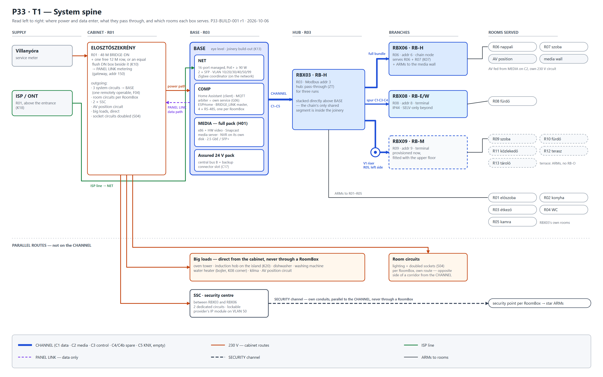
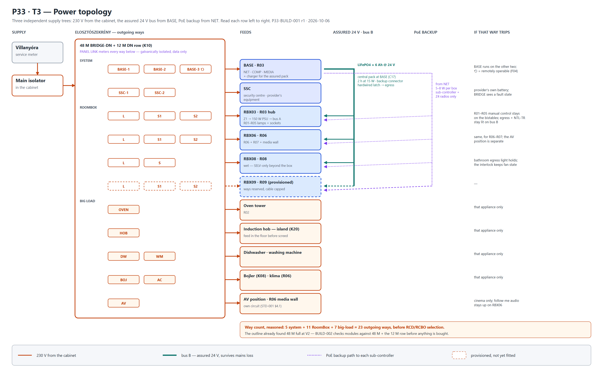
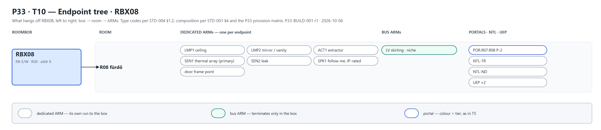
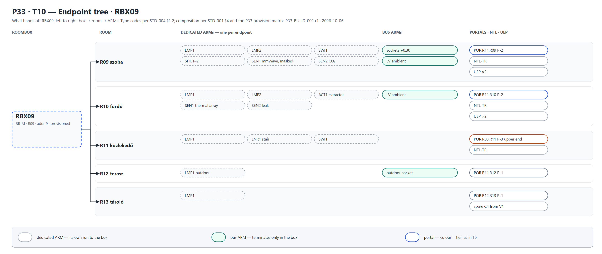

# P33-BUILD-001 — Topology and Hardware Composition

**Doc:** P33-BUILD-001 · r1 · 2026-10-06 · English · views T1 · T3 · T5 · T10
**Closes:** U22, the hardware composition of the P33 instance. It is also the first time all eight
standards meet one real dwelling.
**Built on:** BRIDGE-OUTLINE-001 r2 §4 · P33-D1 r3 (round K) · STD-001 · 004 · 005 · 007
**De-identified.** The room geometry and client documents stay in `07_P33/` on this PC. This file
carries topology and composition only.

> **What this document is for.** It is the **topology first**: which element feeds which, in what
> order, through what. Hardware is fixed at the level of **class and role** — RB-H, a 16-port PoE+
> switch, a full MEDIA pack. **Product selection and the per-ARM schedule are deferred to
> P33-BUILD-002**, which can then be checked against this topology rather than invented beside it.

---

## 1. The instance at a glance

**Thirteen rooms on two floors; four RoomBoxes; one BASE.** The upper floor is provisioned now and
fitted later. It will not be renovated until the ground floor is finished (K05).

| Box | Class | Sits in | Modbus | Serves | Reached |
|---|---|---|---|---|---|
| **RBX03** | **RB-H** | R03 étkező | **3** | R01 R02 R03 R04 R05 | direct from BASE, stacked above it |
| **RBX06** | **RB-H** | R06 nappali | **6** | R06 R07 + the media wall / AV position | chained from RBX03 |
| **RBX08** | **RB-E/W** | R08 fürdő | **8** | R08 | chained from RBX03 · terminal |
| **RBX09** | **RB-M** | R09 upper room | **9** | R09 R10 R11 R12 R13 | chained from RBX03 through the **V1 riser** · terminal |

**Names are keyed to rooms (K19).** Reference, room and address are one number, so no lookup
table exists to go stale. The chain-order names RBX01–04 are retired before any label was printed,
which was the last cheap moment to change them.

**Lamp ARMs, one per lamp:** RBX03 **9** · RBX06 **8** · RBX08 **2** · RBX09 **7** — **26 in total**,
the figure the DALI argument in the outline already absorbed.

---

## 2. T1 — the system spine, left to right



The same, in text, for the terminal and for diffs:

```
 SUPPLY          CABINET · R01                 BASE · R03 (eye level)        HUB · R03          BRANCHES                       ROOMS
 ─────────       ─────────────────────         ──────────────────────        ───────────        ──────────────────────         ──────────────────────
 villanyóra ───► ELOSZTÓSZEKRÉNY ── power ───► ┌ NET    16p PoE+     ┐
                 48 M + 12 M row ·· PANEL ···► │ COMP   HA · arbiter │ ═CH═► RBX03 RB-H ═╦═CH══► RBX06 RB-H     ─► R06 · R07 · AV/media wall
 ISP / ONT ──────────────── ISP line ────────► │ MEDIA  full pack    │      addr 3      ╠═spur═► RBX08 RB-E/W   ─► R08
 (R01, K18)                 LINK (data only)   └ assured 24 V pack   ┘      ZT ×3       ╚═CH══► (V1) ═► RBX09 RB-M ─► R09 · R10 · R11 · R12 · R13
                    │                                                           └── ARMs ─────────────────────────► R01 · R02 · R03 · R04 · R05
                    │
 PARALLEL           ├── one 230 V circuit per RoomBox ── own route, opposite side of a corridor from the CHANNEL
 ROUTES             ├── big loads, direct ── oven tower · induction hob (island) · dishwasher · washing machine · bojler · klíma · AV
                    └── SSC ×2 ── SSC ══ SECURITY channel (own conduits) ══► security point per RoomBox
```

**How to read it.** Everything travels left to right, and **only the blue spine is the CHANNEL**.
The lower lanes are the routes that never touch it — the most commonly misunderstood fact in the
whole design, so the figure keeps them physically separate on the page.

---

## 3. Three things the topology reveals

These came out of drawing it. They are written down because each changes something.

### 3.1 Stacking BASE under the hub collapses the chain's shared segment into joinery

A physical chain with a logical star means the hub box carries **every downstream box's uplink
through its pass-through zone**. Between a remote BASE and the hub, that is a shared segment
carrying four rooms' cables in one bundle — the one place in a chain where conduit fill becomes a
problem.

**With BASE directly beneath RBX03, that segment no longer exists as a conduit.** It is a cable
tray inside one piece of joinery, open-fronted and serviceable. Every CHANNEL run leaving the
joinery carries **one box's cables only**. This is a good result of K13 that nobody asked for, and
worth preserving: if BASE ever moves, the fill problem comes back.

### 3.2 …and it puts BASE's heat into the hub's air intake

**A caution, flagged once.** BASE dissipates **70–110 W** (ARCH-002's budget). RoomBoxes breathe
**in at the bottom and out at the top** (STD-001 §2.2), and Z5 — the sensor shelf — sits in the
intake air *by design*, so it reads the room. Stacked naively, RBX03 inhales BASE's exhaust:
its thermal margin shrinks, and its temperature and humidity sensors report the cabinet rather
than the room.

**Building it as asked, under three conditions:**

1. **Two compartments in the joinery** with a solid horizontal baffle between them.
2. **BASE exhausts forward** through its own top slot in the joinery front, below the baffle —
   never upward into RBX03.
3. **RBX03's room sensing moves out of the box**: a `SEN` ARM to a wall point in R03 away from
   the joinery. The in-box Z5 shelf stays for internal monitoring only.

This is **reasoned, not measured**. The commissioning check is STD-001 §8's ΔT test on RBX03 with
BASE at full load; if RBX03 exceeds ΔT 25 K, B17's fan fallback applies to the BASE compartment,
not the RoomBox.

### 3.3 Three Thread border routers in one cabinet is one border router

STD-005 §5's reference places **two border routers at BASE and one at RoomBox 1**, to spread
redundancy. In P33, RoomBox 1 *is* stacked on BASE, so all three would sit within half a metre of
each other — the redundancy STD-005 asked for, without the spatial diversity that made it worth
having.

**Correction for this instance:** two border routers at BASE, the third at **RBX06** — the far end
of the ground floor and directly under the void, so it also reaches up towards the upper floor
before RBX09 exists. When the upper floor is fitted, review whether it moves to RBX09.

---

## 4. Node composition

Class and role. Products in BUILD-002.

### 4.1 BASE — R03, eye level, joinery build-out

| Layer | Composition | From |
|---|---|---|
| **NET** | 16-port managed switch, PoE+ (802.3at), **≥ 90 W** budget, 2 × SFP · Zigbee coordinator, network-attached | STD-005 §2, §5 |
| **COMP** | Home Assistant as a client · **arbiter as its own service** · MQTT broker · ESPHome · BRIDGE_LINK master with **4 × RS-485**, one channel per RoomBox · two Thread border routers (§3.3) | G06 · STD-004 §3 · STD-005 §5 |
| **MEDIA** | **Full pack**: low-power x86 with hardware video · NVMe system + library bays · **NVR on its own surveillance disk** · Snapcast server · media server · 2.5 GbE / SFP+ uplink | H01 · STD-007 §7 |
| **Assured supply** | central 24 V bus B pack + **backup connector slot** | C17 |
| **Supply** | 3 system circuits from the cabinet, one through a remotely operable breaker | F04 · STD-001 §4.2 |

**The protocol masters attach to the network, never by USB to COMP** (ARCH-002 §4.2). That is
what lets MEDIA leave this joinery later — K10 says it may — without a redesign.

### 4.2 The RoomBoxes

| | RBX03 | RBX06 | RBX08 | RBX09 |
|---|---|---|---|---|
| **Class** | RB-H 600 × 600 × 120 | RB-H 600 × 600 × 120 | RB-E/W, RB-M envelope, IP44 | RB-M 400 × 500 × 110 |
| **Role** | hub · ZT for 3 runs | chain node · media wall | terminal, wet | terminal, upper floor |
| **PSU** | 150 W, 24 V rail | 150 W | per RB-M | per RB-M |
| **Room switch** | wide-DC 12–57 V, PoE+ injecting, 8-port | same, ≈ 63 W injection (2 APs + panel + camera position) | 5-port | 5–8-port |
| **Sub-controller** | BRIDGE_LINK node 3 + PoE backup path from NET | node 6 | node 8 | node 9 |
| **Z4 radios** | Zigbee router · Thread router · BLE proxy | the same + **Thread border router** (§3.3) | Zigbee router · BLE proxy | the same as RBX03, fitted later |
| **Actuation** | ζ/η bistables for **9** lamps · shutters per R02/R03 | **8** lamps · shutters R06 (4+) and R07 (2) | **2** lamps · extractor | **7** lamps · 2 shutters |
| **Thermal class** | 70 W design max — **see §3.2** | 70 W | 40 W | 40 W |

**RB-H buys modules, not heat.** RBX06 went from RB-L to RB-H because it now serves two rooms and
the media wall (K07). That raises usable modules from 27 to 33, but **RB-L and RB-H share the same
70 W thermal ceiling** (STD-001 §2.6). Eight lamps, six or more shutter motors and a 63 W PoE
injection is the heaviest box in the house. The module count and the dissipation are BUILD-002's
first check, before anything is bought.

### 4.3 Positions that are not RoomBoxes

| Position | Composition |
|---|---|
| **Elosztószekrény** (R01) | 48 M BRIDGE-DN + **one free 12 M row, or an equal flush DN box beside it** (K10) — the PANEL LINK home: galvanically isolated circuit metering, smart breakers, the metering gateway (address 150) |
| **AV position** (R06 media wall) | ventilated joinery void, **own 230 V circuit**, HDMI + eARC to the screen, fed from MEDIA on **C2** through RBX06's pass-through · the media-wall cable route of STD-007 §5.3 |
| **SSC** | between RBX03 and RBX06 · 2 dedicated circuits · lockable · the provider's IP module on **VLAN 50** only |
| **V1 riser** (R05, left side) | the CHANNEL bundle in sleeves through the slab, fire-stopped · inspection box at the top of the kamra · draw cords in everything · **built now** |

---

## 5. The CHANNEL runs

| Run | From → to | Conduits | Notes |
|---|---|---|---|
| **CH-0** | BASE → RBX03 | — | **inside the joinery** (§3.1). No conduit |
| **CH-6** | RBX03 → RBX06 | full bundle **C1 · C2 · C3 · C4 · C4b · C5** | one penetration of the masonry spine. C2 carries the AV feed on to the media wall |
| **CH-8** | RBX03 → RBX08 | **spur C1 · C3 · C4** | RB-E terminal, no screen (STD-001 §5). Keep it clear of the wet-wall zone |
| **CH-9** | RBX03 → V1 → RBX09 | full bundle | **provisioned now, terminated later.** A full bundle because the riser can never be reopened cheaply, whatever the upper floor turns out to need |
| **CH-9s** | V1 junction → R13 tároló | **C4** spare | from the junction, not from RBX09, so RBX09 stays truly terminal (K16) |

**The bundle order never varies** (STD-001 §3.1): C1 · C2 · C3 · C4 · C4b · C5, left to right
looking away from BASE, in every run and at every pull point.

---

## 6. Addressing and the network

| | Allocation |
|---|---|
| **BRIDGE_LINK** | RBX03 = **3** · RBX06 = **6** · RBX08 = **8** · RBX09 = **9** · PANEL LINK gateway = **150** · BASE service node = **151**. One RS-485 channel per RoomBox, so **one node per channel** against a limit of eight — the 400 ms timing budget is not in play |
| **VLANs** | 10 Trusted · 20 IoT + Audio · 30 Cameras · 40 Guest · 50 Security · 99 Management (STD-004 §2.2) |
| **IP plan** | `10.33.<vlan>.0/24` |
| **NET ports** | ONT · COMP · MEDIA · NVR · PANEL LINK gateway · SSC module · 4 RoomBox uplinks = **10 of 16**. If each sub-controller's PoE backup takes its own port on the second Cat6A in C1, **14 of 16** — still inside, but that is the number to watch |

---

## 7. Presence anchors this topology implies

- **Two P-3 count anchors**: the entrance door (`P33.POR.OUT.R01`) and the **stair**
  (`P33.POR.R03.R11`). The stair's ground-floor end can be instrumented now, from RBX03. Its upper
  end waits for the upper floor.
- **The void is a line of sight, not a portal.** People cannot cross it, so the zone graph gets no
  edge. Sensors can see across it, so **R09's mmWave needs a mask** towards the railing — or it
  will report the living room.
- **R03 remains two zones** (dwell and transit), per outline §4.3.

---

## 8. T5 — the presence zone graph


**Depth from the entrance runs left to right.** Ground floor above, the upper floor below, joined
only by the stair.

**The graph is a tree.** Every room has exactly one way in. That is unusual and valuable: every
crossing has one possible destination, so counts propagate without ambiguity, and a leaf room's
occupancy follows from its single portal alone. The island loop does not break it, because the
loop lies inside one zone.

**R08 is an en-suite (K21).** Its only door opens from its side section — the K08 corner — into
R07, which is itself reached only from R06. So the bathroom sits at the end of a three-room branch:
R03 → R06 → R07 → R08. Two consequences:

- **A night bathroom trip never touches the rest of the house.** The bedroom's 45-minute grace and
  the bathroom's interlock interact only with each other, which is the quiet case the design
  wants.
- **The follow-me inversion becomes visible.** R08 has a follow-me pair, and since P02 so does R07,
  so the branch is covered end to end. Before P02, a stream would have skipped the one room on the
  way.

**Tiers, as drawn.** P-3 on the two count anchors — the entrance and the stair. P-2 on R03's two
doors (to R01 and R06), on every bedroom and bathroom door, and on the stair head's doors upstairs.
P-1 on the leaves where direction suffices: the WC, the kamra, the terrace, the store.

**Two zones in R03, and the kitchen joins one of them.** The dining half and R02 are one dwell
zone, since the island loop makes the open edge permanent (D09). The corridor half is a transit
zone. The boundary between them is drawn by zoned mmWave, not by a portal.

**The terrace is not an exterior edge.** Nobody arrives from it, so it is a zone like any other,
and the house count holds while someone stands outside on it.

> **One decision this leaves for you.** Outline §4.3 argued that R03's internal doorways deserve
> **P-3** as much as the entrance does, because a misordered crossing there corrupts every
> downstream zone at once. T5 draws them **P-2**, the D01 position. The tree structure narrows the
> gap: in a tree a crossing cannot be misattributed between branches, only miscounted. **P-2 is
> enough unless commissioning shows abreast crossings at R01↔R03** — and the portal ARM is the same
> either way, so the upgrade is a fit-out change, not a construction one.

---

## 9. T3 — the power topology



**Three independent supply trees, read row by row.** 230 V from the cabinet; the **assured 24 V
bus** from the central pack at BASE; and the **PoE backup path** from NET to every sub-controller.
Each row ends in what still works when that cabinet way trips. That column is the manual-first
doctrine stated per circuit.

**What it shows:**

- **No single cabinet way removes control of a room.** A RoomBox's lighting way trips; its lamps
  go dark, but its sub-controller stays alive on PoE and its egress light and NTL-TR stay alive on
  bus B. The room can still report what happened.
- **BASE has three ways and needs one.** The third is remotely operable (F04), so the system can be
  power-cycled without reaching the cabinet.
- **Big loads never meet a RoomBox.** Their failures are their own.

**Way count, reasoned rather than counted against a schedule:** 5 system + 11 RoomBox (lighting
and doubled sockets, S04) + 7 big-load ≈ **23 outgoing ways**, before RCD/RCBO selection. The
outline already found the 48-module cabinet full at V2. **The 12-module DN row of K10 is for
PANEL LINK, not for these ways**, so BUILD-002's first cabinet task is a module count against
both.

> **A gap T3 exposed: the assured bus has no defined route.** Bus B runs from the central pack at
> BASE to every RoomBox, but STD-001 §3.1's CHANNEL has no conduit for it — LV is "made in each
> RoomBox" and does not travel the CHANNEL. The two candidates are **C4b**, the M20 spare (which
> STD-001 reserves for a DALI pair, now foreclosed by C30), or **a dedicated M20 alongside the
> bundle**. My recommendation is **C4b**: DALI is out, the conduit is already in every run, and it
> keeps the bundle order unchanged. **Your call**, because it spends a spare.

---

## 10. T10 — the endpoint trees

One sheet per RoomBox, read box → room → ARMs:

| | |
|---|---|
|  |  |
|  |  |

**Three columns per room.** Dedicated ARMs, one run per endpoint. Bus ARMs, which terminate only
in the box. Portals, notification lights and UEPs, with portals coloured by tier as in T5.

**Each portal is listed once, under the box that instruments it.** `POR.R03.R06` sits on RBX03's
sheet, not RBX06's, because RBX03 owns R03's side of that door.

**Composition comes from STD-001 §4's room-class rows and the P33 provision matrix.** The trees
are therefore a **first draft of the ARM schedule** — BUILD-002 assigns ARM numbers (`P33.R03.A1…`)
and conduit sizes to them. RBX09's tree is drawn dashed: provisioned, not fitted.

---

## 11. Further views — for a later round

T1, T3, T5 and T10 are done. The remaining six:

T1 answers *what feeds what*. Each view below answers one different question about the same
installation. All read left to right unless the question has a different natural axis.

| | View | The question it answers | Natural form |
|---|---|---|---|
| **T2** | **CHANNEL lanes** | which conduit carries what, run by run, through the riser and the pass-through | a "metro map": one lane per run, C1–C5 as parallel tracks, stations at boxes and pull points |
| ~~T3~~ | **Power topology** — *done, §9* | which breaker feeds what, and what dies with it | cabinet ways → circuits → boxes and big loads, with the assured 24 V bus as a second, independent tree |
| **T4** | **Control and data star** | how COMP and NET actually see the house | COMP's four RS-485 channels and NET's 16 ports as two fan-outs, VLAN-coloured |
| ~~T5~~ | **Presence zone graph** — *done, §8* | where people can go, and where the system counts them | rooms as nodes, portals as edges with their P-tier, anchors marked, the void as a non-walkable sight line |
| **T6** | **Radio map** | which protocol is coordinated where, and who routes for whom | Zigbee / Thread / BLE as three overlaid meshes on the box positions |
| **T7** | **Media and audio paths** | why music and television never share a path | Path A (Snapcast, distributed) and Path B (local, low-latency) side by side, follow-me rooms highlighted |
| **T8** | **Failure domains** | what still works when COMP, NET, a circuit or a box is lost | the T1 layout re-coloured per failure state — manual-first made visible |
| **T9** | **Build sequence** | what must be in the wall before the plaster | a swimlane: the 13 build steps against the rooms, with *provision now / fit later* for the upper floor |
| ~~T10~~ | **Endpoint trees** — *done, §10* | what hangs off each box | per RoomBox: box → ARMs → endpoints, the ARM schedule as a tree — BUILD-002's backbone |

**Next, if you want them:** T2 and T8. T2 because the riser and the hub's joinery are where
conduit fill will actually be decided. T8 because it is T3's failure column turned into a picture of
the whole house.

---

## 12. Open

| | Item | Blocks |
|---|---|---|
| 1 | **RBX08's wall** in the redrawn bathroom, outside zones 0–2 | CH-8's route |
| 2 | **The media wall's position** in R06 | RBX06's exact wall · the AV position · C2's route |
| 3 | **RBX06's wall** — candidate on the R06 face of the masonry spine beside R07 (drawn with "?" on the floor sheet) | CH-6 |
| 4 | **Product selection** and the **per-ARM schedule** | BUILD-002 |
| 5 | **§3.2's ΔT** on RBX03 above a loaded BASE | commissioning, not design |
| 6 | **Assured bus B route** — C4b (recommended) or a dedicated M20 (§9) | bus B to every box |
| 7 | **R03's doorways: P-2 or P-3** (§8) — P-2 drawn; the ARM is the same either way | portal fit-out only |
| 8 | **Cabinet module count** — ≈ 23 ways against 48 M (§9) | the cabinet |
| 9 | **C23 / C23B** lighting types · **H10** Snapcast placement · **D9** security provider | unchanged |
