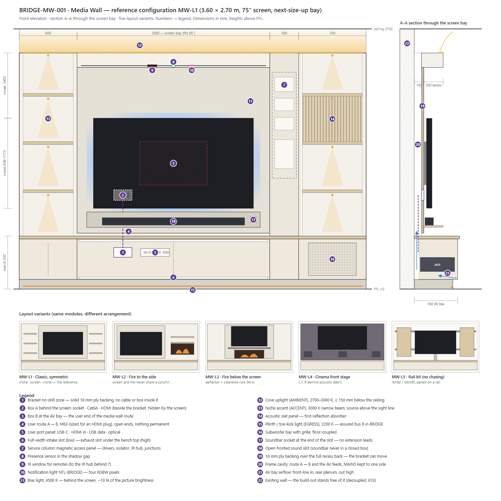

# BRIDGE-MW-001 — Media Wall

**Doc:** BRIDGE-MW-001 · **r0 — concept for review** · 2026-10-21 · English
**Built on:** STD-007 §2.3 · §5.3 (the AV position, the media-wall cable route) · STD-001 §1 · §4.1 · A2 §5 · §6
(the R06 worked example) · STD-002 §1 · §8 · §9 · STD-008 · the guide `home-cinema-part1` (via the Planner's
Házimozi layer)
**Closes, once answered:** STD-007 §9's last open line — *"the AV position … still wants a drawn enclosure."*
**Figure:** [`fig/MW-001_media-wall.svg`](fig/MW-001_media-wall.svg) (generated by `src/make-fig.js`)

---

## 0. Where this starts

A UK electrician's media-wall install (YouTube `tNE_dTfKTRA`, analysed in chat 2026-10-19) works on five rules:

1. **Hide the cables, keep the bracket zone clear.** Power and data plates go behind the screen, beside and
   below the bracket fixing. The screen hides them, no screw can hit a cable, and the bracket fixes into solid
   timber.
2. **Only a conduit crosses the wall.** Each device has its mains locally. All the signal cables run in one
   flexible conduit to the low AV point, so devices can change without opening the board.
3. **What fails or must be switched off stays reachable.** The fire's spur sits on the face, not behind the
   insert. The LED driver can be reached, because drivers fail far more often than strips.
4. **Light sits in the recess heads, out of sight.** You see the wash, never the diodes.
5. **Every device has its own socket.** The soundbar's sits at the end of the bar, so no extension leads.

All five are right, and all five already exist in BRIDGE under other names:
- rule 2 is STD-007 §5.3;
- rule 3 is the manual-first doctrine;
- rule 4 is STD-002 §9.

What the video does not have is a **system**. The wall is built once, for one screen, one set of devices and
one owner's habits. MW-001 turns it into a **product**: a grid of modules with fixed bands and depths. It comes
in three tiers that share the same carcass, so a wall sold without BRIDGE can later become a BRIDGE wall
without being opened.

---

## 1. One carcass, three tiers

| Tier | For | Electrics | BRIDGE scale |
|---|---|---|---|
| **MW-C — Classic** | a client with no smart-home plan | conventional: local sockets, a 24 V driver behind the service panel, a plain or smart dimmer | none |
| **MW-R — Ready** | Classic now, BRIDGE "maybe later" | Classic **+ every light run home-run to the service column as its own SELV pair**, and the CHANNEL-compatible empty conduits to a future RoomBox position | S-A / S-B |
| **MW-B — BRIDGE** | a BRIDGE dwelling | lights on bus A / bus B, an AV position per STD-001 §4.1, Path B audio, presence, scenes, NTL | S-C |

The carcass, grid, depths, boxes and conduit route are **identical in all three**. A tier only decides
what is pulled, what is fitted and what is terminated. That is the BRIDGE doctrine of *provision now, fit
later*, sold as an upgrade path rather than buried as a cost.

### 1.1 The ten disciplines (every tier)

1. **The screen bay is sized for the next screen size up.** The bracket backing covers the whole recess back,
   so a bigger screen changes a bracket, not the wall.
2. **There is a no-drill zone, drawn and labelled.** The bracket area is solid 18 mm ply with no cable or box
   inside it (the video's rule 1, made explicit).
3. **There are two boxes and one route.** Box A sits behind the screen and box B at the AV bay, joined by M63
   sized for an HDMI *plug* (STD-007 §5.3). Its ends are open, and nothing permanent runs in it.
4. **Permanent runs are separate from the user route.** The screen's AOC, the Cat6A and the speaker cables each
   have their own conduit (A2 §6).
5. **MAINS stays on one side of the cavity, signal on the other**, and they cross at 90° (A2 §5, the corridor
   rule inside a wall).
6. **Everything that fails is behind one panel.** The **service column** holds:
   - the drivers / PSU and the local isolator;
   - the IR hub and the junctions.

   It opens magnetically, without tools, and nothing serviceable sits behind the screen.
7. **No closed box for sound.** The soundbar slot is open-fronted, and a front stage behind fabric is
   acoustically transparent.
8. **Heat has a path.** The AV bay draws air in low across its full width and lets it out high (§4.3). The
   screen recess keeps a 50 mm gap on its sides and top.
9. **Light is layered, not "added"**, using four of STD-002's five layers. Each layer has its own run and its
   own feed:
   - AMBIENT: the cove;
   - ACCENT: the niches;
   - EGRESS: the plinth;
   - the bias light behind the screen.
10. **Everything is labelled and photographed before it is closed** (STD-001 §3.3), including in tier C.

---

## 2. The grid

| Axis | Unit | Rule |
|---|---|---|
| **Horizontal — bays** | 50 mm planning grid | side bays **300 / 450 / 600 / 700**. Screen bay = screen width of the **next size up** + 2 × 75 reveal, rounded up to 50 (75″ installed → an 85″ bay of 2000) |
| **Vertical — bands** | above FFL | **P** plinth 0–100 · **L** low band 100–520 (AV bay, storage, sub) · bench top 520–550 · **S** sound band 640–800 · **V** view band (screen, §4.1) · **K** crown 2300–2450 · cove gap 2450 → ceiling (≥ 150) |
| **Depth — planes** | from the existing wall face | cavity 0–75 (CW75 frame) · recess back 100 · face 300 (crown, side bays) · AV bay 450 |

The screen bay is **recessed 200 mm** behind the side bays and crown. A slim screen on a low-profile bracket
sits almost flush with the face, and the recess hides the bias-light halo and the box A plates. Inside a box,
STD-001's 18 mm module still governs, so the service column takes DIN gear.

---

## 3. Module catalogue

Codes are `MW-` + three letters. They name joinery modules, never endpoints: endpoints inside them keep their
STD-004 type codes (`SOC`, `LNR`, `SEN`, `NTL`, `SPK` …).

| Module | Does | Size | C | R | B |
|---|---|---|---|---|---|
| **MW-SCR** screen bay | screen, bracket backing, box A, bias light | next-size-up width · recess 200 | ✓ | ✓ | ✓ |
| **MW-AVB** AV bay | box B, user port panel, the AV gear, airflow | full bay width · 420 h · **450 d** | ✓ | ✓ | ✓ = the **AV position** |
| **MW-SND** sound slot | open soundbar slot, its own socket | screen bay − 200 · 160 h | ✓ | ✓ | ✓ or MW-LCR |
| **MW-LCR** front stage | L C R in-wall behind acoustic fabric (§4.4) | full width band | option | option | ✓ cinema |
| **MW-SVC** service column | drivers / PSU, isolator, IR hub, junctions behind a magnetic panel | 300 w · full height | ✓ | ✓ | ✓ — becomes the wall's **edge node** |
| **MW-NCH** niche bay | shelves with ACCENT light | 450–700 w · 300 d | ✓ | ✓ | ✓ |
| **MW-ACU** acoustic panel | slats + felt in a niche or a whole bay — first-reflection absorber | any bay | option | option | option |
| **MW-SUB** sub bay | grille, floor-coupled, line level + its own socket | 500–700 w in the low band | option | option | ✓ |
| **MW-FIR** fire bay | electric insert (§4.5) | per insert + clearances | option | option | option, with an interlock |
| **MW-STO** storage | push-latch doors in the low band | any | ✓ | ✓ | ✓ |
| **MW-CRN** crown | cove strip on top; on its underside presence, IR window, NTL | full width · 150 h | cove only | cove + empty sensor box | full |
| **MW-PLN** plinth | toe-kick EGRESS light | 100 h, set back 50 | ✓ | ✓ | ✓ on **bus B** |

---

## 4. Engineering notes

### 4.1 Screen height — the guide's rule, not a guess

The screen's bottom edge is `z_bot = h_eye − H_s / 3`: the eye sits in the lower third of the picture (guide
§3.1, the Planner's `cinCalc`).
- **Eye height:** 1150 for a sofa, 1200 for cinema seats.
- **Example:** a 75″ screen (H_s 935) gives `z_bot` 838, so its centre is at 1305 and its top at 1773.
- **Viewing distance:** the guide's 30°–40° band sets it. The Planner's Házimozi layer computes all of this
  from the room, and Sets B–E cover a fixed screen, seat, projector or ceiling.

**Above a fire (MW-L3) the screen goes up, and that costs comfort.** At 3 m every 100 mm above the rule
adds about 2° of upward gaze. A fire typically pushes the screen 400–500 mm up, which is 8–10°, held for a
whole film. This is the strongest argument for MW-L2.

### 4.2 The bracket and the boxes

- **Backing.** 18 mm ply over the whole recess back is screwed to the CW studs at ≤ 400 centres. Any
  VESA bracket then fixes anywhere, rated for the next size up × 2.
- **No-drill zone.** The bracket footprint for the next size up is drawn on the as-built and on a label
  inside box A.
- **Box A (15 × 10 cm).** It holds one double socket, one Cat6A and the HDMI/AOC entry. It sits **beside
  and below** the no-drill zone, hidden by the screen, at ≤ 300 mm from the screen's lower corner so the
  connections reach without slack loops.
- **Box B (15 × 10 cm).** It sits in the AV bay at device height, as the far end of the M63 user route.

### 4.3 Heat

**AV bay.** A receiver (or AVR + amp) runs at **150–300 W** continuous (guide §7.1). Natural convection
through the bay is **h ≈ 0.4 m** of chimney at ΔT ≈ 10 K.
- That gives v ≈ 0.6 × √(2 g h ΔT / T) ≈ **0.3 m/s**.
- Carrying 200 W needs **≈ 60 m³/h**, which is **≈ 500 cm² per opening**: one full-width low slot (2 m × 25 mm)
  and one full-width high slot under the bench top.

**That is buildable, and it is the default.** Where the bay is narrower or the gear hotter, a pair of 120 mm
DC fans on a thermostat goes in the rear plenum. A temperature sensor reports the bay in tier B, and STD-001's
no-fan rule applies to RoomBoxes, not to the AV position.

**Screen recess.** The screen dissipates 100–200 W. Keep **≥ 50 mm** of air on its sides and top inside the
recess, open to the room; that gap is where the bias light lives. Never fill the space above the screen with
a closed box.

**Cavity.** Mineral wool (A1) fills the frame cavity behind the side bays for fire and acoustics. **Never fill
it behind the AV bay's rear plenum.**

### 4.4 Sound

- **The soundbar is never in a closed box.** Keep the slot ≥ 60 mm taller than the bar and open-fronted, with
  the bar's front flush with the slot face.
- **Front stage (MW-LCR, the cinema variant MW-L4).**
  - The L C R speakers go in-wall behind acoustically transparent fabric. They follow the guide's §3.6
    geometry, which the Planner already computes.
  - The cavity behind each speaker is lined, or a back box is used.
  - The front stage is a different set of speakers from the follow-me ceiling pair (STD-007 §2.4).
- **First reflections.** An MW-ACU panel in the side bays at ear height takes the side-wall reflection a
  hard media wall otherwise throws back.
- **The subwoofer** is floor-coupled in the low band, with a line-level cable and its own socket on AV-2
  (STD-007 / Planner C7).

### 4.5 The fire bay (MW-FIR)

An electric insert puts out **1.5–2 kW of heat with a fan**, which is the wrong neighbour for a screen.

- **MW-L2 (default): the fire sits beside the screen, never in the same column.** This needs no deflector,
  no raised screen and no interlock.
- **MW-L3: the fire sits below the screen, only with all of the following:**
  - an insert whose heat outlet blows down or forward, or one run flame-effect-only;
  - a **deflector shelf** between the two, projecting ≥ 100 mm past the screen;
  - **≥ 300 mm** clear between the insert top and the screen's bottom edge;
  - the manufacturer's clearances, which govern where they are larger;
  - in tier B, a temperature sensor at the screen's lower edge. Above **40 °C** it cuts the heater (flame
    effect stays), and the cut-off is an interlock on a relay, not a scene.
- **Electrical.** The insert has its own 16 A circuit, a 30 mA RCD, and a **local double-pole switch on the
  face** (HU practice: no UK fused spur). Its isolator is never behind the insert (video rule 3).

### 4.6 Light and scenes

| Run | Layer | CCT | Feed in C / R | Feed in B |
|---|---|---|---|---|
| Cove (MW-CRN top) | AMBIENT | 2700–3000 K | local 24 V driver, dimmed | **bus A** |
| Niches (MW-NCH) | ACCENT | 3000 K, narrow | same driver, own channel | bus A |
| **Bias light** behind the screen | — (viewing) | **6500 K, CRI ≥ 90** | USB from the screen, or the driver | bus A, scene-linked |
| Plinth (MW-PLN) | EGRESS | 2200 K | driver, own channel | **bus B (assured)** |

**The bias light** is the elevation the video lacks. A dim D65 halo at about 10 % of the picture's
brightness makes blacks look deeper, reduces eye strain in a dark room, and does not shift the picture's
white point the way warm room light does. It is the only light that belongs in the room during a film.

**Scenes (tier B; tier C gets the same as presets on a smart dimmer if wanted):**

| Scene | Cove | Niches | Bias | Plinth | NTL |
|---|---|---|---|---|---|
| **Watch** | 20 % | 15 % | on | on | normal |
| **Film** | off | off | **on** | 5 % | **suppressed** |
| **Ambient** | 60 % | 40 % | off | on | normal |
| **Night** | off | off | off | 2 % | normal |

In tier B, the screen powering on (CEC or the network) triggers **Watch**, presence keeps it, and switching
to a film source offers **Film**.

### 4.7 Electrical — HU practice

| | C / R | B |
|---|---|---|
| AV bay | **its own 16 A circuit** (RCBO A 30 mA, 2.5 mm²) | AV-1 rack B16 · AV-2 amp + sub C16 · AV-3 projector + screen B16, **one phase, own RCD** (STD-007, Planner C7) |
| Screen (box A) | on the AV circuit | AV-1 |
| Soundbar socket | on the AV circuit | AV-1 / AV-2 |
| Fire insert | its own 16 A circuit | the same + the §4.5 interlock |
| LED driver(s) | the room's lighting circuit, through the service column isolator | no driver: bus A / B from the RoomBox |

**Accessibility (MSZ HD 60364).** Every junction and every driver stays accessible: the service column exists
for exactly this. Nothing serviceable is plastered in.

### 4.8 Wireways per tier

| Run | C | R | B |
|---|---|---|---|
| User route A ↔ B | **M63** | M63 | M63 |
| Screen AOC (AV bay → screen) | M40 | M40 | M40 |
| Cat6A to the screen + AV | M25 | M25 | M25 |
| MAINS (AV circuit, fire circuit) | M25 + M20 | same | same |
| Speakers (front stage, if taken) | M16 each | M16 each | M16 each |
| Light runs | driver → strips | **every run home-run to MW-SVC as its own pair** | from the RoomBox via MW-SVC |
| To the future RoomBox | — | **C1 M25 · C2 M40 · C3 M20 · C4 M25, empty + draw cords** | the CHANNEL itself |
| Sensor box in the crown | — | empty M20 to MW-SVC | presence + NTL + IR |
| Through-partition sleeve | if the other room has a screen: M40, offset ≥ 300 | same | same |

---

## 5. Layout variants

| Variant | Arrangement | When |
|---|---|---|
| **MW-L1 Classic** | niche · screen · niche, low AV band, sound slot | the reference, the most common living-room case |
| **MW-L2 Fire to the side** | screen + fire bay side by side | a fire is wanted; **the default whenever one is** |
| **MW-L3 Fire below** | fire under the screen with the §4.5 rules | the client insists on the classic look |
| **MW-L4 Cinema front** | fabric band with L C R behind, screen or projection screen above | a cinema room (Planner Házimozi layer) |
| **MW-L5 Rail kit** | rail-mounted panels and shelves, surface trunking for the route, no chasing | rentals, retrofits, quick installs |

All five use the same modules. A variant is an arrangement, so the quote, the cut list and the Planner object
are generated from the module list.

---

## 6. Commissioning (all tiers; tier B adds STD-007 §8)

- [ ] The bracket fixings are inside the ply backing, and **no cable lies in the no-drill zone** (detector
      sweep, photographed).
- [ ] An assembled HDMI plug passes the A ↔ B route end to end.
- [ ] The AV bay's ΔT is **≤ 15 K** after 60 min at the client's normal volume.
- [ ] There is a **≥ 50 mm** gap around the screen in the recess.
- [ ] Every driver, isolator and junction can be reached through the service panel without tools.
- [ ] The fire bay (L3): the screen's lower edge stays **≤ 40 °C** after 60 min at full heat. In tier B, the
      interlock trips at the setpoint.
- [ ] The bias light measures 6500 K, and its brightness is set at about 10 % of a mid-grey picture.
- [ ] Labels and photographs are filed against the room in the Planner.

---

## 7. Planner tie-in (later work package, not this doc)

- **Media Wall object:** a parametric object (module list + bay widths) placed on a wall. It draws in plan,
  elevation and 3D, and puts boxes A / B, the service column and the conduits on the right layers.
- **Házimozi layer.** An MW-L4 wall feeds the cinema calculator its screen wall and `x_scr`. The CTV / CRK /
  CLR nodes snap into the wall's modules, and the C7 cable list already covers the runs.
- **Tier → takeoff.** The tier switches which conduits are pulled empty and which cables are counted.

---

## 8. Decisions wanted (A recommended)

| Ref | Question | A | B | C |
|---|---|---|---|---|
| **MW-Q1** | Tiers | **three: Classic · Ready · BRIDGE** | two: Classic · BRIDGE | — |
| **MW-Q2** | Default frame | **CW metal studs + 18 mm ply backing + 2 × GKB** (HU drywall practice) | timber studs (as in the video) | prefab carcass modules on a rail (MW-L5 for everything) |
| **MW-Q3** | Fire in the product | **MW-L2 default, MW-L3 only with the §4.5 rules** | L2 only, never under the screen | no fire module |
| **MW-Q4** | Front audio | **soundbar slot standard, MW-LCR as the cinema option** | LCR standard | — |
| **MW-Q5** | Bias light | **in every tier** | tier B only | — |
| **MW-Q6** | AV bay cooling default | **passive full-width slots (§4.3), fans as a fallback** | thermostatic fans always | — |
| **MW-Q7** | Next deliverable | **a client sheet (HU, illustrated, per tier) + this doc to r1** | the Planner Media Wall object pack (WPs) | both, sheet first |
