# Kommunikációs vonalak — a Kisokos

*Generálva a kártyákból (`node Kisokos/kisokos.js md`); ne szerkeszd kézzel, a kártyát szerkeszd a `vonalak.json`-ban. Vázlat: minden kártya ellenőrzésre vár. Minden vonal ugyanazt a rajzot kapja (`svg/<id>.svg`): a sávjai a közös 1 Hz – 1 PHz skálán, alatta a hullámhossz, halványan a többi vonal, a jelalak és a fő számok.*

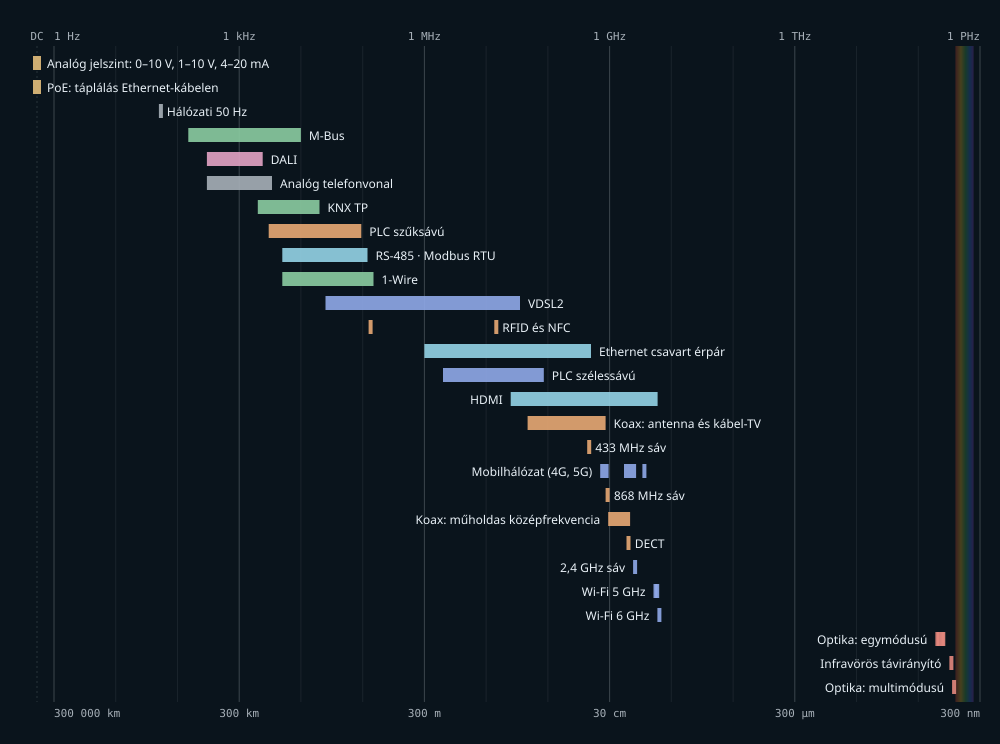

## Gyorstábla

| Vonal | Csoport | Sáv | Sebesség | Távolság | A lakásban |
|---|---|---|---|---|---|
| Hálózati 50 Hz | viszonyítás | 50 Hz | — | — | Minden áramkör. A gyengeáramú vonalak szerelésénél ettől kell elválasztani őket. |
| Analóg jelszint: 0–10 V, 1–10 V, 4–20 mA | vezetékes jelszint | egyenáram (DC) | folyamatos érték, nem bitfolyam | 4–20 mA: több száz méter; 0–10 V: néhány tíz méter, a feszültségesés miatt | LED-tápegységek és lámpatestek fényerő-vezérlése, hőszivattyúk és szellőzők bemenetei, szenzorok. |
| DALI | vezetékes busz | 300 Hz – 2,4 kHz | 1200 bit/s | legfeljebb 300 m (a keresztmetszettől függ) | Világításvezérlés nagyobb lakásban, irodában: lámpatestenként szabályozott fényerő, jelenetek, színhőmérséklet. |
| KNX TP | vezetékes busz | 2 kHz – 20 kHz | 9600 bit/s | vonalszegmensenként legfeljebb 1000 m kábel | Kapcsolás, dimmelés, redőny, fűtés, jelenetek, jelenlét-érzékelés egy közös buszon; okosotthon-központ felé átjáróval. |
| RS-485 · Modbus RTU | vezetékes busz | 5 kHz – 120 kHz | jellemzően 9,6–115,2 kbit/s | legfeljebb kb. 1200 m kis sebességen | Fogyasztásmérők az elosztóban, napelemes inverter, akkumulátor, hőszivattyú, töltő: ezek összekötése egy vezérlővel vagy okosotthon-központtal. |
| M-Bus | vezetékes busz | 150 Hz – 10 kHz | 300–9600 bit/s, jellemzően 2400 | a mérők számától és a sebességtől függően néhány száz métertől 1–2 km-ig | Társasházi hő-, víz- és gázmérők távleolvasása; lakáson belüli almérők. |
| 1-Wire | vezetékes busz | 5 kHz – 150 kHz | 15,4 kbit/s (overdrive módban 125 kbit/s) | jó topológiával néhány tíz méter, legfeljebb kb. 100 m | Hőmérők (DS18B20) fűtéshez, puffertartályhoz, szobákhoz; saját építésű ESPHome-rendszerek. |
| Analóg telefonvonal | vezetékes hálózat | 300 Hz – 3,4 kHz | egy hangcsatorna | kilométerek | Régi lakások telefonvezetékei; riasztók, liftek tárcsázója; ma sokszor csak az xDSL hordozója. |
| VDSL2 | vezetékes hálózat | 25 kHz – 35 MHz | rövid vonalon több száz Mbit/s (35b profil), hosszabbon jóval kevesebb | néhány száz méter fölött jelentősen lassul | Vezetékes internet a régi telefonhálózaton; a modemtől a lakás felé már Ethernet és Wi-Fi. |
| PLC szűksávú | erősáramú vonal | 3 kHz – 95 kHz | néhány kbit/s-tól néhány tíz kbit/s-ig | a transzformátorig, ismétlőkkel | Egyes okos fogyasztásmérők kommunikációja a szolgáltató felé. |
| PLC szélessávú | erősáramú vonal | 2 MHz – 86 MHz | névlegesen több száz Mbit/s, a valóságban jóval kevesebb | egy mérőn belül | Hálózat ott, ahol nincs adatkábel és a Wi-Fi gyenge (pince, melléképület egy mérőn). |
| Ethernet csavart érpár | vezetékes hálózat | 1 MHz – 500 MHz | 1 Gbit/s (Cat5e, 100 MHz) · 10 Gbit/s rövidebb távon (Cat6, 250 MHz) · 10 Gbit/s 100 m-en (Cat6A, 500 MHz) | 100 m csatorna (90 m fix szakasz + 10 m patch kábel) | Strukturált lakáshálózat: minden szobába, a TV mögé, a mennyezeti Wi-Fi ponthoz, a kamerákhoz, a médiadobozba. |
| PoE: táplálás Ethernet-kábelen | vezetékes hálózat | egyenáram (DC) | a teljesítmény a fontos: 802.3af 15,4 W · 802.3at 30 W · 802.3bt 60 W és 90 W (a forrás oldalán) | 100 m, mint az Etherneté | IP-kamerák, mennyezeti Wi-Fi pontok, IP-kaputelefon, érzékelők, kisebb kijelzők. |
| HDMI | vezetékes hálózat | 25 MHz – 6 GHz | HDMI 2.0: 18 Gbit/s · HDMI 2.1: 48 Gbit/s | passzív kábelen néhány méter (2.1-nél rövidebb), optikai kábellel több tíz méter, HDBaseT-vel 100 m | TV a falon, projektor a mennyezeten, a forrás a szekrényben: a falban vezetett kép. |
| Koax: antenna és kábel-TV | koax | 47 MHz – 862 MHz | csatornánként néhány tíz Mbit/s; DOCSIS 3.1-gyel Gbit/s nagyságrend | a csillapítástól függ; erősítővel hosszabb | TV-aljzatok, antennahálózat, kábeltelevízió és kábelinternet, társasházi elosztás. |
| Koax: műholdas középfrekvencia | koax | 950 MHz – 2,15 GHz | sok transzponder egyszerre | néhány tíz méter erősítés nélkül | Parabolától a vevőkig; társasházban multikapcsolóval minden lakás felé. |
| 433 MHz sáv | rádió | 433,1 MHz – 434,8 MHz | néhány kbit/s | falakon át is néhány tíz méter | Kapunyitó- és redőnytávirányítók, időjárásállomások, régebbi vezeték nélküli riasztóérzékelők és csengők. |
| 868 MHz sáv | rádió | 863 MHz – 870 MHz | Z-Wave legfeljebb 100 kbit/s; LoRa néhány kbit/s vagy kevesebb | jól átjut a falakon; LoRa akár kilométerekre | Z-Wave okosotthon-eszközök, vezeték nélküli riasztóérzékelők, LoRa szenzorok (kert, pince), rádiós mérőleolvasás. |
| 2,4 GHz sáv | rádió | 2,4 GHz – 2,483 GHz | Zigbee és Thread 250 kbit/s · BLE 1–2 Mbit/s · Wi-Fi több száz Mbit/s | lakáson belül; falak és födém sokat csillapítanak | A legtöbb okos eszköz: kapcsolók, érzékelők, izzók, termosztátok; régebbi és olcsóbb Wi-Fi eszközök. |
| Wi-Fi 5 GHz | rádió | 5,15 GHz – 5,725 GHz | Gbit/s nagyságrend | egy-két szoba, falanként jelentős csillapítás | Gyors lakáson belüli Wi-Fi: laptop, telefon, TV. |
| Wi-Fi 6 GHz | rádió | 5,945 GHz – 6,425 GHz | Gbit/s nagyságrend | nagyjából egy helyiség | Nagy sávszélességet kérő eszközök (VR, nagy fájlok) a pont közelében. |
| DECT | rádió | 1,88 GHz – 1,9 GHz | beszédcsatornák; ULE: kis adatforgalom | beltéren néhány tíz méter, ismétlővel több | Vezeték nélküli telefonok a routerhez kötött bázissal, egyes okosotthon-eszközök (ULE). |
| Mobilhálózat (4G, 5G) | rádió | 703 MHz – 960 MHz · 1,71 GHz – 2,69 GHz · 3,4 GHz – 3,8 GHz | néhány Mbit/s-tól Gbit/s-ig, a lefedettségtől függően | kilométerek; beltéren a falak és a fém nyílászárók rontják | Mobilinternet-router, okos mérők és riasztók mobil kommunikációja, beltéri lefedettség. |
| RFID és NFC | rádió | 125 kHz · 13,56 MHz | néhány kbit/s (125 kHz) – néhány száz kbit/s (13,56 MHz) | néhány centiméter | Beléptetés: kapu, lépcsőház, garázs, kaputelefonba épített olvasó. |
| Infravörös távirányító | fény | 319 THz | néhány száz bit/s | néhány méter, rálátással | TV, klíma, hangsáv; okosotthonból IR-adóval vezérelhető. |
| Optika: egymódusú | fény | 190 THz – 194 THz · 201 THz – 201 THz · 229 THz – 229 THz · 236 THz – 236 THz | GPON: 2,5 Gbit/s le, 1,25 Gbit/s fel · XGS-PON: 10 Gbit/s | kilométerek, akár tíz kilométerek | A szolgáltató optikája a lakás optikai végpontjáig (ONT); onnan Ethernet. Új építésnél: védőcső a csatlakozási ponttól a médiadobozig. |
| Optika: multimódusú | fény | 353 THz | 1–10 Gbit/s és felette | néhány száz méter | Lakásban ritka; irodaházban, nagy családi háznál két épület között. |

## Viszonyítás

### Hálózati 50 Hz

*Más néven:* erősáram, 230 V, fázis

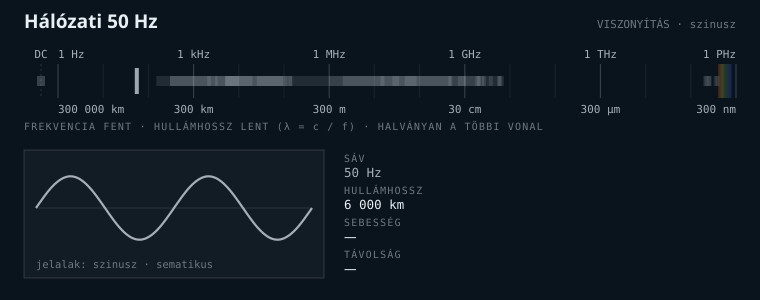

Nem adatvonal: ez a skála viszonyítási pontja. A váltakozó feszültség másodpercenként 50 teljes periódust fut be; minden más vonal ehhez képest magasabb vagy alacsonyabb frekvencián dolgozik, és erre a vezetékre ül rá a PLC is.

- **Közeg:** Erősáramú vezeték: L, N, PE (háromfázisú hálózatban L1, L2, L3)
- **Jel:** Szinuszos váltakozó feszültség, 230 V fázisfeszültség, 400 V vonali feszültség (szinusz)
- **Sáv:** 50 Hz
- **Hullámhossz:** 6 000 km
- **Sebesség:** —
- **Távolság:** —
- **Topológia:** fa: elosztóból áramkörönként
- **Táplálás:** maga a táplálás
- **Kábel:** NYM-J, NYY-J, H07V-U / H07V-K
- **Csatlakozó:** aljzat, sorkapocs, sínre szerelt készülék
- **Szabvány:** MSZ HD 60364 sorozat
- **A lakásban:** Minden áramkör. A gyengeáramú vonalak szerelésénél ettől kell elválasztani őket.
- **Szerelés:**
  - A gyengeáramú kábeleket az erősáramútól elválasztva kell vezetni, külön csőben vagy válaszfallal; a pontos távolságot a kábeltípus és a szabvány adja.
- **Buktatók:**
  - A felharmonikusok (kapcsolóüzemű tápok, LED-meghajtók) az 50 Hz többszörösein zavarnak, és a PLC-t is rontják.
- **Rokon vonalak:** PLC szűksávú, PLC szélessávú, DALI
- **Keresőszavak:** HU: 230 V váltakozó feszültség · hálózati frekvencia 50 Hz — EN: mains frequency 50 Hz · 230 V AC — DE: Netzfrequenz 50 Hz · Netzspannung 230 V
- **Hol kapható:** Villamossági nagykereskedés.
- **A Készletben:**
  - `VRG-0205` NYM-J 3x 1,5 (50) 300/500V tömör installációs vezeték (MB-Cu, MBCu) · 331 Ft — *termék*: NYM-J 3 × 1,5 installációs kábel
  - `VRG-0206` NYM-J 3x 1,5 szürke (100) 300/500V tömör installációs vezeték (MB-Cu, MBCu) · 331 Ft — *termék*: NYM-J 3 × 1,5 installációs kábel
  - `VRG-0207` NYM-J 3x 1,5 szürke (0) 300/500V tömör installációs vezeték (MB-Cu, MBCu) · 352 Ft — *termék*: NYM-J 3 × 1,5 installációs kábel
  - `VRG-0208` NYM-J 3x 2,5 szürke (100) 300/500V tömör installációs vezeték (MB-Cu, MBCu) · 504 Ft — *termék*: NYM-J 3 × 2,5 installációs kábel
  - `VRG-0209` NYM-J 3x 2,5 szürke (0) 300/500V tömör installációs vezeték (MB-Cu, MBCu) · 548 Ft — *termék*: NYM-J 3 × 2,5 installációs kábel
  - `VRG-0210` NYM-J 5x 1,5 szürke (0) 300/500V tömör installációs vezeték (MB-Cu, MBCu) · 557 Ft — *termék*: NYM-J 5 × 1,5 installációs kábel (pl. csillárkapcsolóhoz, DALI-hoz)
  - `VRG-0196` H07V-U 1x 1,5 barna (100) · 101 Ft — *termék*: H07V-U 1 × 1,5 tömör vezeték (védőcsőbe)
  - `VRG-0197` H07V-U 1x 1,5 fekete (100) · 101 Ft — *termék*: H07V-U 1 × 1,5 tömör vezeték
  - `VRG-0198` H07V-U 1x 1,5 kék (100) · 101 Ft — *termék*: H07V-U 1 × 1,5 tömör vezeték, kék (nulla)
  - `VRG-0199` H07V-U 1x 1,5 z/s (100) · 101 Ft — *termék*: H07V-U 1 × 1,5 tömör vezeték, zöld-sárga (védővezető)
  - `VRG-0200` H07V-U 1x 2,5 fekete (100) · 164 Ft — *termék*: H07V-U 1 × 2,5 tömör vezeték
  - `VRG-0201` H07V-U 1x 2,5 kék (100) · 164 Ft — *termék*: H07V-U 1 × 2,5 tömör vezeték, kék
  - `VRG-0202` H07V-U 1x 2,5 z/s (100) · 164 Ft — *termék*: H07V-U 1 × 2,5 tömör vezeték, zöld-sárga
  - `VRG-0185` H07V-K 1x 1,5 fekete (100) · 100 Ft — *termék*: H07V-K 1 × 1,5 sodrott vezeték (elosztóba)
  - `VRG-0057` NYY-J 3x 1,5 (0) RE-TÖMÖR [ 0,6/1kV ] fekete erőátviteli kábel · 431 Ft — *termék*: NYY-J 3 × 1,5 erőátviteli kábel (földbe, kültérre)
  - `VRG-0058` NYY-J 3x 4 (0) RE-TÖMÖR [ 0,6/1kV ] fekete erőátviteli kábel · 971 Ft — *termék*: NYY-J 3 × 4 erőátviteli kábel
  - `VRG-0056` EAYY-J 5x 16 /NAYY-J/ RE (0) földkábel 5x16 — *termék*: NAYY-J 5 × 16 alumínium földkábel (betáplálás)
  - `VRG-0203` H05VV-F 3x 1,5 (0) · 379 Ft — *termék*: H05VV-F 3 × 1,5 hajlékony kábel (készülékbekötés)
  - `VRG-0059` H05RR-F 3x1,5 (100) (GT) · 456 Ft — *termék*: H05RR-F 3x1,5 (100) (GT)
  - `VRG-0060` H05RR-F 3x1,5 fekete (0) 300/500V gumikábel (GT) · 446 Ft — *termék*: H05RR-F 3x1,5 fekete (0) 300/500V gumikábel (GT)
  - `VRG-0186` H07V-K 1x 4 fekete (0) · 283 Ft — *termék*: H07V-K 1x 4 fekete (0)
  - `VRG-0187` H07V-K 1x 4 kék (0) · 283 Ft — *termék*: H07V-K 1x 4 kék (0)
  - `VRG-0188` H07V-K 1x 4 z/s (0) · 283 Ft — *termék*: H07V-K 1x 4 z/s (0)
  - `VRG-0189` 10 mkh (H07V-K 1x10) — *termék*: 10 mkh (H07V-K 1x10)
  - `VRG-0190` H07V-K 1x 10 fekete (0) 450/750V hajlékony egyerű sodrott vezeték (M-kh, Mkh) · 720 Ft — *termék*: H07V-K 1x 10 fekete (0) 450/750V hajlékony egyerű sodrott vezeték (M-kh, Mkh)
  - `VRG-0191` 10 mkh (H07V-K 1x10) — *termék*: 10 mkh (H07V-K 1x10)
  - `VRG-0192` H07V-K 1x 10 kék (0) 450/750V hajlékony egyerű sodrott vezeték (M-kh, Mkh) · 721 Ft — *termék*: H07V-K 1x 10 kék (0) 450/750V hajlékony egyerű sodrott vezeték (M-kh, Mkh)
  - `VRG-0193` 10 mkh (H07V-K 1x10) — *termék*: 10 mkh (H07V-K 1x10)
  - `VRG-0194` H07V-K 1x 10 zöld/sárga (0) 450/750V hajlékony egyerű sodrott vezeték (M-kh, Mkh) · 728 Ft — *termék*: H07V-K 1x 10 zöld/sárga (0) 450/750V hajlékony egyerű sodrott vezeték (M-kh, Mkh)
  - `VRG-0195` H07V-K 1x 16 zöld/sárga (0) 450/750V hajlékony egyerű sodrott vezeték (M-kh, Mkh) · 1 125 Ft — *termék*: H07V-K 1x 16 zöld/sárga (0) 450/750V hajlékony egyerű sodrott vezeték (M-kh, Mkh)
  - `VRG-0204` H05VV-F 5x 1,5 (0) · 560 Ft — *termék*: H05VV-F 5x 1,5 (0)

## Vezetékes jelszint

### Analóg jelszint: 0–10 V, 1–10 V, 4–20 mA

*Más néven:* 0-10V vezérlés, áramhurok, 1-10V dimmelés

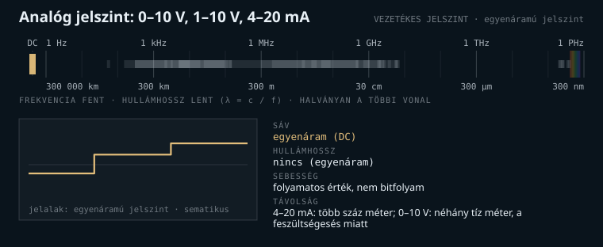

Egyetlen értéket visz át egy feszültség- vagy áramszinttel: a 0–10 V vagy 1–10 V szintje például a fényerőt, a 4–20 mA-es áramhurok egy mért értéket. Nincs benne bitfolyam; az áramhurok azért terjedt el, mert a vezeték ellenállása nem hamisítja meg az értéket, és a 4 mA alatti áram szakadást jelez.

- **Közeg:** Két ér, gyakran árnyékolt kábelben
- **Jel:** Közel egyenáramú feszültség- vagy áramszint (egyenáramú jelszint)
- **Sáv:** egyenáram (DC)
- **Hullámhossz:** nincs (egyenáram)
- **Sebesség:** folyamatos érték, nem bitfolyam
- **Távolság:** 4–20 mA: több száz méter; 0–10 V: néhány tíz méter, a feszültségesés miatt
- **Topológia:** pont-pont (egy adó, egy vagy több bemenet)
- **Táplálás:** 1–10 V-nál a vezérelt eszköz adja az áramot; 4–20 mA-nél a hurkot külön táp hajtja
- **Kábel:** 2 × 0,5–1,5 mm², árnyékolt vezérlőkábel (pl. LiYCY)
- **Csatlakozó:** sorkapocs
- **Szabvány:** IEC 60929 melléklet (1–10 V), IEC 60381-1 (4–20 mA)
- **A lakásban:** LED-tápegységek és lámpatestek fényerő-vezérlése, hőszivattyúk és szellőzők bemenetei, szenzorok.
- **Szerelés:**
  - Az 1–10 V-os vezérlőér a vezérelt eszköz bemenete felé polaritásos: + és − nem cserélhető.
  - Hosszabb 0–10 V-os vonalon árnyékolt kábel, az árnyékolás egy ponton földelve.
- **Buktatók:**
  - A 0–10 V és az 1–10 V nem ugyanaz: az 1–10 V-os bemenet saját áramot ad, a 0–10 V-os vezérlőnek kell hajtania.
  - A hosszú, árnyékolatlan vezérlőér mellé futó tápkábel villódzást okozhat.
- **Rokon vonalak:** DALI, KNX TP
- **Keresőszavak:** HU: 1-10V dimmelhető LED tápegység · 0-10V vezérlőmodul · 4-20mA távadó — EN: 1-10V dimming · 0-10V control · 4-20mA transmitter — DE: 1-10V Dimmung · 0-10V Steuerung · 4-20mA Messumformer
- **Hol kapható:** Villamossági nagykereskedés, világítástechnikai szaküzlet.

## Vezetékes busz

### DALI

*Más néven:* DALI-2, D4i, világításbusz

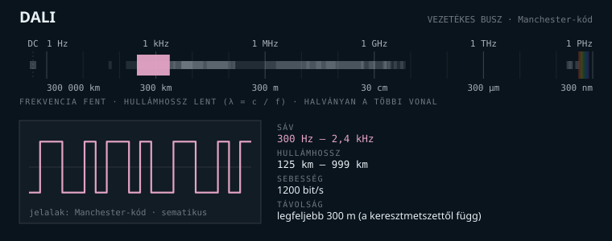

Digitális világításvezérlő busz. Egy buszra legfeljebb 64 címezhető eszköz kerül; minden lámpatest saját címet kap, csoportokba és jelenetekbe sorolható, és vissza is jelez (például lámpahibát). A jel Manchester-kódolású, a buszfeszültséget a busztáp adja.

- **Közeg:** Két ér; futhat ugyanabban a kábelben, mint a lámpatest tápja
- **Jel:** Manchester-kódolt alapsávú jel a kb. 16 V-os buszfeszültségen (Manchester-kód)
- **Sáv:** 300 Hz – 2,4 kHz
- **Hullámhossz:** 125 km – 999 km
- **Sebesség:** 1200 bit/s
- **Távolság:** legfeljebb 300 m (a keresztmetszettől függ)
- **Topológia:** szabad: busz, csillag, fa (gyűrű nélkül)
- **Táplálás:** a busztáp adja a buszfeszültséget (legfeljebb 250 mA)
- **Kábel:** a tápkábel két ere (pl. NYM-J 5 × 1,5 mm²) vagy külön 2 × 1,5 mm²
- **Csatlakozó:** sorkapocs (DA+, DA−, a legtöbb eszközön polaritásfüggetlen)
- **Szabvány:** IEC 62386
- **A lakásban:** Világításvezérlés nagyobb lakásban, irodában: lámpatestenként szabályozott fényerő, jelenetek, színhőmérséklet.
- **Szerelés:**
  - A DALI-vezeték nem érintésvédelmi törpefeszültség: futhat a hálózati erekkel egy kábelben, de úgy is kell kezelni.
  - Buszonként egy busztáp (vagy a tápok áramának összege ne lépje túl a határt).
- **Buktatók:**
  - A 64 cím buszonként értendő: nagyobb rendszer több buszt és átjárót kíván.
  - Régi DALI és DALI-2 eszköz vegyesen működhet, de a DALI-2 funkciók csak minősített eszközzel.
- **Rokon vonalak:** Analóg jelszint: 0–10 V, 1–10 V, 4–20 mA, KNX TP
- **Keresőszavak:** HU: DALI-2 dimmelhető LED tápegység · DALI busztáp · DALI vezérlő — EN: DALI-2 LED driver · DALI bus power supply · DALI controller — DE: DALI-2 Betriebsgerät · DALI Busnetzteil · DALI Steuergerät
- **Hol kapható:** Villamossági nagykereskedés, világítástechnikai szaküzlet.

### KNX TP

*Más néven:* KNX busz, EIB, KNX twisted pair

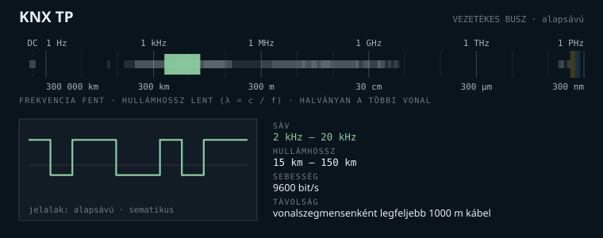

Épületautomatizálási busz: egy csavart érpáron minden eszköz (kapcsoló, aktor, érzékelő, termosztát) üzeneteket küld egymásnak. Nincs központi vezérlő: a programozott csoportcímek kötik össze, melyik nyomógomb melyik kimenetet kapcsolja. A busz egyben tápot is ad az eszközöknek.

- **Közeg:** Csavart érpár, árnyékolt buszkábel
- **Jel:** Alapsávú jel a kb. 30 V-os egyenfeszültségű buszon (SELV) (alapsávú)
- **Sáv:** 2 kHz – 20 kHz
- **Hullámhossz:** 15 km – 150 km
- **Sebesség:** 9600 bit/s
- **Távolság:** vonalszegmensenként legfeljebb 1000 m kábel
- **Topológia:** szabad: busz, csillag, fa (gyűrű nélkül); vonalak és területek csatolókkal
- **Táplálás:** a busztáp tápláléja az eszközöket (SELV)
- **Kábel:** KNX buszkábel J-Y(St)Y 2 × 2 × 0,8 mm, zöld köpennyel
- **Csatlakozó:** piros-fekete buszkapocs
- **Szabvány:** EN 50090, ISO/IEC 14543-3
- **A lakásban:** Kapcsolás, dimmelés, redőny, fűtés, jelenetek, jelenlét-érzékelés egy közös buszon; okosotthon-központ felé átjáróval.
- **Szerelés:**
  - SELV-vezeték: a hálózati erektől el kell választani (külön cső, vagy a doboz belsejében elválasztás).
  - A második érpár tartalék: ne használd fel hálózati célra.
  - Buszkábelt minden kapcsolóhelyre és aktorhelyre: utólag nehéz pótolni.
- **Buktatók:**
  - Gyűrű a buszon: tilos.
  - Az eszközök programozásához ETS szoftver és licenc kell.
- **Rokon vonalak:** DALI, RS-485 · Modbus RTU, Ethernet csavart érpár
- **Keresőszavak:** HU: KNX buszkábel · KNX busztáp · KNX kapcsolóaktor — EN: KNX bus cable · KNX power supply · KNX switch actuator — DE: KNX Busleitung · KNX Spannungsversorgung · KNX Schaltaktor
- **Hol kapható:** Villamossági nagykereskedés, KNX-forgalmazó.

### RS-485 · Modbus RTU

*Más néven:* RS485, Modbus, terepi busz

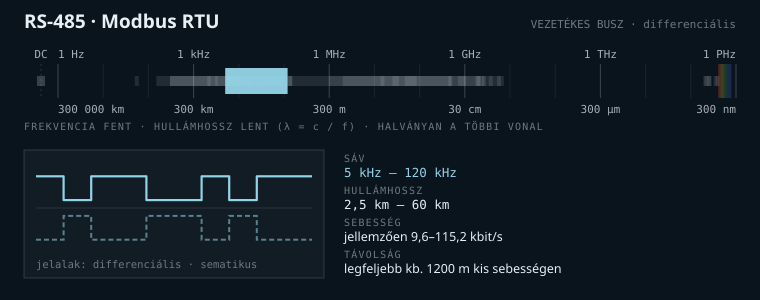

Az RS-485 a fizikai réteg: egy csavart érpáron a két vezeték feszültségkülönbsége hordozza a biteket, ezért jól tűri a zajt. Rajta a Modbus RTU egy egyszerű kérdés-felelet protokoll: egy mester kérdezi sorban a szolgákat (fogyasztásmérő, inverter, hőszivattyú), mindegyiknek saját címe van.

- **Közeg:** Csavart érpár, árnyékolt
- **Jel:** Differenciális alapsávú jel (differenciális)
- **Sáv:** 5 kHz – 120 kHz
- **Hullámhossz:** 2,5 km – 60 km
- **Sebesség:** jellemzően 9,6–115,2 kbit/s
- **Távolság:** legfeljebb kb. 1200 m kis sebességen
- **Topológia:** lánc (daisy chain), a két végén 120 Ω-os lezárással; csillag nem
- **Táplálás:** nem visz tápot
- **Kábel:** árnyékolt csavart érpár, pl. Li2YCY 2 × 2 × 0,22
- **Csatlakozó:** sorkapocs (A, B, GND), néha RJ45
- **Szabvány:** TIA/EIA-485, Modbus over Serial Line
- **A lakásban:** Fogyasztásmérők az elosztóban, napelemes inverter, akkumulátor, hőszivattyú, töltő: ezek összekötése egy vezérlővel vagy okosotthon-központtal.
- **Szerelés:**
  - A busz két végére 120 Ω-os lezáró ellenállás; közbül nem.
  - Az A és B jelölése gyártónként fordított lehet: ha nem megy, cseréld meg.
  - Közös referenciapont (GND) is kell, ha az eszközök külön tápról járnak.
- **Buktatók:**
  - Csillagpontos bekötés reflexiót okoz: lánc kell.
  - Minden eszköznek egyedi cím és azonos sebesség-paritás beállítás kell.
- **Rokon vonalak:** M-Bus, KNX TP, Ethernet csavart érpár
- **Keresőszavak:** HU: RS485 Modbus fogyasztásmérő · Modbus átalakító · 120 ohm lezáró — EN: RS485 Modbus energy meter · Modbus gateway · 120 ohm termination — DE: RS485 Modbus Energiezähler · Modbus Gateway · Abschlusswiderstand 120 Ohm
- **Hol kapható:** Villamossági nagykereskedés, ipari automatizálási kereskedés.

### M-Bus

*Más néven:* Meter-Bus, mérőbusz, wM-Bus (rádiós változat)

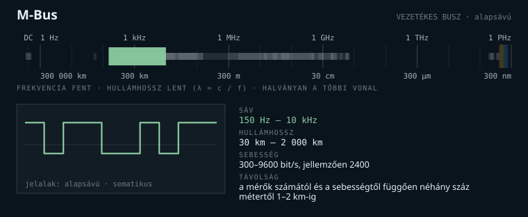

Mérőórák leolvasására készült kétvezetékes busz. A mester feszültségváltással kérdez, a mérők áramfelvétel-változással felelnek; a busz egyben a mérők tápja is. A két ér polaritásfüggetlen, így a szerelés egyszerű.

- **Közeg:** Két ér, polaritásfüggetlen
- **Jel:** Lefelé feszültségmoduláció, felfelé árammoduláció (alapsávú)
- **Sáv:** 150 Hz – 10 kHz
- **Hullámhossz:** 30 km – 2 000 km
- **Sebesség:** 300–9600 bit/s, jellemzően 2400
- **Távolság:** a mérők számától és a sebességtől függően néhány száz métertől 1–2 km-ig
- **Topológia:** busz, fa, csillag
- **Táplálás:** a mester tápláléja a buszt
- **Kábel:** telefonkábel jellegű érpár, pl. J-Y(St)Y 2 × 2 × 0,8
- **Csatlakozó:** sorkapocs
- **Szabvány:** EN 13757
- **A lakásban:** Társasházi hő-, víz- és gázmérők távleolvasása; lakáson belüli almérők.
- **Szerelés:**
  - A mester (szint-átalakító) határozza meg, hány mérő fér a buszra.
  - Rádiós változata, a wM-Bus 868 MHz-en dolgozik.
- **Buktatók:**
  - A mérő gyártója és a leolvasó rendszer együtt adja meg, milyen adatot lehet kiolvasni.
- **Rokon vonalak:** RS-485 · Modbus RTU, 868 MHz sáv
- **Keresőszavak:** HU: M-Bus mester · M-Bus hőmennyiségmérő · távleolvasás — EN: M-Bus master · M-Bus heat meter · remote meter reading — DE: M-Bus Pegelwandler · M-Bus Wärmezähler · Fernauslesung
- **Hol kapható:** Gépész és mérőóra-forgalmazó, ipari automatizálási kereskedés.

### 1-Wire

*Más néven:* One-Wire, Dallas busz, DS18B20 busz

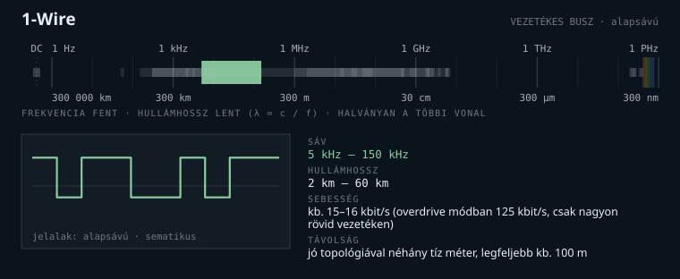

Egy adatvezeték és egy föld köti a mestert (mikrovezérlő) az érzékelőkhöz. Minden eszköznek gyárilag egyedi 64 bites címe van, így sok hőmérő fér egy vonalra. Parazita táplálással az adatvezeték egyben tápot is ad.

- **Közeg:** Egy adatér + föld (+ opcionális tápér)
- **Jel:** Időrésekkel kódolt alapsávú jel, felhúzó ellenállással (alapsávú)
- **Sáv:** 5 kHz – 150 kHz
- **Hullámhossz:** 2 km – 60 km
- **Sebesség:** 15,4 kbit/s (overdrive módban 125 kbit/s)
- **Távolság:** jó topológiával néhány tíz méter, legfeljebb kb. 100 m
- **Topológia:** lánc a legjobb; csillag rövid ágakkal
- **Táplálás:** külön tápér vagy parazita táplálás
- **Kábel:** csavart érpár (gyakran Cat5e egy-egy ere)
- **Csatlakozó:** sorkapocs, csatlakozó a modulon
- **Szabvány:** gyártói (Analog Devices / Maxim)
- **A lakásban:** Hőmérők (DS18B20) fűtéshez, puffertartályhoz, szobákhoz; saját építésű ESPHome-rendszerek.
- **Szerelés:**
  - 4,7 kΩ körüli felhúzó ellenállás az adatér és a táp között a mester oldalán.
  - Hosszú, elágazó vonalon a jel torzul: lánc és csavart érpár.
- **Buktatók:**
  - Ipari, szabványos megoldás helyett hobbi szint: dokumentálni kell, ki tartja karban.
- **Rokon vonalak:** RS-485 · Modbus RTU, Analóg jelszint: 0–10 V, 1–10 V, 4–20 mA
- **Keresőszavak:** HU: DS18B20 vízálló hőmérő · 1-Wire hőmérő — EN: DS18B20 waterproof sensor · 1-Wire temperature sensor — DE: DS18B20 Temperatursensor · 1-Wire Sensor
- **Hol kapható:** Elektronikai alkatrész-kereskedés (pl. modulbolt).

## Vezetékes hálózat

### Analóg telefonvonal

*Más néven:* POTS, telefon érpár, vezetékes telefon

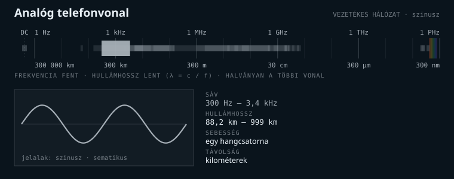

Egy réz érpáron a hang közvetlenül, analóg jelként utazik a 300–3400 Hz-es beszédsávban. A központ egyenfeszültséggel táplálja a vonalat, és nagyobb, kis frekvenciájú váltakozó feszültséggel csenget.

- **Közeg:** Egy csavart réz érpár
- **Jel:** Analóg hangfrekvenciás jel egyenfeszültségű tápláláson (szinusz)
- **Sáv:** 300 Hz – 3,4 kHz
- **Hullámhossz:** 88,2 km – 999 km
- **Sebesség:** egy hangcsatorna
- **Távolság:** kilométerek
- **Topológia:** pont-pont a központ felé; lakáson belül párhuzamos aljzatok
- **Táplálás:** a központ tápláléja
- **Kábel:** telefonkábel, pl. J-Y(St)Y 2 × 2 × 0,6
- **Csatlakozó:** RJ11, régi telefonaljzat
- **Szabvány:** ETSI ES 201 970
- **A lakásban:** Régi lakások telefonvezetékei; riasztók, liftek tárcsázója; ma sokszor csak az xDSL hordozója.
- **Szerelés:**
  - Régi lakásban a telefonkábel gyakran felhasználható gyengeáramú érpárként, de hálózathoz kevés.
- **Buktatók:**
  - Csengetéskor a vonalon érintésre kellemetlen feszültség van.
  - A régi párhuzamos aljzatok rontják az xDSL-t.
- **Rokon vonalak:** VDSL2, DECT
- **Keresőszavak:** HU: telefonkábel 2x2x0,6 · RJ11 aljzat — EN: telephone cable · RJ11 socket — DE: Telefonkabel J-Y(St)Y · TAE Dose
- **Hol kapható:** Villamossági nagykereskedés, barkácsáruház.

### VDSL2

*Más néven:* xDSL, DSL, vectoring

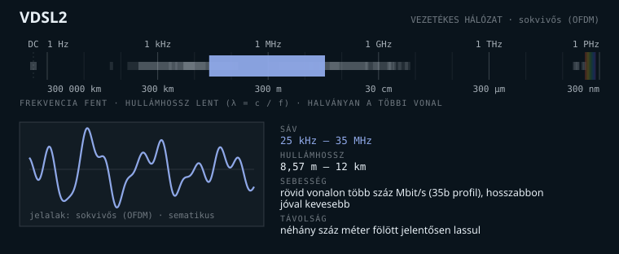

A telefon érpáron a hangsáv fölött sok ezer keskeny vivő (DMT) visz adatot egyszerre. Minél rövidebb és jobb a réz, annál több vivő használható, ezért a sebesség a távolsággal gyorsan esik.

- **Közeg:** Csavart réz érpár (telefonvonal)
- **Jel:** Sokvivős (DMT) moduláció (sokvivős (OFDM))
- **Sáv:** 25 kHz – 35 MHz
- **Hullámhossz:** 8,57 m – 12 km
- **Sebesség:** rövid vonalon több száz Mbit/s (35b profil), hosszabbon jóval kevesebb
- **Távolság:** néhány száz méter fölött jelentősen lassul
- **Topológia:** pont-pont a szolgáltató szekrényéig
- **Táplálás:** nem visz tápot
- **Kábel:** telefon érpár
- **Csatlakozó:** RJ11
- **Szabvány:** ITU-T G.993.2
- **A lakásban:** Vezetékes internet a régi telefonhálózaton; a modemtől a lakás felé már Ethernet és Wi-Fi.
- **Szerelés:**
  - A modemet az első telefonaljzatra kell kötni; a lakáson belüli párhuzamos telefonvezetékek rontják a jelet.
- **Buktatók:**
  - A régi, laza telefoncsatlakozások zajosak: a sebesség a lakáson belüli bekötésen is múlik.
- **Rokon vonalak:** Analóg telefonvonal, Optika: egymódusú, Ethernet csavart érpár
- **Keresőszavak:** HU: VDSL2 modem · DSL szűrő — EN: VDSL2 modem · DSL splitter — DE: VDSL2 Modem · DSL Splitter
- **Hol kapható:** Szolgáltató, műszaki áruház.

### Ethernet csavart érpár

*Más néven:* UTP, Cat5e, Cat6, Cat6A, strukturált hálózat, LAN

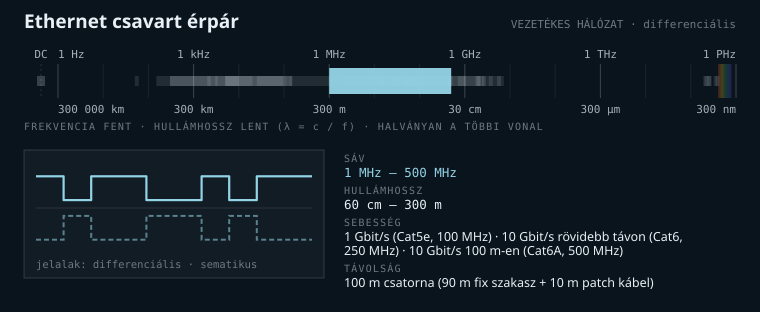

Négy csavart érpár; mindegyiken differenciális, többszintű jel utazik, mind a négy páron egyszerre mindkét irányban (1 Gbit/s fölött). A kábel kategóriája azt adja meg, milyen frekvenciáig garantált a jelátvitel: ebből következik a sebesség.

- **Közeg:** Négy csavart érpár (U/UTP, F/UTP, S/FTP)
- **Jel:** Differenciális, többszintű kódolás mind a négy páron (differenciális)
- **Sáv:** 1 MHz – 500 MHz
- **Hullámhossz:** 60 cm – 300 m
- **Sebesség:** 1 Gbit/s (Cat5e, 100 MHz) · 10 Gbit/s rövidebb távon (Cat6, 250 MHz) · 10 Gbit/s 100 m-en (Cat6A, 500 MHz)
- **Távolság:** 100 m csatorna (90 m fix szakasz + 10 m patch kábel)
- **Topológia:** csillag a rack vagy a médiadoboz switchétől
- **Táplálás:** PoE-vel táplálni is tud (lásd PoE)
- **Kábel:** Cat6A F/UTP vagy U/UTP fali kábel, tömör erű
- **Csatlakozó:** RJ45, keystone modul, patch panel
- **Szabvány:** IEEE 802.3, ISO/IEC 11801, EN 50173 / EN 50174
- **A lakásban:** Strukturált lakáshálózat: minden szobába, a TV mögé, a mennyezeti Wi-Fi ponthoz, a kamerákhoz, a médiadobozba.
- **Szerelés:**
  - Az erősáramú kábeltől elválasztva vezetni (EN 50174-2): távolság vagy elválasztó, keresztezés derékszögben.
  - Hajlítási sugár legalább a kábel átmérőjének négyszerese; ne törd meg, ne húzd túl, ne szorítsd kábelkötegelővel.
  - Egy rendszeren belül egyféle bekötési szín-sorrend (T568A vagy T568B).
  - Csillagpontba (médiadoboz) tápaljzat és szellőzés.
- **Buktatók:**
  - A sodrott erű patch kábel nem fali kábel.
  - CCA (rézbevonatú alumínium) kábel olcsóbb, de nem felel meg a szabványnak: nagyobb az ellenállása, PoE-nál melegszik, a csatlakozásai lazulnak. Tömör rézérrel kell szerelni.
  - A párokat a csatlakozóig csavarva kell hagyni; a hosszan kibontott pár áthallást okoz.
  - Telepítés után mérés (legalább folytonosság és pár-sorrend).
- **Rokon vonalak:** PoE: táplálás Ethernet-kábelen, Optika: egymódusú, Wi-Fi 5 GHz, HDMI
- **Keresőszavak:** HU: Cat6A fali kábel · keystone modul RJ45 · patch panel · médiadoboz — EN: Cat6A installation cable · RJ45 keystone jack · patch panel — DE: Cat.7 Verlegekabel · Cat6A Keystone Modul · Patchpanel · Multimediaverteiler
- **Hol kapható:** Villamossági nagykereskedés, hálózati szakkereskedés.
- **A Készletben:**
  - `VRG-0003` Számítógép vezeték CAT5E UTP Belden 1583E — *termék*: Cat5e U/UTP fali kábel
  - `VRG-0004` (939081 ) Számítógép vezeték CAT5 E - UTP fali réz PVC (0) BELDEN 1583e · 205 Ft — *termék*: Cat5e U/UTP fali kábel, réz
  - `VRG-0182` Számítógép vezeték CAT5 E - UTP fali CCA!! (0) · 155 Ft — *termék*: Cat5e UTP, de CCA (rézbevonatú alumínium): nem szabványos, PoE-nál melegszik, új szerelésbe nem ajánlott
  - `VRG-0183` Számítógép vezeték CAT6 UTP — *termék*: Cat6 U/UTP fali kábel
  - `VRG-0184` (989689 ) Számítógép vezeték CAT6 - UTP fali réz PVC (0) BITNER · 216 Ft — *termék*: Cat6 U/UTP fali kábel, réz
  - `VRG-0073` LEGRAND 413102 OH kalapsínre szerelhető RJ45 port Cat6 árnyékolt (FTP) 250MHz - 1 Gigabit/s · 2 827 Ft — *alkatrész*: kalapsínre szerelhető RJ45 port Cat6 (FTP): médiadobozba, elosztóba
  - `VRG-0081` Legrand 753142 Valena Life 1xRJ45 UTP Cat6 aljzat, fehér · 6 212 Ft — *alkatrész*: RJ45 Cat6 fali aljzat
  - `VRG-0122` ASFORA fehér 1xRJ45 Cat5e UTP aljzat, kerettel EPH4300121 · 3 640 Ft — *alkatrész*: RJ45 Cat5e fali aljzat kerettel
  - `VRG-0123` ASFORA fehér 1xRJ45 Cat6 UTP aljzat, kerettel EPH4700121 · 5 094 Ft — *alkatrész*: RJ45 Cat6 fali aljzat kerettel
  - `VRG-0159` Telefon Moduláris dugó 8P8C árnyékolt Cat 5-hoz (FTP) · 131 Ft — *alkatrész*: 8P8C (RJ45) dugó, árnyékolt
  - `VRG-0161` Telefon Moduláris dugó 8P8C-hez törésgátló TS 52/WH fehér · 61 Ft — *alkatrész*: törésgátló a 8P8C dugóhoz

### PoE: táplálás Ethernet-kábelen

*Más néven:* Power over Ethernet, 802.3af, 802.3at, 802.3bt

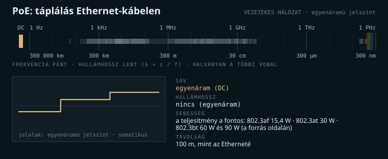

A switch (vagy injektor) az Ethernet-kábel érpárjain egyenfeszültséget is küld, így a kamera, a Wi-Fi pont vagy a kaputelefon egyetlen kábelről kap adatot és tápot. Csak akkor kapcsol feszültséget, ha a túloldal PoE-eszköznek jelentkezik.

- **Közeg:** Az Ethernet-kábel érpárjai
- **Jel:** Egyenfeszültség (kb. 44–57 V) az adatjel mellett (egyenáramú jelszint)
- **Sáv:** egyenáram (DC)
- **Hullámhossz:** nincs (egyenáram)
- **Sebesség:** a teljesítmény a fontos: 802.3af 15,4 W · 802.3at 30 W · 802.3bt 60 W és 90 W (a forrás oldalán)
- **Távolság:** 100 m, mint az Etherneté
- **Topológia:** csillag, mint az Etherneté
- **Táplálás:** ez maga a táplálás
- **Kábel:** Cat5e vagy jobb; nagyobb teljesítményhez Cat6A
- **Csatlakozó:** RJ45
- **Szabvány:** IEEE 802.3af / at / bt
- **A lakásban:** IP-kamerák, mennyezeti Wi-Fi pontok, IP-kaputelefon, érzékelők, kisebb kijelzők.
- **Szerelés:**
  - A switch PoE-kerete (összes watt) korlátozza, hány eszköz kap tápot egyszerre.
  - Kötegben futó kábeleknél nagy PoE-teljesítménynél a melegedés miatt a gyártói előírás számít.
- **Buktatók:**
  - A „passzív PoE” nem szabványos: a szabványos eszközt tönkreteheti vagy nem táplálja.
  - A teljesítmény a kábel ellenállása miatt a végén kisebb, mint a switchnél.
- **Rokon vonalak:** Ethernet csavart érpár
- **Keresőszavak:** HU: PoE switch · PoE injektor · 802.3at — EN: PoE switch · PoE injector · 802.3bt — DE: PoE Switch · PoE Injektor
- **Hol kapható:** Hálózati szakkereskedés, villamossági nagykereskedés.

### HDMI

*Más néven:* HDMI 2.0, HDMI 2.1, HDBaseT

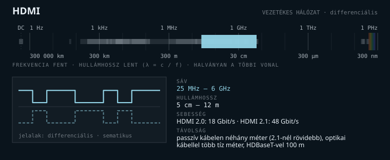

Kép és hang tömörítetlenül, több nagy sebességű differenciális érpáron (TMDS, a 2.1-ben FRL). A nagy adatsebesség miatt passzív kábelen csak néhány métert bír; hosszabb távra aktív vagy optikai kábel, vagy HDBaseT-átvitel Cat6 kábelen.

- **Közeg:** Több árnyékolt csavart érpár egy kábelben
- **Jel:** Nagy sebességű differenciális soros jel (differenciális)
- **Sáv:** 25 MHz – 6 GHz
- **Hullámhossz:** 5 cm – 12 m
- **Sebesség:** HDMI 2.0: 18 Gbit/s · HDMI 2.1: 48 Gbit/s
- **Távolság:** passzív kábelen néhány méter (2.1-nél rövidebb), optikai kábellel több tíz méter, HDBaseT-vel 100 m
- **Topológia:** pont-pont
- **Táplálás:** csak kis segédtáp (5 V)
- **Kábel:** HDMI kábel (Premium High Speed, Ultra High Speed), optikai HDMI (AOC), HDBaseT-hez Cat6A
- **Csatlakozó:** HDMI A
- **Szabvány:** HDMI Specification, HDBaseT (IEEE 1911)
- **A lakásban:** TV a falon, projektor a mennyezeten, a forrás a szekrényben: a falban vezetett kép.
- **Szerelés:**
  - Falba ne HDMI-kábelt, hanem elegendően nagy védőcsövet: a kábel cserélhető marad, és a csatlakozó átfér.
  - Hosszú távra optikai HDMI vagy HDBaseT, a végpontoknál tápaljzattal.
- **Buktatók:**
  - Egy jövőbeli szabvány több sávszélességet kér: a csőben vezetett kábel cserélhető, a bevakolt nem.
- **Rokon vonalak:** Ethernet csavart érpár, Koax: antenna és kábel-TV
- **Keresőszavak:** HU: optikai HDMI kábel · HDBaseT extender · HDMI fali csatlakozó — EN: active optical HDMI cable · HDBaseT extender · HDMI wall plate — DE: optisches HDMI Kabel · HDBaseT Extender · HDMI Anschlussdose
- **Hol kapható:** Műszaki áruház, AV-szaküzlet, villamossági nagykereskedés.

## Erősáramú vonal

### PLC szűksávú

*Más néven:* CENELEC A sáv, G3-PLC, PRIME

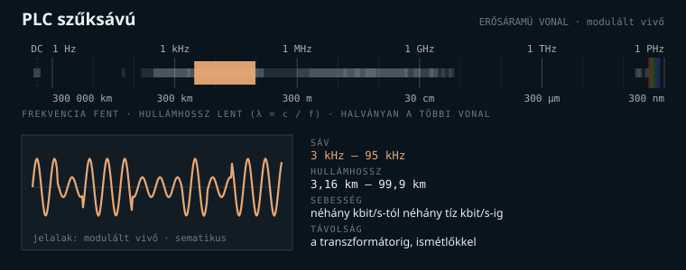

Az áramszolgáltató az 50 Hz-es feszültségre egy kis amplitúdójú, modulált vivőt ültet a 3–95 kHz-es sávban, és így beszélget az okos mérőkkel a transzformátorállomásig.

- **Közeg:** A kisfeszültségű hálózat vezetői
- **Jel:** Modulált vivő (OFDM) a hálózati feszültségen (modulált vivő)
- **Sáv:** 3 kHz – 95 kHz
- **Hullámhossz:** 3,16 km – 99,9 km
- **Sebesség:** néhány kbit/s-tól néhány tíz kbit/s-ig
- **Távolság:** a transzformátorig, ismétlőkkel
- **Topológia:** a kisfeszültségű hálózat fája
- **Táplálás:** —
- **Kábel:** a hálózat maga
- **Csatlakozó:** közvetlenül a hálózaton
- **Szabvány:** EN 50065 (CENELEC sávok), ITU-T G.9903 (G3-PLC), G.9904 (PRIME)
- **A lakásban:** Egyes okos fogyasztásmérők kommunikációja a szolgáltató felé.
- **Szerelés:**
  - A lakás oldalán nincs vele teendő; zavaró fogyasztó (pl. olcsó tápegység) rontja a mérő kommunikációját.
- **Buktatók:**
  - A 95–148,5 kHz-es sávok a fogyasztói alkalmazásoké: más eszközök is használhatják.
- **Rokon vonalak:** Hálózati 50 Hz, PLC szélessávú
- **Keresőszavak:** HU: okos mérő PLC kommunikáció — EN: narrowband PLC smart meter · G3-PLC — DE: Schmalband-PLC Smart Meter
- **Hol kapható:** —

### PLC szélessávú

*Más néven:* powerline adapter, HomePlug AV2, G.hn hálózaton

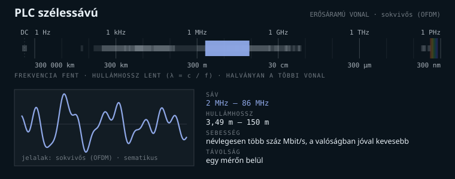

A konnektorba dugott adapterek a lakás erősáramú vezetékén, a 2–86 MHz-es sávban sok vivővel (OFDM) visznek adatot egymás között. A sebesség a vezeték állapotától, a távolságtól és a zavaró fogyasztóktól függ.

- **Közeg:** A lakás erősáramú hálózata
- **Jel:** OFDM a hálózati vezetéken (sokvivős (OFDM))
- **Sáv:** 2 MHz – 86 MHz
- **Hullámhossz:** 3,49 m – 150 m
- **Sebesség:** névlegesen több száz Mbit/s, a valóságban jóval kevesebb
- **Távolság:** egy mérőn belül
- **Topológia:** közös közeg az adapterek között
- **Táplálás:** —
- **Kábel:** a hálózat maga
- **Csatlakozó:** konnektoros adapter (Ethernet vagy Wi-Fi kimenettel)
- **Szabvány:** IEEE 1901, ITU-T G.hn
- **A lakásban:** Hálózat ott, ahol nincs adatkábel és a Wi-Fi gyenge (pince, melléképület egy mérőn).
- **Szerelés:**
  - Fali aljzatba közvetlenül, ne elosztóba vagy túlfeszültség-védőbe.
  - Más fázison vagy áram-védőkapcsolón túl gyengébb lehet.
- **Buktatók:**
  - Ideiglenes megoldásnak jó; tartósan Ethernet-kábel a megbízható.
  - Rádiófrekvenciás zavart kelthet a rövidhullámú sávban.
- **Rokon vonalak:** Ethernet csavart érpár, PLC szűksávú, Wi-Fi 5 GHz
- **Keresőszavak:** HU: powerline adapter · HomePlug AV2 adapter — EN: powerline adapter · HomePlug AV2 — DE: Powerline Adapter · dLAN
- **Hol kapható:** Műszaki áruház, informatikai bolt.

## Koax

### Koax: antenna és kábel-TV

*Más néven:* koax, 75 ohm, DVB-T, DVB-C, DOCSIS

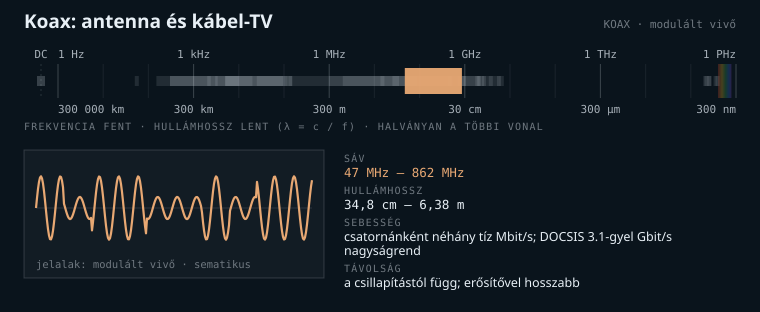

Egy belső ér és a köré tekert árnyékolás alkot egy 75 Ω-os hullámvezetőt; rajta egymás mellett sok modulált rádiófrekvenciás csatorna utazik. A kábeltévés hálózaton ugyanezen a kábelen jön az internet is (DOCSIS).

- **Közeg:** 75 Ω-os koaxiális kábel
- **Jel:** Modulált rádiófrekvenciás csatornák (modulált vivő)
- **Sáv:** 47 MHz – 862 MHz
- **Hullámhossz:** 34,8 cm – 6,38 m
- **Sebesség:** csatornánként néhány tíz Mbit/s; DOCSIS 3.1-gyel Gbit/s nagyságrend
- **Távolság:** a csillapítástól függ; erősítővel hosszabb
- **Topológia:** fa: elosztókkal vagy csillag
- **Táplálás:** nem visz tápot (kivéve egyes antennaerősítők)
- **Kábel:** jól árnyékolt 75 Ω-os koax (pl. 4-szeres árnyékolású)
- **Csatlakozó:** F-csatlakozó, IEC antennacsatlakozó
- **Szabvány:** EN 50083, EN 60728
- **A lakásban:** TV-aljzatok, antennahálózat, kábeltelevízió és kábelinternet, társasházi elosztás.
- **Szerelés:**
  - A nem használt elosztó-kimenetet 75 Ω-os lezáróval kell lezárni.
  - Csillagpontos elosztás és jó árnyékolású kábel: a mobilhálózatok a 700–800 MHz-es sávban zavarhatnak.
- **Buktatók:**
  - Átmenő (soros) TV-aljzatok sora lefelé gyengül.
  - Préselt F-csatlakozó helyett a csavarosat könnyű rosszul felszerelni.
- **Rokon vonalak:** Koax: műholdas középfrekvencia, Mobilhálózat (4G, 5G), HDMI
- **Keresőszavak:** HU: koax kábel 75 ohm · F csatlakozó · antennaelosztó · TV aljzat — EN: 75 ohm coaxial cable · F connector · TV splitter — DE: Koaxialkabel 75 Ohm · F-Stecker · Antennenverteiler · Antennendose
- **Hol kapható:** Villamossági nagykereskedés, antennaszaküzlet.
- **A Készletben:**
  - `VRG-0121` ASFORA fehér TV aljzat végzáró 1 dB kerettel EPH3200121 · 2 317 Ft — *alkatrész*: TV-aljzat végzáró (a lánc utolsó aljzata)
  - `VRG-0160` F-csatlakozó FF 1 · 67 Ft — *alkatrész*: F-csatlakozó a koaxkábelhez

### Koax: műholdas középfrekvencia

*Más néven:* SAT KF, LNB jel, multikapcsoló

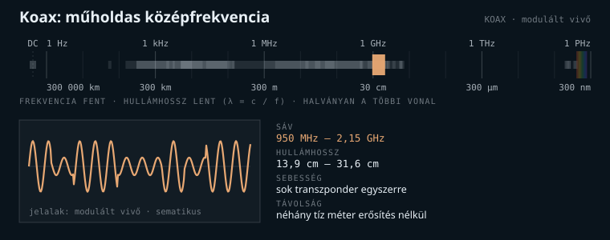

A parabola fejében lévő LNB a 10,7–12,75 GHz-es műholdas jelet 950–2150 MHz-re keveri le, és ez jut le a koaxon. A vevő 13 vagy 18 V-tal táplálja a fejet, ezzel választ polarizációt, a 22 kHz-es jellel pedig sávot.

- **Közeg:** 75 Ω-os koax, jobb árnyékolással
- **Jel:** Lekevert középfrekvenciás jel, a fej tápfeszültségével (modulált vivő)
- **Sáv:** 950 MHz – 2,15 GHz
- **Hullámhossz:** 13,9 cm – 31,6 cm
- **Sebesség:** sok transzponder egyszerre
- **Távolság:** néhány tíz méter erősítés nélkül
- **Topológia:** csillag: minden vevőnek saját kábel a fejtől vagy a multikapcsolótól
- **Táplálás:** 13/18 V a vevőtől a fej felé
- **Kábel:** jól árnyékolt SAT koax (pl. 120 dB árnyékolás)
- **Csatlakozó:** F-csatlakozó, multikapcsoló
- **Szabvány:** EN 50494 / EN 50607 (egykábeles rendszerek)
- **A lakásban:** Parabolától a vevőkig; társasházban multikapcsolóval minden lakás felé.
- **Szerelés:**
  - Minden vevőhöz külön kábel, vagy egykábeles (Unicable) rendszer.
  - A tetőn villámvédelmi és potenciálkiegyenlítési bekötés.
- **Buktatók:**
  - A koaxon tápfeszültség van: rövidzár a fejet vagy a vevőt is tönkreteheti.
- **Rokon vonalak:** Koax: antenna és kábel-TV
- **Keresőszavak:** HU: multikapcsoló · LNB · SAT koax kábel — EN: multiswitch · LNB · satellite coax — DE: Multischalter · LNB · SAT Koaxialkabel
- **Hol kapható:** Antennaszaküzlet, villamossági nagykereskedés.

## Rádió

### 433 MHz sáv

*Más néven:* 433 MHz rádió, SRD 433, rádiós távirányító

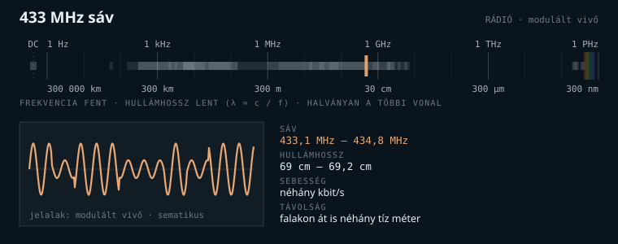

Szabadon használható keskeny sáv (433,05–434,79 MHz) egyszerű, olcsó rádiós eszközöknek: a jel többnyire csak be-ki kapcsolt vivő vagy frekvenciaváltás, sokszor protokoll és titkosítás nélkül.

- **Közeg:** rádió
- **Jel:** Egyszerű be-ki (OOK) vagy frekvenciabillentyűzéses moduláció (modulált vivő)
- **Sáv:** 433,1 MHz – 434,8 MHz
- **Hullámhossz:** 69 cm – 69,2 cm
- **Sebesség:** néhány kbit/s
- **Távolság:** falakon át is néhány tíz méter
- **Topológia:** pont-pont vagy szórt adás
- **Táplálás:** elemes eszközök
- **Kábel:** —
- **Csatlakozó:** —
- **Szabvány:** ERC/REC 70-03 (SRD sávok)
- **A lakásban:** Kapunyitó- és redőnytávirányítók, időjárásállomások, régebbi vezeték nélküli riasztóérzékelők és csengők.
- **Szerelés:**
  - A vevő antennájának helye sokat számít; fém elosztószekrényben a vétel romlik.
- **Buktatók:**
  - Sok olcsó eszköz kódja lehallgatható és visszajátszható: biztonsági célra (kapu, riasztó) gördülőkódos vagy titkosított eszköz kell.
- **Rokon vonalak:** 868 MHz sáv, 2,4 GHz sáv
- **Keresőszavak:** HU: 433 MHz távirányító · 433 MHz vevő — EN: 433 MHz remote · 433 MHz receiver — DE: 433 MHz Funkfernbedienung · 433 MHz Empfänger
- **Hol kapható:** Műszaki áruház, elektronikai alkatrész-kereskedés.

### 868 MHz sáv

*Más néven:* Z-Wave, LoRa, wM-Bus, SRD 868

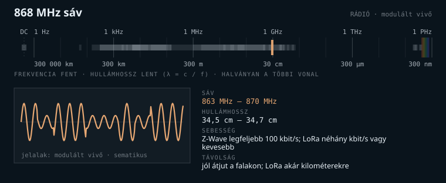

Az Európában szabadon használható 863–870 MHz-es sávban keskeny sávú rádiók dolgoznak, szigorú adási időkorláttal. A Z-Wave hálót alkot (az eszközök továbbadják egymás üzenetét), a LoRa nagyon lassan, de kilométerekre ad, a wM-Bus mérőórákat olvas le.

- **Közeg:** rádió
- **Jel:** Keskeny sávú moduláció (FSK, a LoRánál chirp-spektrumszórás) (modulált vivő)
- **Sáv:** 863 MHz – 870 MHz
- **Hullámhossz:** 34,5 cm – 34,7 cm
- **Sebesség:** Z-Wave legfeljebb 100 kbit/s; LoRa néhány kbit/s vagy kevesebb
- **Távolság:** jól átjut a falakon; LoRa akár kilométerekre
- **Topológia:** Z-Wave: háló; LoRa: csillag átjáróval
- **Táplálás:** elemes vagy hálózati eszközök
- **Kábel:** —
- **Csatlakozó:** —
- **Szabvány:** ETSI EN 300 220, ITU-T G.9959 (Z-Wave), LoRaWAN
- **A lakásban:** Z-Wave okosotthon-eszközök, vezeték nélküli riasztóérzékelők, LoRa szenzorok (kert, pince), rádiós mérőleolvasás.
- **Szerelés:**
  - A hálózati táplálású Z-Wave eszközök továbbítanak: elosztva telepítve javítják a lefedettséget.
- **Buktatók:**
  - Az amerikai Z-Wave eszköz más frekvencián dolgozik: csak európai változat jó.
  - Az adási időkorlát miatt nem való folyamatos adatfolyamra.
- **Rokon vonalak:** 433 MHz sáv, 2,4 GHz sáv, M-Bus
- **Keresőszavak:** HU: Z-Wave modul EU · LoRa szenzor · 868 MHz — EN: Z-Wave EU · LoRaWAN sensor · 868 MHz — DE: Z-Wave EU · LoRaWAN Sensor · 868 MHz Funk
- **Hol kapható:** Okosotthon-szaküzlet, elektronikai kereskedés.

### 2,4 GHz sáv

*Más néven:* Wi-Fi 2,4 GHz, Zigbee, Thread, Bluetooth, BLE, Matter

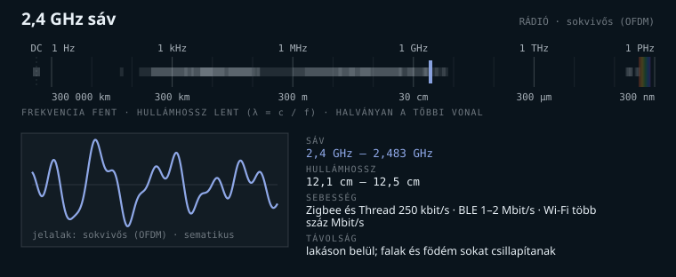

A 2400–2483,5 MHz-es, világszerte szabad sávon osztozik a Wi-Fi, a Zigbee, a Thread és a Bluetooth. A Zigbee és a Thread kis fogyasztású hálót alkot (a hálózati eszközök továbbítanak); a Thread IP-alapú, rá épül a Matter. A sáv zsúfolt, a csatornák kiosztása számít.

- **Közeg:** rádió
- **Jel:** Wi-Fi: OFDM; Zigbee és Thread: DSSS (IEEE 802.15.4); Bluetooth: frekvenciaugratás, GFSK (sokvivős (OFDM))
- **Sáv:** 2,4 GHz – 2,483 GHz
- **Hullámhossz:** 12,1 cm – 12,5 cm
- **Sebesség:** Zigbee és Thread 250 kbit/s · BLE 1–2 Mbit/s · Wi-Fi több száz Mbit/s
- **Távolság:** lakáson belül; falak és födém sokat csillapítanak
- **Topológia:** Wi-Fi: csillag a hozzáférési ponttól; Zigbee, Thread: háló
- **Táplálás:** elemes és hálózati eszközök
- **Kábel:** —
- **Csatlakozó:** —
- **Szabvány:** IEEE 802.11, IEEE 802.15.4, Bluetooth Core, Thread, Matter
- **A lakásban:** A legtöbb okos eszköz: kapcsolók, érzékelők, izzók, termosztátok; régebbi és olcsóbb Wi-Fi eszközök.
- **Szerelés:**
  - A Zigbee-csatornát a Wi-Fi csatornáitól távol kell választani.
  - A koordinátort (átjárót) ne fém elosztószekrénybe és ne közvetlenül a router mellé.
- **Buktatók:**
  - A mikrohullámú sütő ugyanebben a sávban zavar.
  - Elemes eszköz nem továbbít: a háló a hálózati tápú eszközökön áll.
- **Rokon vonalak:** Wi-Fi 5 GHz, 868 MHz sáv, Ethernet csavart érpár
- **Keresőszavak:** HU: Zigbee koordinátor · Thread border router · Matter okos kapcsoló — EN: Zigbee coordinator · Thread border router · Matter smart switch — DE: Zigbee Koordinator · Thread Border Router · Matter Schalter
- **Hol kapható:** Okosotthon-szaküzlet, műszaki áruház.
- **A Készletben:**
  - `VRG-0167` Wi-Fi okos dugalj (2P+F), 1x16A, fehér Stilo · 4 358 Ft — *használja*: Wi-Fi-s okos dugalj: a 2,4 GHz-es sávon kommunikál

### Wi-Fi 5 GHz

*Más néven:* Wi-Fi 5, Wi-Fi 6, 802.11ac, 802.11ax, DFS

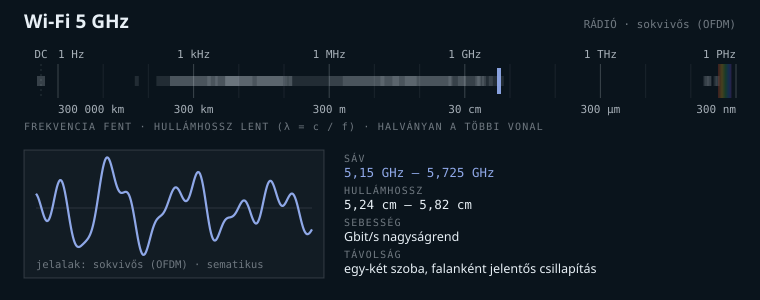

Széles csatornákon, sok vivővel (OFDM) gyors adatátvitel a hozzáférési pont és az eszközök között. A sáv tágasabb és kevésbé zsúfolt, mint a 2,4 GHz, de a falakon rosszabbul jut át, ezért nagyobb lakáshoz több hozzáférési pont kell.

- **Közeg:** rádió
- **Jel:** OFDM / OFDMA, széles (40–160 MHz-es) csatornák (sokvivős (OFDM))
- **Sáv:** 5,15 GHz – 5,725 GHz
- **Hullámhossz:** 5,24 cm – 5,82 cm
- **Sebesség:** Gbit/s nagyságrend
- **Távolság:** egy-két szoba, falanként jelentős csillapítás
- **Topológia:** csillag a hozzáférési ponttól; több pont Ethernet-gerinccel vagy hálóban
- **Táplálás:** —
- **Kábel:** —
- **Csatlakozó:** —
- **Szabvány:** IEEE 802.11ac / ax / be, ETSI EN 301 893
- **A lakásban:** Gyors lakáson belüli Wi-Fi: laptop, telefon, TV.
- **Szerelés:**
  - A hozzáférési pontokat Ethernet-kábellel (PoE-vel) érdemes bekötni, mennyezetre, a lefedendő terület közepére.
- **Buktatók:**
  - A felső csatornákon radarvédelmi szabály (DFS) van: a pont ideiglenesen csatornát válthat.
- **Rokon vonalak:** 2,4 GHz sáv, Wi-Fi 6 GHz, Ethernet csavart érpár, PoE: táplálás Ethernet-kábelen
- **Keresőszavak:** HU: mennyezeti Wi-Fi hozzáférési pont · Wi-Fi 6 access point PoE — EN: ceiling Wi-Fi access point · Wi-Fi 6 PoE access point — DE: Deckenaccesspoint · WLAN Access Point PoE
- **Hol kapható:** Hálózati szakkereskedés, informatikai bolt.

### Wi-Fi 6 GHz

*Más néven:* Wi-Fi 6E, Wi-Fi 7, 802.11be

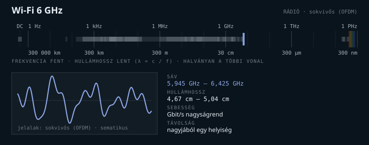

Új, Európában 5945–6425 MHz-es sáv nagyon széles csatornákkal és kevés zavarral, csak az újabb eszközöknek. Beltéren kis teljesítménnyel, ezért szinte helyiségenként kell hozzáférési pont.

- **Közeg:** rádió
- **Jel:** OFDMA, nagyon széles csatornák (sokvivős (OFDM))
- **Sáv:** 5,945 GHz – 6,425 GHz
- **Hullámhossz:** 4,67 cm – 5,04 cm
- **Sebesség:** Gbit/s nagyságrend
- **Távolság:** nagyjából egy helyiség
- **Topológia:** csillag a hozzáférési ponttól
- **Táplálás:** —
- **Kábel:** —
- **Csatlakozó:** —
- **Szabvány:** IEEE 802.11ax (6E), 802.11be (Wi-Fi 7), ETSI EN 303 687
- **A lakásban:** Nagy sávszélességet kérő eszközök (VR, nagy fájlok) a pont közelében.
- **Szerelés:**
  - Helyiségenként hozzáférési pont, vezetékes gerinccel.
- **Buktatók:**
  - A régebbi eszközök nem látják a sávot.
- **Rokon vonalak:** Wi-Fi 5 GHz, Ethernet csavart érpár
- **Keresőszavak:** HU: Wi-Fi 7 router · Wi-Fi 6E hozzáférési pont — EN: Wi-Fi 7 router · Wi-Fi 6E access point — DE: WiFi 7 Router · WLAN 6E Access Point
- **Hol kapható:** Informatikai bolt.

### DECT

*Más néven:* vezeték nélküli telefon, DECT ULE

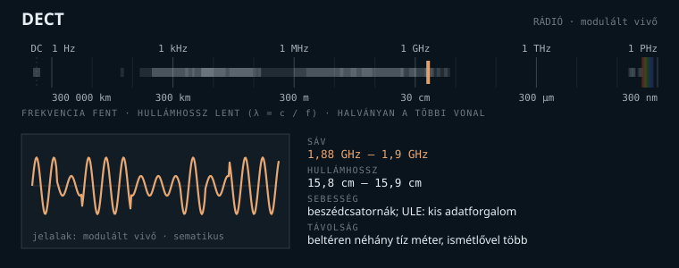

Európában az 1880–1900 MHz-es, csak erre fenntartott sávban dolgozó vezeték nélküli telefonrendszer; a bázisállomás időrésekben beszél a kézibeszélőkkel. Kis fogyasztású változata (ULE) okosotthon-eszközöket is kezel.

- **Közeg:** rádió
- **Jel:** Időosztásos rádióátvitel (TDMA), GFSK (modulált vivő)
- **Sáv:** 1,88 GHz – 1,9 GHz
- **Hullámhossz:** 15,8 cm – 15,9 cm
- **Sebesség:** beszédcsatornák; ULE: kis adatforgalom
- **Távolság:** beltéren néhány tíz méter, ismétlővel több
- **Topológia:** csillag a bázistól
- **Táplálás:** —
- **Kábel:** —
- **Csatlakozó:** —
- **Szabvány:** ETSI EN 300 175
- **A lakásban:** Vezeték nélküli telefonok a routerhez kötött bázissal, egyes okosotthon-eszközök (ULE).
- **Szerelés:**
  - A bázis helye határozza meg a lefedettséget; ismétlővel bővíthető.
- **Buktatók:**
  - Saját sáv, ezért nem zavarja a Wi-Fit, de a bázisállomás közel a hálózati eszközökhöz is működik.
- **Rokon vonalak:** Analóg telefonvonal, 2,4 GHz sáv
- **Keresőszavak:** HU: DECT telefon · DECT ismétlő — EN: DECT phone · DECT repeater — DE: DECT Telefon · DECT Repeater
- **Hol kapható:** Műszaki áruház.

### Mobilhálózat (4G, 5G)

*Más néven:* LTE, 5G NR, mobilnet, beltéri lefedettség

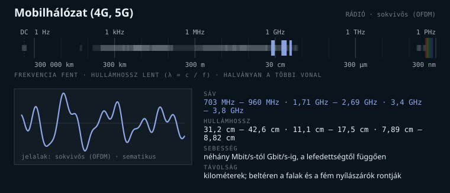

A szolgáltatók engedélyezett sávjaiban (Magyarországon jellemzően 700, 800, 900, 1800, 2100, 2600 MHz és 3,4–3,8 GHz) dolgozó cellás hálózat. Az alacsony sávok messzebbre és falakon át is elérnek, a magasak gyorsabbak, de rövid hatótávolságúak.

- **Közeg:** rádió
- **Jel:** OFDMA lefelé, SC-FDMA vagy OFDMA felfelé (sokvivős (OFDM))
- **Sáv:** 703 MHz – 960 MHz · 1,71 GHz – 2,69 GHz · 3,4 GHz – 3,8 GHz
- **Hullámhossz:** 31,2 cm – 42,6 cm · 11,1 cm – 17,5 cm · 7,89 cm – 8,82 cm
- **Sebesség:** néhány Mbit/s-tól Gbit/s-ig, a lefedettségtől függően
- **Távolság:** kilométerek; beltéren a falak és a fém nyílászárók rontják
- **Topológia:** cellás
- **Táplálás:** —
- **Kábel:** kültéri antennához alacsony csillapítású koax
- **Csatlakozó:** N, SMA, TS9 (eszközfüggő)
- **Szabvány:** 3GPP
- **A lakásban:** Mobilinternet-router, okos mérők és riasztók mobil kommunikációja, beltéri lefedettség.
- **Szerelés:**
  - Rossz beltéri vételnél kültéri antenna a router mellé, rövid kábellel.
  - Az erősítő (repeater) csak szolgáltatói engedéllyel üzemeltethető.
- **Buktatók:**
  - Az energiahatékony nyílászárók fémbevonatos üvege erősen csillapít.
  - A 700–800 MHz-es mobiljel zavarhatja a rosszul árnyékolt antennahálózatot.
- **Rokon vonalak:** Koax: antenna és kábel-TV, Wi-Fi 5 GHz
- **Keresőszavak:** HU: 4G router külső antenna · 5G router — EN: 4G router external antenna · 5G router — DE: LTE Router Außenantenne · 5G Router
- **Hol kapható:** Szolgáltató, informatikai bolt, antennaszaküzlet.

### RFID és NFC

*Más néven:* proximity kártya, 125 kHz, 13,56 MHz, Mifare, NFC

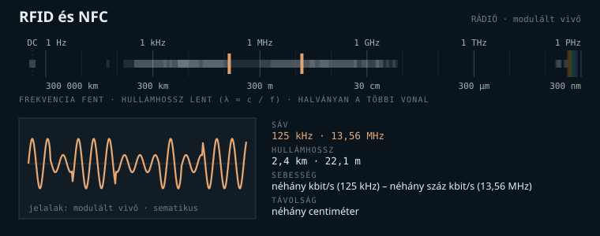

Az olvasó tekercse mágneses mezőt kelt, a kártya vagy kulcstartó ebből kap tápot, és a mező terhelésével válaszol. Két sáv terjedt el: a 125 kHz-es (egyszerű, csak azonosító) és a 13,56 MHz-es (Mifare, NFC: titkosítható).

- **Közeg:** közeli mágneses csatolás
- **Jel:** Terhelésmoduláció az olvasó mezőjében (modulált vivő)
- **Sáv:** 125 kHz · 13,56 MHz
- **Hullámhossz:** 2,4 km · 22,1 m
- **Sebesség:** néhány kbit/s (125 kHz) – néhány száz kbit/s (13,56 MHz)
- **Távolság:** néhány centiméter
- **Topológia:** pont-pont az olvasó és a kártya között
- **Táplálás:** a kártya passzív, az olvasó mezőjéből táplálkozik
- **Kábel:** az olvasótól a vezérlőig: gyártó szerint (Wiegand, RS-485, OSDP)
- **Csatlakozó:** sorkapocs
- **Szabvány:** ISO 14443 (13,56 MHz), ISO 15693, ISO 11784/11785 (125 kHz)
- **A lakásban:** Beléptetés: kapu, lépcsőház, garázs, kaputelefonba épített olvasó.
- **Szerelés:**
  - Fém felületre szerelve az olvasási távolság csökken: távtartó vagy fémre szánt olvasó kell.
- **Buktatók:**
  - A 125 kHz-es kártyák egyszerűen másolhatók: biztonságra a titkosított 13,56 MHz-es rendszer való.
- **Rokon vonalak:** RS-485 · Modbus RTU, Ethernet csavart érpár
- **Keresőszavak:** HU: RFID kártyaolvasó 13,56 MHz · Mifare kulcstartó · Wiegand olvasó — EN: 13.56 MHz RFID reader · Mifare key fob · Wiegand reader — DE: RFID Leser 13,56 MHz · Mifare Schlüsselanhänger
- **Hol kapható:** Biztonságtechnikai szakkereskedés.

## Fény

### Infravörös távirányító

*Más néven:* IR távirányító, 38 kHz, 940 nm

A távirányító LED-je 940 nm körüli, szemmel nem látható infravörös fényt villogtat, egy 36–40 kHz-es vivővel modulálva, hogy a vevő elkülönítse a napfénytől és a lámpáktól. Csak rálátással működik.

- **Közeg:** infravörös fény a levegőben
- **Jel:** Fényimpulzusok 36–40 kHz-es vivőre ültetve (fényimpulzus)
- **Sáv:** 319 THz
- **Hullámhossz:** 940 nm
- **Sebesség:** néhány száz bit/s
- **Távolság:** néhány méter, rálátással
- **Topológia:** pont-pont
- **Táplálás:** elem
- **Kábel:** —
- **Csatlakozó:** —
- **Szabvány:** gyártói protokollok (NEC, RC-5 és mások)
- **A lakásban:** TV, klíma, hangsáv; okosotthonból IR-adóval vezérelhető.
- **Szerelés:**
  - Szekrénybe zárt eszközhöz IR-ismétlő vagy okosotthon-IR-adó.
- **Buktatók:**
  - Erős napfény és egyes LED-lámpák zavarhatják.
- **Rokon vonalak:** 2,4 GHz sáv
- **Keresőszavak:** HU: IR ismétlő · infra adó okosotthon — EN: IR repeater · IR blaster — DE: IR Verlängerung · IR Sender Smart Home
- **Hol kapható:** Műszaki áruház.

### Optika: egymódusú

*Más néven:* FTTH, GPON, XGS-PON, single mode, OS2

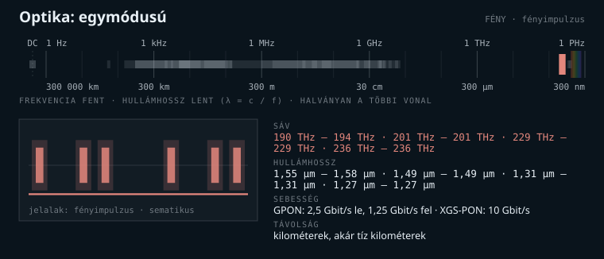

A kb. 9 µm-es üvegmagban a fény egyetlen módusban halad, így alig torzul, és kilométereket tesz meg. Az FTTH-hálózat egy szálon két irányban dolgozik, eltérő hullámhosszokon: lefelé 1490 nm, felfelé 1310 nm (a gyorsabb XGS-PON 1577 és 1270 nm-en).

- **Közeg:** egymódusú üvegszál (OS2), hajlításra érzéketlen kivitel beltérre (G.657)
- **Jel:** Fényimpulzusok több hullámhosszon (fényimpulzus)
- **Sáv:** 190 THz – 194 THz · 201 THz – 201 THz · 229 THz – 229 THz · 236 THz – 236 THz
- **Hullámhossz:** 1,55 µm – 1,58 µm · 1,49 µm – 1,49 µm · 1,31 µm – 1,31 µm · 1,27 µm – 1,27 µm
- **Sebesség:** GPON: 2,5 Gbit/s le, 1,25 Gbit/s fel · XGS-PON: 10 Gbit/s
- **Távolság:** kilométerek, akár tíz kilométerek
- **Topológia:** pont-többpont (passzív osztó) a szolgáltatónál; pont-pont lakáson belül
- **Táplálás:** nem visz tápot
- **Kábel:** beltéri FTTH kábel G.657.A2 szállal
- **Csatlakozó:** SC/APC (zöld), LC
- **Szabvány:** ITU-T G.652 / G.657 (szál), G.984 (GPON), G.9807 (XGS-PON)
- **A lakásban:** A szolgáltató optikája a lakás optikai végpontjáig (ONT); onnan Ethernet. Új építésnél: védőcső a csatlakozási ponttól a médiadobozig.
- **Szerelés:**
  - Hajlítási sugár: a szál típusa szerint; a G.657.A2 szál kisebb sugarat is tűr.
  - A csatlakozó végét védősapkával kell tartani; a por csillapítást okoz.
  - Az optikába nem szabad belenézni: a lézerfény láthatatlan, és károsíthatja a szemet.
- **Buktatók:**
  - Az APC (zöld, ferde csiszolású) és az UPC (kék) csatlakozó nem keverhető.
  - A szál hegesztése vagy csatlakozózása szerszámot és gyakorlatot kíván: sokszor a szolgáltató végzi.
- **Rokon vonalak:** Optika: multimódusú, Ethernet csavart érpár, VDSL2
- **Keresőszavak:** HU: FTTH optikai kábel G.657 · SC/APC patch kábel · optikai végpont doboz — EN: FTTH drop cable G.657 · SC/APC patch cord · fibre termination box — DE: FTTH Glasfaserkabel G.657 · SC/APC Patchkabel · Glasfaser Anschlussdose
- **Hol kapható:** Hálózati szakkereskedés, optikai szaküzlet.

### Optika: multimódusú

*Más néven:* multimode, OM3, OM4, 850 nm

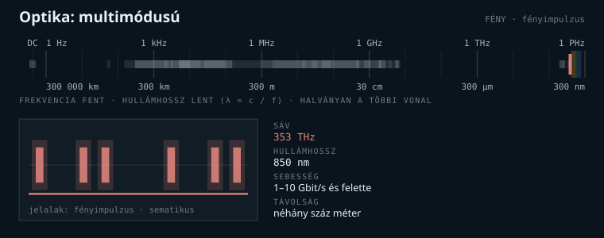

Az 50 µm-es magban a fény sok módusban halad, ezért rövidebb távon dolgozik, de olcsóbb fényforrással (850 nm-es VCSEL). Épületen belüli gerinceknek és szervertermeknek készült.

- **Közeg:** multimódusú üvegszál (OM3, OM4)
- **Jel:** Fényimpulzusok 850 nm-en (közeli infravörös) (fényimpulzus)
- **Sáv:** 353 THz
- **Hullámhossz:** 850 nm
- **Sebesség:** 1–10 Gbit/s és felette
- **Távolság:** néhány száz méter
- **Topológia:** pont-pont
- **Táplálás:** nem visz tápot
- **Kábel:** OM3 / OM4 kábel
- **Csatlakozó:** LC, SC
- **Szabvány:** ISO/IEC 11801 (OM-osztályok), IEEE 802.3
- **A lakásban:** Lakásban ritka; irodaházban, nagy családi háznál két épület között.
- **Szerelés:**
  - Egymódusú és multimódusú szál nem keverhető egy csatornán.
- **Buktatók:**
  - Új telepítésnél ma gyakran az egymódusú a jövőállóbb választás.
- **Rokon vonalak:** Optika: egymódusú, Ethernet csavart érpár
- **Keresőszavak:** HU: OM4 optikai patch kábel · LC duplex — EN: OM4 fibre patch cord · LC duplex — DE: OM4 Patchkabel · LC Duplex
- **Hol kapható:** Hálózati szakkereskedés.
