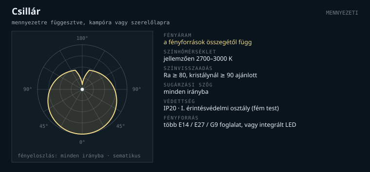
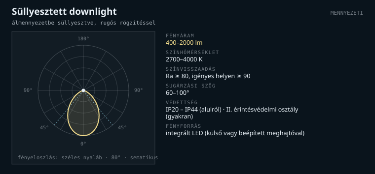
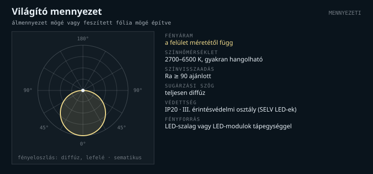
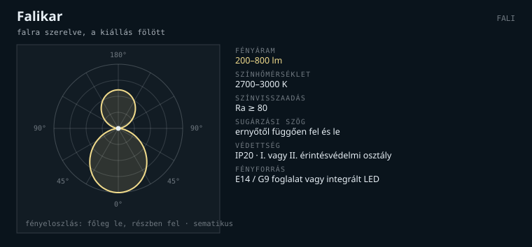
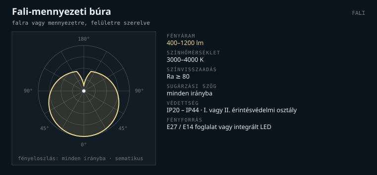
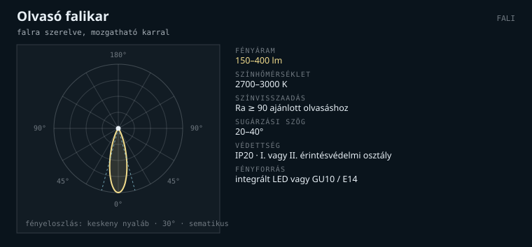
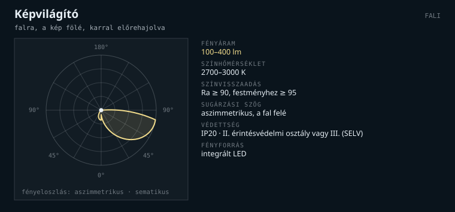
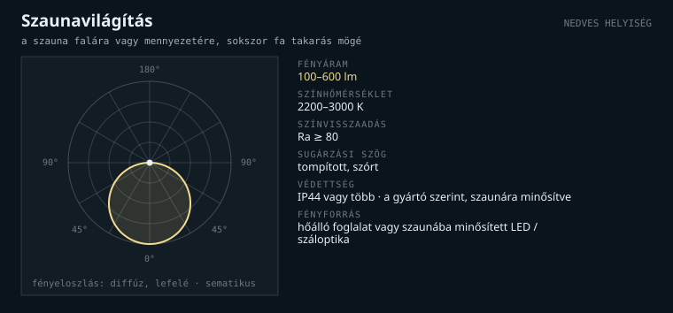

# Lámpák és világítótestek — a Kisokos

*Generálva a kártyákból (`node Kisokos/kisokos.js md`); ne szerkeszd kézzel, a kártyát szerkeszd a `lampak.json`-ban. Egy kártya = egy lámpatest-típus, nem termék. A fényeloszlás-rajz típusonként általános (sematikus), nem egy termék mért adata. Vázlat: minden kártya ellenőrzésre vár; a pontos adat a termék adatlapján van.*

## Gyorstábla

| Típus | Család | Szerelés | Védettség | Fényeloszlás | Rajzjel |
|---|---|---|---|---|---|
| Mennyezeti lámpa (plafonlámpa) | Mennyezeti | mennyezetre, felületre szerelve | IP20 | diffúz, lefelé | `lum.general` |
| LED-korong lámpa („ufó”) | Mennyezeti | mennyezetre vagy falra, felületre szerelve | IP20 – IP65 (kiviteltől függően) | diffúz, lefelé | `lum.general` |
| Búrás mennyezeti lámpa | Mennyezeti | mennyezetre, felületre szerelve | IP20 – IP44 | minden irányba | `lum.general` |
| Csillár | Mennyezeti | mennyezetre függesztve, kampóra vagy szerelőlapra | IP20 | minden irányba | `lum.general` |
| Függeszték | Mennyezeti | mennyezetről zsinóron, láncon vagy acélsodronyon függesztve | IP20 | főleg le, részben fel | `lum.general` |
| LED-panel | Mennyezeti | álmennyezeti raszterbe fektetve, vagy felületre szerelő keretben, vagy függesztve | IP20 – IP44 (alulról IP54-es kivitel is) | denevérszárny (batwing) | `lum.panel` |
| Süllyesztett downlight | Mennyezeti | álmennyezetbe süllyesztve, rugós rögzítéssel | IP20 – IP44 (alulról) | széles nyaláb 80° | `lum.spot` |
| Beépíthető spot | Mennyezeti | álmennyezetbe süllyesztve, rugós keretben | IP20 – IP65 (alulról, fürdős kivitel) | keskeny nyaláb 36° | `lum.spot` |
| Felületre szerelt spot | Mennyezeti | mennyezetre vagy falra, felületre szerelve | IP20 | keskeny nyaláb 40° | `lum.spot` |
| Sínrendszer 230 V | Mennyezeti | mennyezetre szerelve, süllyesztve vagy függesztve | IP20 | keskeny nyaláb 30° | `lum.spot` |
| Mágneses sín 48 V | Mennyezeti | mennyezetbe süllyesztve (keret nélkül is), felületre vagy függesztve | IP20 | keskeny nyaláb 24° | `lum.linear` |
| Világító mennyezet | Mennyezeti | álmennyezet mögé vagy feszített fólia mögé építve | IP20 | diffúz, lefelé | `lum.panel` |
| Falikar | Fali | falra szerelve, a kiállás fölött | IP20 | főleg le, részben fel | `lum.wall` |
| Fali-mennyezeti búra | Fali | falra vagy mennyezetre, felületre szerelve | IP20 – IP44 | minden irányba | `lum.wall` |
| Fel-le világító fali lámpa | Fali | falra, felületre szerelve | IP20 beltérben, IP44 – IP65 kültéren | fel és le 24° | `lum.wall` |
| Olvasó falikar | Fali | falra szerelve, mozgatható karral | IP20 | keskeny nyaláb 30° | `lum.wall` |
| Képvilágító | Fali | falra, a kép fölé, karral előrehajolva | IP20 | aszimmetrikus | `lum.wall` |
| Falba süllyesztett lépcső- és orientációs fény | Fali | falba süllyesztve, szerelvénydobozba vagy saját beépítő dobozba | IP20 beltérben, IP44 – IP65 kültéren | aszimmetrikus | `lum.wall` |
| Fali fényvető (wall washer) | Fali | a fal elé, mennyezetre, padlóba vagy a fal tövébe | IP20 – IP67 (padlóba és kültérre) | aszimmetrikus | `lum.linear` |
| Fürdőszobai mennyezeti lámpa | Nedves helyiség | mennyezetre, felületre szerelve | legalább IP44 (zónától függően több) | diffúz, lefelé | `lum.general` |
| Fürdőszobai beépíthető spot | Nedves helyiség | álmennyezetbe süllyesztve | IP44 – IP65 alulról | széles nyaláb 60° | `lum.spot` |
| Tükörvilágítás | Nedves helyiség | tükör fölé vagy mellé, falra; vagy a tükörbe építve | legalább IP44 | aszimmetrikus | `lum.wall` |
| Páramentes lámpatest | Nedves helyiség | mennyezetre vagy falra, felületre szerelve, csatokkal zárt burkolattal | IP65 | diffúz, lefelé | `lum.linear` |
| Hajólámpa | Nedves helyiség | falra vagy mennyezetre, felületre szerelve | IP54 – IP65 | minden irányba | `lum.outdoor` |
| Szaunavilágítás | Nedves helyiség | a szauna falára vagy mennyezetére, sokszor fa takarás mögé | IP44 vagy több | diffúz, lefelé | `lum.general` |

## 1. Mennyezeti

### Mennyezeti lámpa (plafonlámpa)

*Más néven:* plafonnier, mennyezeti lámpatest, felületre szerelt mennyezeti lámpa

A legalapvetőbb lámpatest: közvetlenül a mennyezetre szerelt test, opál vagy mintás burkolattal, a helyiség általános világítására. Lehet foglalatos (E27, E14) vagy integrált LED-es.

- **Szerelés:** mennyezetre, felületre szerelve
- **Fényforrás:** integrált LED, vagy E27 / E14 foglalat
- **Védettség:** IP20 · I. vagy II. érintésvédelmi osztály
- **Fény:** 1000–4000 lm a helyiség méretétől függően · 2700–4000 K · Ra ≥ 80, igényes helyen ≥ 90 · széles, diffúz
- **Vezérlés:** kapcsolt; dimmelhető kivitel fázishasításos vagy okos (Zigbee, Wi-Fi) vezérléssel; egyes típusokban CCT-állítás (vonalak: Hálózati 50 Hz, 2,4 GHz sáv)
- **Beépítés:**
  - A lámpakiállásnál a vezetéket sorkapocsba kötni; a védővezetőt I. osztályú testnél bekötni.
  - A test súlyához illő rögzítés: két vagy több csavar a mennyezet anyagához választott dübellel.
  - A burkolat cseréjéhez és a tisztításhoz hozzáférés maradjon.
- **Rögzítés:** Beton, Üreges födémpanel, Gipszkarton, Nylon terpesztődübel, Fém üreges fali dübel
- **Előírás:** MSZ EN 60598-1, MSZ EN 60598-2-1 (rögzített lámpatestek)
- **Rajzjel:** `lum.general` (Rajztár)
- **Hova:** szoba, előszoba, folyosó, konyha általános világítása
- **Buktatók:**
  - Egyetlen középső lámpa a helyiség szélein sötét foltot hagy: nagyobb helyiségben kiegészítő fény kell.
  - Olcsó dimmelhető LED villoghat a régi dimmerrel: a dimmer és a lámpa kompatibilitása az adatlapon van.
- **Rokon típusok:** LED-korong lámpa („ufó”), Búrás mennyezeti lámpa, LED-panel
- **Keresőszavak:** HU: mennyezeti lámpa LED 24W · plafonlámpa 4000K — EN: ceiling light LED · flush mount ceiling light — DE: Deckenleuchte LED · Aufbauleuchte
- **Hol kapható:** Villamossági nagykereskedés, lámpaszaküzlet, barkácsáruház.

### LED-korong lámpa („ufó”)

*Más néven:* LED kerek lámpa, ufó lámpa, mozgásérzékelős mennyezeti lámpa

Lapos, kerek, integrált LED-es lámpatest opál burkolattal. Gyakran IP44-es, így előszobába, fürdőbe, pincébe is jó; sok kivitelben mozgás- és fényérzékelővel.

- **Szerelés:** mennyezetre vagy falra, felületre szerelve
- **Fényforrás:** integrált LED
- **Védettség:** IP20 – IP65 (kiviteltől függően) · II. érintésvédelmi osztály (gyakran)
- **Fény:** 800–3000 lm · 3000–4000 K · Ra ≥ 80 · széles, diffúz
- **Vezérlés:** kapcsolt; beépített mozgás- és alkonyérzékelő; vészvilágítási kivitel is van (vonalak: Hálózati 50 Hz)
- **Beépítés:**
  - Mozgásérzékelős kivitelnél az érzékelő látószöge és hatótávolsága határozza meg a helyet.
  - Érzékelős lámpát nem célszerű a falikapcsolóval is kapcsolni: lekapcsolt állapotban nem érzékel.
- **Rögzítés:** Beton, Gipszkarton, Nylon terpesztődübel, Becsavarható gipszkarton dübel
- **Előírás:** MSZ EN 60598-2-1
- **Rajzjel:** `lum.general` (Rajztár)
- **Hova:** előszoba, folyosó, lépcsőház, kamra, pince, fürdő (IP44-es kivitel)
- **Buktatók:**
  - Az integrált LED nem cserélhető: a lámpa élettartama a LED-é és a meghajtóé.
- **Rokon típusok:** Mennyezeti lámpa (plafonlámpa), Fürdőszobai mennyezeti lámpa, Hajólámpa
- **Keresőszavak:** HU: LED mennyezeti lámpa mozgásérzékelős IP44 · LED korong lámpa — EN: LED ceiling light with motion sensor · round LED ceiling light IP44 — DE: LED Deckenleuchte mit Bewegungsmelder · LED Deckenleuchte IP44
- **Hol kapható:** Villamossági nagykereskedés, barkácsáruház.

### Búrás mennyezeti lámpa

*Más néven:* búra, gömblámpa, üvegbúrás lámpa

Foglalatos lámpatest üveg vagy műanyag búrával; a búra minden irányba szórja a fényt, a mennyezetet is megvilágítja. Klasszikus előszoba- és kamralámpa.

- **Szerelés:** mennyezetre, felületre szerelve
- **Fényforrás:** E27 vagy E14 foglalat (LED-fényforrással)
- **Védettség:** IP20 – IP44 · I. vagy II. érintésvédelmi osztály
- **Fény:** a fényforrástól függ: jellemzően 470–1500 lm · a fényforrástól függ · a fényforrástól függ · minden irányba
- **Vezérlés:** kapcsolt; dimmelhető fényforrással dimmelhető (vonalak: Hálózati 50 Hz)
- **Beépítés:**
  - A búra súlya és rögzítése (csavaros, rugós) a cserét is meghatározza.
  - A foglalat hőterhelése: a megadott legnagyobb fényforrás-teljesítményt nem szabad túllépni.
- **Rögzítés:** Beton, Gipszkarton, Nylon terpesztődübel, Fém üreges fali dübel
- **Előírás:** MSZ EN 60598-2-1
- **Rajzjel:** `lum.general` (Rajztár)
- **Hova:** előszoba, kamra, lépcső, régi lakások általános világítása
- **Buktatók:**
  - Zárt búra alatt a nem zárt lámpatestbe szánt LED-fényforrás túlmelegedhet: a fényforrás csomagolása jelzi, ha zárt lámpatestbe is való.
- **Rokon típusok:** Mennyezeti lámpa (plafonlámpa), Fali-mennyezeti búra
- **Keresőszavak:** HU: üvegbúrás mennyezeti lámpa E27 · gömb lámpa — EN: glass globe ceiling light E27 — DE: Glas Deckenleuchte E27 · Kugelleuchte
- **Hol kapható:** Lámpaszaküzlet, barkácsáruház.

### Csillár

*Más néven:* többkarú lámpa, kristálycsillár

Díszítő, többkarú vagy függesztett lámpatest, sokszor több foglalattal. A fényt minden irányba szórja; a súlya és mérete miatt a rögzítése külön figyelmet kér.

- **Szerelés:** mennyezetre függesztve, kampóra vagy szerelőlapra
- **Fényforrás:** több E14 / E27 / G9 foglalat, vagy integrált LED
- **Védettség:** IP20 · I. érintésvédelmi osztály (fém test)
- **Fény:** a fényforrások összegétől függ · jellemzően 2700–3000 K · Ra ≥ 80, kristálynál ≥ 90 ajánlott · minden irányba
- **Vezérlés:** kapcsolt; csillárkapcsolóval két fokozatban (két áramkör); dimmelhető fényforrásokkal dimmelhető (vonalak: Hálózati 50 Hz)
- **Beépítés:**
  - A súlyhoz méretezett rögzítés: födémbe beütős horgony kampóval, üreges födémbe billenő dübel, gipszkarton mennyezeten csak a vázszerkezetre vagy betétre.
  - Csillárkapcsolóhoz háromerű kiállás (két fázisvezető + nulla) és a védővezető.
  - A fém testet a védővezetőhöz kell kötni.
- **Rögzítés:** Beütős horgony, Billenő dübel, Vegyi dübel, Üreges födémpanel, Gipszkarton
- **Előírás:** MSZ EN 60598-2-1
- **Rajzjel:** `lum.general` (Rajztár)
- **Hova:** nappali, étkező, előtér, magas belmagasságú terek
- **Buktatók:**
  - A régi kampó teherbírása ismeretlen: nehéz csillárhoz új rögzítés.
  - Sok kis foglalat sok G9 vagy E14 izzót jelent: a fényforrás-csere a karbantartás része.
- **Rokon típusok:** Függeszték, Mennyezeti lámpa (plafonlámpa)
- **Keresőszavak:** HU: csillár E14 · csillárkampó · csillárkapcsoló — EN: chandelier E14 · ceiling hook · two-gang light switch — DE: Kronleuchter E14 · Deckenhaken · Serienschalter
- **Hol kapható:** Lámpaszaküzlet, lakberendezési áruház.

### Függeszték

*Más néven:* függesztett lámpa, pendant lámpa, étkezőlámpa

Egy vagy több, kábelen lógó lámpatest; az ernyő formája adja a fényt: zárt ernyőnél főleg lefelé, áttetszőnél részben a mennyezetre is. Asztal, pult, sziget fölé.

- **Szerelés:** mennyezetről zsinóron, láncon vagy acélsodronyon függesztve
- **Fényforrás:** E27 / E14 / GU10 foglalat vagy integrált LED
- **Védettség:** IP20 · I. vagy II. érintésvédelmi osztály
- **Fény:** 500–3000 lm testenként · 2700–3000 K (étkező), 3000–4000 K (konyhapult) · Ra ≥ 90 étel és asztal fölé · főleg le, a nyitott ernyőnél részben fel
- **Vezérlés:** kapcsolt vagy dimmelt; okos fényforrással (vonalak: Hálózati 50 Hz, 2,4 GHz sáv, DALI)
- **Beépítés:**
  - A rozetta (mennyezeti takaró) takarja a kiállást és tartja a súlyt.
  - Étkezőasztal fölött jellemzően 60–80 cm-rel az asztallap fölött; a kiállást az asztal tervezett helyéhez kell igazítani.
  - Több függesztékhez sor- vagy kör-rozetta, vagy külön kiállások.
- **Rögzítés:** Beton, Gipszkarton, Fém üreges fali dübel, Billenő dübel
- **Előírás:** MSZ EN 60598-2-1
- **Rajzjel:** `lum.general` (Rajztár)
- **Hova:** étkező, konyhasziget, pult, lépcsőház (hosszú függeszték)
- **Buktatók:**
  - Ha az asztal helye változik, a kiállás rossz helyen marad: előre tervezni, vagy eltolható rozettát választani.
  - A túl alacsony függeszték káprázik és útban van.
- **Rokon típusok:** Csillár, Mennyezeti lámpa (plafonlámpa), Sínrendszer 230 V
- **Keresőszavak:** HU: függeszték lámpa E27 · rozetta · étkezőasztal lámpa — EN: pendant light E27 · ceiling rose · dining table pendant — DE: Pendelleuchte E27 · Baldachin · Esstischleuchte
- **Hol kapható:** Lámpaszaküzlet, lakberendezési áruház.

### LED-panel

*Más néven:* álmennyezeti panel 600×600, LED panel 60x60, raszteres lámpatest

Lapos, négyszögletes lámpatest egyenletes, nagy felületű fénnyel; a 600 × 600-as méret az álmennyezeti rasztert követi. Irodák, rendelők, nagy konyhák.

- **Szerelés:** álmennyezeti raszterbe fektetve, vagy felületre szerelő keretben, vagy függesztve
- **Fényforrás:** integrált LED, külön meghajtóval
- **Védettség:** IP20 – IP44 (alulról IP54-es kivitel is) · II. érintésvédelmi osztály (gyakran)
- **Fény:** 3000–4500 lm (600 × 600) · 3000–4000 K (irodában 4000 K) · Ra ≥ 80 · széles; irodai kivitelben alacsony káprázás (UGR < 19)
- **Vezérlés:** kapcsolt, 1–10 V vagy DALI dimmelés (meghajtótól függ) (vonalak: Analóg jelszint: 0–10 V, 1–10 V, 4–20 mA, DALI, Hálózati 50 Hz)
- **Beépítés:**
  - A meghajtót (drivert) a panel mögött, hozzáférhetően és szellőzve kell elhelyezni.
  - Felületre szerelő keretnél a mennyezet anyagához illő dübel; álmennyezetben a raszter terhelhetősége számít.
- **Rögzítés:** Gipszkarton, Fém üreges fali dübel, Beton
- **Előírás:** MSZ EN 60598-2-2 (süllyesztett lámpatestek), MSZ EN 12464-1 (munkahelyi világítás)
- **Rajzjel:** `lum.panel` (Rajztár)
- **Hova:** iroda, dolgozószoba, rendelő, nagy konyha, garázs
- **Buktatók:**
  - Lakásban a hideg, egyenletes fény könnyen irodaszerű; a színhőmérséklet és a dimmelés számít.
  - Az olcsó meghajtó villódzhat (flicker).
- **Rokon típusok:** Süllyesztett downlight, Mennyezeti lámpa (plafonlámpa)
- **Keresőszavak:** HU: LED panel 60x60 UGR19 · felületre szerelő keret LED panelhez — EN: LED panel 600x600 UGR<19 · surface mount frame — DE: LED Panel 62x62 UGR19 · Aufbaurahmen LED Panel
- **Hol kapható:** Villamossági nagykereskedés.

### Süllyesztett downlight

*Más néven:* beépíthető LED lámpa, mélysugárzó, LED downlight

Az álmennyezetbe süllyesztett, lefelé világító lámpatest; a fényforrás a mennyezet síkja fölött ül, ezért kevésbé káprázik. A mélysugárzó a mélyebben ülő, kis káprázású változat.

- **Szerelés:** álmennyezetbe süllyesztve, rugós rögzítéssel
- **Fényforrás:** integrált LED (külső vagy beépített meghajtóval)
- **Védettség:** IP20 – IP44 (alulról) · II. érintésvédelmi osztály (gyakran)
- **Fény:** 400–2000 lm · 2700–4000 K · Ra ≥ 80, igényes helyen ≥ 90 · 60–100°
- **Vezérlés:** kapcsolt; fázishasításos, 1–10 V vagy DALI dimmelés a meghajtótól függően (vonalak: DALI, Analóg jelszint: 0–10 V, 1–10 V, 4–20 mA, Hálózati 50 Hz)
- **Beépítés:**
  - A kivágás átmérője és a beépítési mélység az adatlapon; a gipszkarton mögött a profil és a vezeték helye előre ellenőrizendő.
  - Hőszigetelés alá vagy közé csak arra minősített lámpatest kerülhet; a meghajtónak hely és szellőzés kell.
  - Kiosztás: egyenletes rács a helyiségben, a faltól nagyjából a lámpák közti távolság felére.
- **Rögzítés:** Gipszkarton, Gipszkarton körkivágó
- **Előírás:** MSZ EN 60598-2-2
- **Rajzjel:** `lum.spot` (Rajztár)
- **Hova:** nappali, konyha, folyosó, fürdő (IP44 alulról)
- **Buktatók:**
  - Túl sok, túl erős downlight hideg, „lyukacsos” mennyezetet ad.
  - A bekötődoboz nélküli meghajtót a gipszkarton mögött nem szabad szabadon hagyni: rögzíteni kell.
- **Rokon típusok:** Beépíthető spot, LED-panel, Fürdőszobai beépíthető spot
- **Keresőszavak:** HU: LED downlight beépíthető · mélysugárzó LED · kivágás 90 mm — EN: recessed LED downlight · cut-out 90 mm — DE: LED Einbaudownlight · Einbauleuchte Ausschnitt 90 mm
- **Hol kapható:** Villamossági nagykereskedés, világítástechnikai szaküzlet.

### Beépíthető spot

*Más néven:* süllyesztett spot, GU10 spot keret, billenthető spot

Keret cserélhető fényforrással (GU10 230 V-on, vagy GU5.3 / MR16 12 V-os tápegységgel) vagy beépített LED-modullal; keskenyebb nyalábbal, sokszor billenthetően, kiemelő és általános világításra.

- **Szerelés:** álmennyezetbe süllyesztve, rugós keretben
- **Fényforrás:** GU10, GU5.3 (12 V), vagy LED-modul
- **Védettség:** IP20 – IP65 (alulról, fürdős kivitel) · I. vagy II. érintésvédelmi osztály
- **Fény:** 300–700 lm spotonként · 2700–4000 K · Ra ≥ 80, kiemeléshez ≥ 90 · 24–60° (fényforrástól függ)
- **Vezérlés:** kapcsolt; dimmelhető fényforrással fázishasításos dimmerrel (vonalak: Hálózati 50 Hz)
- **Beépítés:**
  - A kivágás általában 68–75 mm; a keret mögött a foglalat és a vezeték hely kér.
  - 12 V-os rendszernél a tápegység teljesítménye és a vezetékhossz (feszültségesés) számít.
- **Rögzítés:** Gipszkarton, Gipszkarton körkivágó
- **Előírás:** MSZ EN 60598-2-2
- **Rajzjel:** `lum.spot` (Rajztár)
- **Hova:** konyha, folyosó, nappali kiemelő világítása, fürdő (IP-s kivitel)
- **Buktatók:**
  - A régi halogén keret és egy LED-fényforrás hőben jól illik, de a 12 V-os halogén trafó nem mindig működik LED-del.
  - Keskeny nyalábbal a mennyezet alatti tér foltos.
- **Rokon típusok:** Süllyesztett downlight, Felületre szerelt spot, Fürdőszobai beépíthető spot
- **Keresőszavak:** HU: GU10 spot keret billenthető · beépíthető spotlámpa — EN: GU10 recessed spotlight frame · tiltable downlight — DE: GU10 Einbaustrahler schwenkbar · Einbaurahmen GU10
- **Hol kapható:** Villamossági nagykereskedés, barkácsáruház.

### Felületre szerelt spot

*Más néven:* mennyezeti spot, forgatható spotlámpa, henger spot

Egy vagy több forgatható, billenthető spot alapon vagy rúdon; ott, ahol nincs álmennyezet, de irányított fény kell.

- **Szerelés:** mennyezetre vagy falra, felületre szerelve
- **Fényforrás:** GU10 vagy integrált LED
- **Védettség:** IP20 · I. vagy II. érintésvédelmi osztály
- **Fény:** 300–700 lm spotonként · 2700–4000 K · Ra ≥ 80 · 24–60°
- **Vezérlés:** kapcsolt; dimmelhető fényforrással dimmelhető (vonalak: Hálózati 50 Hz)
- **Beépítés:**
  - Egy kiállásról több spot: a rúd vagy a talp takarja a kiállást.
  - A forgatható fej kábelét ne törje meg a forgatás.
- **Rögzítés:** Beton, Gipszkarton, Nylon terpesztődübel
- **Előírás:** MSZ EN 60598-2-1
- **Rajzjel:** `lum.spot` (Rajztár)
- **Hova:** konyha, folyosó, régi lakás betonmennyezete
- **Buktatók:**
  - A szemmagasságba fordított spot káprázik.
- **Rokon típusok:** Beépíthető spot, Sínrendszer 230 V
- **Keresőszavak:** HU: mennyezeti spotlámpa 3 ágú GU10 — EN: surface mounted spotlight bar — DE: Deckenstrahler GU10 3-flammig
- **Hol kapható:** Lámpaszaküzlet, barkácsáruház.

### Sínrendszer 230 V

*Más néven:* áramsín, egyfázisú sín, háromfázisú sín, sínspot

Fém sín, amelyben a hálózati vezetők futnak; a spotok adapterrel bárhová bepattinthatók és áthelyezhetők. A háromfázisú (három áramkörös) sínen a spotok három csoportban kapcsolhatók.

- **Szerelés:** mennyezetre szerelve, süllyesztve vagy függesztve
- **Fényforrás:** sínadapteres spotok (GU10 vagy integrált LED)
- **Védettség:** IP20 · I. érintésvédelmi osztály
- **Fény:** spotonként 500–3000 lm · 2700–4000 K · Ra ≥ 90 üzletben, kiemelésre · 10–60° (cserélhető optika)
- **Vezérlés:** egy vagy három kapcsolt kör; DALI-sín is van (vonalak: Hálózati 50 Hz, DALI)
- **Beépítés:**
  - A betáplálás a sín végén vagy közepén, a sínrendszer saját betápláló elemével.
  - Egy gyártó sínjei, adapterei és spotjai: a rendszerek nem keverhetők.
  - A sín terhelhetőségét (A) és a spotok összteljesítményét össze kell vetni.
- **Rögzítés:** Beton, Gipszkarton, Fém üreges fali dübel, Beütős horgony
- **Előírás:** MSZ EN 60570 (sínrendszerek)
- **Rajzjel:** `lum.spot` (Rajztár)
- **Hova:** nappali, galéria, konyha, üzlet, bemutatótér
- **Buktatók:**
  - Egyfázisú és háromfázisú adapter nem cserélhető fel.
  - A „háromfázisú” sín lakásban három külön kapcsolt kört jelent, nem 400 V-ot a spotokon.
- **Rokon típusok:** Mágneses sín 48 V, Felületre szerelt spot, Függeszték
- **Keresőszavak:** HU: 3 fázisú sín · sínspot adapter · áramsín betápláló — EN: 3-circuit track · track spotlight · track feed — DE: 3-Phasen Stromschiene · Schienenstrahler · Einspeisung
- **Hol kapható:** Világítástechnikai szaküzlet, villamossági nagykereskedés.

### Mágneses sín 48 V

*Más néven:* mágneses sínrendszer, 48V track, magnetic track

Keskeny, törpefeszültségű (48 V DC) sín, amelybe a lámpamodulok mágnessel pattannak be: spot, vonali fény, függeszték egy rendszerben. A tápegység a sínen kívül van.

- **Szerelés:** mennyezetbe süllyesztve (keret nélkül is), felületre vagy függesztve
- **Fényforrás:** integrált LED-modulok
- **Védettség:** IP20 · III. érintésvédelmi osztály (SELV)
- **Fény:** modulonként 200–2000 lm · 2700–4000 K · Ra ≥ 90 (jellemző) · modultól függően 15–120°
- **Vezérlés:** a tápegység szerint: kapcsolt, DALI, Zigbee vagy saját rendszer (vonalak: DALI, 2,4 GHz sáv)
- **Beépítés:**
  - A tápegység teljesítménye és helye (hozzáférhetően, szellőzve) előre tervezendő.
  - Hosszabb sínszakaszon a feszültségesés miatt több betáplálás kellhet.
  - A süllyesztett, keret nélküli kivitelt a gipszkarton glettelése előtt kell beépíteni.
- **Rögzítés:** Gipszkarton, Fém üreges fali dübel, Beton
- **Előírás:** MSZ EN 60598-1, a tápegységre MSZ EN 61347
- **Rajzjel:** `lum.linear` (Rajztár)
- **Hova:** nappali, konyha, folyosó, modern belsőépítészet
- **Buktatók:**
  - A modulok gyártóhoz kötöttek.
  - A 48 V-os sín nem 230 V-os sín: a két rendszer elemei nem cserélhetők.
- **Rokon típusok:** Sínrendszer 230 V, Süllyesztett downlight
- **Keresőszavak:** HU: mágneses sín 48V · mágneses sín spot · 48V tápegység — EN: 48V magnetic track light · magnetic track spotlight — DE: 48V Magnetschiene · Magnetschienensystem
- **Hol kapható:** Világítástechnikai szaküzlet, villamossági nagykereskedés.

### Világító mennyezet

*Más néven:* feszített fényes mennyezet, világító felület, fénymennyezet

Áttetsző feszített fólia vagy lap mögé szerelt LED-szalagok vagy -modulok egyetlen, egyenletesen világító felületté. Égbolthatású, árnyékmentes fény.

- **Szerelés:** álmennyezet mögé vagy feszített fólia mögé építve
- **Fényforrás:** LED-szalag vagy LED-modulok tápegységgel
- **Védettség:** IP20 · III. érintésvédelmi osztály (SELV LED-ek)
- **Fény:** a felület méretétől függ · 2700–6500 K, gyakran hangolható · Ra ≥ 90 ajánlott · teljesen diffúz
- **Vezérlés:** DALI, 1–10 V vagy okos vezérlés; hangolható fehérnél két csatorna (vonalak: DALI, Analóg jelszint: 0–10 V, 1–10 V, 4–20 mA, 2,4 GHz sáv)
- **Beépítés:**
  - Az egyenletességhez a LED-ek és a fólia közti távolság számít: a gyártói távolságot tartani kell.
  - A tápegységek és a csatlakozások szervizelhetősége: bontható szakasz vagy revíziós nyílás.
  - A feszített mennyezet szerelőjével együtt kell tervezni.
- **Rögzítés:** Beton, Gipszkarton, Nylon terpesztődübel
- **Előírás:** MSZ EN 60598-1, MSZ EN 62471 (fotobiológiai biztonság)
- **Rajzjel:** `lum.panel` (Rajztár)
- **Hova:** fürdő, ablak nélküli helyiség, konyha, belsőépítészeti hangsúly
- **Buktatók:**
  - Túl kevés LED vagy túl kis távolság csíkos, pöttyös felületet ad.
  - A fólia mögötti meghibásodás javítása bontással jár.
- **Rokon típusok:** LED-panel, Mennyezeti lámpa (plafonlámpa)
- **Keresőszavak:** HU: feszített mennyezet világító · LED szalag fénymennyezethez — EN: backlit stretch ceiling · luminous ceiling — DE: Lichtdecke · beleuchtete Spanndecke
- **Hol kapható:** Feszített mennyezet szerelő, világítástechnikai szaküzlet.

## 2. Fali

### Falikar

*Más néven:* fali lámpa, fali dekorlámpa

Falra szerelt lámpa ernyővel vagy búrával; hangulat- és kiegészítő világítás, sokszor párban (ágy két oldalán, tükör mellett, folyosón).

- **Szerelés:** falra szerelve, a kiállás fölött
- **Fényforrás:** E14 / G9 foglalat vagy integrált LED
- **Védettség:** IP20 · I. vagy II. érintésvédelmi osztály
- **Fény:** 200–800 lm · 2700–3000 K · Ra ≥ 80 · ernyőtől függően fel és le
- **Vezérlés:** kapcsolt; a lámpán lévő kapcsolóval vagy falikapcsolóval (vonalak: Hálózati 50 Hz)
- **Beépítés:**
  - A fali kiállás magassága jellemzően 1,6–1,9 m, ágy fölött a fejtámlához igazítva.
  - A kiállás a lámpatest talpa alá essen: a pontos helyet a választott lámpa adja.
- **Rögzítés:** Tömör tégla, Üreges kerámia falazóblokk, Gipszkarton, Nylon terpesztődübel, Univerzális dübel, Fém üreges fali dübel
- **Előírás:** MSZ EN 60598-2-1
- **Rajzjel:** `lum.wall` (Rajztár)
- **Hova:** hálószoba, nappali, folyosó, lépcső
- **Buktatók:**
  - A kiállást a lámpa kiválasztása előtt elhelyezve a talp nem takarja a dobozt.
- **Rokon típusok:** Fali-mennyezeti búra, Fel-le világító fali lámpa, Olvasó falikar
- **Keresőszavak:** HU: falikar E14 · fali lámpa nappaliba — EN: wall sconce E14 · wall light — DE: Wandleuchte E14 · Wandlampe
- **Hol kapható:** Lámpaszaküzlet, lakberendezési áruház.

### Fali-mennyezeti búra

*Más néven:* fali búra, fali-mennyezeti lámpa

Kis, búrás vagy opál burkolatú lámpatest, falra és mennyezetre is szerelhető; folyosók, lépcsők, kamrák, kisebb helyiségek alaplámpája.

- **Szerelés:** falra vagy mennyezetre, felületre szerelve
- **Fényforrás:** E27 / E14 foglalat vagy integrált LED
- **Védettség:** IP20 – IP44 · I. vagy II. érintésvédelmi osztály
- **Fény:** 400–1200 lm · 3000–4000 K · Ra ≥ 80 · minden irányba
- **Vezérlés:** kapcsolt; mozgásérzékelős kivitelben is (vonalak: Hálózati 50 Hz)
- **Beépítés:**
  - Falra szerelve a magasság a helyiség funkciójához igazodik; lépcsőn a lépcsőfokokat ne a szembe világítsa.
- **Rögzítés:** Tömör tégla, Üreges kerámia falazóblokk, Beton, Nylon terpesztődübel, Univerzális dübel
- **Előírás:** MSZ EN 60598-2-1
- **Rajzjel:** `lum.wall` (Rajztár)
- **Hova:** folyosó, lépcső, kamra, mosókonyha
- **Buktatók:**
  - Zárt búrában a fényforrás melegszik: arra alkalmas LED kell.
- **Rokon típusok:** Búrás mennyezeti lámpa, Falikar, Hajólámpa
- **Keresőszavak:** HU: fali mennyezeti lámpa E27 — EN: wall ceiling light E27 — DE: Wand- und Deckenleuchte E27
- **Hol kapható:** Barkácsáruház, lámpaszaküzlet.

### Fel-le világító fali lámpa

*Más néven:* up-down lámpa, kétirányú fali spot

Henger vagy hasáb alakú fali lámpa, amely egy keskeny nyalábot felfelé, egyet lefelé küld; a falon jellegzetes fénycsíkot rajzol. Beltéri és IP-s kültéri kivitelben is.

- **Szerelés:** falra, felületre szerelve
- **Fényforrás:** 2 × GU10 vagy integrált LED
- **Védettség:** IP20 beltérben, IP44 – IP65 kültéren · I. vagy II. érintésvédelmi osztály
- **Fény:** 300–1000 lm · 2700–3000 K · Ra ≥ 80 · két keskeny nyaláb, 10–40°
- **Vezérlés:** kapcsolt; dimmelhető fényforrással (vonalak: Hálózati 50 Hz)
- **Beépítés:**
  - Pontos, egyenes felszerelés: a ferde lámpa ferde fénycsíkot rajzol.
  - Több lámpánál egyforma magasság és köz.
- **Rögzítés:** Tömör tégla, Üreges kerámia falazóblokk, Gipszkarton, Nylon terpesztődübel, Univerzális dübel
- **Előírás:** MSZ EN 60598-2-1
- **Rajzjel:** `lum.wall` (Rajztár)
- **Hova:** folyosó, nappali hangulatfény, bejárat (kültéri kivitel)
- **Buktatók:**
  - Önmagában kevés fényt ad a helyiségbe: hangulatvilágítás.
- **Rokon típusok:** Falikar, Fali fényvető (wall washer)
- **Keresőszavak:** HU: fel le világító fali lámpa — EN: up down wall light — DE: Up-Down Wandleuchte
- **Hol kapható:** Lámpaszaküzlet, barkácsáruház.

### Olvasó falikar

*Más néven:* olvasólámpa falra, flexibilis karú fali lámpa, ágy melletti lámpa

Irányítható karú vagy hajlítható nyakú fali lámpa keskeny nyalábbal, olvasáshoz; sokszor saját kapcsolóval, néha USB-töltővel.

- **Szerelés:** falra szerelve, mozgatható karral
- **Fényforrás:** integrált LED vagy GU10 / E14
- **Védettség:** IP20 · I. vagy II. érintésvédelmi osztály
- **Fény:** 150–400 lm · 2700–3000 K · Ra ≥ 90 ajánlott olvasáshoz · 20–40°
- **Vezérlés:** a lámpán lévő kapcsolóval vagy érintéssel; néha dimmelhető (vonalak: Hálózati 50 Hz)
- **Beépítés:**
  - Ágy mellett a fejtámla fölött, a fekvő és ülő olvasáshoz igazítva; a kiállás a talp alá kerüljön.
  - Ha a lámpán kapcsoló van, a kiállás folyamatos fázist kaphat, vagy kapcsolt kört a falikapcsolóval.
- **Rögzítés:** Tömör tégla, Gipszkarton, Nylon terpesztődübel, Fém üreges fali dübel
- **Előírás:** MSZ EN 60598-2-1
- **Rajzjel:** `lum.wall` (Rajztár)
- **Hova:** hálószoba, olvasósarok, szálloda
- **Buktatók:**
  - A másik ágy felé világító nyaláb zavar: keskeny nyaláb, jó irányítás.
- **Rokon típusok:** Falikar
- **Keresőszavak:** HU: olvasólámpa falra USB · ágy melletti fali lámpa — EN: bedside wall reading light — DE: Leselampe Wand · Bettleuchte
- **Hol kapható:** Lámpaszaküzlet, lakberendezési áruház.

### Képvilágító

*Más néven:* festményvilágító, picture light

A kép fölé szerelt, előre hajló karú lámpa, amely ferdén a képre világít; aszimmetrikus, a fal felé eső fényeloszlással.

- **Szerelés:** falra, a kép fölé, karral előrehajolva
- **Fényforrás:** integrált LED
- **Védettség:** IP20 · II. érintésvédelmi osztály vagy III. (SELV)
- **Fény:** 100–400 lm · 2700–3000 K · Ra ≥ 90, festményhez ≥ 95 · aszimmetrikus, a fal felé
- **Vezérlés:** kapcsolt vagy dimmelt (vonalak: Hálózati 50 Hz)
- **Beépítés:**
  - A kiállás a kép fölött, a lámpa talpa alá; a kép helye és mérete előre egyeztetendő.
- **Rögzítés:** Tömör tégla, Gipszkarton, Nylon terpesztődübel, Fém üreges fali dübel
- **Előírás:** MSZ EN 60598-2-1
- **Rajzjel:** `lum.wall` (Rajztár)
- **Hova:** nappali, folyosó, galéria
- **Buktatók:**
  - Az UV- és hősugárzás a festményt károsíthatja: LED-es, UV-mentes fényforrás.
- **Rokon típusok:** Fali fényvető (wall washer)
- **Keresőszavak:** HU: képvilágító LED — EN: LED picture light — DE: LED Bilderleuchte
- **Hol kapható:** Lámpaszaküzlet.

### Falba süllyesztett lépcső- és orientációs fény

*Más néven:* lépcsővilágítás, orientációs fény, falba süllyesztett lámpa

Alacsonyan, a falba süllyesztett kis lámpa, amely lefelé, a padlóra és a lépcsőfokra világít; éjszakai tájékozódásra és lépcsőkhöz. Sok típus a szabványos szerelvénydobozba illik.

- **Szerelés:** falba süllyesztve, szerelvénydobozba vagy saját beépítő dobozba
- **Fényforrás:** integrált LED (230 V vagy 12–24 V)
- **Védettség:** IP20 beltérben, IP44 – IP65 kültéren · II. vagy III. érintésvédelmi osztály
- **Fény:** 20–200 lm · 2700–3000 K · Ra ≥ 80 · aszimmetrikus, lefelé a padlóra
- **Vezérlés:** kapcsolt, mozgásérzékelővel, alkonykapcsolóval vagy okos vezérléssel; éjszakai, gyenge fokozat (vonalak: Hálózati 50 Hz, 2,4 GHz sáv)
- **Beépítés:**
  - Szerelvénydobozba illő típusnál a dobozt a fal síkjában és vízszintesen kell beépíteni (dobozfúró).
  - Lépcsőnél jellemzően a fokok fölött 20–40 cm-rel; minden fokhoz vagy minden másodikhoz.
  - 12–24 V-os kivitelnél a tápegység helye és hozzáférhetősége.
- **Rögzítés:** Dobozfúró korona, Üreges kerámia falazóblokk, Gipszkarton, Gipszkarton körkivágó
- **Előírás:** MSZ EN 60598-2-2
- **Rajzjel:** `lum.wall` (Rajztár)
- **Hova:** lépcső, folyosó, hálószoba éjszakai fénye, terasz
- **Buktatók:**
  - A doboz helyét a burkolat és a lépcsőfokok végleges síkjához kell igazítani.
- **Rokon típusok:** Fali fényvető (wall washer), Fali-mennyezeti búra
- **Keresőszavak:** HU: lépcsővilágító lámpa falba süllyesztett · orientációs fény szerelvénydobozba — EN: recessed step light · orientation light for flush box — DE: Treppenstufenleuchte Unterputz · Orientierungsleuchte UP-Dose
- **Hol kapható:** Villamossági nagykereskedés, lámpaszaküzlet.

### Fali fényvető (wall washer)

*Más néven:* falmosó lámpa, wall washer, wall grazer

A falfelületet egyenletesen „mosó” vagy súrolófényben kirajzoló, aszimmetrikus lámpatest; a falat teszi világossá, nem a teret. Kőfal, tégla, textúra kiemelésére.

- **Szerelés:** a fal elé, mennyezetre, padlóba vagy a fal tövébe
- **Fényforrás:** integrált LED
- **Védettség:** IP20 – IP67 (padlóba és kültérre) · II. vagy III. érintésvédelmi osztály
- **Fény:** 500–3000 lm · 2700–4000 K · Ra ≥ 90 · aszimmetrikus, a fal felé
- **Vezérlés:** kapcsolt, DALI vagy 1–10 V dimmelés (vonalak: DALI, Analóg jelszint: 0–10 V, 1–10 V, 4–20 mA)
- **Beépítés:**
  - A faltól mért távolság határozza meg az egyenletességet: a gyártói távolságot kell tartani.
  - Súrolófénynél (közel a falhoz) minden falhiba látszik: előtte a fal síkja.
- **Rögzítés:** Beton, Gipszkarton, Fém üreges fali dübel
- **Előírás:** MSZ EN 60598-2-2
- **Rajzjel:** `lum.linear` (Rajztár)
- **Hova:** nappali, előtér, lépcsőház, homlokzat (kültéri kivitel)
- **Buktatók:**
  - A súrolófény minden glettelési hibát kiemel.
- **Rokon típusok:** Képvilágító, Fel-le világító fali lámpa
- **Keresőszavak:** HU: wall washer LED · falmosó lámpatest — EN: LED wall washer · wall grazer — DE: Wandfluter LED
- **Hol kapható:** Világítástechnikai szaküzlet.

## 6. Nedves helyiség

### Fürdőszobai mennyezeti lámpa

*Más néven:* IP44 mennyezeti lámpa, fürdőszobalámpa

A fürdő általános világítása párától és fröccsenő víztől védett (legalább IP44) lámpatesttel. A szabvány a fürdőt zónákra osztja; a zóna határozza meg, mi és milyen védettséggel szerelhető oda.

- **Szerelés:** mennyezetre, felületre szerelve
- **Fényforrás:** integrált LED vagy E27 zárt búrában
- **Védettség:** legalább IP44 (zónától függően több) · I. vagy II. érintésvédelmi osztály
- **Fény:** 1000–2500 lm · 3000–4000 K · Ra ≥ 90 (bőrszín, sminkelés) · széles, diffúz
- **Vezérlés:** kapcsolt; a kapcsoló a fürdőn kívül vagy a zónákon kívül; páraelszívóval együtt is (vonalak: Hálózati 50 Hz)
- **Beépítés:**
  - A zónák (0, 1, 2) a kád és a zuhany körül; zóna 1-be és 2-be legalább IPX4, vízsugárnak kitett helyen IPX5. A pontos feltételeket a szabvány adja.
  - A fürdő áramköreit áram-védőkapcsoló védje.
  - Pára: a lámpatest tömítése és a kábelbevezetés tömszelencéje.
- **Rögzítés:** Beton, Gipszkarton, Csempe, járólap, Nylon terpesztődübel
- **Előírás:** MSZ HD 60364-7-701 (fürdő- és zuhanyhelyiségek), MSZ EN 60598-2-1
- **Rajzjel:** `lum.general` (Rajztár)
- **Hova:** fürdőszoba, zuhanyzó, mosdó
- **Buktatók:**
  - A zónán belüli nem megfelelő IP-jű lámpatest balesetveszélyes és szabálytalan.
  - Hideg, gyenge színvisszaadású fény a tükörben rossz arcképet ad.
- **Rokon típusok:** Fürdőszobai beépíthető spot, Tükörvilágítás, LED-korong lámpa („ufó”)
- **Keresőszavak:** HU: fürdőszobai mennyezeti lámpa IP44 — EN: bathroom ceiling light IP44 — DE: Badezimmer Deckenleuchte IP44
- **Hol kapható:** Villamossági nagykereskedés, lámpaszaküzlet.

### Fürdőszobai beépíthető spot

*Más néven:* zuhanyspot, IP65 downlight, vízálló spot

Alulról vízálló (IP44 – IP65) beépíthető spot vagy downlight a fürdő álmennyezetébe, akár a zuhany fölé; a zónától függően törpefeszültségű kivitelben.

- **Szerelés:** álmennyezetbe süllyesztve
- **Fényforrás:** integrált LED vagy zárt GU10 / GU5.3 keret
- **Védettség:** IP44 – IP65 alulról · II. vagy III. érintésvédelmi osztály
- **Fény:** 300–900 lm · 3000–4000 K · Ra ≥ 90 · 36–90°
- **Vezérlés:** kapcsolt; dimmelhető kivitelben is (vonalak: Hálózati 50 Hz)
- **Beépítés:**
  - Zóna 1-ben (a zuhany vagy a kád fölött) a szabvány szerinti védettség és táplálás; a tápegység a zónákon kívül.
  - A tömítés a kerettel és az üveggel együtt alulról számít: a keret mögött pára gyűlhet, ezért szellőzés és tömszelence.
- **Rögzítés:** Gipszkarton, Gipszkarton körkivágó
- **Előírás:** MSZ HD 60364-7-701, MSZ EN 60598-2-2
- **Rajzjel:** `lum.spot` (Rajztár)
- **Hova:** fürdő, zuhanyzó, szauna előtere
- **Buktatók:**
  - Az IP44 elég a zóna 2-ben, de a zuhanysugár alá IPX5 vagy jobb kell.
- **Rokon típusok:** Süllyesztett downlight, Beépíthető spot, Fürdőszobai mennyezeti lámpa
- **Keresőszavak:** HU: IP65 beépíthető spot zuhany fölé — EN: IP65 shower downlight — DE: IP65 Einbaustrahler Dusche
- **Hol kapható:** Villamossági nagykereskedés, világítástechnikai szaküzlet.

### Tükörvilágítás

*Más néven:* tükörlámpa, tükör fölötti lámpa, világító tükör

A tükör előtt álló arcát világítja meg; a legjobb, ha két oldalról vagy a tükör körül szórt fény jön, mert a csak felülről érkező fény árnyékot vet az arcra.

- **Szerelés:** tükör fölé vagy mellé, falra; vagy a tükörbe építve
- **Fényforrás:** integrált LED
- **Védettség:** legalább IP44 · II. érintésvédelmi osztály (gyakran)
- **Fény:** 500–1500 lm · 3000–4000 K, sokszor hangolható · Ra ≥ 90 · széles, az arc felé
- **Vezérlés:** kapcsolt; érintőkapcsoló a tükrön, páramentesítő fűtéssel együtt (vonalak: Hálózati 50 Hz)
- **Beépítés:**
  - A kiállás helye a tükör vagy a tükrös szekrény méretéhez; világító tükörnél a tükör mögött.
  - A mosdó a zónákon kívül esik, de a fröccsenő víz miatt IP44 ajánlott.
- **Rögzítés:** Csempe, járólap, Tömör tégla, Üreges kerámia falazóblokk, Gipszkarton, Nylon terpesztődübel
- **Előírás:** MSZ HD 60364-7-701, MSZ EN 60598-2-1
- **Rajzjel:** `lum.wall` (Rajztár)
- **Hova:** fürdő, mosdó, öltözőasztal
- **Buktatók:**
  - Csak felülről érkező fény az arcon árnyékot vet.
  - A tükrös szekrény és a világító tükör méretéhez a kiállást a megrendelés előtt kell rögzíteni.
- **Rokon típusok:** Fürdőszobai mennyezeti lámpa, Falikar
- **Keresőszavak:** HU: tükörlámpa LED IP44 · világító tükör érintőkapcsolós — EN: LED mirror light IP44 · illuminated mirror — DE: Spiegelleuchte LED IP44 · Lichtspiegel
- **Hol kapható:** Fürdőszoba-szaküzlet, lámpaszaküzlet.

### Páramentes lámpatest

*Más néven:* IP65 armatúra, páramentes LED-armatúra, vízmentes lámpa

Hosszúkás, tömített (IP65) lámpatest műanyag házzal és búrával; garázs, pince, műhely, mosókonyha, istálló világítására. LED-cső vagy integrált LED világít benne.

- **Szerelés:** mennyezetre vagy falra, felületre szerelve, csatokkal zárt burkolattal
- **Fényforrás:** integrált LED vagy T8 LED-cső
- **Védettség:** IP65 · IK08 vagy jobb · I. vagy II. érintésvédelmi osztály
- **Fény:** 2000–6000 lm (hossztól függően) · 4000–6500 K · Ra ≥ 80 · széles
- **Vezérlés:** kapcsolt; mozgásérzékelős vagy vészvilágítási kivitelben is (vonalak: Hálózati 50 Hz)
- **Beépítés:**
  - A kábelt tömszelencén át kell bevezetni, és a tömítést visszazárni.
  - Sorolható kivitelnél a lámpák egymásról kapnak tápot: a betáplálás és az átkötés a lámpában.
- **Rögzítés:** Beton, Tömör tégla, Nylon terpesztődübel, Beütős dübel
- **Előírás:** MSZ EN 60598-2-1
- **Rajzjel:** `lum.linear` (Rajztár)
- **Hova:** garázs, pince, műhely, mosókonyha, kazánház
- **Buktatók:**
  - A nyitva hagyott vagy rosszul visszazárt tömszelence után a lámpa nem IP65.
  - Fénycsöves régi armatúra LED-csőre cserélésénél a gyújtó és az előtét kezelése a LED-cső típusától függ.
- **Rokon típusok:** Hajólámpa, LED-panel
- **Keresőszavak:** HU: páramentes lámpatest LED IP65 120 cm — EN: LED vapour-tight batten IP65 — DE: LED Feuchtraumleuchte IP65
- **Hol kapható:** Villamossági nagykereskedés, barkácsáruház.

### Hajólámpa

*Más néven:* bulkhead lámpa, ovális hajólámpa, rácsos hajólámpa

Kis, tömített, ütésálló lámpatest búrával, sokszor védőráccsal; pincében, kamrában, kazánházban, kültéren a bejárat mellett.

- **Szerelés:** falra vagy mennyezetre, felületre szerelve
- **Fényforrás:** E27 foglalat vagy integrált LED
- **Védettség:** IP54 – IP65 · IK08 – IK10 (rácsos kivitel) · I. vagy II. érintésvédelmi osztály
- **Fény:** 500–1500 lm · 3000–4000 K · Ra ≥ 80 · minden irányba
- **Vezérlés:** kapcsolt; mozgásérzékelős kivitelben is (vonalak: Hálózati 50 Hz)
- **Beépítés:**
  - Kültéren a kábelbevezetés alulról, tömszelencével, hogy a víz ne folyjon be.
- **Rögzítés:** Tömör tégla, Beton, Hőszigetelt homlokzat, Nylon terpesztődübel, Rögzítő hőszigetelt homlokzathoz
- **Előírás:** MSZ EN 60598-2-1
- **Rajzjel:** `lum.outdoor` (Rajztár)
- **Hova:** pince, kamra, kazánház, garázs, bejárat
- **Buktatók:**
  - Hőszigetelt homlokzatra a szigetelésen át, távtartó rögzítővel.
- **Rokon típusok:** Páramentes lámpatest, Fali-mennyezeti búra, LED-korong lámpa („ufó”)
- **Keresőszavak:** HU: hajólámpa IP65 · rácsos hajólámpa E27 — EN: bulkhead light IP65 — DE: Ovalleuchte IP65 · Kellerleuchte
- **Hol kapható:** Barkácsáruház, villamossági nagykereskedés.

### Szaunavilágítás

*Más néven:* szaunalámpa, hőálló lámpatest, szauna LED

A szauna hőmérsékletére minősített, magas hőállóságú, nedvességálló lámpatest; a fényt jellemzően fa ráccsal tompítják. Gyakran törpefeszültségű LED, a tápegység a kabinon kívül.

- **Szerelés:** a szauna falára vagy mennyezetére, sokszor fa takarás mögé
- **Fényforrás:** hőálló foglalat vagy szaunába minősített LED / száloptika
- **Védettség:** IP44 vagy több · a gyártó szerint, szaunára minősítve
- **Fény:** 100–600 lm · 2200–3000 K · Ra ≥ 80 · tompított, szórt
- **Vezérlés:** kapcsolt, a kabinon kívülről (vonalak: Hálózati 50 Hz)
- **Beépítés:**
  - A szauna-helyiség szabályai: hőmérsékleti zónák, a kályha körüli tilos terület, a vezetékek hőállósága.
  - A tápegység és a kapcsoló a kabinon kívül.
- **Rögzítés:** Fa
- **Előírás:** MSZ HD 60364-7-703 (szaunák), MSZ EN 60598-2-1
- **Rajzjel:** `lum.general` (Rajztár)
- **Hova:** szauna, gőzkabin (külön minősítéssel)
- **Buktatók:**
  - Nem szaunára minősített LED a hőtől hamar tönkremegy.
  - A kályha fölé szerelt lámpa túlmelegszik.
- **Rokon típusok:** Fürdőszobai mennyezeti lámpa
- **Keresőszavak:** HU: szauna lámpa hőálló · szauna LED világítás — EN: sauna light heat resistant · sauna LED lighting — DE: Saunaleuchte · Sauna LED Beleuchtung
- **Hol kapható:** Szaunaszaküzlet, wellness-forgalmazó.
