# Lámpák és világítótestek — a Kisokos

*Generálva a kártyákból (`node Kisokos/kisokos.js md`); ne szerkeszd kézzel, a kártyát szerkeszd a `lampak.json`-ban. Egy kártya = egy lámpatest-típus, nem termék. A fényeloszlás-rajz típusonként általános (sematikus), nem egy termék mért adata. Vázlat: minden kártya ellenőrzésre vár; a pontos adat a termék adatlapján van.*

## Gyorstábla

| Típus | Család | Szerelés | Védettség | Fényeloszlás | Rajzjel |
|---|---|---|---|---|---|
| Mennyezeti lámpa (plafonlámpa) | Mennyezeti | mennyezetre, felületre szerelve | IP20 | diffúz, lefelé | `lum.general` |
| LED-korong lámpa („ufó”) | Mennyezeti | mennyezetre vagy falra, felületre szerelve | IP20 – IP65 (kiviteltől függően) | diffúz, lefelé | `lum.general` |
| Búrás mennyezeti lámpa | Mennyezeti | mennyezetre, felületre szerelve | IP20 – IP44 | minden irányba | `lum.general` |
| Csillár | Mennyezeti | mennyezetre függesztve, kampóra vagy szerelőlapra | IP20 | minden irányba | `lum.general` |
| Függeszték | Mennyezeti | mennyezetről zsinóron, láncon vagy acélsodronyon függesztve | IP20 | főleg le, részben fel | `lum.general` |
| LED-panel | Mennyezeti | álmennyezeti raszterbe fektetve, vagy felületre szerelő keretben, vagy függesztve | IP20 – IP44 (alulról IP54-es kivitel is) | denevérszárny (batwing) | `lum.panel` |
| Süllyesztett downlight | Mennyezeti | álmennyezetbe süllyesztve, rugós rögzítéssel | IP20 – IP44 (alulról) | széles nyaláb 80° | `lum.spot` |
| Beépíthető spot | Mennyezeti | álmennyezetbe süllyesztve, rugós keretben | IP20 – IP65 (alulról, fürdős kivitel) | keskeny nyaláb 36° | `lum.spot` |
| Felületre szerelt spot | Mennyezeti | mennyezetre vagy falra, felületre szerelve | IP20 | keskeny nyaláb 40° | `lum.spot` |
| Sínrendszer 230 V | Mennyezeti | mennyezetre szerelve, süllyesztve vagy függesztve | IP20 | keskeny nyaláb 30° | `lum.spot` |
| Mágneses sín 48 V | Mennyezeti | mennyezetbe süllyesztve (keret nélkül is), felületre vagy függesztve | IP20 | keskeny nyaláb 24° | `lum.linear` |
| Világító mennyezet | Mennyezeti | álmennyezet mögé vagy feszített fólia mögé építve | IP20 | diffúz, lefelé | `lum.panel` |
| Falikar | Fali | falra szerelve, a kiállás fölött | IP20 | főleg le, részben fel | `lum.wall` |
| Fali-mennyezeti búra | Fali | falra vagy mennyezetre, felületre szerelve | IP20 – IP44 | minden irányba | `lum.wall` |
| Fel-le világító fali lámpa | Fali | falra, felületre szerelve | IP20 beltérben, IP44 – IP65 kültéren | fel és le 24° | `lum.wall` |
| Olvasó falikar | Fali | falra szerelve, mozgatható karral | IP20 | keskeny nyaláb 30° | `lum.wall` |
| Képvilágító | Fali | falra, a kép fölé, karral előrehajolva | IP20 | aszimmetrikus | `lum.wall` |
| Falba süllyesztett lépcső- és orientációs fény | Fali | falba süllyesztve, szerelvénydobozba vagy saját beépítő dobozba | IP20 beltérben, IP44 – IP65 kültéren | aszimmetrikus | `lum.wall` |
| Fali fényvető (wall washer) | Fali | a fal elé, mennyezetre, padlóba vagy a fal tövébe | IP20 – IP67 (padlóba és kültérre) | aszimmetrikus | `lum.linear` |
| LED-szalag (12 / 24 V) | Rejtett és vonali | alumínium profilba ragasztva, vagy közvetlenül felületre | IP20 beltérben, IP54 – IP67 szilikonbevonattal | széles nyaláb 120° | `lum.strip` |
| Hálózati feszültségű LED-szalag (230 V) | Rejtett és vonali | felületre, klipszekkel vagy profilban | IP65 – IP67 | széles nyaláb 120° | `lum.strip` |
| Alumínium profil LED-szalaghoz | Rejtett és vonali | felületre, süllyesztve (falba, bútorba, gipszkartonba), sarokba vagy függesztve | IP20 (tömítéssel IP44 – IP65) | diffúz, lefelé | `lum.linear` |
| LED neon flex | Rejtett és vonali | rögzítőklipszekkel vagy profilban, hajlítva | IP65 – IP68 | széles nyaláb 120° | `lum.strip` |
| Rejtett (indirekt) világítás párkányban | Rejtett és vonali | gipszkarton párkány, koronaléc vagy kazetta mögé rejtve | IP20 | aszimmetrikus | `lum.strip` |
| Keret nélküli (trimless) beépítés | Rejtett és vonali | gipszkartonba vagy vakolatba beépítve és a felülettel egy síkba glettelve | IP20 | keskeny nyaláb 36° | `lum.spot` |
| Árnyékfuga- és lábazatvilágítás | Rejtett és vonali | a padló és a fal találkozásánál, árnyékfugába vagy szegélyprofilba | IP20 – IP44 | aszimmetrikus | `lum.strip` |
| Konyhai pult alatti világítás | Bútor és beépített | a felső konyhaszekrények alá, a fal közelébe | IP20 – IP44 | diffúz, lefelé | `lum.linear` |
| Szekrény- és gardróbvilágítás | Bútor és beépített | a szekrény belső tetejére, oldalára vagy a ruharúdba | IP20 | diffúz, lefelé | `lum.strip` |
| Polc- és vitrinvilágítás | Bútor és beépített | polc elejébe vagy aljába, üvegpolc élébe, vitrin tetejébe | IP20 | keskeny nyaláb 40° | `lum.strip` |
| Bútorspot | Bútor és beépített | bútorba süllyesztve vagy felületre szerelve | IP20 – IP44 | keskeny nyaláb 45° | `lum.spot` |
| Ágy alatti orientációs fény | Bútor és beépített | az ágy keretének aljára | IP20 | aszimmetrikus | `lum.strip` |
| Lépcsőfokba épített világítás | Bútor és beépített | minden lépcsőfok élébe vagy alá profilban | IP20 – IP44 | aszimmetrikus | `lum.strip` |
| Fürdőszobai mennyezeti lámpa | Nedves helyiség | mennyezetre, felületre szerelve | legalább IP44 (zónától függően több) | diffúz, lefelé | `lum.general` |
| Fürdőszobai beépíthető spot | Nedves helyiség | álmennyezetbe süllyesztve | IP44 – IP65 alulról | széles nyaláb 60° | `lum.spot` |
| Tükörvilágítás | Nedves helyiség | tükör fölé vagy mellé, falra; vagy a tükörbe építve | legalább IP44 | aszimmetrikus | `lum.wall` |
| Páramentes lámpatest | Nedves helyiség | mennyezetre vagy falra, felületre szerelve, csatokkal zárt burkolattal | IP65 | diffúz, lefelé | `lum.linear` |
| Hajólámpa | Nedves helyiség | falra vagy mennyezetre, felületre szerelve | IP54 – IP65 | minden irányba | `lum.outdoor` |
| Szaunavilágítás | Nedves helyiség | a szauna falára vagy mennyezetére, sokszor fa takarás mögé | IP44 vagy több | diffúz, lefelé | `lum.general` |
| Kültéri falikar | Kültéri | homlokzatra, a bejárat, terasz, garázs mellé | IP44 – IP65 | főleg le, részben fel | `lum.outdoor` |
| Mozgásérzékelős reflektor | Kültéri | homlokzatra, eresz alá, oszlopra | IP65 | széles nyaláb 100° | `lum.flood` |
| Kerti oszloplámpa (bollard) | Kültéri | talajba betonozott alapra vagy rögzítőtüskére, 30–100 cm magasan | IP44 – IP65 | minden irányba | `lum.outdoor` |
| Leszúrható kerti spot | Kültéri | a földbe szúrt tüskére, irányítható fejjel | IP65 – IP67 | keskeny nyaláb 36° | `lum.outdoor` |
| Földbe süllyesztett lámpa (uplight) | Kültéri | a talajba, burkolatba vagy teraszba süllyesztve, a fedőlap a felülettel egy síkban | IP67 – IP68 | felfelé (uplight) 30° | `lum.outdoor` |
| Homlokzat-megvilágító | Kültéri | a homlokzat előtt a talajra, a homlokzat aljára vagy tetejére | IP65 – IP67 | aszimmetrikus | `lum.flood` |
| Medencevilágítás | Kültéri | a medence falába beépítve vagy a falra szerelve, víz alatt | IP68 | széles nyaláb 90° | `lum.outdoor` |
| Napelemes kerti lámpa | Kültéri | leszúrva vagy felcsavarozva, vezeték nélkül | IP44 – IP65 | minden irányba | `lum.outdoor` |
| Kapuoszlop- és pillérlámpa | Kültéri | a kapuoszlop vagy a kerítéspillér tetejére | IP44 – IP65 | minden irányba | `lum.outdoor` |
| Kültéri fényfüzér | Kültéri | kifeszítve teraszon, pergolán, fák között; acélsodronyra függesztve | IP44 – IP65 | minden irányba | `lum.outdoor` |
| Előtető- és teraszmennyezeti lámpa | Kültéri | az előtető, az eresz vagy a terasz mennyezetébe süllyesztve vagy felületre | IP44 – IP65 | széles nyaláb 80° | `lum.spot` |
| Önálló akkumulátoros biztonsági lámpatest | Biztonsági és jelző | mennyezetre vagy falra, felületre szerelve vagy süllyesztve | IP20 – IP65 | denevérszárny (batwing) | `lum.emergency` |
| Központi akkumulátoros rendszer lámpateste | Biztonsági és jelző | mennyezetre vagy falra, a központi rendszer áramköreire kötve | IP20 – IP65 | denevérszárny (batwing) | `lum.emergency-central` |
| Menekülési útirány- és kijáratjelző | Biztonsági és jelző | ajtó fölé, falra, mennyezetre függesztve vagy zászlósan | IP20 – IP65 | minden irányba | `lum.exit` |
| Süllyesztett biztonsági spot | Biztonsági és jelző | álmennyezetbe süllyesztve, kis kivágással | IP20 – IP65 (alulról) | denevérszárny (batwing) | `lum.emergency` |
| Nagy terek biztonsági lámpateste (nyílt terület) | Biztonsági és jelző | nagy belmagasságú mennyezetre vagy falra | IP40 – IP65 | széles nyaláb 120° | `lum.emergency` |
| Vészvilágítási modul (konverziós készlet) | Biztonsági és jelző | egy normál lámpatestbe vagy mellé építve | a lámpatesté | diffúz, lefelé | `lum.emergency` |
| Áramszünet-jelző éjszakai fény | Biztonsági és jelző | dugaszolós, a fali aljzatba | IP20 | minden irányba | `lum.general` |
| Utánvilágító (fotolumineszcens) jel és csík | Biztonsági és jelző | falra, padlóra, lépcsőélre ragasztva vagy csavarozva | nem villamos termék | diffúz, lefelé | `` |

## 1. Mennyezeti

### Mennyezeti lámpa (plafonlámpa)

*Más néven:* plafonnier, mennyezeti lámpatest, felületre szerelt mennyezeti lámpa

A legalapvetőbb lámpatest: közvetlenül a mennyezetre szerelt test, opál vagy mintás burkolattal, a helyiség általános világítására. Lehet foglalatos (E27, E14) vagy integrált LED-es.

- **Szerelés:** mennyezetre, felületre szerelve
- **Fényforrás:** integrált LED, vagy E27 / E14 foglalat
- **Védettség:** IP20 · I. vagy II. érintésvédelmi osztály
- **Fény:** 1000–4000 lm a helyiség méretétől függően · 2700–4000 K · Ra ≥ 80, igényes helyen ≥ 90 · széles, diffúz
- **Vezérlés:** kapcsolt; dimmelhető kivitel fázishasításos vagy okos (Zigbee, Wi-Fi) vezérléssel; egyes típusokban CCT-állítás (vonalak: Hálózati 50 Hz, 2,4 GHz sáv)
- **Beépítés:**
  - A lámpakiállásnál a vezetéket sorkapocsba kötni; a védővezetőt I. osztályú testnél bekötni.
  - A test súlyához illő rögzítés: két vagy több csavar a mennyezet anyagához választott dübellel.
  - A burkolat cseréjéhez és a tisztításhoz hozzáférés maradjon.
- **Rögzítés:** Beton, Üreges födémpanel, Gipszkarton, Nylon terpesztődübel, Fém üreges fali dübel
- **Előírás:** MSZ EN 60598-1, MSZ EN 60598-2-1 (rögzített lámpatestek)
- **Rajzjel:** `lum.general` (Rajztár)
- **Hova:** szoba, előszoba, folyosó, konyha általános világítása
- **Buktatók:**
  - Egyetlen középső lámpa a helyiség szélein sötét foltot hagy: nagyobb helyiségben kiegészítő fény kell.
  - Olcsó dimmelhető LED villoghat a régi dimmerrel: a dimmer és a lámpa kompatibilitása az adatlapon van.
- **Rokon típusok:** LED-korong lámpa („ufó”), Búrás mennyezeti lámpa, LED-panel
- **Keresőszavak:** HU: mennyezeti lámpa LED 24W · plafonlámpa 4000K — EN: ceiling light LED · flush mount ceiling light — DE: Deckenleuchte LED · Aufbauleuchte
- **Hol kapható:** Villamossági nagykereskedés, lámpaszaküzlet, barkácsáruház.

### LED-korong lámpa („ufó”)

*Más néven:* LED kerek lámpa, ufó lámpa, mozgásérzékelős mennyezeti lámpa

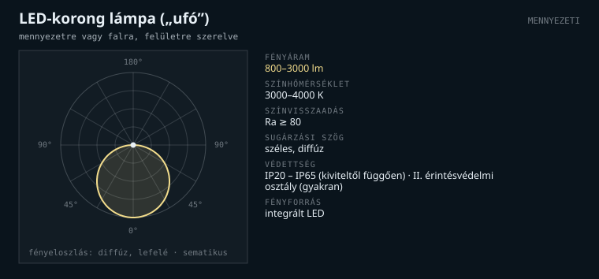

Lapos, kerek, integrált LED-es lámpatest opál burkolattal. Gyakran IP44-es, így előszobába, fürdőbe, pincébe is jó; sok kivitelben mozgás- és fényérzékelővel.

- **Szerelés:** mennyezetre vagy falra, felületre szerelve
- **Fényforrás:** integrált LED
- **Védettség:** IP20 – IP65 (kiviteltől függően) · II. érintésvédelmi osztály (gyakran)
- **Fény:** 800–3000 lm · 3000–4000 K · Ra ≥ 80 · széles, diffúz
- **Vezérlés:** kapcsolt; beépített mozgás- és alkonyérzékelő; vészvilágítási kivitel is van (vonalak: Hálózati 50 Hz)
- **Beépítés:**
  - Mozgásérzékelős kivitelnél az érzékelő látószöge és hatótávolsága határozza meg a helyet.
  - Érzékelős lámpát nem célszerű a falikapcsolóval is kapcsolni: lekapcsolt állapotban nem érzékel.
- **Rögzítés:** Beton, Gipszkarton, Nylon terpesztődübel, Becsavarható gipszkarton dübel
- **Előírás:** MSZ EN 60598-2-1
- **Rajzjel:** `lum.general` (Rajztár)
- **Hova:** előszoba, folyosó, lépcsőház, kamra, pince, fürdő (IP44-es kivitel)
- **Buktatók:**
  - Az integrált LED nem cserélhető: a lámpa élettartama a LED-é és a meghajtóé.
- **Rokon típusok:** Mennyezeti lámpa (plafonlámpa), Fürdőszobai mennyezeti lámpa, Hajólámpa
- **Keresőszavak:** HU: LED mennyezeti lámpa mozgásérzékelős IP44 · LED korong lámpa — EN: LED ceiling light with motion sensor · round LED ceiling light IP44 — DE: LED Deckenleuchte mit Bewegungsmelder · LED Deckenleuchte IP44
- **Hol kapható:** Villamossági nagykereskedés, barkácsáruház.

### Búrás mennyezeti lámpa

*Más néven:* búra, gömblámpa, üvegbúrás lámpa

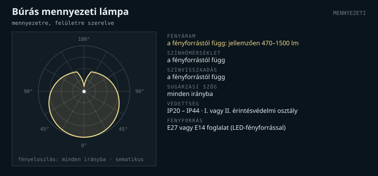

Foglalatos lámpatest üveg vagy műanyag búrával; a búra minden irányba szórja a fényt, a mennyezetet is megvilágítja. Klasszikus előszoba- és kamralámpa.

- **Szerelés:** mennyezetre, felületre szerelve
- **Fényforrás:** E27 vagy E14 foglalat (LED-fényforrással)
- **Védettség:** IP20 – IP44 · I. vagy II. érintésvédelmi osztály
- **Fény:** a fényforrástól függ: jellemzően 470–1500 lm · a fényforrástól függ · a fényforrástól függ · minden irányba
- **Vezérlés:** kapcsolt; dimmelhető fényforrással dimmelhető (vonalak: Hálózati 50 Hz)
- **Beépítés:**
  - A búra súlya és rögzítése (csavaros, rugós) a cserét is meghatározza.
  - A foglalat hőterhelése: a megadott legnagyobb fényforrás-teljesítményt nem szabad túllépni.
- **Rögzítés:** Beton, Gipszkarton, Nylon terpesztődübel, Fém üreges fali dübel
- **Előírás:** MSZ EN 60598-2-1
- **Rajzjel:** `lum.general` (Rajztár)
- **Hova:** előszoba, kamra, lépcső, régi lakások általános világítása
- **Buktatók:**
  - Zárt búra alatt a nem zárt lámpatestbe szánt LED-fényforrás túlmelegedhet: a fényforrás csomagolása jelzi, ha zárt lámpatestbe is való.
- **Rokon típusok:** Mennyezeti lámpa (plafonlámpa), Fali-mennyezeti búra
- **Keresőszavak:** HU: üvegbúrás mennyezeti lámpa E27 · gömb lámpa — EN: glass globe ceiling light E27 — DE: Glas Deckenleuchte E27 · Kugelleuchte
- **Hol kapható:** Lámpaszaküzlet, barkácsáruház.

### Csillár

*Más néven:* többkarú lámpa, kristálycsillár

Díszítő, többkarú vagy függesztett lámpatest, sokszor több foglalattal. A fényt minden irányba szórja; a súlya és mérete miatt a rögzítése külön figyelmet kér.

- **Szerelés:** mennyezetre függesztve, kampóra vagy szerelőlapra
- **Fényforrás:** több E14 / E27 / G9 foglalat, vagy integrált LED
- **Védettség:** IP20 · I. érintésvédelmi osztály (fém test)
- **Fény:** a fényforrások összegétől függ · jellemzően 2700–3000 K · Ra ≥ 80, kristálynál ≥ 90 ajánlott · minden irányba
- **Vezérlés:** kapcsolt; csillárkapcsolóval két fokozatban (két áramkör); dimmelhető fényforrásokkal dimmelhető (vonalak: Hálózati 50 Hz)
- **Beépítés:**
  - A súlyhoz méretezett rögzítés: födémbe beütős horgony kampóval, üreges födémbe billenő dübel, gipszkarton mennyezeten csak a vázszerkezetre vagy betétre.
  - Csillárkapcsolóhoz háromerű kiállás (két fázisvezető + nulla) és a védővezető.
  - A fém testet a védővezetőhöz kell kötni.
- **Rögzítés:** Beütős horgony, Billenő dübel, Vegyi dübel, Üreges födémpanel, Gipszkarton
- **Előírás:** MSZ EN 60598-2-1
- **Rajzjel:** `lum.general` (Rajztár)
- **Hova:** nappali, étkező, előtér, magas belmagasságú terek
- **Buktatók:**
  - A régi kampó teherbírása ismeretlen: nehéz csillárhoz új rögzítés.
  - Sok kis foglalat sok G9 vagy E14 izzót jelent: a fényforrás-csere a karbantartás része.
- **Rokon típusok:** Függeszték, Mennyezeti lámpa (plafonlámpa)
- **Keresőszavak:** HU: csillár E14 · csillárkampó · csillárkapcsoló — EN: chandelier E14 · ceiling hook · two-gang light switch — DE: Kronleuchter E14 · Deckenhaken · Serienschalter
- **Hol kapható:** Lámpaszaküzlet, lakberendezési áruház.

### Függeszték

*Más néven:* függesztett lámpa, pendant lámpa, étkezőlámpa

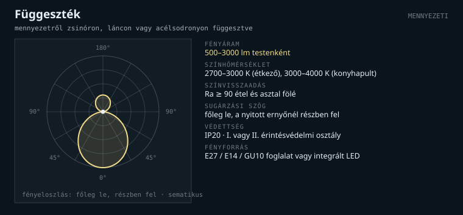

Egy vagy több, kábelen lógó lámpatest; az ernyő formája adja a fényt: zárt ernyőnél főleg lefelé, áttetszőnél részben a mennyezetre is. Asztal, pult, sziget fölé.

- **Szerelés:** mennyezetről zsinóron, láncon vagy acélsodronyon függesztve
- **Fényforrás:** E27 / E14 / GU10 foglalat vagy integrált LED
- **Védettség:** IP20 · I. vagy II. érintésvédelmi osztály
- **Fény:** 500–3000 lm testenként · 2700–3000 K (étkező), 3000–4000 K (konyhapult) · Ra ≥ 90 étel és asztal fölé · főleg le, a nyitott ernyőnél részben fel
- **Vezérlés:** kapcsolt vagy dimmelt; okos fényforrással (vonalak: Hálózati 50 Hz, 2,4 GHz sáv, DALI)
- **Beépítés:**
  - A rozetta (mennyezeti takaró) takarja a kiállást és tartja a súlyt.
  - Étkezőasztal fölött jellemzően 60–80 cm-rel az asztallap fölött; a kiállást az asztal tervezett helyéhez kell igazítani.
  - Több függesztékhez sor- vagy kör-rozetta, vagy külön kiállások.
- **Rögzítés:** Beton, Gipszkarton, Fém üreges fali dübel, Billenő dübel
- **Előírás:** MSZ EN 60598-2-1
- **Rajzjel:** `lum.general` (Rajztár)
- **Hova:** étkező, konyhasziget, pult, lépcsőház (hosszú függeszték)
- **Buktatók:**
  - Ha az asztal helye változik, a kiállás rossz helyen marad: előre tervezni, vagy eltolható rozettát választani.
  - A túl alacsony függeszték káprázik és útban van.
- **Rokon típusok:** Csillár, Mennyezeti lámpa (plafonlámpa), Sínrendszer 230 V
- **Keresőszavak:** HU: függeszték lámpa E27 · rozetta · étkezőasztal lámpa — EN: pendant light E27 · ceiling rose · dining table pendant — DE: Pendelleuchte E27 · Baldachin · Esstischleuchte
- **Hol kapható:** Lámpaszaküzlet, lakberendezési áruház.

### LED-panel

*Más néven:* álmennyezeti panel 600×600, LED panel 60x60, raszteres lámpatest

Lapos, négyszögletes lámpatest egyenletes, nagy felületű fénnyel; a 600 × 600-as méret az álmennyezeti rasztert követi. Irodák, rendelők, nagy konyhák.

- **Szerelés:** álmennyezeti raszterbe fektetve, vagy felületre szerelő keretben, vagy függesztve
- **Fényforrás:** integrált LED, külön meghajtóval
- **Védettség:** IP20 – IP44 (alulról IP54-es kivitel is) · II. érintésvédelmi osztály (gyakran)
- **Fény:** 3000–4500 lm (600 × 600) · 3000–4000 K (irodában 4000 K) · Ra ≥ 80 · széles; irodai kivitelben alacsony káprázás (UGR < 19)
- **Vezérlés:** kapcsolt, 1–10 V vagy DALI dimmelés (meghajtótól függ) (vonalak: Analóg jelszint: 0–10 V, 1–10 V, 4–20 mA, DALI, Hálózati 50 Hz)
- **Beépítés:**
  - A meghajtót (drivert) a panel mögött, hozzáférhetően és szellőzve kell elhelyezni.
  - Felületre szerelő keretnél a mennyezet anyagához illő dübel; álmennyezetben a raszter terhelhetősége számít.
- **Rögzítés:** Gipszkarton, Fém üreges fali dübel, Beton
- **Előírás:** MSZ EN 60598-2-2 (süllyesztett lámpatestek), MSZ EN 12464-1 (munkahelyi világítás)
- **Rajzjel:** `lum.panel` (Rajztár)
- **Hova:** iroda, dolgozószoba, rendelő, nagy konyha, garázs
- **Buktatók:**
  - Lakásban a hideg, egyenletes fény könnyen irodaszerű; a színhőmérséklet és a dimmelés számít.
  - Az olcsó meghajtó villódzhat (flicker).
- **Rokon típusok:** Süllyesztett downlight, Mennyezeti lámpa (plafonlámpa)
- **Keresőszavak:** HU: LED panel 60x60 UGR19 · felületre szerelő keret LED panelhez — EN: LED panel 600x600 UGR<19 · surface mount frame — DE: LED Panel 62x62 UGR19 · Aufbaurahmen LED Panel
- **Hol kapható:** Villamossági nagykereskedés.

### Süllyesztett downlight

*Más néven:* beépíthető LED lámpa, mélysugárzó, LED downlight

Az álmennyezetbe süllyesztett, lefelé világító lámpatest; a fényforrás a mennyezet síkja fölött ül, ezért kevésbé káprázik. A mélysugárzó a mélyebben ülő, kis káprázású változat.

- **Szerelés:** álmennyezetbe süllyesztve, rugós rögzítéssel
- **Fényforrás:** integrált LED (külső vagy beépített meghajtóval)
- **Védettség:** IP20 – IP44 (alulról) · II. érintésvédelmi osztály (gyakran)
- **Fény:** 400–2000 lm · 2700–4000 K · Ra ≥ 80, igényes helyen ≥ 90 · 60–100°
- **Vezérlés:** kapcsolt; fázishasításos, 1–10 V vagy DALI dimmelés a meghajtótól függően (vonalak: DALI, Analóg jelszint: 0–10 V, 1–10 V, 4–20 mA, Hálózati 50 Hz)
- **Beépítés:**
  - A kivágás átmérője és a beépítési mélység az adatlapon; a gipszkarton mögött a profil és a vezeték helye előre ellenőrizendő.
  - Hőszigetelés alá vagy közé csak arra minősített lámpatest kerülhet; a meghajtónak hely és szellőzés kell.
  - Kiosztás: egyenletes rács a helyiségben, a faltól nagyjából a lámpák közti távolság felére.
- **Rögzítés:** Gipszkarton, Gipszkarton körkivágó
- **Előírás:** MSZ EN 60598-2-2
- **Rajzjel:** `lum.spot` (Rajztár)
- **Hova:** nappali, konyha, folyosó, fürdő (IP44 alulról)
- **Buktatók:**
  - Túl sok, túl erős downlight hideg, „lyukacsos” mennyezetet ad.
  - A bekötődoboz nélküli meghajtót a gipszkarton mögött nem szabad szabadon hagyni: rögzíteni kell.
- **Rokon típusok:** Beépíthető spot, LED-panel, Fürdőszobai beépíthető spot
- **Keresőszavak:** HU: LED downlight beépíthető · mélysugárzó LED · kivágás 90 mm — EN: recessed LED downlight · cut-out 90 mm — DE: LED Einbaudownlight · Einbauleuchte Ausschnitt 90 mm
- **Hol kapható:** Villamossági nagykereskedés, világítástechnikai szaküzlet.

### Beépíthető spot

*Más néven:* süllyesztett spot, GU10 spot keret, billenthető spot

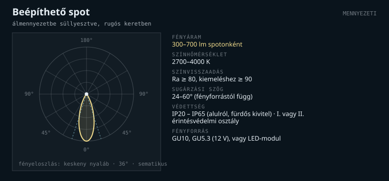

Keret cserélhető fényforrással (GU10 230 V-on, vagy GU5.3 / MR16 12 V-os tápegységgel) vagy beépített LED-modullal; keskenyebb nyalábbal, sokszor billenthetően, kiemelő és általános világításra.

- **Szerelés:** álmennyezetbe süllyesztve, rugós keretben
- **Fényforrás:** GU10, GU5.3 (12 V), vagy LED-modul
- **Védettség:** IP20 – IP65 (alulról, fürdős kivitel) · I. vagy II. érintésvédelmi osztály
- **Fény:** 300–700 lm spotonként · 2700–4000 K · Ra ≥ 80, kiemeléshez ≥ 90 · 24–60° (fényforrástól függ)
- **Vezérlés:** kapcsolt; dimmelhető fényforrással fázishasításos dimmerrel (vonalak: Hálózati 50 Hz)
- **Beépítés:**
  - A kivágás általában 68–75 mm; a keret mögött a foglalat és a vezeték hely kér.
  - 12 V-os rendszernél a tápegység teljesítménye és a vezetékhossz (feszültségesés) számít.
- **Rögzítés:** Gipszkarton, Gipszkarton körkivágó
- **Előírás:** MSZ EN 60598-2-2
- **Rajzjel:** `lum.spot` (Rajztár)
- **Hova:** konyha, folyosó, nappali kiemelő világítása, fürdő (IP-s kivitel)
- **Buktatók:**
  - A régi halogén keret és egy LED-fényforrás hőben jól illik, de a 12 V-os halogén trafó nem mindig működik LED-del.
  - Keskeny nyalábbal a mennyezet alatti tér foltos.
- **Rokon típusok:** Süllyesztett downlight, Felületre szerelt spot, Fürdőszobai beépíthető spot
- **Keresőszavak:** HU: GU10 spot keret billenthető · beépíthető spotlámpa — EN: GU10 recessed spotlight frame · tiltable downlight — DE: GU10 Einbaustrahler schwenkbar · Einbaurahmen GU10
- **Hol kapható:** Villamossági nagykereskedés, barkácsáruház.

### Felületre szerelt spot

*Más néven:* mennyezeti spot, forgatható spotlámpa, henger spot

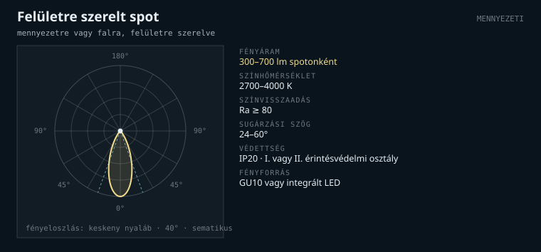

Egy vagy több forgatható, billenthető spot alapon vagy rúdon; ott, ahol nincs álmennyezet, de irányított fény kell.

- **Szerelés:** mennyezetre vagy falra, felületre szerelve
- **Fényforrás:** GU10 vagy integrált LED
- **Védettség:** IP20 · I. vagy II. érintésvédelmi osztály
- **Fény:** 300–700 lm spotonként · 2700–4000 K · Ra ≥ 80 · 24–60°
- **Vezérlés:** kapcsolt; dimmelhető fényforrással dimmelhető (vonalak: Hálózati 50 Hz)
- **Beépítés:**
  - Egy kiállásról több spot: a rúd vagy a talp takarja a kiállást.
  - A forgatható fej kábelét ne törje meg a forgatás.
- **Rögzítés:** Beton, Gipszkarton, Nylon terpesztődübel
- **Előírás:** MSZ EN 60598-2-1
- **Rajzjel:** `lum.spot` (Rajztár)
- **Hova:** konyha, folyosó, régi lakás betonmennyezete
- **Buktatók:**
  - A szemmagasságba fordított spot káprázik.
- **Rokon típusok:** Beépíthető spot, Sínrendszer 230 V
- **Keresőszavak:** HU: mennyezeti spotlámpa 3 ágú GU10 — EN: surface mounted spotlight bar — DE: Deckenstrahler GU10 3-flammig
- **Hol kapható:** Lámpaszaküzlet, barkácsáruház.

### Sínrendszer 230 V

*Más néven:* áramsín, egyfázisú sín, háromfázisú sín, sínspot

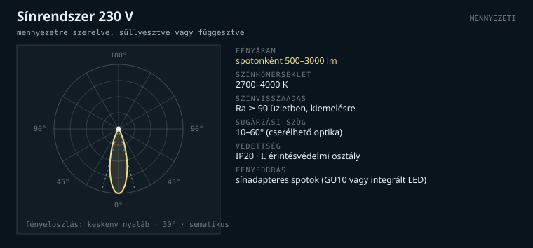

Fém sín, amelyben a hálózati vezetők futnak; a spotok adapterrel bárhová bepattinthatók és áthelyezhetők. A háromfázisú (három áramkörös) sínen a spotok három csoportban kapcsolhatók.

- **Szerelés:** mennyezetre szerelve, süllyesztve vagy függesztve
- **Fényforrás:** sínadapteres spotok (GU10 vagy integrált LED)
- **Védettség:** IP20 · I. érintésvédelmi osztály
- **Fény:** spotonként 500–3000 lm · 2700–4000 K · Ra ≥ 90 üzletben, kiemelésre · 10–60° (cserélhető optika)
- **Vezérlés:** egy vagy három kapcsolt kör; DALI-sín is van (vonalak: Hálózati 50 Hz, DALI)
- **Beépítés:**
  - A betáplálás a sín végén vagy közepén, a sínrendszer saját betápláló elemével.
  - Egy gyártó sínjei, adapterei és spotjai: a rendszerek nem keverhetők.
  - A sín terhelhetőségét (A) és a spotok összteljesítményét össze kell vetni.
- **Rögzítés:** Beton, Gipszkarton, Fém üreges fali dübel, Beütős horgony
- **Előírás:** MSZ EN 60570 (sínrendszerek)
- **Rajzjel:** `lum.spot` (Rajztár)
- **Hova:** nappali, galéria, konyha, üzlet, bemutatótér
- **Buktatók:**
  - Egyfázisú és háromfázisú adapter nem cserélhető fel.
  - A „háromfázisú” sín lakásban három külön kapcsolt kört jelent, nem 400 V-ot a spotokon.
- **Rokon típusok:** Mágneses sín 48 V, Felületre szerelt spot, Függeszték
- **Keresőszavak:** HU: 3 fázisú sín · sínspot adapter · áramsín betápláló — EN: 3-circuit track · track spotlight · track feed — DE: 3-Phasen Stromschiene · Schienenstrahler · Einspeisung
- **Hol kapható:** Világítástechnikai szaküzlet, villamossági nagykereskedés.

### Mágneses sín 48 V

*Más néven:* mágneses sínrendszer, 48V track, magnetic track

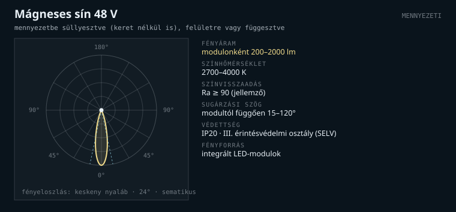

Keskeny, törpefeszültségű (48 V DC) sín, amelybe a lámpamodulok mágnessel pattannak be: spot, vonali fény, függeszték egy rendszerben. A tápegység a sínen kívül van.

- **Szerelés:** mennyezetbe süllyesztve (keret nélkül is), felületre vagy függesztve
- **Fényforrás:** integrált LED-modulok
- **Védettség:** IP20 · III. érintésvédelmi osztály (SELV)
- **Fény:** modulonként 200–2000 lm · 2700–4000 K · Ra ≥ 90 (jellemző) · modultól függően 15–120°
- **Vezérlés:** a tápegység szerint: kapcsolt, DALI, Zigbee vagy saját rendszer (vonalak: DALI, 2,4 GHz sáv)
- **Beépítés:**
  - A tápegység teljesítménye és helye (hozzáférhetően, szellőzve) előre tervezendő.
  - Hosszabb sínszakaszon a feszültségesés miatt több betáplálás kellhet.
  - A süllyesztett, keret nélküli kivitelt a gipszkarton glettelése előtt kell beépíteni.
- **Rögzítés:** Gipszkarton, Fém üreges fali dübel, Beton
- **Előírás:** MSZ EN 60598-1, a tápegységre MSZ EN 61347
- **Rajzjel:** `lum.linear` (Rajztár)
- **Hova:** nappali, konyha, folyosó, modern belsőépítészet
- **Buktatók:**
  - A modulok gyártóhoz kötöttek.
  - A 48 V-os sín nem 230 V-os sín: a két rendszer elemei nem cserélhetők.
- **Rokon típusok:** Sínrendszer 230 V, Süllyesztett downlight
- **Keresőszavak:** HU: mágneses sín 48V · mágneses sín spot · 48V tápegység — EN: 48V magnetic track light · magnetic track spotlight — DE: 48V Magnetschiene · Magnetschienensystem
- **Hol kapható:** Világítástechnikai szaküzlet, villamossági nagykereskedés.

### Világító mennyezet

*Más néven:* feszített fényes mennyezet, világító felület, fénymennyezet

Áttetsző feszített fólia vagy lap mögé szerelt LED-szalagok vagy -modulok egyetlen, egyenletesen világító felületté. Égbolthatású, árnyékmentes fény.

- **Szerelés:** álmennyezet mögé vagy feszített fólia mögé építve
- **Fényforrás:** LED-szalag vagy LED-modulok tápegységgel
- **Védettség:** IP20 · III. érintésvédelmi osztály (SELV LED-ek)
- **Fény:** a felület méretétől függ · 2700–6500 K, gyakran hangolható · Ra ≥ 90 ajánlott · teljesen diffúz
- **Vezérlés:** DALI, 1–10 V vagy okos vezérlés; hangolható fehérnél két csatorna (vonalak: DALI, Analóg jelszint: 0–10 V, 1–10 V, 4–20 mA, 2,4 GHz sáv)
- **Beépítés:**
  - Az egyenletességhez a LED-ek és a fólia közti távolság számít: a gyártói távolságot tartani kell.
  - A tápegységek és a csatlakozások szervizelhetősége: bontható szakasz vagy revíziós nyílás.
  - A feszített mennyezet szerelőjével együtt kell tervezni.
- **Rögzítés:** Beton, Gipszkarton, Nylon terpesztődübel
- **Előírás:** MSZ EN 60598-1, MSZ EN 62471 (fotobiológiai biztonság)
- **Rajzjel:** `lum.panel` (Rajztár)
- **Hova:** fürdő, ablak nélküli helyiség, konyha, belsőépítészeti hangsúly
- **Buktatók:**
  - Túl kevés LED vagy túl kis távolság csíkos, pöttyös felületet ad.
  - A fólia mögötti meghibásodás javítása bontással jár.
- **Rokon típusok:** LED-panel, Mennyezeti lámpa (plafonlámpa)
- **Keresőszavak:** HU: feszített mennyezet világító · LED szalag fénymennyezethez — EN: backlit stretch ceiling · luminous ceiling — DE: Lichtdecke · beleuchtete Spanndecke
- **Hol kapható:** Feszített mennyezet szerelő, világítástechnikai szaküzlet.

## 2. Fali

### Falikar

*Más néven:* fali lámpa, fali dekorlámpa

Falra szerelt lámpa ernyővel vagy búrával; hangulat- és kiegészítő világítás, sokszor párban (ágy két oldalán, tükör mellett, folyosón).

- **Szerelés:** falra szerelve, a kiállás fölött
- **Fényforrás:** E14 / G9 foglalat vagy integrált LED
- **Védettség:** IP20 · I. vagy II. érintésvédelmi osztály
- **Fény:** 200–800 lm · 2700–3000 K · Ra ≥ 80 · ernyőtől függően fel és le
- **Vezérlés:** kapcsolt; a lámpán lévő kapcsolóval vagy falikapcsolóval (vonalak: Hálózati 50 Hz)
- **Beépítés:**
  - A fali kiállás magassága jellemzően 1,6–1,9 m, ágy fölött a fejtámlához igazítva.
  - A kiállás a lámpatest talpa alá essen: a pontos helyet a választott lámpa adja.
- **Rögzítés:** Tömör tégla, Üreges kerámia falazóblokk, Gipszkarton, Nylon terpesztődübel, Univerzális dübel, Fém üreges fali dübel
- **Előírás:** MSZ EN 60598-2-1
- **Rajzjel:** `lum.wall` (Rajztár)
- **Hova:** hálószoba, nappali, folyosó, lépcső
- **Buktatók:**
  - A kiállást a lámpa kiválasztása előtt elhelyezve a talp nem takarja a dobozt.
- **Rokon típusok:** Fali-mennyezeti búra, Fel-le világító fali lámpa, Olvasó falikar
- **Keresőszavak:** HU: falikar E14 · fali lámpa nappaliba — EN: wall sconce E14 · wall light — DE: Wandleuchte E14 · Wandlampe
- **Hol kapható:** Lámpaszaküzlet, lakberendezési áruház.

### Fali-mennyezeti búra

*Más néven:* fali búra, fali-mennyezeti lámpa

Kis, búrás vagy opál burkolatú lámpatest, falra és mennyezetre is szerelhető; folyosók, lépcsők, kamrák, kisebb helyiségek alaplámpája.

- **Szerelés:** falra vagy mennyezetre, felületre szerelve
- **Fényforrás:** E27 / E14 foglalat vagy integrált LED
- **Védettség:** IP20 – IP44 · I. vagy II. érintésvédelmi osztály
- **Fény:** 400–1200 lm · 3000–4000 K · Ra ≥ 80 · minden irányba
- **Vezérlés:** kapcsolt; mozgásérzékelős kivitelben is (vonalak: Hálózati 50 Hz)
- **Beépítés:**
  - Falra szerelve a magasság a helyiség funkciójához igazodik; lépcsőn a lépcsőfokokat ne a szembe világítsa.
- **Rögzítés:** Tömör tégla, Üreges kerámia falazóblokk, Beton, Nylon terpesztődübel, Univerzális dübel
- **Előírás:** MSZ EN 60598-2-1
- **Rajzjel:** `lum.wall` (Rajztár)
- **Hova:** folyosó, lépcső, kamra, mosókonyha
- **Buktatók:**
  - Zárt búrában a fényforrás melegszik: arra alkalmas LED kell.
- **Rokon típusok:** Búrás mennyezeti lámpa, Falikar, Hajólámpa
- **Keresőszavak:** HU: fali mennyezeti lámpa E27 — EN: wall ceiling light E27 — DE: Wand- und Deckenleuchte E27
- **Hol kapható:** Barkácsáruház, lámpaszaküzlet.

### Fel-le világító fali lámpa

*Más néven:* up-down lámpa, kétirányú fali spot

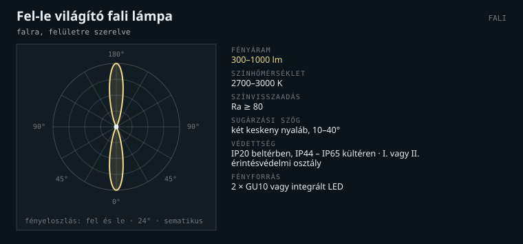

Henger vagy hasáb alakú fali lámpa, amely egy keskeny nyalábot felfelé, egyet lefelé küld; a falon jellegzetes fénycsíkot rajzol. Beltéri és IP-s kültéri kivitelben is.

- **Szerelés:** falra, felületre szerelve
- **Fényforrás:** 2 × GU10 vagy integrált LED
- **Védettség:** IP20 beltérben, IP44 – IP65 kültéren · I. vagy II. érintésvédelmi osztály
- **Fény:** 300–1000 lm · 2700–3000 K · Ra ≥ 80 · két keskeny nyaláb, 10–40°
- **Vezérlés:** kapcsolt; dimmelhető fényforrással (vonalak: Hálózati 50 Hz)
- **Beépítés:**
  - Pontos, egyenes felszerelés: a ferde lámpa ferde fénycsíkot rajzol.
  - Több lámpánál egyforma magasság és köz.
- **Rögzítés:** Tömör tégla, Üreges kerámia falazóblokk, Gipszkarton, Nylon terpesztődübel, Univerzális dübel
- **Előírás:** MSZ EN 60598-2-1
- **Rajzjel:** `lum.wall` (Rajztár)
- **Hova:** folyosó, nappali hangulatfény, bejárat (kültéri kivitel)
- **Buktatók:**
  - Önmagában kevés fényt ad a helyiségbe: hangulatvilágítás.
- **Rokon típusok:** Falikar, Fali fényvető (wall washer)
- **Keresőszavak:** HU: fel le világító fali lámpa — EN: up down wall light — DE: Up-Down Wandleuchte
- **Hol kapható:** Lámpaszaküzlet, barkácsáruház.

### Olvasó falikar

*Más néven:* olvasólámpa falra, flexibilis karú fali lámpa, ágy melletti lámpa

Irányítható karú vagy hajlítható nyakú fali lámpa keskeny nyalábbal, olvasáshoz; sokszor saját kapcsolóval, néha USB-töltővel.

- **Szerelés:** falra szerelve, mozgatható karral
- **Fényforrás:** integrált LED vagy GU10 / E14
- **Védettség:** IP20 · I. vagy II. érintésvédelmi osztály
- **Fény:** 150–400 lm · 2700–3000 K · Ra ≥ 90 ajánlott olvasáshoz · 20–40°
- **Vezérlés:** a lámpán lévő kapcsolóval vagy érintéssel; néha dimmelhető (vonalak: Hálózati 50 Hz)
- **Beépítés:**
  - Ágy mellett a fejtámla fölött, a fekvő és ülő olvasáshoz igazítva; a kiállás a talp alá kerüljön.
  - Ha a lámpán kapcsoló van, a kiállás folyamatos fázist kaphat, vagy kapcsolt kört a falikapcsolóval.
- **Rögzítés:** Tömör tégla, Gipszkarton, Nylon terpesztődübel, Fém üreges fali dübel
- **Előírás:** MSZ EN 60598-2-1
- **Rajzjel:** `lum.wall` (Rajztár)
- **Hova:** hálószoba, olvasósarok, szálloda
- **Buktatók:**
  - A másik ágy felé világító nyaláb zavar: keskeny nyaláb, jó irányítás.
- **Rokon típusok:** Falikar
- **Keresőszavak:** HU: olvasólámpa falra USB · ágy melletti fali lámpa — EN: bedside wall reading light — DE: Leselampe Wand · Bettleuchte
- **Hol kapható:** Lámpaszaküzlet, lakberendezési áruház.

### Képvilágító

*Más néven:* festményvilágító, picture light

A kép fölé szerelt, előre hajló karú lámpa, amely ferdén a képre világít; aszimmetrikus, a fal felé eső fényeloszlással.

- **Szerelés:** falra, a kép fölé, karral előrehajolva
- **Fényforrás:** integrált LED
- **Védettség:** IP20 · II. érintésvédelmi osztály vagy III. (SELV)
- **Fény:** 100–400 lm · 2700–3000 K · Ra ≥ 90, festményhez ≥ 95 · aszimmetrikus, a fal felé
- **Vezérlés:** kapcsolt vagy dimmelt (vonalak: Hálózati 50 Hz)
- **Beépítés:**
  - A kiállás a kép fölött, a lámpa talpa alá; a kép helye és mérete előre egyeztetendő.
- **Rögzítés:** Tömör tégla, Gipszkarton, Nylon terpesztődübel, Fém üreges fali dübel
- **Előírás:** MSZ EN 60598-2-1
- **Rajzjel:** `lum.wall` (Rajztár)
- **Hova:** nappali, folyosó, galéria
- **Buktatók:**
  - Az UV- és hősugárzás a festményt károsíthatja: LED-es, UV-mentes fényforrás.
- **Rokon típusok:** Fali fényvető (wall washer)
- **Keresőszavak:** HU: képvilágító LED — EN: LED picture light — DE: LED Bilderleuchte
- **Hol kapható:** Lámpaszaküzlet.

### Falba süllyesztett lépcső- és orientációs fény

*Más néven:* lépcsővilágítás, orientációs fény, falba süllyesztett lámpa

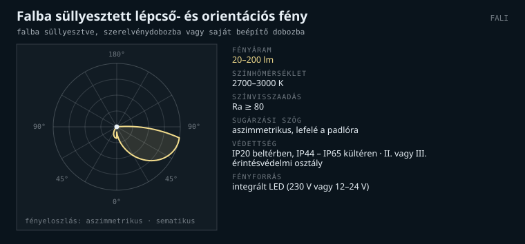

Alacsonyan, a falba süllyesztett kis lámpa, amely lefelé, a padlóra és a lépcsőfokra világít; éjszakai tájékozódásra és lépcsőkhöz. Sok típus a szabványos szerelvénydobozba illik.

- **Szerelés:** falba süllyesztve, szerelvénydobozba vagy saját beépítő dobozba
- **Fényforrás:** integrált LED (230 V vagy 12–24 V)
- **Védettség:** IP20 beltérben, IP44 – IP65 kültéren · II. vagy III. érintésvédelmi osztály
- **Fény:** 20–200 lm · 2700–3000 K · Ra ≥ 80 · aszimmetrikus, lefelé a padlóra
- **Vezérlés:** kapcsolt, mozgásérzékelővel, alkonykapcsolóval vagy okos vezérléssel; éjszakai, gyenge fokozat (vonalak: Hálózati 50 Hz, 2,4 GHz sáv)
- **Beépítés:**
  - Szerelvénydobozba illő típusnál a dobozt a fal síkjában és vízszintesen kell beépíteni (dobozfúró).
  - Lépcsőnél jellemzően a fokok fölött 20–40 cm-rel; minden fokhoz vagy minden másodikhoz.
  - 12–24 V-os kivitelnél a tápegység helye és hozzáférhetősége.
- **Rögzítés:** Dobozfúró korona, Üreges kerámia falazóblokk, Gipszkarton, Gipszkarton körkivágó
- **Előírás:** MSZ EN 60598-2-2
- **Rajzjel:** `lum.wall` (Rajztár)
- **Hova:** lépcső, folyosó, hálószoba éjszakai fénye, terasz
- **Buktatók:**
  - A doboz helyét a burkolat és a lépcsőfokok végleges síkjához kell igazítani.
- **Rokon típusok:** Fali fényvető (wall washer), Fali-mennyezeti búra
- **Keresőszavak:** HU: lépcsővilágító lámpa falba süllyesztett · orientációs fény szerelvénydobozba — EN: recessed step light · orientation light for flush box — DE: Treppenstufenleuchte Unterputz · Orientierungsleuchte UP-Dose
- **Hol kapható:** Villamossági nagykereskedés, lámpaszaküzlet.

### Fali fényvető (wall washer)

*Más néven:* falmosó lámpa, wall washer, wall grazer

A falfelületet egyenletesen „mosó” vagy súrolófényben kirajzoló, aszimmetrikus lámpatest; a falat teszi világossá, nem a teret. Kőfal, tégla, textúra kiemelésére.

- **Szerelés:** a fal elé, mennyezetre, padlóba vagy a fal tövébe
- **Fényforrás:** integrált LED
- **Védettség:** IP20 – IP67 (padlóba és kültérre) · II. vagy III. érintésvédelmi osztály
- **Fény:** 500–3000 lm · 2700–4000 K · Ra ≥ 90 · aszimmetrikus, a fal felé
- **Vezérlés:** kapcsolt, DALI vagy 1–10 V dimmelés (vonalak: DALI, Analóg jelszint: 0–10 V, 1–10 V, 4–20 mA)
- **Beépítés:**
  - A faltól mért távolság határozza meg az egyenletességet: a gyártói távolságot kell tartani.
  - Súrolófénynél (közel a falhoz) minden falhiba látszik: előtte a fal síkja.
- **Rögzítés:** Beton, Gipszkarton, Fém üreges fali dübel
- **Előírás:** MSZ EN 60598-2-2
- **Rajzjel:** `lum.linear` (Rajztár)
- **Hova:** nappali, előtér, lépcsőház, homlokzat (kültéri kivitel)
- **Buktatók:**
  - A súrolófény minden glettelési hibát kiemel.
- **Rokon típusok:** Képvilágító, Fel-le világító fali lámpa
- **Keresőszavak:** HU: wall washer LED · falmosó lámpatest — EN: LED wall washer · wall grazer — DE: Wandfluter LED
- **Hol kapható:** Világítástechnikai szaküzlet.

## 3. Rejtett és vonali

### LED-szalag (12 / 24 V)

*Más néven:* LED szalag, LED strip, COB szalag, SMD szalag

Hajlékony nyomtatott áramkör, rajta sűrűn LED-ek; törpefeszültségű tápegységről működik, méterenként vágható. A COB-szalagon a LED-ek pontjai nem látszanak, folytonos fénycsíkot ad. Szinte minden rejtett és vonali világítás alapja.

- **Szerelés:** alumínium profilba ragasztva, vagy közvetlenül felületre
- **Fényforrás:** SMD vagy COB LED-ek a szalagon; egyszínű, hangolható fehér (CCT), RGB, RGBW
- **Védettség:** IP20 beltérben, IP54 – IP67 szilikonbevonattal · III. érintésvédelmi osztály (SELV), a tápegység II.
- **Fény:** méterenként 300–2000 lm · 2700–6500 K vagy hangolható · Ra ≥ 90 ajánlott (olcsó szalagnál 80 alatti is van) · kb. 120°
- **Vezérlés:** PWM-vezérlő a tápegység után: nyomógomb, rádiós (Zigbee, Wi-Fi), DALI vagy 1–10 V bemenetű vezérlő (vonalak: DALI, Analóg jelszint: 0–10 V, 1–10 V, 4–20 mA, 2,4 GHz sáv)
- **Beépítés:**
  - A szalag melegszik: alumínium profilba ragasztva marad tartós; a profil hűtőborda is.
  - Feszültségesés: 24 V-os szalagot nagyjából 5 m-enként érdemes táplálni (12 V-osat sűrűbben), hosszú szakaszt két végéről vagy középről.
  - A tápegység teljesítménye a szalag teljesítményénél 20–30 %-kal nagyobb legyen; hozzáférhető, szellőző helyre.
  - Csak a jelölt vágási pontokon vágható; a csatlakozás forrasztva vagy gyári csatlakozóval.
- **Rögzítés:** Forgácslapcsavar, Gipszkarton csavar, Nylon terpesztődübel
- **Előírás:** MSZ EN 60598-2-21 (LED-szalag mint lámpatest), a tápegységre MSZ EN 61347
- **Rajzjel:** `lum.strip` (Rajztár)
- **Hova:** konyha, nappali rejtett fénye, lépcső, bútor, polc, tükör, kert (IP-s kivitel)
- **Buktatók:**
  - Profil nélkül a ragasztó elenged és a LED-ek hamar öregednek.
  - Az egy ponton táplált hosszú szalag vége halványabb és sárgább.
  - Az olcsó szalag színe tételenként eltér: egy helyiségbe egy tételből.
- **Rokon típusok:** Alumínium profil LED-szalaghoz, LED neon flex, Hálózati feszültségű LED-szalag (230 V), Rejtett (indirekt) világítás párkányban
- **Keresőszavak:** HU: LED szalag 24V CRI90 · COB LED szalag · LED tápegység 24V — EN: 24V LED strip CRI 90 · COB LED strip · 24V LED driver — DE: LED Streifen 24V CRI90 · COB LED Streifen · LED Netzteil 24V
- **Hol kapható:** Villamossági nagykereskedés, LED-szaküzlet.

### Hálózati feszültségű LED-szalag (230 V)

*Más néven:* 230V LED szalag, high voltage LED strip

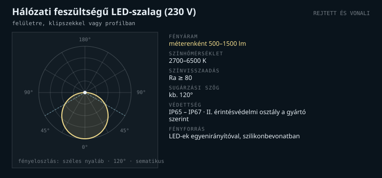

Tápegység nélkül, közvetlenül 230 V-ról működő szalag; hosszú szakaszok (akár 50 m) táplálhatók egy pontról, de csak nagyobb, 0,5–1 m-es egységekben vágható, és a feszültség miatt másképp kell kezelni.

- **Szerelés:** felületre, klipszekkel vagy profilban
- **Fényforrás:** LED-ek egyenirányítóval, szilikonbevonatban
- **Védettség:** IP65 – IP67 · II. érintésvédelmi osztály a gyártó szerint
- **Fény:** méterenként 500–1500 lm · 2700–6500 K · Ra ≥ 80 · kb. 120°
- **Vezérlés:** kapcsolt; dimmelhető kivitel fázishasításos dimmerrel (vonalak: Hálózati 50 Hz)
- **Beépítés:**
  - Csak a gyártó saját betápláló kábelével és végzáró sapkájával: a szalag érintésre veszélyes feszültségen van.
  - Hálózati áramkör áram-védőkapcsolóval.
  - Nem vágható tetszőlegesen: csak a jelölt egységhatáron.
- **Rögzítés:** Nylon terpesztődübel, Forgácslapcsavar, Beton
- **Előírás:** MSZ EN 60598-2-21
- **Rajzjel:** `lum.strip` (Rajztár)
- **Hova:** kültéri kontúr, eresz, hosszú korlát, csarnok
- **Buktatók:**
  - Sérült szigetelésű vagy rosszul lezárt végű szalag áramütésveszélyes.
  - Az egyenirányító miatt villódzhat (100 Hz).
- **Rokon típusok:** LED-szalag (12 / 24 V), LED neon flex
- **Keresőszavak:** HU: 230V LED szalag · hálózati LED szalag betápláló — EN: 230V LED strip · high voltage LED strip — DE: 230V LED Streifen · Hochvolt LED Band
- **Hol kapható:** LED-szaküzlet, villamossági nagykereskedés.

### Alumínium profil LED-szalaghoz

*Más néven:* LED profil, LED alu profil, sarokprofil, süllyesztett profil

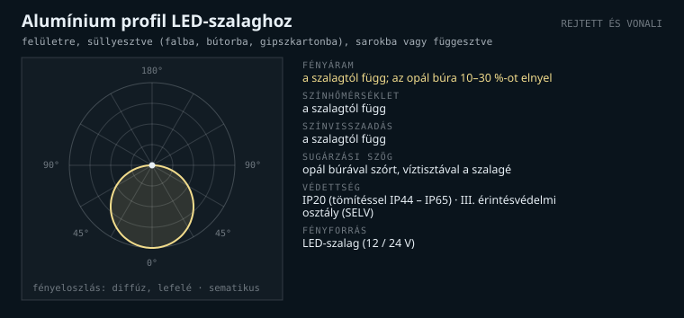

Alumínium sín búrával (opál, félig áttetsző vagy víztiszta), amely tartja és hűti a LED-szalagot, és a fényét egyenletes csíkká szórja. A szalagból így vonali lámpatest lesz.

- **Szerelés:** felületre, süllyesztve (falba, bútorba, gipszkartonba), sarokba vagy függesztve
- **Fényforrás:** LED-szalag (12 / 24 V)
- **Védettség:** IP20 (tömítéssel IP44 – IP65) · III. érintésvédelmi osztály (SELV)
- **Fény:** a szalagtól függ; az opál búra 10–30 %-ot elnyel · a szalagtól függ · a szalagtól függ · opál búrával szórt, víztisztával a szalagé
- **Vezérlés:** mint a LED-szalagé (vonalak: DALI, Analóg jelszint: 0–10 V, 1–10 V, 4–20 mA, 2,4 GHz sáv)
- **Beépítés:**
  - Egyenletes fénycsíkhoz a szalag és az opál búra közti távolság számít: mélyebb profil vagy COB-szalag kell, ha nem lehet pöttyös.
  - Süllyesztett profilnál a horony a profil méretére, a glettelés előtt.
  - A vezeték bevezetése a profil végén vagy hátulján: a végzáró és a kábelfurat előre.
- **Rögzítés:** Gipszkarton, Gipszkarton csavar, Forgácslapcsavar, OSB és forgácslap, Nylon terpesztődübel
- **Előírás:** MSZ EN 60598-2-21
- **Rajzjel:** `lum.linear` (Rajztár)
- **Hova:** konyhapult, lépcső, bútor, fal- és mennyezeti fénycsík
- **Buktatók:**
  - A víztiszta búrán át a LED-pontok tükröződnek a fényes felületeken.
- **Rokon típusok:** LED-szalag (12 / 24 V), Keret nélküli (trimless) beépítés, Konyhai pult alatti világítás
- **Keresőszavak:** HU: LED alu profil opál búrával · süllyesztett LED profil · sarok LED profil — EN: aluminium LED profile with diffuser · recessed LED profile · corner LED profile — DE: LED Aluprofil mit Abdeckung · Einbauprofil LED · Eckprofil LED
- **Hol kapható:** LED-szaküzlet, villamossági nagykereskedés.

### LED neon flex

*Más néven:* neon flex, szilikon LED cső, LED neon

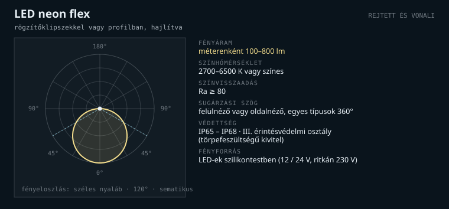

Tömör, szilikon testű, hajlítható LED-szalag, amely folytonos, neoncsőszerű fénycsíkot ad. Íveket, betűket, kontúrokat lehet vele rajzolni; kültérre is jó.

- **Szerelés:** rögzítőklipszekkel vagy profilban, hajlítva
- **Fényforrás:** LED-ek szilikontestben (12 / 24 V, ritkán 230 V)
- **Védettség:** IP65 – IP68 · III. érintésvédelmi osztály (törpefeszültségű kivitel)
- **Fény:** méterenként 100–800 lm · 2700–6500 K vagy színes · Ra ≥ 80 · felülnéző vagy oldalnéző, egyes típusok 360°
- **Vezérlés:** mint a LED-szalagé (vonalak: 2,4 GHz sáv, Analóg jelszint: 0–10 V, 1–10 V, 4–20 mA)
- **Beépítés:**
  - A legkisebb hajlítási sugarat és a hajlítás irányát (oldalra vagy felfelé) a típus adja meg.
  - A vágási pontok ritkábbak; a végeket szilikonnal és gyári sapkával kell zárni.
- **Rögzítés:** Nylon terpesztődübel, Forgácslapcsavar, Beton
- **Előírás:** MSZ EN 60598-2-21
- **Rajzjel:** `lum.strip` (Rajztár)
- **Hova:** díszvilágítás, felirat, lépcső élfénye, kert, medence széle
- **Buktatók:**
  - A rosszul lezárt vég beázik.
- **Rokon típusok:** LED-szalag (12 / 24 V), Hálózati feszültségű LED-szalag (230 V)
- **Keresőszavak:** HU: LED neon flex 24V · szilikon LED szalag — EN: LED neon flex 24V · silicone LED neon — DE: LED Neon Flex 24V · Silikon LED Schlauch
- **Hol kapható:** LED-szaküzlet.

### Rejtett (indirekt) világítás párkányban

*Más néven:* indirekt világítás, koronaléc világítás, gipszkarton párkány fény, kazettás fény

A LED-szalag a mennyezet széle mentén egy párkány vagy léc mögé kerül, és a fényt a mennyezetre és a falra veti; a fényforrás nem látszik, csak a megvilágított felület. Lágy hangulat- és alapfény.

- **Szerelés:** gipszkarton párkány, koronaléc vagy kazetta mögé rejtve
- **Fényforrás:** LED-szalag profilban
- **Védettség:** IP20 · III. érintésvédelmi osztály (SELV)
- **Fény:** méterenként 600–1500 lm a kívánt fényerőtől függően · 2700–3000 K · Ra ≥ 90 · aszimmetrikus, a mennyezet felé
- **Vezérlés:** dimmelt: DALI, 1–10 V, rádiós vezérlő (vonalak: DALI, Analóg jelszint: 0–10 V, 1–10 V, 4–20 mA, 2,4 GHz sáv)
- **Beépítés:**
  - A párkány méreteit (magasság, kinyúlás) a szalaggal együtt kell tervezni a szárazépítővel.
  - A szalag ne látsszon a helyiség egyik pontjáról se; a fény ne vágjon éles csíkot a mennyezetre.
  - A tápegységnek hozzáférhető hely: revíziós nyílás vagy a párkány bontható része.
- **Rögzítés:** Gipszkarton, Gipszkarton csavar, Forgácslapcsavar
- **Előírás:** MSZ EN 60598-2-21
- **Rajzjel:** `lum.strip` (Rajztár)
- **Hova:** nappali, hálószoba, előtér
- **Buktatók:**
  - Egyenetlen mennyezeten a súroló fény minden hibát kiemel.
  - Túl közel a mennyezethez forró, foltos csík lesz.
- **Rokon típusok:** LED-szalag (12 / 24 V), Alumínium profil LED-szalaghoz, Világító mennyezet
- **Keresőszavak:** HU: indirekt világítás gipszkarton párkány · rejtett LED világítás — EN: cove lighting · indirect LED lighting — DE: Lichtvoute · indirekte Beleuchtung LED
- **Hol kapható:** LED-szaküzlet, szárazépítő anyagkereskedés.

### Keret nélküli (trimless) beépítés

*Más néven:* trimless spot, bevakolható profil, keret nélküli downlight

A spot vagy a profil pereme a gipszkarton vagy a vakolat alá kerül, és a felülettel egy síkba glettelik; a mennyezeten csak a fénynyílás látszik, keret nem.

- **Szerelés:** gipszkartonba vagy vakolatba beépítve és a felülettel egy síkba glettelve
- **Fényforrás:** integrált LED vagy cserélhető modul (GU10, MR16) a beépítő házban
- **Védettség:** IP20 · a lámpatesttől függően
- **Fény:** a betéttől függ · 2700–4000 K · Ra ≥ 90 · a betéttől függ
- **Vezérlés:** a betéttől függ; gyakran DALI vagy fázishasításos dimmelés (vonalak: DALI, Hálózati 50 Hz)
- **Beépítés:**
  - A beépítő házat a gipszkarton szerelése közben kell elhelyezni, a glettelés és a festés előtt: ezt a szárazépítővel és a festővel egyeztetni kell.
  - A betétnek cserélhetőnek kell maradnia alulról.
  - A pontos kivágás a gyártói sablonnal.
- **Rögzítés:** Gipszkarton, Gipszkarton körkivágó, Gipszkarton csavar
- **Előírás:** MSZ EN 60598-2-2
- **Rajzjel:** `lum.spot` (Rajztár)
- **Hova:** nappali, galéria, igényes belsőépítészet
- **Buktatók:**
  - Utólag nem lehet trimless-re cserélni: a glettelés előtt dől el.
  - A ház mögötti tér nem lehet szigeteléssel betöltve, ha a lámpa nem arra minősített.
- **Rokon típusok:** Süllyesztett downlight, Alumínium profil LED-szalaghoz, Mágneses sín 48 V
- **Keresőszavak:** HU: trimless spot gipszkartonba · bevakolható LED profil — EN: trimless downlight plaster-in · plaster-in LED profile — DE: Trimless Einbaustrahler · Einputzprofil LED
- **Hol kapható:** Világítástechnikai szaküzlet.

### Árnyékfuga- és lábazatvilágítás

*Más néven:* padlószegély fény, lebegő hatás, árnyékfuga LED

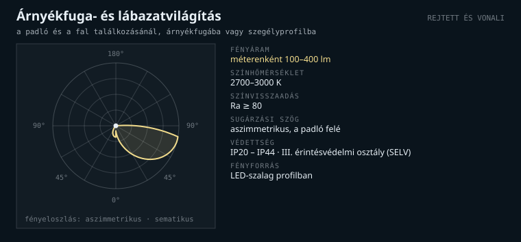

A padló menti fugában vagy szegélylécben futó LED-szalag lefelé, a padlóra világít; a fal „lebeg”, és éjszakai tájékozódó fényként is szolgál.

- **Szerelés:** a padló és a fal találkozásánál, árnyékfugába vagy szegélyprofilba
- **Fényforrás:** LED-szalag profilban
- **Védettség:** IP20 – IP44 · III. érintésvédelmi osztály (SELV)
- **Fény:** méterenként 100–400 lm · 2700–3000 K · Ra ≥ 80 · aszimmetrikus, a padló felé
- **Vezérlés:** kapcsolt, mozgásérzékelővel vagy okos vezérléssel; éjszakai fokozat (vonalak: 2,4 GHz sáv, Analóg jelszint: 0–10 V, 1–10 V, 4–20 mA)
- **Beépítés:**
  - A profilt a burkolással és a falszerkezettel együtt kell tervezni.
  - A padlófelmosás vize ne érje a szalagot: tömített kivitel.
- **Rögzítés:** Gipszkarton, Forgácslapcsavar, Nylon terpesztődübel
- **Előírás:** MSZ EN 60598-2-21
- **Rajzjel:** `lum.strip` (Rajztár)
- **Hova:** folyosó, hálószoba, fürdő, lépcső
- **Buktatók:**
  - A fényes padló tükrözi a szalagot.
- **Rokon típusok:** LED-szalag (12 / 24 V), Falba süllyesztett lépcső- és orientációs fény, Ágy alatti orientációs fény
- **Keresőszavak:** HU: LED szegélyprofil · árnyékfuga világítás — EN: LED skirting light · shadow gap lighting — DE: LED Sockelleiste · Schattenfuge Beleuchtung
- **Hol kapható:** LED-szaküzlet, burkolóanyag-kereskedés.

## 4. Bútor és beépített

### Konyhai pult alatti világítás

*Más néven:* pultvilágítás, felső szekrény alatti lámpa, konyhai munkafény

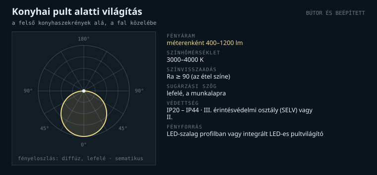

A munkalapot a felső szekrények aljából megvilágító vonali fény: profilos LED-szalag vagy lapos LED-lámpatest. A mennyezeti lámpától a munkavégző test árnyékot vet; ez a fény azt szünteti meg.

- **Szerelés:** a felső konyhaszekrények alá, a fal közelébe
- **Fényforrás:** LED-szalag profilban vagy integrált LED-es pultvilágító
- **Védettség:** IP20 – IP44 · III. érintésvédelmi osztály (SELV) vagy II.
- **Fény:** méterenként 400–1200 lm · 3000–4000 K · Ra ≥ 90 (az étel színe) · lefelé, a munkalapra
- **Vezérlés:** falikapcsoló, a profilba épített kézlegyintéses vagy érintő kapcsoló, okos vezérlés (vonalak: 2,4 GHz sáv, Analóg jelszint: 0–10 V, 1–10 V, 4–20 mA)
- **Beépítés:**
  - A fényt a szekrény elülső széléhez közel, a fal felé irányítva: így a fényes csempe nem tükröz.
  - A tápegység a felső szekrény fölé vagy mögé, hozzáférhetően; a kiállás helye a konyhatervből.
  - A vezetékeket a konyhabútor szerelése előtt kell kivezetni.
- **Rögzítés:** OSB és forgácslap, Forgácslapcsavar
- **Előírás:** MSZ EN 60598-2-21 / -2-1
- **Rajzjel:** `lum.linear` (Rajztár)
- **Hova:** konyha, kamra, mosókonyha
- **Buktatók:**
  - A fényes csempén és a munkalapon a LED-pontok tükröződnek: opál búra.
  - A kézlegyintéses kapcsoló a pára és a gőz miatt tévesen is kapcsolhat.
- **Rokon típusok:** Alumínium profil LED-szalaghoz, LED-szalag (12 / 24 V), Polc- és vitrinvilágítás
- **Keresőszavak:** HU: pult alatti LED világítás · LED profil konyhába érintőkapcsolós — EN: under cabinet LED lighting · kitchen LED profile with touch switch — DE: Unterbauleuchte LED Küche · LED Profil mit Sensor
- **Hol kapható:** LED-szaküzlet, konyhabútor-szerelő.

### Szekrény- és gardróbvilágítás

*Más néven:* gardróbvilágítás, ajtókapcsolós szekrényfény, akkus szekrénylámpa

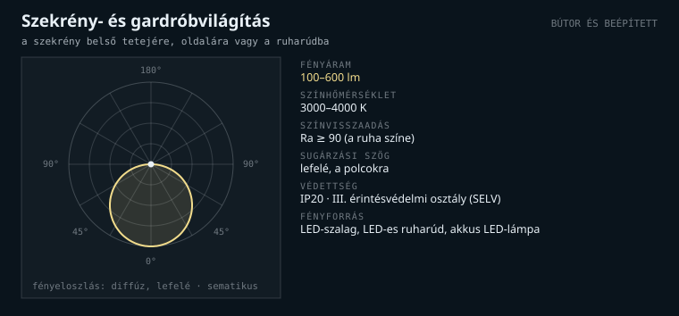

A szekrény belsejét az ajtó nyitásakor bekapcsoló fény: profilos LED-szalag, LED-es ruharúd vagy kis lámpatest, ajtókapcsolóval vagy mozgásérzékelővel; vezeték nélküli helyen akkus kivitelben.

- **Szerelés:** a szekrény belső tetejére, oldalára vagy a ruharúdba
- **Fényforrás:** LED-szalag, LED-es ruharúd, akkus LED-lámpa
- **Védettség:** IP20 · III. érintésvédelmi osztály (SELV)
- **Fény:** 100–600 lm · 3000–4000 K · Ra ≥ 90 (a ruha színe) · lefelé, a polcokra
- **Vezérlés:** ajtókapcsoló, mozgásérzékelő (vonalak: Analóg jelszint: 0–10 V, 1–10 V, 4–20 mA)
- **Beépítés:**
  - A tápegység a szekrény tetején vagy mögötte; a kiállást a gardróbtervhez kell igazítani.
  - A szalag ne melegítse a ruhát: profilban.
- **Rögzítés:** OSB és forgácslap, Forgácslapcsavar
- **Előírás:** MSZ EN 60598-2-21
- **Rajzjel:** `lum.strip` (Rajztár)
- **Hova:** gardrób, beépített szekrény, kamra
- **Buktatók:**
  - Az akkus lámpa kényelmes, de rendszeres töltést kér.
- **Rokon típusok:** Konyhai pult alatti világítás, Alumínium profil LED-szalaghoz
- **Keresőszavak:** HU: szekrényvilágítás mozgásérzékelős · LED ruharúd · ajtókapcsoló LED-hez — EN: wardrobe light with sensor · LED wardrobe rail · door switch for LED — DE: Schrankbeleuchtung mit Sensor · LED Kleiderstange · Türkontaktschalter LED
- **Hol kapható:** Bútorvasalat-kereskedés, LED-szaküzlet.

### Polc- és vitrinvilágítás

*Más néven:* vitrinvilágítás, üvegpolc világítás, könyvespolc fény

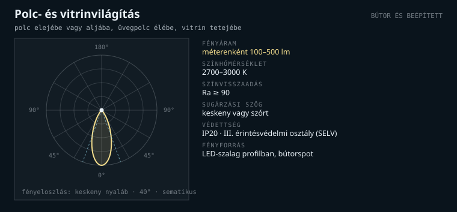

A polcon vagy a vitrinben lévő tárgyakat kiemelő fény: keskeny LED-profil, az üvegpolc élét megvilágító fény vagy mini spot. Kis fényerő, jó színvisszaadás.

- **Szerelés:** polc elejébe vagy aljába, üvegpolc élébe, vitrin tetejébe
- **Fényforrás:** LED-szalag profilban, bútorspot
- **Védettség:** IP20 · III. érintésvédelmi osztály (SELV)
- **Fény:** méterenként 100–500 lm · 2700–3000 K · Ra ≥ 90 · keskeny vagy szórt
- **Vezérlés:** kapcsolt, dimmelt; a vitrin érintőkapcsolója (vonalak: Analóg jelszint: 0–10 V, 1–10 V, 4–20 mA, 2,4 GHz sáv)
- **Beépítés:**
  - A vezetékeket a bútor gyártása közben kell elvezetni; utólag csak kábelcsatornával.
  - Üvegpolcnál a fény az él felől jut be: a polc tartóiba épített LED-del.
- **Rögzítés:** Forgácslapcsavar, OSB és forgácslap
- **Előírás:** MSZ EN 60598-2-21
- **Rajzjel:** `lum.strip` (Rajztár)
- **Hova:** nappali, könyvtár, bemutatótér
- **Buktatók:**
  - Tükröződés az üvegen: a fény irányát a nézőponthoz kell igazítani.
- **Rokon típusok:** Bútorspot, Konyhai pult alatti világítás
- **Keresőszavak:** HU: vitrin LED világítás · üvegpolc LED — EN: cabinet display lighting · glass shelf LED — DE: Vitrinenbeleuchtung LED · Glaskantenbeleuchtung
- **Hol kapható:** Bútorvasalat-kereskedés, LED-szaküzlet.

### Bútorspot

*Más néven:* mini spot 12 V, bútorba süllyesztett spot, puck light

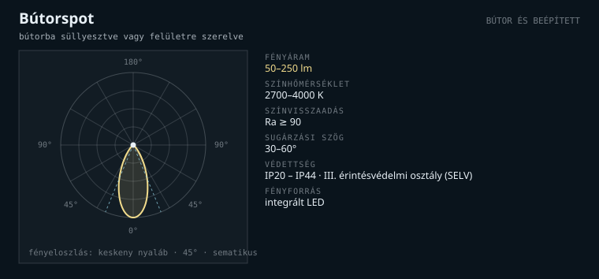

Kis, kerek LED-spot (12 / 24 V) bútorlapba süllyesztve, pult, polc, vitrin vagy mosdópult fölé.

- **Szerelés:** bútorba süllyesztve vagy felületre szerelve
- **Fényforrás:** integrált LED
- **Védettség:** IP20 – IP44 · III. érintésvédelmi osztály (SELV)
- **Fény:** 50–250 lm · 2700–4000 K · Ra ≥ 90 · 30–60°
- **Vezérlés:** kapcsolt, dimmelt; elosztóval több spot egy tápegységről (vonalak: Analóg jelszint: 0–10 V, 1–10 V, 4–20 mA, 2,4 GHz sáv)
- **Beépítés:**
  - Az elosztó és a csatlakozók egy gyártói rendszerből; a polaritás számít.
  - A furat mélysége a bútorlap vastagságához: a forgácslap ne repedjen.
- **Rögzítés:** Forgácslapcsavar, OSB és forgácslap
- **Előírás:** MSZ EN 60598-2-2
- **Rajzjel:** `lum.spot` (Rajztár)
- **Hova:** konyha, fürdő mosdópultja, vitrin, ágy feletti polc
- **Buktatók:**
  - Sok kis spot sok kábel: a tápegység és az elosztó helye előre.
- **Rokon típusok:** Polc- és vitrinvilágítás, Konyhai pult alatti világítás
- **Keresőszavak:** HU: bútorspot 12V · LED mini spot bútorba — EN: 12V cabinet puck light · furniture spotlight — DE: Möbeleinbaustrahler 12V · LED Möbelspot
- **Hol kapható:** Bútorvasalat-kereskedés, LED-szaküzlet.

### Ágy alatti orientációs fény

*Más néven:* ágyvilágítás mozgásérzékelővel, éjszakai ágyfény

Az ágy aljára szerelt LED-szalag, amely felkeléskor mozgásérzékelőre halványan a padlóra világít; éjszakai tájékozódás anélkül, hogy a többi alvót felébresztené.

- **Szerelés:** az ágy keretének aljára
- **Fényforrás:** LED-szalag
- **Védettség:** IP20 · III. érintésvédelmi osztály (SELV)
- **Fény:** méterenként 50–200 lm · 2200–2700 K · Ra ≥ 80 · aszimmetrikus, lefelé
- **Vezérlés:** mozgásérzékelő időzítéssel, alkonykapcsolóval (vonalak: 2,4 GHz sáv)
- **Beépítés:**
  - A tápegység a fali aljzatról; a kábel ne essen a lábak útjába.
- **Rögzítés:** Fa, Forgácslapcsavar
- **Előírás:** MSZ EN 60598-2-21
- **Rajzjel:** `lum.strip` (Rajztár)
- **Hova:** hálószoba, gyerekszoba, idősek otthona
- **Buktatók:**
  - A túl erős vagy hideg fény felébreszt.
- **Rokon típusok:** Árnyékfuga- és lábazatvilágítás, Falba süllyesztett lépcső- és orientációs fény
- **Keresőszavak:** HU: ágyvilágítás mozgásérzékelős LED — EN: under bed motion sensor light — DE: Bettbeleuchtung mit Bewegungsmelder
- **Hol kapható:** LED-szaküzlet, lakberendezési áruház.

### Lépcsőfokba épített világítás

*Más néven:* lépcsővezérlő LED, futófényes lépcső, lépcsőfok LED-profil

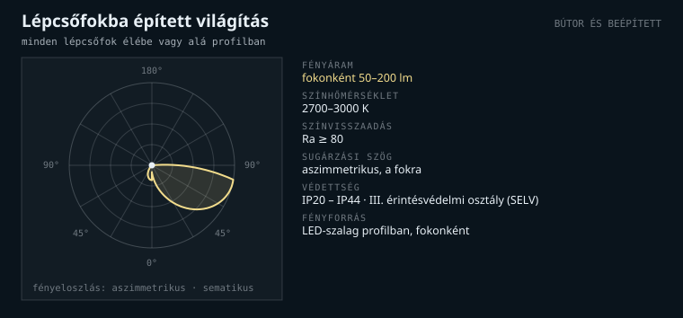

Minden fok alá vagy élébe épített LED-profil, amelyet egy lépcsővezérlő a lépcső aljára és tetejére tett érzékelőkre fokonként, „futva” kapcsol fel és le.

- **Szerelés:** minden lépcsőfok élébe vagy alá profilban
- **Fényforrás:** LED-szalag profilban, fokonként
- **Védettség:** IP20 – IP44 · III. érintésvédelmi osztály (SELV)
- **Fény:** fokonként 50–200 lm · 2700–3000 K · Ra ≥ 80 · aszimmetrikus, a fokra
- **Vezérlés:** lépcsővezérlő mozgásérzékelőkkel (alul, felül), éjszakai alapfényerővel (vonalak: Analóg jelszint: 0–10 V, 1–10 V, 4–20 mA, 2,4 GHz sáv)
- **Beépítés:**
  - Fokonként külön vezeték a vezérlőig: a lépcső építése vagy burkolása előtt kell behúzni.
  - A vezérlő és a tápegység hozzáférhető helyre (lépcső alatti tér, revíziós nyílás).
- **Rögzítés:** Fa, Beton, Forgácslapcsavar, Nylon terpesztődübel
- **Előírás:** MSZ EN 60598-2-21
- **Rajzjel:** `lum.strip` (Rajztár)
- **Hova:** belső lépcső, pincelépcső, kültéri lépcső (IP-s kivitel)
- **Buktatók:**
  - A fokonkénti vezetékezés utólag szinte lehetetlen.
- **Rokon típusok:** Falba süllyesztett lépcső- és orientációs fény, Alumínium profil LED-szalaghoz
- **Keresőszavak:** HU: lépcsővezérlő LED · lépcső világítás futófény — EN: LED stair light controller · stair lighting sequential — DE: Treppenlichtsteuerung LED · Lauflicht Treppe
- **Hol kapható:** LED-szaküzlet.

## 6. Nedves helyiség

### Fürdőszobai mennyezeti lámpa

*Más néven:* IP44 mennyezeti lámpa, fürdőszobalámpa

A fürdő általános világítása párától és fröccsenő víztől védett (legalább IP44) lámpatesttel. A szabvány a fürdőt zónákra osztja; a zóna határozza meg, mi és milyen védettséggel szerelhető oda.

- **Szerelés:** mennyezetre, felületre szerelve
- **Fényforrás:** integrált LED vagy E27 zárt búrában
- **Védettség:** legalább IP44 (zónától függően több) · I. vagy II. érintésvédelmi osztály
- **Fény:** 1000–2500 lm · 3000–4000 K · Ra ≥ 90 (bőrszín, sminkelés) · széles, diffúz
- **Vezérlés:** kapcsolt; a kapcsoló a fürdőn kívül vagy a zónákon kívül; páraelszívóval együtt is (vonalak: Hálózati 50 Hz)
- **Beépítés:**
  - A zónák (0, 1, 2) a kád és a zuhany körül; zóna 1-be és 2-be legalább IPX4, vízsugárnak kitett helyen IPX5. A pontos feltételeket a szabvány adja.
  - A fürdő áramköreit áram-védőkapcsoló védje.
  - Pára: a lámpatest tömítése és a kábelbevezetés tömszelencéje.
- **Rögzítés:** Beton, Gipszkarton, Csempe, járólap, Nylon terpesztődübel
- **Előírás:** MSZ HD 60364-7-701 (fürdő- és zuhanyhelyiségek), MSZ EN 60598-2-1
- **Rajzjel:** `lum.general` (Rajztár)
- **Hova:** fürdőszoba, zuhanyzó, mosdó
- **Buktatók:**
  - A zónán belüli nem megfelelő IP-jű lámpatest balesetveszélyes és szabálytalan.
  - Hideg, gyenge színvisszaadású fény a tükörben rossz arcképet ad.
- **Rokon típusok:** Fürdőszobai beépíthető spot, Tükörvilágítás, LED-korong lámpa („ufó”)
- **Keresőszavak:** HU: fürdőszobai mennyezeti lámpa IP44 — EN: bathroom ceiling light IP44 — DE: Badezimmer Deckenleuchte IP44
- **Hol kapható:** Villamossági nagykereskedés, lámpaszaküzlet.

### Fürdőszobai beépíthető spot

*Más néven:* zuhanyspot, IP65 downlight, vízálló spot

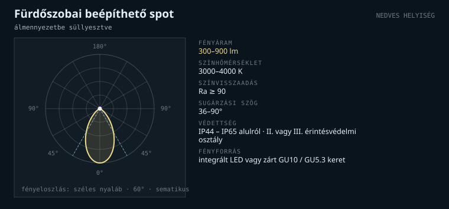

Alulról vízálló (IP44 – IP65) beépíthető spot vagy downlight a fürdő álmennyezetébe, akár a zuhany fölé; a zónától függően törpefeszültségű kivitelben.

- **Szerelés:** álmennyezetbe süllyesztve
- **Fényforrás:** integrált LED vagy zárt GU10 / GU5.3 keret
- **Védettség:** IP44 – IP65 alulról · II. vagy III. érintésvédelmi osztály
- **Fény:** 300–900 lm · 3000–4000 K · Ra ≥ 90 · 36–90°
- **Vezérlés:** kapcsolt; dimmelhető kivitelben is (vonalak: Hálózati 50 Hz)
- **Beépítés:**
  - Zóna 1-ben (a zuhany vagy a kád fölött) a szabvány szerinti védettség és táplálás; a tápegység a zónákon kívül.
  - A tömítés a kerettel és az üveggel együtt alulról számít: a keret mögött pára gyűlhet, ezért szellőzés és tömszelence.
- **Rögzítés:** Gipszkarton, Gipszkarton körkivágó
- **Előírás:** MSZ HD 60364-7-701, MSZ EN 60598-2-2
- **Rajzjel:** `lum.spot` (Rajztár)
- **Hova:** fürdő, zuhanyzó, szauna előtere
- **Buktatók:**
  - Az IP44 elég a zóna 2-ben, de a zuhanysugár alá IPX5 vagy jobb kell.
- **Rokon típusok:** Süllyesztett downlight, Beépíthető spot, Fürdőszobai mennyezeti lámpa
- **Keresőszavak:** HU: IP65 beépíthető spot zuhany fölé — EN: IP65 shower downlight — DE: IP65 Einbaustrahler Dusche
- **Hol kapható:** Villamossági nagykereskedés, világítástechnikai szaküzlet.

### Tükörvilágítás

*Más néven:* tükörlámpa, tükör fölötti lámpa, világító tükör

A tükör előtt álló arcát világítja meg; a legjobb, ha két oldalról vagy a tükör körül szórt fény jön, mert a csak felülről érkező fény árnyékot vet az arcra.

- **Szerelés:** tükör fölé vagy mellé, falra; vagy a tükörbe építve
- **Fényforrás:** integrált LED
- **Védettség:** legalább IP44 · II. érintésvédelmi osztály (gyakran)
- **Fény:** 500–1500 lm · 3000–4000 K, sokszor hangolható · Ra ≥ 90 · széles, az arc felé
- **Vezérlés:** kapcsolt; érintőkapcsoló a tükrön, páramentesítő fűtéssel együtt (vonalak: Hálózati 50 Hz)
- **Beépítés:**
  - A kiállás helye a tükör vagy a tükrös szekrény méretéhez; világító tükörnél a tükör mögött.
  - A mosdó a zónákon kívül esik, de a fröccsenő víz miatt IP44 ajánlott.
- **Rögzítés:** Csempe, járólap, Tömör tégla, Üreges kerámia falazóblokk, Gipszkarton, Nylon terpesztődübel
- **Előírás:** MSZ HD 60364-7-701, MSZ EN 60598-2-1
- **Rajzjel:** `lum.wall` (Rajztár)
- **Hova:** fürdő, mosdó, öltözőasztal
- **Buktatók:**
  - Csak felülről érkező fény az arcon árnyékot vet.
  - A tükrös szekrény és a világító tükör méretéhez a kiállást a megrendelés előtt kell rögzíteni.
- **Rokon típusok:** Fürdőszobai mennyezeti lámpa, Falikar
- **Keresőszavak:** HU: tükörlámpa LED IP44 · világító tükör érintőkapcsolós — EN: LED mirror light IP44 · illuminated mirror — DE: Spiegelleuchte LED IP44 · Lichtspiegel
- **Hol kapható:** Fürdőszoba-szaküzlet, lámpaszaküzlet.

### Páramentes lámpatest

*Más néven:* IP65 armatúra, páramentes LED-armatúra, vízmentes lámpa

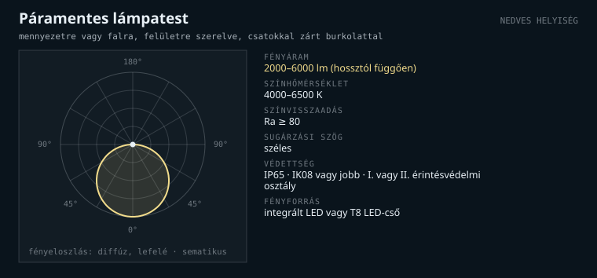

Hosszúkás, tömített (IP65) lámpatest műanyag házzal és búrával; garázs, pince, műhely, mosókonyha, istálló világítására. LED-cső vagy integrált LED világít benne.

- **Szerelés:** mennyezetre vagy falra, felületre szerelve, csatokkal zárt burkolattal
- **Fényforrás:** integrált LED vagy T8 LED-cső
- **Védettség:** IP65 · IK08 vagy jobb · I. vagy II. érintésvédelmi osztály
- **Fény:** 2000–6000 lm (hossztól függően) · 4000–6500 K · Ra ≥ 80 · széles
- **Vezérlés:** kapcsolt; mozgásérzékelős vagy vészvilágítási kivitelben is (vonalak: Hálózati 50 Hz)
- **Beépítés:**
  - A kábelt tömszelencén át kell bevezetni, és a tömítést visszazárni.
  - Sorolható kivitelnél a lámpák egymásról kapnak tápot: a betáplálás és az átkötés a lámpában.
- **Rögzítés:** Beton, Tömör tégla, Nylon terpesztődübel, Beütős dübel
- **Előírás:** MSZ EN 60598-2-1
- **Rajzjel:** `lum.linear` (Rajztár)
- **Hova:** garázs, pince, műhely, mosókonyha, kazánház
- **Buktatók:**
  - A nyitva hagyott vagy rosszul visszazárt tömszelence után a lámpa nem IP65.
  - Fénycsöves régi armatúra LED-csőre cserélésénél a gyújtó és az előtét kezelése a LED-cső típusától függ.
- **Rokon típusok:** Hajólámpa, LED-panel
- **Keresőszavak:** HU: páramentes lámpatest LED IP65 120 cm — EN: LED vapour-tight batten IP65 — DE: LED Feuchtraumleuchte IP65
- **Hol kapható:** Villamossági nagykereskedés, barkácsáruház.

### Hajólámpa

*Más néven:* bulkhead lámpa, ovális hajólámpa, rácsos hajólámpa

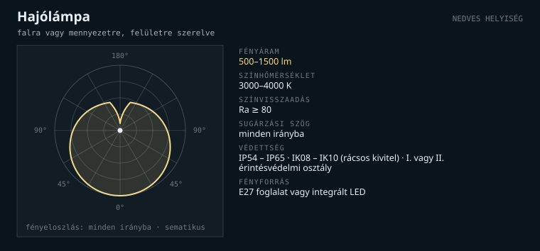

Kis, tömített, ütésálló lámpatest búrával, sokszor védőráccsal; pincében, kamrában, kazánházban, kültéren a bejárat mellett.

- **Szerelés:** falra vagy mennyezetre, felületre szerelve
- **Fényforrás:** E27 foglalat vagy integrált LED
- **Védettség:** IP54 – IP65 · IK08 – IK10 (rácsos kivitel) · I. vagy II. érintésvédelmi osztály
- **Fény:** 500–1500 lm · 3000–4000 K · Ra ≥ 80 · minden irányba
- **Vezérlés:** kapcsolt; mozgásérzékelős kivitelben is (vonalak: Hálózati 50 Hz)
- **Beépítés:**
  - Kültéren a kábelbevezetés alulról, tömszelencével, hogy a víz ne folyjon be.
- **Rögzítés:** Tömör tégla, Beton, Hőszigetelt homlokzat, Nylon terpesztődübel, Rögzítő hőszigetelt homlokzathoz
- **Előírás:** MSZ EN 60598-2-1
- **Rajzjel:** `lum.outdoor` (Rajztár)
- **Hova:** pince, kamra, kazánház, garázs, bejárat
- **Buktatók:**
  - Hőszigetelt homlokzatra a szigetelésen át, távtartó rögzítővel.
- **Rokon típusok:** Páramentes lámpatest, Fali-mennyezeti búra, LED-korong lámpa („ufó”)
- **Keresőszavak:** HU: hajólámpa IP65 · rácsos hajólámpa E27 — EN: bulkhead light IP65 — DE: Ovalleuchte IP65 · Kellerleuchte
- **Hol kapható:** Barkácsáruház, villamossági nagykereskedés.

### Szaunavilágítás

*Más néven:* szaunalámpa, hőálló lámpatest, szauna LED

A szauna hőmérsékletére minősített, magas hőállóságú, nedvességálló lámpatest; a fényt jellemzően fa ráccsal tompítják. Gyakran törpefeszültségű LED, a tápegység a kabinon kívül.

- **Szerelés:** a szauna falára vagy mennyezetére, sokszor fa takarás mögé
- **Fényforrás:** hőálló foglalat vagy szaunába minősített LED / száloptika
- **Védettség:** IP44 vagy több · a gyártó szerint, szaunára minősítve
- **Fény:** 100–600 lm · 2200–3000 K · Ra ≥ 80 · tompított, szórt
- **Vezérlés:** kapcsolt, a kabinon kívülről (vonalak: Hálózati 50 Hz)
- **Beépítés:**
  - A szauna-helyiség szabályai: hőmérsékleti zónák, a kályha körüli tilos terület, a vezetékek hőállósága.
  - A tápegység és a kapcsoló a kabinon kívül.
- **Rögzítés:** Fa
- **Előírás:** MSZ HD 60364-7-703 (szaunák), MSZ EN 60598-2-1
- **Rajzjel:** `lum.general` (Rajztár)
- **Hova:** szauna, gőzkabin (külön minősítéssel)
- **Buktatók:**
  - Nem szaunára minősített LED a hőtől hamar tönkremegy.
  - A kályha fölé szerelt lámpa túlmelegszik.
- **Rokon típusok:** Fürdőszobai mennyezeti lámpa
- **Keresőszavak:** HU: szauna lámpa hőálló · szauna LED világítás — EN: sauna light heat resistant · sauna LED lighting — DE: Saunaleuchte · Sauna LED Beleuchtung
- **Hol kapható:** Szaunaszaküzlet, wellness-forgalmazó.

## 7. Kültéri

### Kültéri falikar

*Más néven:* homlokzati lámpa, bejárati lámpa, kültéri fali lámpa

Az időjárásnak ellenálló, legalább IP44-es fali lámpatest a bejárat, a terasz és a homlokzat világítására; sokszor mozgásérzékelővel vagy alkonykapcsolóval.

- **Szerelés:** homlokzatra, a bejárat, terasz, garázs mellé
- **Fényforrás:** E27 foglalat vagy integrált LED
- **Védettség:** IP44 – IP65 · I. vagy II. érintésvédelmi osztály
- **Fény:** 300–1200 lm · 2700–3000 K · Ra ≥ 80 · kivitel szerint lefelé, fel-le vagy minden irányba
- **Vezérlés:** kapcsolt, mozgásérzékelő, alkonykapcsoló, okos vezérlés (vonalak: Hálózati 50 Hz, 2,4 GHz sáv)
- **Beépítés:**
  - Hőszigetelt homlokzaton távtartó rögzítő vagy a szigeteléskor beépített szerelőelem kell.
  - A kábel bevezetése alulról, tömszelencével; a falon átvezetett kábel mögött tömítés.
  - A kültéri áramkört áram-védőkapcsoló védje.
- **Rögzítés:** Hőszigetelt homlokzat, Rögzítő hőszigetelt homlokzathoz, Tömör tégla, Üreges kerámia falazóblokk, Nylon terpesztődübel
- **Előírás:** MSZ HD 60364-7-714 (kültéri világítás), MSZ EN 60598-2-1
- **Rajzjel:** `lum.outdoor` (Rajztár)
- **Hova:** bejárat, terasz, garázskapu, homlokzat
- **Buktatók:**
  - A szomszéd ablakába vagy az utcára vakító lámpa zavar; lefelé irányított, árnyékolt fény jobb.
  - Fekete fémház napon nagyon felmelegszik.
- **Rokon típusok:** Mozgásérzékelős reflektor, Előtető- és teraszmennyezeti lámpa, Hajólámpa
- **Keresőszavak:** HU: kültéri falilámpa IP54 mozgásérzékelős · homlokzati lámpa — EN: outdoor wall light IP54 with sensor — DE: Außenwandleuchte IP54 mit Bewegungsmelder
- **Hol kapható:** Villamossági nagykereskedés, barkácsáruház, lámpaszaküzlet.

### Mozgásérzékelős reflektor

*Más néven:* LED fényvető, kültéri reflektor, projektor lámpa

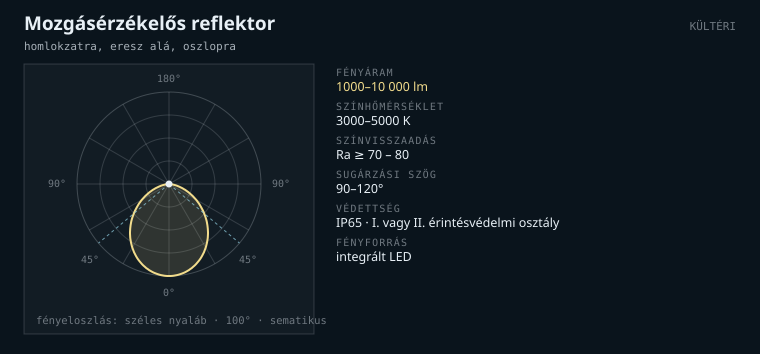

Nagy fényerejű LED-fényvető széles nyalábbal, udvarok, kocsibeállók, kertek megvilágítására; gyakran beépített vagy külön mozgásérzékelővel.

- **Szerelés:** homlokzatra, eresz alá, oszlopra
- **Fényforrás:** integrált LED
- **Védettség:** IP65 · I. vagy II. érintésvédelmi osztály
- **Fény:** 1000–10 000 lm · 3000–5000 K · Ra ≥ 70 – 80 · 90–120°
- **Vezérlés:** mozgásérzékelő (PIR), alkonykapcsoló, időzítés, kamera-rendszerhez kötve (vonalak: Hálózati 50 Hz, 2,4 GHz sáv)
- **Beépítés:**
  - Az érzékelőt az elhaladás irányára keresztben érdemes tájolni, mert úgy érzékel legjobban.
  - A fényvetőt lefelé kell dönteni: vízszintesen vakít és a szomszédba világít.
  - Hőszigetelt homlokzaton távtartó rögzítő.
- **Rögzítés:** Rögzítő hőszigetelt homlokzathoz, Tömör tégla, Beton, Nylon terpesztődübel
- **Előírás:** MSZ HD 60364-7-714
- **Rajzjel:** `lum.flood` (Rajztár)
- **Hova:** udvar, kocsibeálló, kert, raktár
- **Buktatók:**
  - A fák, az autók és a meleg levegő mozgása téves kapcsolást okozhat.
  - A túl erős fényvető fényszennyezés.
- **Rokon típusok:** Kültéri falikar, Homlokzat-megvilágító
- **Keresőszavak:** HU: LED reflektor mozgásérzékelős 30W — EN: LED floodlight with PIR sensor — DE: LED Strahler mit Bewegungsmelder
- **Hol kapható:** Villamossági nagykereskedés, barkácsáruház.

### Kerti oszloplámpa (bollard)

*Más néven:* állólámpa kertbe, kerti oszlop, útszéli lámpa

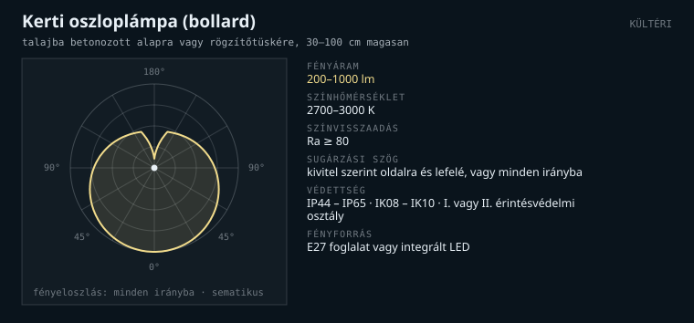

Alacsony, oszlop formájú kültéri lámpa, amely a járdát, az utat és a kert szegélyét világítja meg alacsony fénypontból, kevés vakítással.

- **Szerelés:** talajba betonozott alapra vagy rögzítőtüskére, 30–100 cm magasan
- **Fényforrás:** E27 foglalat vagy integrált LED
- **Védettség:** IP44 – IP65 · IK08 – IK10 · I. vagy II. érintésvédelmi osztály
- **Fény:** 200–1000 lm · 2700–3000 K · Ra ≥ 80 · kivitel szerint oldalra és lefelé, vagy minden irányba
- **Vezérlés:** alkonykapcsoló, időzítés, okos vezérlés (vonalak: Hálózati 50 Hz, 2,4 GHz sáv)
- **Beépítés:**
  - Földkábelt (pl. NYY-J) védőcsőben vagy homokágyban, jelzőszalaggal; a fektetési mélységet az előírás adja.
  - A talp betonalapba vagy gyári rögzítőtüskére; a kábelvég a talpban hozzáférhetően.
  - Kerti áramkör áram-védőkapcsolóval.
- **Rögzítés:** Beton, Csavaros terpesztő horgony, Betoncsavar
- **Előírás:** MSZ HD 60364-7-714
- **Rajzjel:** `lum.outdoor` (Rajztár)
- **Hova:** kerti út, kocsibeálló széle, bejárati járda
- **Buktatók:**
  - A fűnyíró és a hó eltolás megüti: ütésálló kivitel és jól látható hely.
- **Rokon típusok:** Leszúrható kerti spot, Napelemes kerti lámpa, Kapuoszlop- és pillérlámpa
- **Keresőszavak:** HU: kerti oszloplámpa LED · földkábel NYY-J — EN: garden bollard light · underground cable — DE: Pollerleuchte · Erdkabel NYY-J
- **Hol kapható:** Villamossági nagykereskedés, kerti világítás szaküzlet.

### Leszúrható kerti spot

*Más néven:* kerti spot, tüskés spot, fa megvilágító

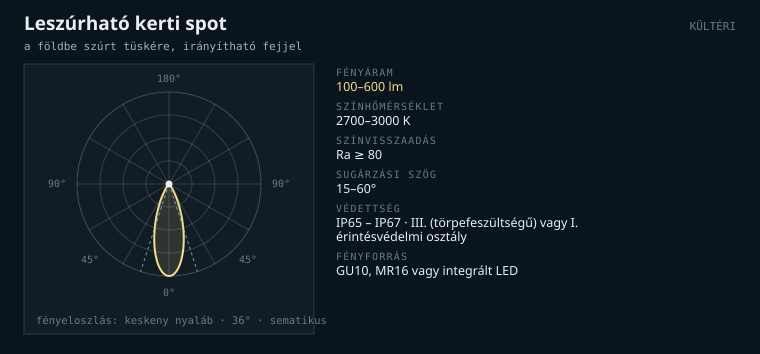

Tüskére szerelt, irányítható kis fényvető fák, bokrok, szobrok, homlokzati elemek megvilágítására; sokszor törpefeszültségű (12 / 24 V) rendszer, amelyet a kertben szabadon át lehet rendezni.

- **Szerelés:** a földbe szúrt tüskére, irányítható fejjel
- **Fényforrás:** GU10, MR16 vagy integrált LED
- **Védettség:** IP65 – IP67 · III. (törpefeszültségű) vagy I. érintésvédelmi osztály
- **Fény:** 100–600 lm · 2700–3000 K · Ra ≥ 80 · 15–60°
- **Vezérlés:** alkonykapcsoló, időzítés, okos vezérlés (vonalak: Hálózati 50 Hz, 2,4 GHz sáv)
- **Beépítés:**
  - Törpefeszültségű rendszernél a transzformátor beltérben vagy védett helyen; a kábel feszültségesése hosszú vonalon számít.
  - 230 V-os spotnál földkábel és földbe szánt kötődoboz kell.
- **Rögzítés:** Beton
- **Előírás:** MSZ HD 60364-7-714
- **Rajzjel:** `lum.outdoor` (Rajztár)
- **Hova:** kert, fák, sövény, homlokzati elemek
- **Buktatók:**
  - A felfelé irányított fény a szomszédot és az eget is világítja: pontos irányítás és árnyékoló.
- **Rokon típusok:** Földbe süllyesztett lámpa (uplight), Kerti oszloplámpa (bollard)
- **Keresőszavak:** HU: leszúrható kerti spot 12V · kerti világítás szett — EN: garden spike light 12V — DE: Erdspießstrahler 12V · Gartenbeleuchtung Set
- **Hol kapható:** Kerti világítás szaküzlet, barkácsáruház.

### Földbe süllyesztett lámpa (uplight)

*Más néven:* inground lámpa, talajba süllyesztett spot, járható lámpa

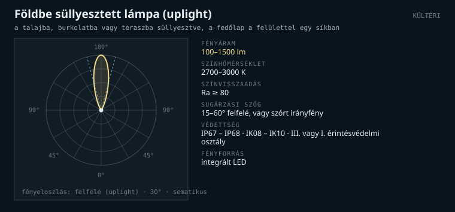

A talajba süllyesztett, felfelé világító lámpatest fák, oszlopok, homlokzatok megvilágítására vagy irányfényként; járható, egyes típusok autóval is terhelhetők.

- **Szerelés:** a talajba, burkolatba vagy teraszba süllyesztve, a fedőlap a felülettel egy síkban
- **Fényforrás:** integrált LED
- **Védettség:** IP67 – IP68 · IK08 – IK10 · III. vagy I. érintésvédelmi osztály
- **Fény:** 100–1500 lm · 2700–3000 K · Ra ≥ 80 · 15–60° felfelé, vagy szórt irányfény
- **Vezérlés:** alkonykapcsoló, időzítés, okos vezérlés (vonalak: Hálózati 50 Hz, 2,4 GHz sáv)
- **Beépítés:**
  - Az aljzat alá vízelvezető kavicsréteg, hogy a lámpa ne álljon vízben.
  - A tömszelencés kábelbevezetés gyári; a kötés földbe szánt kötőkészlettel.
  - A fedőlap felülete forró lehet: ahol mezítláb járnak, arra minősített kivitel.
- **Rögzítés:** Beton
- **Előírás:** MSZ HD 60364-7-714, MSZ EN 60598-2-13 (talajba süllyesztett lámpatestek)
- **Rajzjel:** `lum.outdoor` (Rajztár)
- **Hova:** terasz, kerti út, fák tövében, homlokzat előtt
- **Buktatók:**
  - Lefolyás nélküli helyen a lámpa megtelik vízzel.
  - A felfelé világító fény könnyen vakít, ha a lámpa mellett járnak.
- **Rokon típusok:** Leszúrható kerti spot, Homlokzat-megvilágító
- **Keresőszavak:** HU: földbe süllyeszthető LED lámpa járható · inground spot IP67 — EN: inground uplight IP67 · walk-over light — DE: Bodeneinbaustrahler IP67 · befahrbar
- **Hol kapható:** Kerti világítás szaküzlet, világítástechnikai szaküzlet.

### Homlokzat-megvilágító

*Más néven:* homlokzati fényvető, kültéri wall washer, díszvilágítás

A homlokzatot vagy egy épületrészt egyenletesen, vagy súrolófénnyel megvilágító kültéri lámpatest; az épület formáját rajzolja ki éjszaka.

- **Szerelés:** a homlokzat előtt a talajra, a homlokzat aljára vagy tetejére
- **Fényforrás:** integrált LED
- **Védettség:** IP65 – IP67 · I., II. vagy III. érintésvédelmi osztály
- **Fény:** 500–5000 lm · 2700–4000 K · Ra ≥ 80 · aszimmetrikus, a fal felé
- **Vezérlés:** alkonykapcsoló, időzítés, DALI vagy okos vezérlés (vonalak: DALI, 2,4 GHz sáv)
- **Beépítés:**
  - A faltól mért távolság és a dőlésszög adja az egyenletességet: a gyártói ajánlás szerint.
  - A felfelé világító fényt árnyékolóval kell az égbolttól elzárni.
- **Rögzítés:** Rögzítő hőszigetelt homlokzathoz, Beton, Tömör tégla, Nylon terpesztődübel
- **Előírás:** MSZ HD 60364-7-714
- **Rajzjel:** `lum.flood` (Rajztár)
- **Hova:** homlokzat, kerítés, kapu, támfal
- **Buktatók:**
  - Fényszennyezés: a fény ne lépje túl a megvilágítandó felületet.
- **Rokon típusok:** Fali fényvető (wall washer), Mozgásérzékelős reflektor, Földbe süllyesztett lámpa (uplight)
- **Keresőszavak:** HU: homlokzat megvilágító LED · kültéri wall washer — EN: facade lighting LED · outdoor wall washer — DE: Fassadenbeleuchtung LED · Außen Wandfluter
- **Hol kapható:** Világítástechnikai szaküzlet.

### Medencevilágítás

*Más néven:* medence lámpa, víz alatti lámpa, pool light

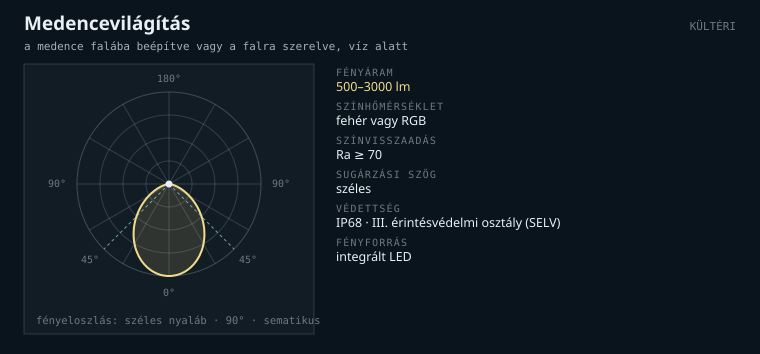

A víz alatt dolgozó, teljesen vízmentes lámpatest a medence falában; törpefeszültségű, és a táplálását a medence zónáin kívül elhelyezett biztonsági transzformátor adja.

- **Szerelés:** a medence falába beépítve vagy a falra szerelve, víz alatt
- **Fényforrás:** integrált LED
- **Védettség:** IP68 · III. érintésvédelmi osztály (SELV)
- **Fény:** 500–3000 lm · fehér vagy RGB · Ra ≥ 70 · széles
- **Vezérlés:** kapcsolt, RGB-vezérlő, a medencegépészet vezérlője (vonalak: 2,4 GHz sáv, 433 MHz sáv)
- **Beépítés:**
  - A medence zónáira (0, 1, 2) vonatkozó szabályok határozzák meg a feszültséget, a védettséget és a transzformátor helyét.
  - A lámpa fészke és a kábelcső a medence építésekor kerül a falba: a medenceépítővel együtt kell tervezni.
  - Egyenpotenciálú összekötés a medence fémrészeivel.
- **Rögzítés:** Beton
- **Előírás:** MSZ HD 60364-7-702 (úszómedencék)
- **Rajzjel:** `lum.outdoor` (Rajztár)
- **Hova:** kerti medence, beltéri medence, jakuzzi
- **Buktatók:**
  - A lámpacseréhez a lámpát a vízből ki kell tudni emelni: a kábelhossz tartalékot a fészekben kell hagyni.
- **Rokon típusok:** LED neon flex, Földbe süllyesztett lámpa (uplight)
- **Keresőszavak:** HU: medence lámpa 12V LED · medence transzformátor — EN: 12V LED pool light · pool light transformer — DE: Poolscheinwerfer 12V LED · Pool Trafo
- **Hol kapható:** Medencetechnikai szaküzlet.

### Napelemes kerti lámpa

*Más néven:* szolár lámpa, napelemes leszúrható lámpa

Saját napelemmel és akkumulátorral működő kis kerti lámpa; nem kell vezeték, alkonykor magától kapcsol. Irányfénynek és díszítésnek jó, általános világításnak kevés.

- **Szerelés:** leszúrva vagy felcsavarozva, vezeték nélkül
- **Fényforrás:** integrált LED, akkumulátor, napelem
- **Védettség:** IP44 – IP65 · III. (saját akkumulátor)
- **Fény:** 5–300 lm · 2700–6000 K · jellemzően nem megadott · kivitel szerint
- **Vezérlés:** beépített alkony- és mozgásérzékelő
- **Beépítés:**
  - Napos helyre, ahol a napelemet nem árnyékolja növény vagy épület; télen kevesebbet világít.
- **Rögzítés:** Beton, Nylon terpesztődübel
- **Előírás:** MSZ EN 60598-2-1
- **Rajzjel:** `lum.outdoor` (Rajztár)
- **Hova:** kert, ágyásszegély, kerti út
- **Buktatók:**
  - Az akkumulátor néhány év után cserére szorul; az olcsó típusok télen alig világítanak.
- **Rokon típusok:** Kerti oszloplámpa (bollard), Leszúrható kerti spot
- **Keresőszavak:** HU: napelemes kerti lámpa — EN: solar garden light — DE: Solar Gartenleuchte
- **Hol kapható:** Barkácsáruház, kertészeti áruház.

### Kapuoszlop- és pillérlámpa

*Más néven:* oszlopfej lámpa, pillérlámpa, kerítéslámpa

A kapuoszlop vagy a pillér tetejére szerelt lámpatest; a bejáratot jelöli és a házszámot, a kaput világítja meg.

- **Szerelés:** a kapuoszlop vagy a kerítéspillér tetejére
- **Fényforrás:** E27 foglalat vagy integrált LED
- **Védettség:** IP44 – IP65 · I. vagy II. érintésvédelmi osztály
- **Fény:** 300–1000 lm · 2700–3000 K · Ra ≥ 80 · minden irányba
- **Vezérlés:** alkonykapcsoló, időzítés, a kaputelefonnal vagy a kapunyitóval összekötve (vonalak: Hálózati 50 Hz, 433 MHz sáv)
- **Beépítés:**
  - A kábelt a pillér építésekor védőcsőben kell felvezetni.
  - A pillér fedlapjába rögzítve; a kábelvég tömszelencén át.
- **Rögzítés:** Beton, Zsalukő, Betoncsavar, Nylon terpesztődübel
- **Előírás:** MSZ HD 60364-7-714
- **Rajzjel:** `lum.outdoor` (Rajztár)
- **Hova:** kapu, kerítés, kocsibejáró
- **Buktatók:**
  - Utólag a pilléren belül nehéz kábelt vezetni.
- **Rokon típusok:** Kerti oszloplámpa (bollard), Kültéri falikar
- **Keresőszavak:** HU: oszlopfej lámpa kapura · pillér lámpa — EN: gate pillar light · post top light — DE: Pfeilerleuchte · Mastaufsatzleuchte
- **Hol kapható:** Lámpaszaküzlet, barkácsáruház.

### Kültéri fényfüzér

*Más néven:* kerti fényfüzér, party füzér, festoon lánc

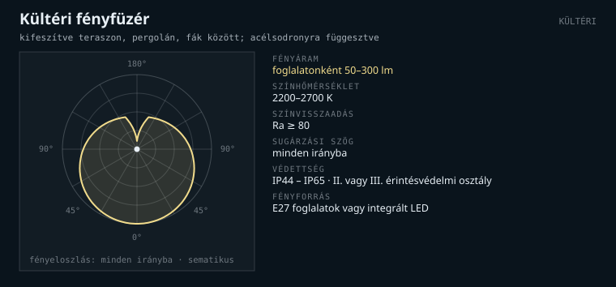

Sorba kötött foglalatok vagy LED-ek egy kábelen, teraszok és kerti terek hangulatvilágítására; dugaszolós, ideiglenes és tartós kivitelben.

- **Szerelés:** kifeszítve teraszon, pergolán, fák között; acélsodronyra függesztve
- **Fényforrás:** E27 foglalatok vagy integrált LED
- **Védettség:** IP44 – IP65 · II. vagy III. érintésvédelmi osztály
- **Fény:** foglalatonként 50–300 lm · 2200–2700 K · Ra ≥ 80 · minden irányba
- **Vezérlés:** kapcsolt kültéri aljzatról, időzítővel vagy okos aljzattal (vonalak: Hálózati 50 Hz, 2,4 GHz sáv)
- **Beépítés:**
  - Tartós felszerelésnél acélsodronyra függesztve, hogy a kábel ne viselje a terhet.
  - A kültéri aljzat legalább IP44-es, fedeles, áram-védőkapcsolóval védett körön.
- **Rögzítés:** Fa, Tömör tégla, Nylon terpesztődübel, Menetes szár, metrikus csavar
- **Előírás:** MSZ EN 60598-2-20 (fényfüzérek)
- **Rajzjel:** `lum.outdoor` (Rajztár)
- **Hova:** terasz, pergola, kert, rendezvénytér
- **Buktatók:**
  - Beltéri füzért kültérre tenni: tilos.
- **Rokon típusok:** Napelemes kerti lámpa, Kültéri falikar
- **Keresőszavak:** HU: kültéri fényfüzér E27 IP65 — EN: outdoor festoon lights IP65 — DE: Außen Lichterkette E27 IP65
- **Hol kapható:** Barkácsáruház, lámpaszaküzlet.

### Előtető- és teraszmennyezeti lámpa

*Más néven:* kültéri downlight, eresz alatti lámpa, előtető lámpa

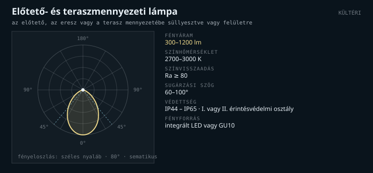

Fedett kültéri mennyezetbe (előtető, terasz, loggia, eresz alja) szerelt, lefelé világító lámpatest; nedvesség és pára ellen védett kivitelben.

- **Szerelés:** az előtető, az eresz vagy a terasz mennyezetébe süllyesztve vagy felületre
- **Fényforrás:** integrált LED vagy GU10
- **Védettség:** IP44 – IP65 · I. vagy II. érintésvédelmi osztály
- **Fény:** 300–1200 lm · 2700–3000 K · Ra ≥ 80 · 60–100°
- **Vezérlés:** kapcsolt, mozgásérzékelő, okos vezérlés (vonalak: Hálózati 50 Hz, 2,4 GHz sáv)
- **Beépítés:**
  - Fa mennyezetbe (lambéria) a lámpa hőjét és a tűzvédelmet figyelembe véve.
  - A pára a mennyezet mögött is lecsapódhat: tömített kivitel.
- **Rögzítés:** Fa, OSB és forgácslap, Gipszkarton körkivágó, Beton
- **Előírás:** MSZ HD 60364-7-714, MSZ EN 60598-2-2
- **Rajzjel:** `lum.spot` (Rajztár)
- **Hova:** terasz, előtető, loggia, kocsibeálló teteje
- **Buktatók:**
  - A rovarok a lámpa köré gyűlnek: melegebb színhőmérséklet kevésbé vonzza őket.
- **Rokon típusok:** Süllyesztett downlight, Kültéri falikar
- **Keresőszavak:** HU: kültéri beépíthető spot IP65 · eresz alatti LED lámpa — EN: outdoor soffit downlight IP65 — DE: Außen Einbaustrahler IP65 · Dachüberstand Leuchte
- **Hol kapható:** Villamossági nagykereskedés, lámpaszaküzlet.

## 8. Biztonsági és jelző

### Önálló akkumulátoros biztonsági lámpatest

*Más néven:* vészvilágító lámpatest, akkus vészvilágítás, self-contained emergency luminaire

Saját akkumulátorral és töltővel működő biztonsági lámpatest: hálózatkimaradáskor magától bekapcsol, és a névleges ideig (jellemzően 1 vagy 3 óra) világít. Készenléti (csak kimaradáskor), állandó üzemű (mindig) vagy kombinált kivitelben.

- **Szerelés:** mennyezetre vagy falra, felületre szerelve vagy süllyesztve
- **Fényforrás:** integrált LED, NiCd / NiMH / LiFePO4 akkumulátor
- **Védettség:** IP20 – IP65 · II. érintésvédelmi osztály (gyakran)
- **Fény:** vészüzemben 100–400 lm · 4000–6500 K · Ra ≥ 70 · menekülési útvonal- vagy nyílt területi optikával
- **Vezérlés:** töltésjelző LED, próbagomb; öntesztes vagy DALI-címezhető kivitel (vonalak: DALI, Hálózati 50 Hz)
- **Beépítés:**
  - Állandó (nem kapcsolt) fázist kap a helyiség világítási áramköréről, hogy annak a kiesésére is bekapcsoljon; a kapcsolt fázis csak állandó üzemű kivitelnél, a gyártó szerint.
  - Az akkumulátor a bekötés után töltődik: a teljes idejű próba csak a teljes feltöltés után.
  - Helye a terv szerint: kijáratok, lépcsők, irányváltások, tűzoltó eszközök fölött.
- **Rögzítés:** Beton, Gipszkarton, Nylon terpesztődübel, Fém üreges fali dübel
- **Előírás:** MSZ EN 60598-2-22, MSZ EN 1838, MSZ EN 50172; a kötelezettség: OTSZ (kártyák: MSZ EN 60598-2-22 · Lámpatestek biztonsági világításhoz, MSZ EN 1838 · Vészvilágítás: alkalmazás, MSZ EN 50172 · Biztonsági világítási rendszerek, OTSZ és TvMI · Hol kell biztonsági világítás)
- **Rajzjel:** `lum.emergency` (Rajztár)
- **Hova:** lépcsőház, folyosó, közösségi terek, munkahelyek, társasház közös terei
- **Buktatók:**
  - Az akkumulátor néhány év alatt elöregszik: az évenkénti teljes próba mutatja meg.
  - A kapcsolt fázisra kötött készenléti lámpatest lekapcsoláskor akkuról világít és lemerül.
- **Rokon típusok:** Központi akkumulátoros rendszer lámpateste, Menekülési útirány- és kijáratjelző, Vészvilágítási modul (konverziós készlet)
- **Keresőszavak:** HU: önálló akkus vészvilágító lámpatest 3 óra · öntesztes vészvilágítás — EN: self-contained emergency light 3h · self-test emergency luminaire — DE: Einzelbatterieleuchte 3h · Notleuchte Selbsttest
- **Hol kapható:** Villamossági nagykereskedés, biztonságtechnikai szaküzlet.

### Központi akkumulátoros rendszer lámpateste

*Más néven:* központi vészvilágítás, CB rendszer, central battery luminaire

Saját akkumulátor nélküli biztonsági lámpatest, amelyet egy központi akkumulátoros egység táplál funkciómegtartó kábelhálózaton. Nagyobb épületekben: egy helyen karbantartható, felügyelhető.

- **Szerelés:** mennyezetre vagy falra, a központi rendszer áramköreire kötve
- **Fényforrás:** integrált LED
- **Védettség:** IP20 – IP65 · a gyártó szerint
- **Fény:** vészüzemben 100–1000 lm · 4000–6500 K · Ra ≥ 70 · menekülési útvonal- vagy nyílt területi optikával
- **Vezérlés:** a központ felügyeli és teszteli (címezhető lámpatestek) (vonalak: Hálózati 50 Hz)
- **Beépítés:**
  - A kábelezés funkciómegtartó (tűzálló) rendszerrel, a terv szerinti időtartamra; a rögzítőelemek is a rendszer részei.
  - A lámpatest és a központ egy gyártói rendszer (címzés, felügyelet).
- **Rögzítés:** Beton, Beütős dübel, Csavaros terpesztő horgony
- **Előírás:** MSZ EN 50171, MSZ EN 60598-2-22, MSZ EN 1838, MSZ EN 50172 (kártyák: MSZ EN 50171 · Központi tápellátó rendszerek, MSZ EN 60598-2-22 · Lámpatestek biztonsági világításhoz, MSZ EN 1838 · Vészvilágítás: alkalmazás, MSZ EN 50172 · Biztonsági világítási rendszerek)
- **Rajzjel:** `lum.emergency-central` (Rajztár)
- **Hova:** irodaház, csarnok, iskola, nagy társasház, mélygarázs
- **Buktatók:**
  - A nem funkciómegtartó rögzítés (műanyag bilincs) tűzben leszakad: a kábelrendszer elemeit egyben kell minősíteni.
- **Rokon típusok:** Önálló akkumulátoros biztonsági lámpatest, Menekülési útirány- és kijáratjelző
- **Keresőszavak:** HU: központi akkumulátoros vészvilágítás · funkciómegtartó kábel E90 — EN: central battery emergency lighting — DE: Zentralbatterie Notbeleuchtung · Funktionserhalt E90
- **Hol kapható:** Biztonságtechnikai szakkereskedés, a rendszer gyártója.

### Menekülési útirány- és kijáratjelző

*Más néven:* kijáratjelző lámpa, EXIT lámpa, zöld futó emberes lámpa

Belülről megvilágított biztonsági jel szabványos piktogrammal (zöld alapon fehér futó ember, ajtó, nyíl). A kijáratot és a menekülés irányát mutatja, hálózatkimaradáskor is világít.

- **Szerelés:** ajtó fölé, falra, mennyezetre függesztve vagy zászlósan
- **Fényforrás:** integrált LED, saját vagy központi akkumulátor
- **Védettség:** IP20 – IP65 · II. érintésvédelmi osztály (gyakran)
- **Fény:** a jel fénysűrűsége a lényeg, nem a fényáram · a zöld jelszín · — · a jel síkjára merőlegesen
- **Vezérlés:** állandó üzemű; öntesztes vagy címezhető kivitel (vonalak: DALI, Hálózati 50 Hz)
- **Beépítés:**
  - A piktogram iránya és a nyíl a menekülés valódi irányát mutassa: a terv és a helyszín együtt.
  - A jel méretét a felismerési távolság adja (belső megvilágítású jelnél kb. 200 × a piktogram magassága).
  - Állandó üzemű: nem kapcsolt fázist kap.
- **Rögzítés:** Beton, Gipszkarton, Nylon terpesztődübel, Fém üreges fali dübel
- **Előírás:** MSZ EN ISO 7010, MSZ EN 1838, MSZ EN 60598-2-22 (kártyák: MSZ EN ISO 7010 · Biztonsági jelek, MSZ EN 1838 · Vészvilágítás: alkalmazás, MSZ EN 60598-2-22 · Lámpatestek biztonsági világításhoz)
- **Rajzjel:** `lum.exit` (Rajztár)
- **Hova:** kijáratok, folyosók, lépcsőházak, közösségi terek
- **Buktatók:**
  - Régi, szöveges (KIJÁRAT) vagy nem szabványos piktogramú jel: cserélni kell.
  - A matricával cserélhető irányú jelnél a beszerelés után ellenőrizni kell a nyilat.
- **Rokon típusok:** Önálló akkumulátoros biztonsági lámpatest, Utánvilágító (fotolumineszcens) jel és csík
- **Keresőszavak:** HU: menekülési útirányjelző lámpa ISO 7010 · kijáratjelző akkus — EN: emergency exit sign light ISO 7010 — DE: Rettungszeichenleuchte ISO 7010
- **Hol kapható:** Villamossági nagykereskedés, biztonságtechnikai szaküzlet.

### Süllyesztett biztonsági spot

*Más néven:* álmennyezeti vészvilágító spot, beépíthető vészvilágítás

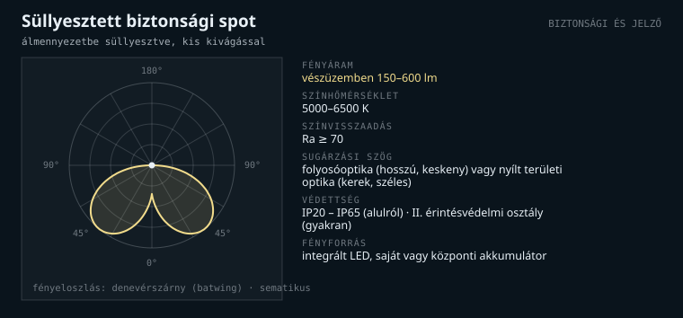

Kis méretű, álmennyezetbe süllyesztett biztonsági lámpatest cserélhető optikával: hosszú, keskeny eloszlás folyosóra (menekülési útvonal), kerek, széles eloszlás nagy térre (nyílt terület). Szinte láthatatlan, amíg nem kell.

- **Szerelés:** álmennyezetbe süllyesztve, kis kivágással
- **Fényforrás:** integrált LED, saját vagy központi akkumulátor
- **Védettség:** IP20 – IP65 (alulról) · II. érintésvédelmi osztály (gyakran)
- **Fény:** vészüzemben 150–600 lm · 5000–6500 K · Ra ≥ 70 · folyosóoptika (hosszú, keskeny) vagy nyílt területi optika (kerek, széles)
- **Vezérlés:** készenléti üzemű; öntesztes vagy DALI-címezhető kivitel (vonalak: DALI, Hálózati 50 Hz)
- **Beépítés:**
  - A kiosztás a fotometriai számításból jön: a lámpatestek közti legnagyobb távolságot a gyártó táblázata adja az optikához és a szerelési magassághoz.
  - Az akkumulátoros egység a kivágás mellett az álmennyezet fölé kerül: a cseréhez hozzáférés.
- **Rögzítés:** Gipszkarton, Gipszkarton körkivágó
- **Előírás:** MSZ EN 1838, MSZ EN 60598-2-22 (kártyák: MSZ EN 1838 · Vészvilágítás: alkalmazás, MSZ EN 60598-2-22 · Lámpatestek biztonsági világításhoz, MSZ EN 50172 · Biztonsági világítási rendszerek)
- **Rajzjel:** `lum.emergency` (Rajztár)
- **Hova:** irodák, folyosók, üzletek, rendelők álmennyezete
- **Buktatók:**
  - A rossz optika (folyosóoptika nagy térben) foltos, a követelményt nem teljesítő megvilágítást ad.
- **Rokon típusok:** Önálló akkumulátoros biztonsági lámpatest, Nagy terek biztonsági lámpateste (nyílt terület)
- **Keresőszavak:** HU: beépíthető vészvilágító spot folyosó optika — EN: recessed emergency downlight corridor lens — DE: Einbau Sicherheitsleuchte Rettungswegoptik
- **Hol kapható:** Biztonságtechnikai szakkereskedés, villamossági nagykereskedés.

### Nagy terek biztonsági lámpateste (nyílt terület)

*Más néven:* pánikellenes világítás, csarnok vészvilágítás, anti-panic lighting

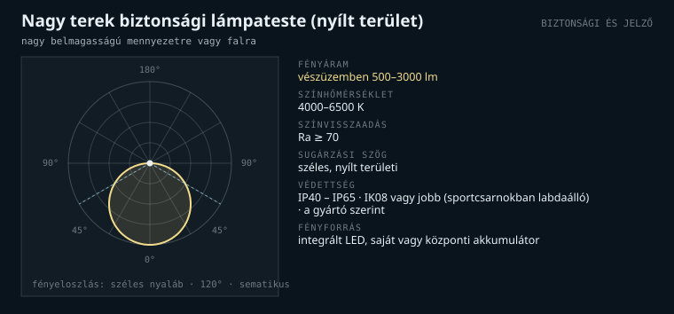

Nagy terekhez (csarnok, sportterem, raktár, közösségi tér) méretezett biztonsági lámpatest nagyobb fényárammal és széles, egyenletes eloszlással, hogy áramszünetben ne törjön ki pánik, és mindenki elérje a menekülési útvonalat.

- **Szerelés:** nagy belmagasságú mennyezetre vagy falra
- **Fényforrás:** integrált LED, saját vagy központi akkumulátor
- **Védettség:** IP40 – IP65 · IK08 vagy jobb (sportcsarnokban labdaálló) · a gyártó szerint
- **Fény:** vészüzemben 500–3000 lm · 4000–6500 K · Ra ≥ 70 · széles, nyílt területi
- **Vezérlés:** készenléti vagy állandó üzemű; öntesztes vagy központi felügyelettel (vonalak: DALI, Hálózati 50 Hz)
- **Beépítés:**
  - Nyílt területre a padlón legalább 0,5 lx (a szélső 0,5 m nélkül): a kiosztást számítással kell igazolni.
  - Nagy magasságban a karbantartás (akkucsere) gépet kíván: központi rendszer lehet jobb.
- **Rögzítés:** Beton, Acélszerkezet, Csavaros terpesztő horgony
- **Előírás:** MSZ EN 1838, MSZ EN 60598-2-22 (kártyák: MSZ EN 1838 · Vészvilágítás: alkalmazás, MSZ EN 60598-2-22 · Lámpatestek biztonsági világításhoz, OTSZ és TvMI · Hol kell biztonsági világítás)
- **Rajzjel:** `lum.emergency` (Rajztár)
- **Hova:** csarnok, sportterem, raktár, mélygarázs, rendezvényterem
- **Buktatók:**
  - Sportcsarnokban labdaálló kivitel és védőrács kell.
- **Rokon típusok:** Süllyesztett biztonsági spot, Központi akkumulátoros rendszer lámpateste
- **Keresőszavak:** HU: csarnok vészvilágítás IP65 · nyílt területi vészvilágítás — EN: high bay emergency lighting · open area emergency lighting — DE: Hallen Sicherheitsleuchte · Antipanikbeleuchtung
- **Hol kapható:** Biztonságtechnikai szakkereskedés.

### Vészvilágítási modul (konverziós készlet)

*Más néven:* vészvilágító modul, emergency kit, inverter modul LED-hez

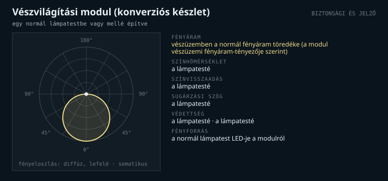

Akkumulátorból, töltőből és átkapcsolóból (inverterből) álló egység, amely egy hagyományos lámpatestet biztonsági lámpatestté alakít: kimaradáskor csökkentett fényerővel a saját akkumulátoráról táplálja a LED-et.

- **Szerelés:** egy normál lámpatestbe vagy mellé építve
- **Fényforrás:** a normál lámpatest LED-je a modulról
- **Védettség:** a lámpatesté · a lámpatesté
- **Fény:** vészüzemben a normál fényáram töredéke (a modul vészüzemi fényáram-tényezője szerint) · a lámpatesté · a lámpatesté · a lámpatesté
- **Vezérlés:** töltésjelző, próbagomb, önteszt (vonalak: Hálózati 50 Hz)
- **Beépítés:**
  - A modulnak kompatibilisnek kell lennie a lámpatest LED-meghajtójával és a LED-modul feszültségével (a gyártói lista szerint).
  - Az átalakított lámpatest megfelelőségéért az átalakító felel: a gyártói átalakítás vagy előre gyártott vészvilágítási kivitel biztonságosabb.
  - A vészüzemi fényáramot a lámpatest helyén is ellenőrizni kell (számítás).
- **Előírás:** MSZ EN 61347-2-7 (a modul), MSZ EN 60598-2-22 (az átalakított lámpatest) (kártyák: MSZ EN 60598-2-22 · Lámpatestek biztonsági világításhoz, MSZ EN 1838 · Vészvilágítás: alkalmazás)
- **Rajzjel:** `lum.emergency` (Rajztár)
- **Hova:** ahol a normál lámpatest a biztonsági világítás része: irodák, folyosók, üzletek
- **Buktatók:**
  - Nem kompatibilis meghajtóval a modul nem kapcsol át, vagy tönkreteszi a LED-et.
  - A vészüzemi fényáram sokkal kisebb, mint a normál: a terv ezzel számoljon.
- **Rokon típusok:** Önálló akkumulátoros biztonsági lámpatest, LED-panel, Páramentes lámpatest
- **Keresőszavak:** HU: vészvilágító modul LED-hez 3 óra · inverter modul vészvilágítás — EN: LED emergency conversion kit 3h — DE: Notlichtumschaltmodul LED 3h · Notlichtbaustein
- **Hol kapható:** Villamossági nagykereskedés, biztonságtechnikai szaküzlet.

### Áramszünet-jelző éjszakai fény

*Más néven:* konnektoros vészfény, kivehető zseblámpás éjszakai fény, power failure light

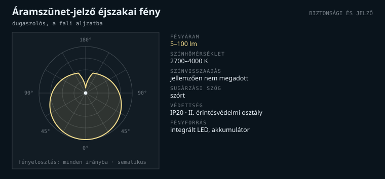

Lakásba való, konnektorba dugott kis lámpa: éjszakai tájékozódó fény, áramszünetkor magától bekapcsol, és sokszor kivehető zseblámpaként is használható. Nem a szabványos biztonsági világítás része, de lakásban hasznos.

- **Szerelés:** dugaszolós, a fali aljzatba
- **Fényforrás:** integrált LED, akkumulátor
- **Védettség:** IP20 · II. érintésvédelmi osztály
- **Fény:** 5–100 lm · 2700–4000 K · jellemzően nem megadott · szórt
- **Vezérlés:** alkonykapcsoló, automatikus bekapcsolás áramszünetkor (vonalak: Hálózati 50 Hz)
- **Beépítés:**
  - Folyosó, lépcső, hálószoba ajtaja mellé, egy elérhető aljzatba.
- **Előírás:** MSZ EN 60598-2-12 (aljzatba dugható éjszakai fények)
- **Rajzjel:** `lum.general` (Rajztár)
- **Hova:** folyosó, gyerekszoba, lépcső, idősek lakása
- **Buktatók:**
  - Nem helyettesíti a kötelező biztonsági világítást ott, ahol az előírás azt kéri.
- **Rokon típusok:** Ágy alatti orientációs fény, Falba süllyesztett lépcső- és orientációs fény
- **Keresőszavak:** HU: áramszünet lámpa konnektorba · vészfény zseblámpával — EN: plug-in power failure night light — DE: Notlicht Steckdose mit Taschenlampe
- **Hol kapható:** Barkácsáruház, műszaki áruház.

### Utánvilágító (fotolumineszcens) jel és csík

*Más néven:* fluoreszkáló menekülési jel, foszforeszkáló csík, photoluminescent sign

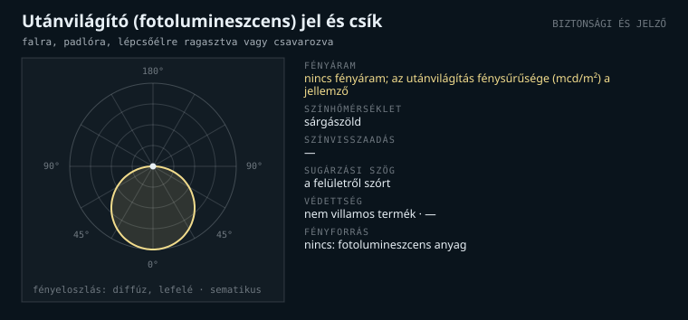

Áram nélkül működő jel vagy csík, amely a környező fényből töltődik fel, és sötétben egy ideig magától világít. Kiegészíti a biztonsági világítást (lépcsőél, padló menti útvonal, jelek), de nem helyettesíti.

- **Szerelés:** falra, padlóra, lépcsőélre ragasztva vagy csavarozva
- **Fényforrás:** nincs: fotolumineszcens anyag
- **Védettség:** nem villamos termék · —
- **Fény:** nincs fényáram; az utánvilágítás fénysűrűsége (mcd/m²) a jellemző · sárgászöld · — · a felületről szórt
- **Vezérlés:** nincs: a normál világítás tölti fel
- **Beépítés:**
  - Csak ott működik, ahol a normál világítás rendszeresen feltölti.
  - A jel piktogramja szabványos legyen; méretét a felismerési távolság adja.
- **Rögzítés:** Nylon terpesztődübel, Csempe, járólap
- **Előírás:** MSZ EN ISO 7010, ISO 16069 (utánvilágító menekülési jelrendszerek) (kártyák: MSZ EN ISO 7010 · Biztonsági jelek)
- **Hova:** lépcsőház, menekülési útvonal, hajó, alagút, mélygarázs
- **Buktatók:**
  - Sötét helyen, ahol nincs feltöltő fény, nem világít.
  - Idővel halványul: cserélni kell.
- **Rokon típusok:** Menekülési útirány- és kijáratjelző
- **Keresőszavak:** HU: utánvilágító menekülési jel · fotolumineszcens csík lépcsőre — EN: photoluminescent exit sign · glow in the dark stair strip — DE: langnachleuchtendes Rettungszeichen · nachleuchtende Treppenmarkierung
- **Hol kapható:** Biztonságtechnikai szaküzlet, munkavédelmi bolt.
