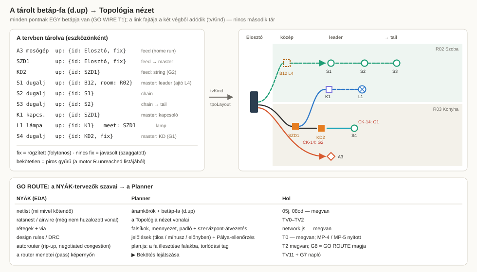

# Topology View (TV): the netlist / ratsnest view of the Erősáram layer, inside GO ROUTE

*Build pack for the user's request of 2026-10-22: a Planner plugin that acts as a **Viewer mode** showing every device and
the connections between them **topologically** rather than geometrically. In it the user sets how circuits run from
the Elosztó downstream; that is the basis of the autowiring, which plays back circuit by circuit.*

*Revision **r2**, 2026-10-29. The user asked to "add this in detail and merge it into the same workflow I am setting up
with GO ROUTE". So r2 does three things:*
- *it is **rebased on the GO WIRE up-tree** (WIREWAY_AUDIT Parts 4–11, built 2026-10-18/19), which already stores most
  of what r1 planned to store;*
- *it is **filed under GO ROUTE** (`GO-ROUTE.md` §5);*
- *it hands the engine-side features to GO ROUTE as **G1–G8** (`02_ENGINE_GAPS.md`).*

*Analysis only: nothing here is built.*

## What changed from r1 (2026-10-22)

| r1 | r2 | Why |
|---|---|---|
| a new store `c.topo.links` per circuit | **`d.up`** on every node (08od), plus `d.lead`, `lamp.meet`, `sw.ctl` / `grp` / `swHead` | GO WIRE built the same tree a week earlier; two stores would contradict each other |
| link kinds `feed / master / chain / sw / lamp` stored | link kinds **derived** from the two ends (`tvKind`, §2) | one fact, one place |
| its own router (r1 T9) and its own sharing calculation (r1 T10) | **the engine's run** (`BL_LAST`: `R.legs`, `R.spans`, `R.report`), mapped onto the view | one engine (E5-Q5, GO WIRE T2) |
| r1 T12, "make the engine follow the topology" | done by GO WIRE T2 for what `up` can say; the rest is **G1–G8** | — |
| WPs `T0…T12`, decisions `Q-T01…` | **`TV0…TV12`**, **`Q-TV01…`** | `T0…T7` and `Q-T0-n` are GO WIRE's names |
| modules `08p…08pd` | **`08t…08td`** | `08p-slab.js` exists now |
| acceptance on CLA (local only) | the **practice apartment** `tools/practice/Gyakorlo_lakas_villany.vplan.json` (in git, not client data), plus Budakalász when GO ROUTE has it | cloud sessions can run it |

## Files

Read in this order:
1. `GO-ROUTE.md` §5 (where this fits)
2. `00_CONTRACT.md`
3. this README, §2–§5
4. the WP you build
5. only the `01_RULES.md` / `02_ENGINE_GAPS.md` sections that WP names

| File | What |
|---|---|
| `README.md` | this file: the model, the mapping to what exists, the view, the map, the order, the status |
| `00_CONTRACT.md` | where and how to work, modules `08t*`, the data (one new field), the golden policy, the report |
| `01_RULES.md` | the hard rules **PR / TR / SR / CK**, each tagged **built**, **TV** (this pack) or **G<n>** (engine gap) |
| `02_ENGINE_GAPS.md` | **G1–G8**: what the user can draw but the engine cannot follow yet; GO ROUTE's candidate features |
| `WP-TV0` … `WP-TV12` | one short session each |
| `TOPO-Q-001.json` | the decision pack, r2: 19 questions; the ones the built tree already answers are marked |
| `PROMPTS.md` | resolve / build-one / build-wave / verify / status |
| `fig/01…09` | the drawings; `fig/09` maps the up-tree onto the view and the PCB words onto ours |

---

## 1. The user's request, item by item

| # | The user's words (short) | Built already (GO WIRE / workflow) | This pack |
|---|---|---|---|
| 1 | A plugin, a Viewer mode, topological instead of geometric | — | **TV0, TV2** |
| 2 | Elosztó + endpoints placed first = the upstream–downstream basis | E3 / E4 placement, the board as the root of `d.up` | read only |
| 3 | Walls make the path between every endpoint = the geometric proof; a simplified view on one common empty pathway, left→right and top→down; a line = the wall section between two points | the wall graph `BL.network.build`; `R.unreached` | **TV1** (the path graph), **TV2** |
| 4 | Elosztó → dedicated endpoint pairs | `up = board` on a DED (T1 auto-fill) | **TV5**: drawn in the view |
| 5 | Elosztó → midpoint / Kötődoboz pairs | szobadoboz → board = master (T1 / T3) | **TV5**; a plain KD = **G1** |
| 6 | Elosztó → KD → KD string circuits (V1); each KD becomes a betáp point | `up` allows hub → hub | **TV5**; the engine = **G2** |
| 7 | Create or choose the circuit set (CLANV4: only 2 klíma, + a custom one) | M2 presets `cpr*`, CLANV4 sample, the Elosztó tray (T4) | **TV4**: the set panel in the view |
| 8 | Master → leader connections | `upRole` master / leader (T1); the ⛓ chain tool (T5) | **TV5** |
| 9 | Leader → tail socket strings: least horizontal travel, arcs beside the gerinc | 📍 `d.lead`, `ldChains` along the routable walls (T3) | **TV6**; the arc = **G6** |
| 10 | Light and switch logic: switch → switch → lamp, or a star through a common point | `sw.ctl`, `grp`, `swHead`, `lamp.meet`; the engine's travellers (plan.js :274) | **TV7**; the true star = **G3** |
| 11 | Circuits cover every device; this is the basis of the autowiring | the tray (T4), `upCheck`, the engine fits the tree (T2) | **TV3** checks, **TV8** |
| 12 | Autowiring flashes circuit by circuit into a composite; conduit size and count with shared paths | the per-pipe packing (trunk), `sizeConduit`, the report | **TV9–TV11**; the log = **G7**, sharing = **G5** |
| 13 | User-placed KDs as preferred or mandatory departure points | — | **TV5** stores `tpoRole`; the engine = **G4** |
| 14 | A basic version first: the traditional circuits, with simple SVG visuals | — | §6 scope; `fig/` |
| 15 | An outline in short segments | — | the WP files + `PROMPTS.md` |

---

## 2. The model: three graphs on one tree


| # | Graph | Source | Stored? |
|---|---|---|---|
| 1 | **Pálya-gráf** `GP`: anchors and the wall sections between them | `BL.network.build` contracted onto the anchors (TV1) | derived, cached on `blInput(level).sig` |
| 2 | **Betáp-fa** `T`: who feeds whom | **`d.up = {id, room?, via?, fix?}`** on every node (08od), plus `d.lead` (08oe), `lamp.meet` (08n), `sw.ctl` / `grp` / `swHead` (08l) | **stored**, as GO WIRE built it |
| 3 | **Csőközösség** `S`: which circuits share which stretch, in how many pipes | the engine's last run `BL_LAST.R` (`legs`, `spans`, `pipes`, `report`), mapped onto GP edges (TV9) | derived; ⚒ Pályák writes it as `gen:'bl'` |



**Link kinds are derived, never stored.** `tvKind(child)` reads the types of the child and of `child.up.id`:

| child → up | Kind | Rule |
|---|---|---|
| DED → board | `feed` (home run) | TR-D1 |
| hub / KD → board, or hub / KD → hub / KD | `feed` (string when hub → hub) | TR-H1, G1, G2 |
| endpoint → hub, KD, board or door L4 | `master` (the child is a leader; `upRole` says so) | TR-S1, TR-L1 |
| SOC → SOC | `chain` | TR-S3 |
| SWI → SWI | `sw` (chain switching) | TR-L1, G3 |
| SWI → hub, while the group's lamps → the same hub | `sw` (star) | TR-L1, G3 |
| LMP → SWI, LMP → LMP, LMP → meet box | `lamp` | TR-L1, TR-L5 |

**States are GO WIRE's:**
- none;
- **javasolt** (suggested): dashed;
- **rögzített** (fixed by the user): solid;
- **bekötetlen** (not wired): red, from `R.unreached`.

The view draws them the way the 🌳 overlay does (`upState`, `UP_COL`), so the two never disagree.

---

## 3. The view


- **Opens** as a full-window overlay (Q-TV14 A), from four places:
  - `⌗ Topológia` in the phase bar (`PH_LIST`, 05db-layout.js:25), under Villamosság and Pályák;
  - the action `view.topology`;
  - the Elosztó's menu;
  - the 🌳 betáp-fa toggle's menu.
  - Esc steps out.
- **Three tabs on one canvas:**
  - **Pályák**: GP, the "one common, empty pathway";
  - **Betáp-fa**: the `up` tree over a faded GP;
  - **Csövek**: the engine's legs and pipes on GP edges.
- **Layout** (Q-TV12 A):
  - columns: Elosztó | masters and KDs (deeper string nodes further right) | leader → … → tail;
  - rows: room lanes, in the order the trunk reaches them;
  - deterministic.
- **The view edits only through the existing functions:**
  - `upSet` / `upFix` / `upClear` / `upAcceptRoom`;
  - `ldSetLeader`;
  - `trayApply`;
  - `cprActivate`;
  - `lswLink` / `lswGroup`.
  - The one new field is `tpoRole` on a junction (00_CONTRACT §3).
  - Never a device move.
- **Selection is shared with the blueprint.** A link's wall sections show in the inspector's mini-plan and, on request,
  flash on the canvas.


---

## 4. The map: work packages

| WP | Title | Size | Module | Depends | Delivers |
|---|---|---|---|---|---|
| **TV0** | View shell | S ~90 | `08tb-tpo-view.js` | — | overlay, tabs, pan / zoom, open / close, action, phase-bar entry, Esc |
| **TV1** | Pálya-gráf | M ~150 | `08t-tpo-graph.js` | TV0 | `tpoGraph(level)`: anchors, wall-section edges, unreachable; the cache |
| **TV2** | Layout and render | M ~200 | `08tb` | TV1 | columns / lanes / barycentre, symbols, the `up` states, selection sync, mini-plan ⏸ |
| **TV3** | Roles and checks | S ~120 | `08ta-tpo-model.js` | TV1 | `tvKind`, `tvPattern`, `tvGroups`, `tvCheck` = `upCheck` + CK-8 … CK-13 ⏸ rules |
| **TV4** | Körkészlet | S ~110 | `08tc-tpo-edit.js` | TV3 | the set panel (M2 presets, CLANV4, counts, ＋ Saját) + the tray inside the view |
| **TV5** | Feed and master | M ~140 | `08tc` | TV4 | ⤳ Betáp / ⇢ Master on the canvas (`upSet`); ▣ KD role `tpoRole`; the string |
| **TV6** | Socket chain | S ~100 | `08tc` | TV5 | ⋯ Lánc on the canvas (the `bfl` rules), 📍 leader, reorder, the `ldChains` order |
| **TV7** | Switching | M ~150 | `08tc` | TV5 | groups, chain / star written as `up`, hub, types (`lswType`), cores per link |
| **TV8** | Suggest and accept | S ~90 | `08ta` | TV3–TV7 | ✨ = `upFill` + `ldChains` + ▣ masters, shown as one approval table; "Elfogadom mind" per lane |
| **TV9** | Engine overlay | M ~140 | `08t` | TV1 | `BL_LAST.R` legs / spans / pipes mapped onto GP edges and anchors; stale-aware |
| **TV10** | Csövek tab | M ~150 | `08td-tpo-share.js` | TV9 | runs, pipes per stretch, box fill, departures (computed from R), the share table ⏸ |
| **TV11** | Playback | S ~130 | `08tb` | TV9 (+ G7) | ▶ circuit by circuit → composite; with G7 / G8, the router's passes |
| **TV12** | Engine gaps | — | `tools/baseline` | GO ROUTE | the G-items the user picks in GO ROUTE §2, each its own WP (`02_ENGINE_GAPS.md`) |

Line counts are new code. A WP reads its own file plus the named anchors: about 3–6 k tokens of pack.

---

## 5. Order and checkpoints, within GO ROUTE

```
GO ROUTE §2 answers
  │
  ├─ Wave A  (see; no engine change, no data written)   TV0 → TV1 → TV2 ⏸ → TV9 → TV10 ⏸
  │            the router's inspection tool: every later engine change is looked at here first
  ├─ Router  (GO ROUTE §2 Q3 A/B/C)                     G7 first (the log), then the user's G-items / G8
  ├─ Wave B  (set; writes d.up / d.lead / tpoRole)      TV3 ⏸ → TV4 → TV5 → TV6 → TV7 → TV8
  └─ Wave C  (play)                                     TV11 (on G7; shows G8's passes when they exist)
```

- **Wave A first:**
  - It only reads (`d.up`, `BL_LAST`), so it is safe on the practice flat today.
  - It is exactly what a router project needs: a ratsnest to see the netlist and a view of what the router did.
- **Wave B can run in parallel with the router.** It edits the tree the router consumes, through `upSet`.
- A Wave B feature that needs an engine gap (KD as master G1, the string G2, the star G3, KD roles G4) is drawable and
  stored right away. Its CK line says `'a motor még nem követi (G<n>)'` until the G-item is built.

| ⏸ | Show | Why |
|---|---|---|
| **TV2** after build | the practice flat and the 4-room fixture: the Pályák and Betáp-fa tabs (screenshots) | the layout is judged by eye |
| **TV10** after build | the practice flat's Csövek tab next to its 🔎 Pálya-ellenőrzés report | the view must say what the engine says, number for number |
| **TV3** before build | `01_RULES.md` §5–§6, every ⚑ (cores, N through switch boxes, branching, 600 mm) | trade rules, not mine |

---

## 6. Scope of the basic version

**In:**
- dedikált, dugaljkör chains, világítás with switching, the V1 string;
- one level at a time (an Alosztó is its own root; E6's feeder is one feed link).

**Out:**
- redőny (MP-18 / audit Q3 decides);
- BRIDGE layers (`topo:'star'` in `EP_CAT` is their hook);
- three-phase balance;
- RCD groups;
- a free-form graph editor.

---

## 7. Reuse map: never rewrite these

| Need | Existing piece |
|---|---|
| the tree, its invariants, states, roles | `08od-wf-uptree.js`: `upSet` (one upstream, no loop, same level), `upChain`, `upRole`, `upState`, `upCheck`, `upFill`, `upAcceptRoom`, `UP_COL` |
| leader sockets, socket chain order, master suggestions | `08oe-wf-leaders.js`: `ldSetLeader`, `ldChains`, `ldMasters`, `ldPlaceMasters` |
| circuits for endpoints that reached the board | `08of-wf-tray.js`: `trayWaiting`, `trayRows`, `trayApply` |
| the click-by-click chain | `08og-wf-chaintool.js`: `bflClick` (source rules, branch = the same up, loop refused) |
| a drawn route for one link | `08oh-wf-via.js`: `viaSet`, `viaClear` |
| circuit presets and sets | `08o-cpr.js`: `CPR_CAT`, `cprActivate`, `cprExpect`, `cprLoadSample`, `cprImport` / `cprExport`, `cprAddCustom` |
| switching groups and types | `08l-wf-switches.js`: `lswGroup`, `lswLink`, `lswLegsOf`, `lswChain`, `lswType`, `lswRetypeAll` |
| boxes and meeting points | `08n-wf-boxes.js`: `jbServicePoints`, `jbMeet`, `jbToolStart('kot')` |
| the engine and its run | `08ob-wf-engine.js`: `blInput`, `blRun` / `BL_LAST`, `blStale`, `blShow`, `blReportHtml` |
| fill, capacity, cables | `tools/baseline/rules.js`: `sizeConduit`, `IZ`, `groupK`, `SWITCH_LEG`, `CABLES`, `CONDUITS` |

---

## 8. Status

| WP | Status | Spec | Note |
|---|---|---|---|
| TV0 – TV12 | **planned** (r1 2026-10-22, r2 2026-10-29) | — | nothing built; G1–G8 wait for GO ROUTE §2 |

## 9. Answers

*(empty: fill in with `PROMPTS.md` §0, or in the GO ROUTE answer round)*
