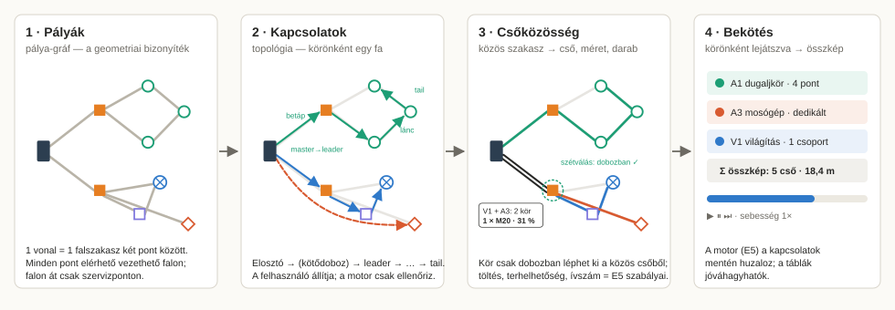
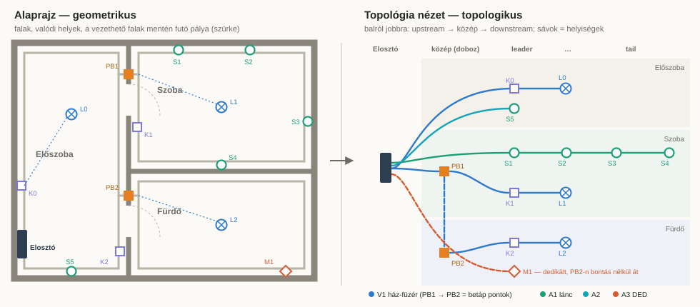
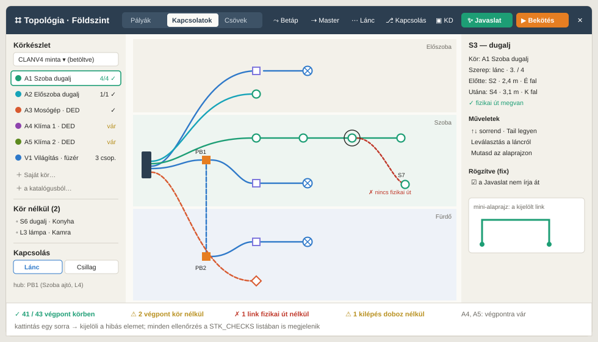

# Topology View (TPO): a topological viewer and connection editor for the Planner's Erősáram layer

*Build pack for the user's request of 2026-10-22: a Planner plugin that acts as a **Viewer mode** showing every device and
the connections between them as a **topological** layout, instead of the geometric one the blueprint shows. In it the
user sets how circuits run from the Elosztó downstream. Autowiring is then built on those settings, and plays back
circuit by circuit. **Analysis only, nothing here is built yet.** The pack was written against branch `planner-stack` as
merged into the default branch (`c421d4e`). Every anchor below was read in that tree.*

Read in this order:
1. `00_CONTRACT.md`
2. this README (§2 the model, §4 the map, §5 the order)
3. the WP you build
4. only the `01_RULES.md` sections that WP names

`TOPO-Q-001.json` holds the open decisions, each with a recommended default. A WP builds the default unless §9
"Answers" says otherwise.

| File | What |
|---|---|
| `README.md` | this file: the idea, the three-graph model, the view, the map, the order, the checkpoints, the status |
| `00_CONTRACT.md` | where and how to work, the module files, the data additions, the golden policy, the report format |
| `01_RULES.md` | **the hard rules**, numbered (PR / TR / SR / CK), so specs and checks can cite them |
| `WP-T0` … `WP-T12` | one small file per work package (13 in all), each sized for one short session |
| `TOPO-Q-001.json` | the decision pack (tuner format), 16 questions |
| `PROMPTS.md` | build-one / verify / resolve / status prompts |
| `fig/*.svg` | the eight drawings referenced below |

---

## 1. What the user asked for, item by item

| # | The user's words (short) | Where it lands |
|---|---|---|
| 1 | A plugin, a **Viewer mode**: every device and the connections between them, **topological instead of geometric** | T0 seam, T2 view |
| 2 | Elosztó and every endpoint are placed first: that is the upstream–downstream basis | input; nothing new (E3/E4 already place them) |
| 3 | Walls create the path between every endpoint, which is the **geometrical proof that two points can be connected**. Then a simplified view opens with all elements on **one common, empty pathway**, left→right and top→down = upstream, mid, downstream. **A line = the wall section between two points** | T1 path graph, T2 layout (`fig/02`) |
| 4 | Set **Elosztó → dedicated endpoint** pairs | T5 |
| 5 | Set **Elosztó → midpoint / Kötődoboz** pairs | T5 |
| 6 | **Elosztó → kötőpont → kötőpont string** circuits (V1-style house strings; every KD touched becomes a betáp point) | T5 + rules TR-H (`fig/03` P3) |
| 7 | **Create or choose from a preset** the list of circuits used (a common set like NV4: only 2 Klíma, plus a custom one) | T4, reusing R1010 M2 presets |
| 8 | **Master → leader** connections | T5 |
| 9 | **Leader → tail string sequences** of dugalj devices (least horizontal travel, arcs beside the gerinc) | T6 + TR-S (`fig/04`) |
| 10 | **Light and switch logic**: leader switch → next switch … → lamp(s), or the **star** via a common point (portal box) | T7 + TR-W (`fig/05`) |
| 11 | Circuits cover every device point; this is **the basis of the autowiring** | T3 checks, T8 seed, T12 engine |
| 12 | Autowiring **plays back in quick flashes**, circuit by circuit, ending in a **composite**, and calculates the **inner diameter and count of every conduit**, with circuits sharing a pathway | T9 route, T10 share, T11 playback (`fig/06`, `fig/07`) |
| 13 | Kötődoboz placed by the user acts as a **preferred or mandatory** point where circuits depart | T5 flag, SR-3 (`fig/06`) |
| 14 | A basic version first: **only the traditional erősáram circuits**, with simple SVG visuals of the internal logic. Other layers follow its lead | scope §6; `fig/` |
| 15 | An outline, in **shorter segments** for lower token usage | the WP files + `PROMPTS.md` |

---

## 2. The model: three graphs, one direction



The user's "correct creation logic" has three steps, so the model has three graphs. Each is computed from the one before
it, and each can be looked at on its own (the three tabs of the view, `fig/08`).

| # | Graph | Built from | Nodes | Edges | Stored? |
|---|---|---|---|---|---|
| 1 | **Pálya-gráf** (path graph) `GP` | the engine's wall-face network (`BL.network.build`) over Vezethető fal + E2 lines | **anchors**: the Elosztó, every box (KD, szobadoboz, portal L4, RBX), every endpoint's drop point | **one line per wall section between two anchors** with no other anchor between them: length, room, wall, crossing (at which service point), soft (unmarked wall ×4) | **derived, never stored** (like `connectivity()`) |
| 2 | **Topológia** (connections) `T` | the user, in the view, with a ✨ suggestion to start from | the same anchors | per circuit **a tree rooted at its board**: link kinds `feed` · `master` · `chain` · `sw` · `lamp` | **stored** on the circuit: `c.topo.links` |
| 3 | **Csőközösség** (sharing) `S` | every link of `T` routed as a shortest path on `GP`, then overlaid | `GP` nodes | `GP` edges with the **set of circuits** on each, cut into **runs**, then pipes (count, size, fill, k) | derived; the Pályák button writes the result as `gen:'bl'` items (E5) |

**Why this split works:**
- The path graph answers *"can these two points be connected physically?"* once, for everything. The user's "geometric
  autorouting only has to verify that device points are connectable".
- The topology answers *"which circuit goes where, in what order"*. That is trade knowledge, so it belongs to the user,
  with a suggestion.
- The sharing step is pure calculation: the E5 engine's existing rules (fill, capacity, bends) applied per run.

**The geometry stays the authority.** A link the path graph cannot realise is drawn red ("nincs fizikai út") and never
silently rerouted (CK-3).

---

## 3. The view



- **Opens** as a full-window overlay over the canvas (Q-T14 A), from three places:
  - `⌗ Topológia` in the phase bar (`PH_LIST`, 05db-layout.js:25), under Villamosság and under Pályák;
  - the action `view.topology` (⌘K);
  - the Elosztó's menu. Esc steps out, per the house rule.
- **Three tabs, one canvas:**
  - **Pályák**: `GP` only, every anchor on the common empty pathway;
  - **Kapcsolatok**: `T` drawn over a faded `GP`;
  - **Csövek**: `S` as line weights and labels.
- **Layout (Q-T12 A):**
  - columns left → right: **Elosztó | közép (dobozok, by string depth) | leader → … → tail**;
  - rows top → down: **room swimlanes**, in the order the trunk reaches them from the Elosztó;
  - within a lane, by circuit, then by chain position.
  - Before any connection exists (the Pályák tab), the columns come from the hop depth on `GP`.
  - Deterministic: ties break by id, so the same plan always gives the same picture.
- **Selection is shared with the blueprint.** Selecting a node selects the device. Hovering a link highlights its wall
  sections in a mini-plan and, on request, on the blueprint itself.
- **A viewer first.** It edits only connection data (`c.topo`, the circuit membership, the KD flag). It never moves a
  device or a wall. Every edit is one undo step (`pushUndo(['circuits'])`).



---

## 4. The map: work packages

| WP | Title | Size | Module | Depends | What it delivers |
|---|---|---|---|---|---|
| **T0** | Seam: the view shell | S (~90) | `08pb-tpo-view.js` | — | overlay, tabs, pan/zoom, open/close, action, bar button, Esc |
| **T1** | Pálya-gráf | M (~160) | `08p-tpo-graph.js` | T0 | `tpoGraph(level)` (anchors, edges, connectivity report), cached by input hash |
| **T2** | Layout + render | M (~200) | `08pb` | T1 | columns / lanes / barycentre pass, node symbols, selection sync, mini-plan ⏸ |
| **T3** | Model + rules | M (~180) | `08pa-tpo-model.js` | T1 | `c.topo` read/write, `tpoPattern`, `tpoCheck` = every CK rule, `STK_CHECKS` lines ⏸ |
| **T4** | Körkészlet | S (~110) | `08pc-tpo-edit.js` | T3 | the circuit-set panel over M2 presets (sets, counts, ＋ Saját), the active circuit, the unassigned list |
| **T5** | Feed + master | M (~150) | `08pc` | T4 | ⤳ Betáp and ⇢ Master tools: Elosztó→DED, Elosztó→KD, KD→KD strings, master→leader; ▣ KD preferált / kötelező |
| **T6** | Dugalj chain | S (~120) | `08pc` | T5 | ⋯ Lánc tool: leader → tail picking, auto-order by arc length, reorder, branch only at a box |
| **T7** | Switching | M (~170) | `08pc` | T5 | ⎇ Kapcsolás: groups, chain / star, hub, switch types, cores per link |
| **T8** | Javaslat (seed) | S (~120) | `08pa` | T3–T7 | fills `c.topo` from E4 circuits, E1 links and E3 boxes → `wfTable`; `fix` links are kept |
| **T9** | Router | M (~150) | `08p` | T1, T3 | every link → a path on `GP` (via KD, pass-by vs enter); per-edge circuit sets |
| **T10** | Csőközösség | M (~180) | `08pd-tpo-share.js` | T9 | runs, departures (SR-2), pref / must KD (SR-3), packing + sizing via `BL.rules`, the share table ⏸ |
| **T11** | Lejátszás | S (~130) | `08pb` | T10 | ▶ Bekötés: circuit-by-circuit animation → composite; reduced-motion → composite at once |
| **T12** | Engine hand-off | L (~250 + engine) | `tools/baseline/plan.js` + `08ob` | T10 | Pályák / Vezetékek honour `c.topo` (`cfg.topo`); P33 parity ⏸ |

Line counts are estimates of new code only. Each WP file lists the anchors to read, so a session reads ~3–6 k tokens of
pack plus the named code, not the whole tree.

---

## 5. Build order and checkpoints

```
Wave A (see)     T0 SEAM → T1 PATH GRAPH → T2 VIEW ⏸
Wave B (set)     T3 MODEL+RULES ⏸ → T4 SET → T5 FEED/MASTER → T6 CHAIN → T7 SWITCHING → T8 SEED
Wave C (wire)    T9 ROUTER → T10 SHARING ⏸ → T11 PLAYBACK → T12 ENGINE ⏸ P33
```

- **Wave A alone is already useful.** It is the pure viewer: does every point connect, and how is the plan wired
  topologically?
- T3 before any editing tool: the tools only write what the checks can read.
- T8 last in Wave B: it seeds exactly the shapes T5–T7 can edit.
- T12 is the only WP that touches the engine.

| ⏸ | Show | Why |
|---|---|---|
| **T2** after build | the P33 v1 planner file (`P33_v1_planner-adat.vplan.json`, local) and the 4-room fixture in the view: Pályák tab, screenshot | the layout is the whole point of a viewer; the user judges readability |
| **T3** before build | `01_RULES.md` §5–§6, every ⚑ row (core counts, N through switch boxes, branching) | these are trade rules, not mine; T3 encodes them as checks |
| **T10** after build | the share table for P33, next to the E5 Pályák result for the same circuits | sharing must agree with the engine before the engine is changed |
| **T12** after build | P33: seeded topology → Pályák / Vezetékek **identical** to today's run (167 legs / 97 boxes); then one hand edit and its diff | parity first, then the new freedom |

---

## 6. Scope of the basic version

**In:**
- the traditional erősáram circuits: dedikált (DED), dugaljkör (SOC chain), világítás with switching (LMP + SWI), the
  ház-füzér (V1 string through KDs);
- one level at a time. An Alosztó level is its own root, and the E6 feeder shows as a single feed link from the level
  below.

**Out (later layers follow its lead):**
- redőny (SHU stays skipped, as in E5);
- BRIDGE layers (data / PoE already carry `topo:'star'` in `EP_CAT`, 05s-endpoints.js:95; that is the hook for them);
- three-phase balancing;
- RCD grouping;
- cross-level circuits other than the E6 feeder;
- the BRIDGE corner-box rule;
- a free-form graph editor (links only between real anchors).

---

## 7. Findings worth not re-deriving

These are the existing pieces the pack reuses. A WP that rewrites one of them has a defect.

- **Circuits** are 05j `data.circuits` (`cktCreate`, `cktAssign`, `cktOfDevice`), extended by M2 with `preset` and
  `rooms`. A device is the endpoint of at most one circuit. The Elosztó and junctions are never endpoints (`cktCanJoin`).
  `c.topo` rides on this record, so **no new top-level collection** is needed.
- **Presets and sets** live in `08o-cpr.js`: `CPR_CAT` (tiers 1–3), `cprRows()`, export / import as `vrg-elo-presets`,
  and the bundled NV4 sample `CPR_SAMPLE_NV4` (duplicate keys = several circuits of one type, e.g. 3 × klíma). The
  user's "common set" is exactly this file format. T4 adds counts and a set picker, not a new format.
- **E4 suggestion** `elpSuggest(boardId)` (08oa) already groups endpoints into circuits by policy. **E1** wrote
  `sw.ctl`, lamp `grp`, `swHead` and the derived `swType`. **E3** gives `jbServicePoints(level)` and `jbMeet(d)`. T8
  seeds from these three.
- **The engine** is `BL` (`08ob`, bundled from `tools/baseline`). `BL.geom.load` → `BL.network.build(G, allowed,
  anchors)` gives the wall-face graph with "a wall is crossed only at a service point" built in (no edge through a
  wall). The trunk / dist / pack / `sizeConduit` / `IZ` / `groupK` / `SWITCH_LEG` all exist (rules.js 81–131,
  plan.js §9). **T1 contracts this graph onto anchors; it does not build a second one.**
- **`05v-graph.js`** (`rgBuild`, Dijkstra / chain / KMB) works on *drawn* routes, not on walls. It is the right model
  for the Steiner-like union in T9 if one is needed, but its input is different. Reuse its tie-break discipline (key
  order).
- **The approval table:**
  - The workflow contract §4 planned a shared `wfTable(title, rows, cols, onApply)`, but **it was never built as a
    helper**. Each WP renders its own `openModal` (09-menus.js:103) with ☑ rows; see `elpDialog` in 08oa:114.
  - T8 builds `tpoTable` on that same pattern, as the one table T8 and T10 both use. Lifting it into a shared
    `wfTable` is an option for later; it is not required here.
- **Engine speed** (E5_ENGINE_REVIEW §2): O(V²) Dijkstra, fine at house size. T1 runs one search per anchor, about 150
  on P33, ≈ 50 ms. Recompute on input-hash change only, never per frame.

---

## 8. Status

| WP | Status | Spec | Note |
|---|---|---|---|
| T0 – T12 | **planned 2026-10-22** | — | pack written; nothing built |

## 9. Answers

*(empty: fill in with `PROMPTS.md` §0)*
