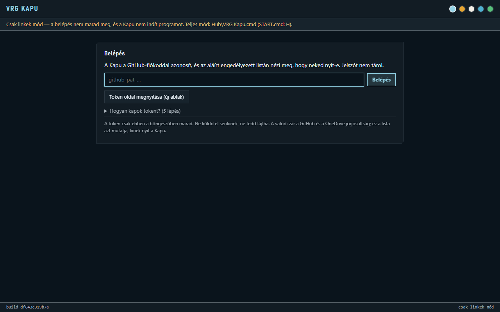
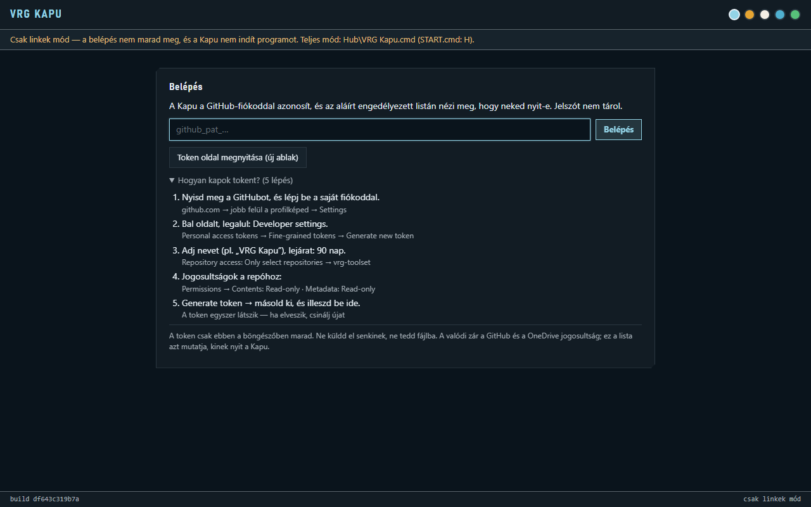
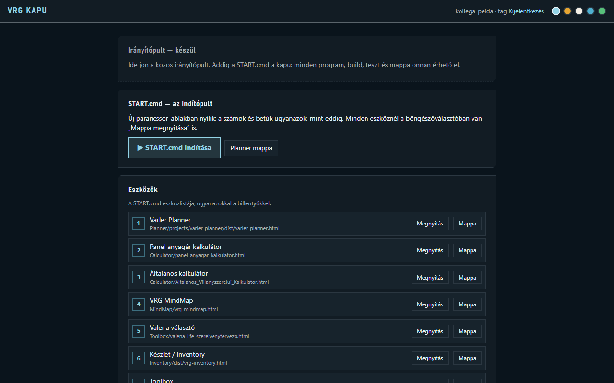

# Az első órád a VRG Kapuval

Ez a leírás végigvezet attól, hogy megkapod a GitHub-meghívót, addig, hogy a Kapun át elindítod a
START.cmd-t és az első eszközt. Kb. fél óra. Jelszót, tokent, helyreállító vagy 2FA-kódot **soha** ne
küldj el senkinek: se e-mailben, se üzenetben, se Claude-nak, és ne írd fájlba.

*Your first hour with VRG Kapu: from the GitHub invite to starting START.cmd and your first tool
through the Kapu, about half an hour. Never send a password, token, recovery code or 2FA code to
anyone — not by e-mail, not in a message, not to Claude — and never put one in a file.*

A VRG Kapu ma a **belépőlap**: a GitHub-fiókoddal azonosít, megnézi az aláírt engedélyezett listát,
és ha rajta vagy, innen indul a START.cmd és minden eszköze. A közös irányítópult később ide jön.

*Today VRG Kapu is the **access page**: it identifies you by your GitHub account, checks the signed
allowed list and, if you are on it, hands you over to START.cmd and every tool in it. The shared
dashboard comes here later.*

## 1. A GitHub-meghívó

Kapsz egy e-mailt a GitHubtól: meghívó a `webagoly-work/vrg-toolset` repóhoz. Lépj be a **saját**
GitHub-fiókoddal, és fogadd el. A repó privát: csak a meghívottak látják.

*You get an e-mail from GitHub inviting you to `webagoly-work/vrg-toolset`. Sign in with your own
GitHub account and accept. The repo is private: only invited people can see it.*

## 2. Kétlépcsős azonosítás (2FA)

GitHub → profilkép → Settings → Password and authentication → kapcsold be a kétlépcsős
azonosítást. A helyreállító kódokat tedd el biztos helyre, csak magadnak.

*GitHub → your picture → Settings → Password and authentication → turn on two-factor authentication.
Keep the recovery codes somewhere safe, for yourself only.*

## 3. GitHub Desktop és a klón

Telepítsd a GitHub Desktopot, lépj be benne, majd File → Clone repository → `vrg-toolset`. Válassz
egy helyi mappát; ebben a mappában lesz minden program és leírás.

*Install GitHub Desktop, sign in, then File → Clone repository → `vrg-toolset`. Pick a local folder;
every program and document will be in it.*

## 4. Node

A Kapu segédhez és a build-eszközökhöz Node kell. Telepítsd a nodejs.org-ról (LTS változat), a
telepítő alapbeállításaival.

*The Kapu helper and the build tools need Node. Install it from nodejs.org (the LTS version) with the
installer's default settings.*

## 5. A Kapu indítása

A klónban kattints duplán a `Hub\VRG Kapu.cmd`-re. Elindítja a Kapu segédet (csak ezen a gépen,
localhost:8795), és megnyitja a Kaput a böngészőben: ez a **teljes mód**, a lap alján ezt is írja.
Ha csak magát a `vrg-kapu.html` fájlt nyitod meg, sárga sáv jelzi a **csak linkek módot**: a belépés
működik, de nem marad meg, és a Kapu nem tud programot vagy mappát megnyitni.

*In the clone, double-click `Hub\VRG Kapu.cmd`. It starts the Kapu helper (this computer only,
localhost:8795) and opens the Kapu in the browser: this is **full mode**, as the bottom line says.
Opening the `vrg-kapu.html` file by itself shows a yellow bar for **links-only mode**: signing in
works but is not kept, and the Kapu cannot open programs or folders.*

## 6. Belépés a GitHub tokennel

A Kapu egy **saját** GitHub tokent kér. A **Hogyan kapok tokent? (5 lépés)** lenyitva megmutatja a
lépéseket, a **Token oldal megnyitása** gomb új ablakban nyitja a GitHub tokenoldalát. Fine-grained
token kell: csak a `vrg-toolset` repóhoz, Contents: Read-only, Metadata: Read-only, 90 napra.
Másold ki, illeszd be, **Belépés**. A token csak ebben a böngészőben marad; ha lejár, csinálj újat
ugyanígy.

*The Kapu asks for your **own** GitHub token. **Hogyan kapok tokent? (5 lépés)** unfolds the steps,
**Token oldal megnyitása** opens GitHub's token page in a new window. Make a fine-grained token: only
the `vrg-toolset` repo, Contents: Read-only, Metadata: Read-only, 90 days. Copy it, paste it,
**Belépés**. The token stays in this browser only; when it expires, make a new one the same way.*

Ha a **Nincs hozzáférés** lap jön, a neved még nincs az engedélyezett listán, vagy a tokenhez nem
adtad meg a `vrg-toolset` repót. Szólj a tulajdonosnak; a token kódját ne küldd el.

*If the **Nincs hozzáférés** (no access) card appears, your name is not on the allowed list yet, or
the token does not include the `vrg-toolset` repo. Tell the owner; do not send the token itself.*

## 7. A nyitott Kapu

Belépés után felül a neved mellett „tag” áll. Három kártyát látsz:

- **Irányítópult — készül**: ide jön a közös irányítópult.
- **START.cmd — az indítópult**: a **▶ START.cmd indítása** új ablakban nyitja a menüt; minden
  program, build, teszt és mappa onnan érhető el.
- **Eszközök**: a START.cmd eszközlistája ugyanazokkal a billentyűkkel, mindegyiknél
  **Megnyitás** és **Mappa**.

*After signing in, the top bar shows your name with "tag" (member). You see three cards:
**Irányítópult — készül** (the shared dashboard, coming later); **START.cmd — az indítópult**, where
**▶ START.cmd indítása** opens the menu in a new window — every program, build, test and folder is
there; and **Eszközök**, START.cmd's tool list with the same keys, each with **Megnyitás** (open) and
**Mappa** (folder).*

## 8. Közös munka

Amíg az irányítópult nem kész, így dolgozunk együtt:

- Munka előtt GitHub Desktopban **Fetch origin**, majd **Pull**, hogy a legfrissebb változaton dolgozz.
- Egy nagyobb módosítás előtt üzenj, melyik programon dolgozol, hogy ne ugyanazt írjuk egyszerre.
- Kis, érthető commitok, magyarázó üzenettel; utána **Push**.
- Nagy fájlok és ügyfélmunkák nem a Gitbe mennek, hanem a megosztott OneDrive `VRG-Megosztott`
  mappába (az ügyfélmunkák a `10_Projektek`-be, munkaszám szerint), ha a tulajdonos megosztotta veled.

*Until the dashboard is ready, this is how we work together: before starting, **Fetch origin** then
**Pull** in GitHub Desktop so you work on the latest version; before a bigger change, send a message
saying which program you are on, so we don't edit the same thing at once; small, clear commits with
a meaningful message, then **Push**; big files and client jobs do not go into Git but into the shared
OneDrive folder `VRG-Megosztott` (client jobs into `10_Projektek`, by job code), once the owner has
shared it with you.*

## Claude Code

A saját Claude-fiókoddal nyisd meg a Claude Code-ot a klónban. A repó `CLAUDE.md`-je adja a
szabályokat; egy programhoz mondd: „olvasd el a `docs/hub/agents/<program>.md`-t, és …”. Részletek:
`docs/hub/agents/README.md`.

*Open Claude Code in the clone with your own Claude account. The repo's `CLAUDE.md` gives the rules;
for one program say „olvasd el a `docs/hub/agents/<program>.md`-t, és …” (read that file, then …).
Details: `docs/hub/agents/README.md`.*
