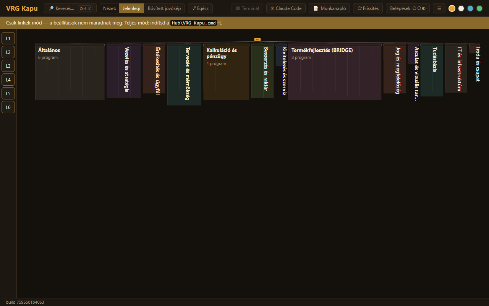
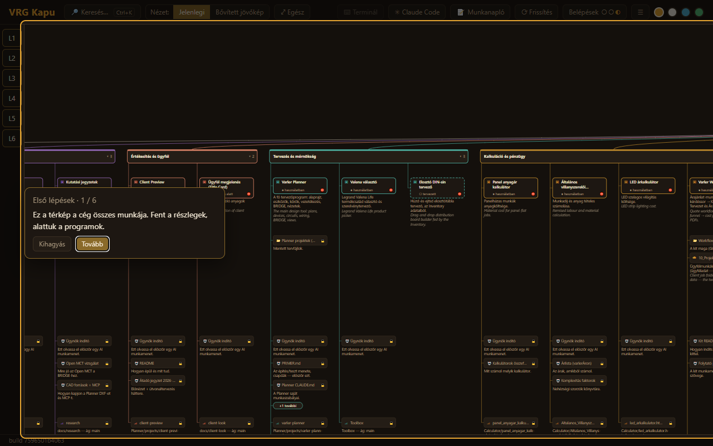
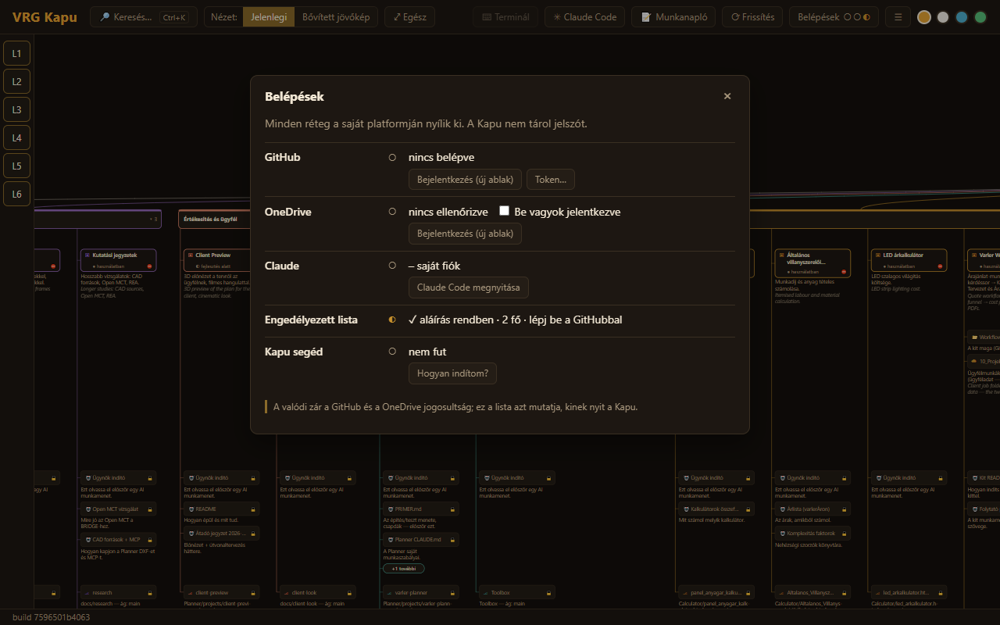
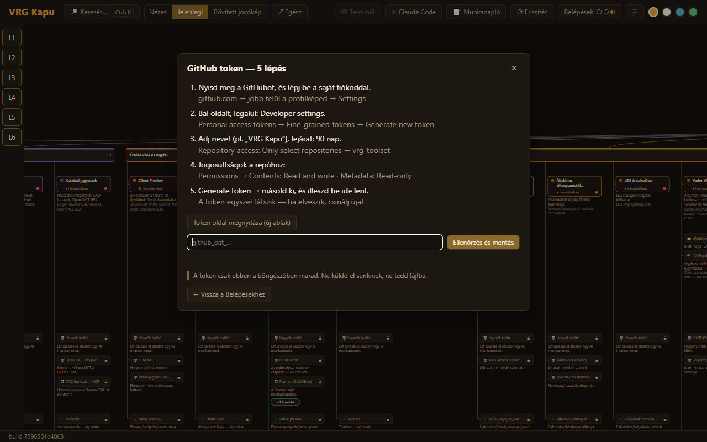
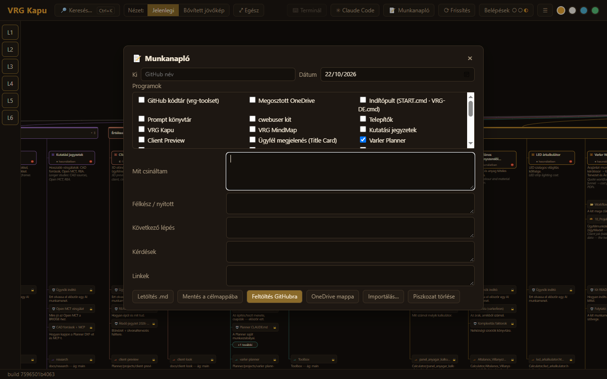

# Az első órád a VRG Kapuval

Ez a leírás végigvezet attól, hogy megkapod a GitHub-meghívót, addig, hogy megírod az első
munkanaplódat. Kb. egy óra. Jelszót, tokent, helyreállító vagy 2FA-kódot **soha** ne küldj el senkinek:
se e-mailben, se üzenetben, se Claude-nak, és ne írd fájlba.

*Your first hour with VRG Kapu: from the GitHub invite to your first work log, about an hour. Never
send a password, token, recovery code or 2FA code to anyone — not by e-mail, not in a message, not to
Claude — and never put one in a file.*

## 1. A GitHub-meghívó

Kapsz egy e-mailt a GitHubtól: meghívó a `webagoly-work/vrg-toolset` repóhoz. Lépj be a **saját**
GitHub-fiókoddal, és fogadd el. A repó privát: csak a meghívottak látják.

*You get an e-mail from GitHub inviting you to `webagoly-work/vrg-toolset`. Sign in with your own
GitHub account and accept. The repo is private: only invited people can see it.*

## 2. Kétlépcsős azonosítás (2FA)

GitHub → profilkép → Settings → Password and authentication → kapcsold be a kétlépcsős
azonosítást. A helyreállító kódokat tedd el biztos helyre, csak magadnak.

*GitHub → your picture → Settings → Password and authentication → turn on two-factor authentication.
Keep the recovery codes somewhere safe, for yourself only.*

## 3. GitHub Desktop és a klón

Telepítsd a GitHub Desktopot, lépj be benne, majd File → Clone repository → `vrg-toolset`. Válassz
egy helyi mappát; ebben a mappában lesz minden program és leírás.

*Install GitHub Desktop, sign in, then File → Clone repository → `vrg-toolset`. Pick a local folder;
every program and document will be in it.*

## 4. Node (vagy a cwebuser kit)

A Kapu segédhez Node kell. Telepíts egy szokásos Node-ot (nodejs.org, LTS), vagy használd a cwebuser
kitet a megosztott OneDrive `20_Telepitok` mappájából.

*The Kapu helper needs Node. Install a normal Node (nodejs.org, LTS), or use the cwebuser kit from the
shared OneDrive folder `20_Telepitok`.*

## 5. A Kapu indítása

A klónban kattints duplán a `Hub\VRG Kapu.cmd`-re. Elindítja a Kapu segédet (csak ezen a gépen,
localhost:8795), és megnyitja a Kaput a böngészőben. Ha csak magát a `vrg-kapu.html` fájlt nyitod meg
(például a OneDrive `00_START` mappából), sárga sáv jelzi a **csak linkek módot**: a térkép és a
linkek működnek, a beállítások nem maradnak meg.

*In the clone, double-click `Hub\VRG Kapu.cmd`. It starts the Kapu helper (this computer only,
localhost:8795) and opens the Kapu in the browser. Opening the `vrg-kapu.html` file by itself (e.g.
from the OneDrive `00_START` folder) shows a yellow bar for links-only mode: the map and the links
work, settings are not kept.*

## 6. Első lépések

Az első megnyitáskor magától elindul egy hatlépéses túra: mi a térkép, hogyan keresel, hol vannak a
belépések és a munkanapló. Később a ☰ → Első lépések indítja újra.

*On the first visit a six-step tour starts by itself: what the map is, how to search, where the
sign-ins and the work log are. Later, ☰ → Első lépések starts it again.*

## 7. Belépések és a GitHub token

Felül **Belépések** → GitHub → **Token…**. A varázsló öt lépésben megmutatja, hogyan készíts a saját
fiókodban egy fine-grained tokent: csak a `vrg-toolset` repóhoz, Contents: Read and write, Metadata:
Read-only, 90 napra. Másold ki, illeszd be, **Ellenőrzés és mentés**. A token csak ebben a
böngészőben marad. Ha a neved a jogosultsági listán van, a térkép kinyílik, és a neved mellett
„tag" áll.

*Top bar **Belépések** → GitHub → **Token…**. The five-step wizard shows how to make a fine-grained
token in your own account: only the `vrg-toolset` repo, Contents: Read and write, Metadata: Read-only,
90 days. Copy it, paste it, **Ellenőrzés és mentés**. The token stays in this browser only. If your
name is on the allowed list, the map unlocks and shows you as "tag" (member).*

## 8. Az első munkanapló

A nap végén **📝 Munkanapló**: melyik programon mit csináltál, mi félkész, mi a következő lépés,
kérdések és linkek. Mentsd a
GitHubra (a `Hub/logs` mappába); a másik ember a **Ki min dolgozik?** sávban látja. Egy nagyobb
módosítás előtt a program jobb klikkes menüjében **Foglalás…**, így tudjuk, ki min dolgozik.

*At the end of the day, **📝 Munkanapló**: on which program you did what, what is half-done, the next
step, questions and links.
Save it to GitHub (the `Hub/logs` folder); the other person sees it in **Ki min dolgozik?**. Before a
bigger change, right-click the program → **Foglalás…**, so we both know who is on what.*

## Claude Code

A saját Claude-fiókoddal nyisd meg a Claude Code-ot a klónban, és mondd: „olvasd el a
`docs/hub/agents/<program>.md`-t, és …". A Kapuban a program jobb klikkes menüje: Claude Code itt →
indító prompt másolása. Részletek: `docs/hub/agents/README.md`.

*Open Claude Code in the clone with your own Claude account and say „olvasd el a
`docs/hub/agents/<program>.md`-t, és …". In the Kapu: right-click a program → Claude Code itt →
indító prompt másolása. Details: `docs/hub/agents/README.md`.*
