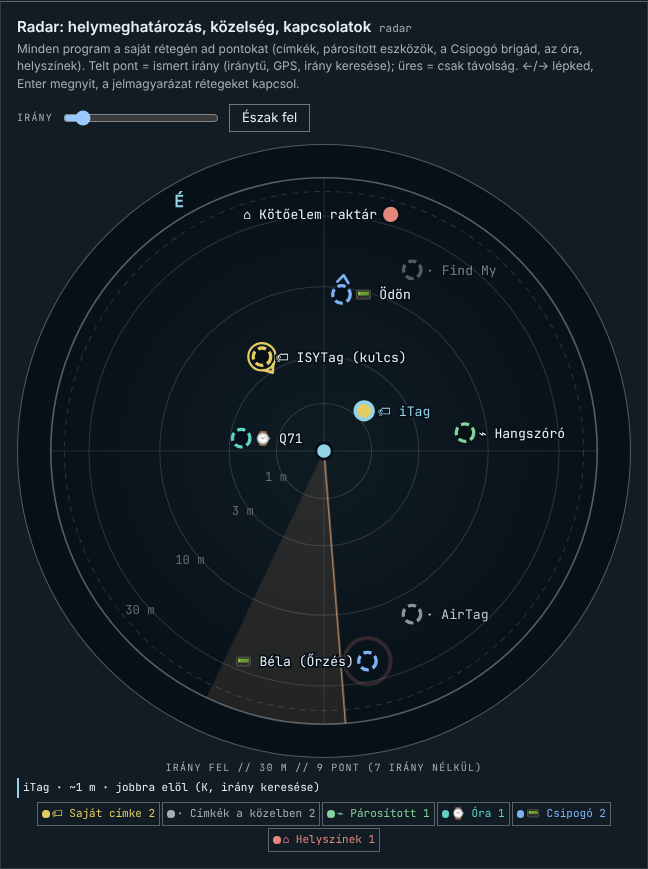

# Radar — the universal locator, proximity and connection display (WP M66)

One radar for everything that is "somewhere around": the Tárgykereső's tags and paired devices, the Csipogó crew's
phones, the Óra, and whatever a later program adds. The Founder (2026-11-23): *"a universal locator / tracker /
directional / proximity detection display that will be used as a plugin for current and later programs, but also … a
universal connection display … able to visually detect other features overlayed"*.



## Where it lives

| Part | Where | What |
|---|---|---|
| The rule | `Mobile/android/kit-core/…/core/Radar.kt` | model, layout, the direction sweep, geodesy, texts (pure Kotlin) |
| The hub | `Mobile/android/kit-core/…/core/RadarHub.kt` | programs register a `RadarSource`; radars ask it for frames; swept bearings are kept here |
| Phone drawing | `Mobile/android/kit/…/kit/ui/Radar.kt` | `VrgRadar` (any frame), `VrgHubRadar` (a feature's own layers from the hub) |
| Phone compass | `Mobile/android/kit/…/kit/Compass.kt` | rotation-vector heading, reference-counted |
| Phone screen | `Mobile/android/feature-radar` | the Radar tile: all layers, Irány fel / Észak fel, Irány keresése, the blip card |
| Desktop / web | `shared/vrg-ui-kit/components/radar.{js,css}` | `VK.radar.mount(el, opts)`, `VK.radar.layout(frame)`; gallery family 3 |
| Shared proof | `shared/vrg-ui-kit/test/fixtures/radar-layout.json` | placements both implementations must reproduce (`test/radar.js`, `RadarTest`) |

## The frame (the contract)

```jsonc
{
  "layers": [{ "id": "tag", "title": "Saját címke", "glyph": "🏷", "tone": "sand", "feature": "tag" }],
  "blips": [{
    "id": "tag:mine", "layer": "tag", "label": "ISYTag",
    "distanceM": 4.2,          // null = unknown (the outer dashed band)
    "bearingDeg": null,        // compass bearing, 0 = north, clockwise; null = unknown
    "bearingSrc": "none",      // none | gps | sweep | source
    "trend": 1,                // +1 closer, -1 away
    "ageMs": 800, "linked": false, "mine": true, "alert": false,
    "detail": "elem: tele",
    "place": { "lat": 47.5, "lon": 19.04 },   // a place: the radar computes a GPS bearing (and distance) from "here"
    "rssi": -61                // live signal: lets Irány keresése work on it (phone only)
  }],
  "headingDeg": 30, "here": { "lat": 47.4979, "lon": 19.0402 }, "mode": "heading-up", "rangeM": null
}
```

Tones: `glow`, `current`, `sand`, `coral`, `kelp`, `muted` (Mélyvíz on the phone; `--vk-layer-*` / `--vk-crit` on the
Desktop). A layer's `feature` is the VRG Mobile catalogue id its card opens.

## The layout rule (identical in both implementations)

- Radius: `0.86 · ln(1 + d) / ln(1 + range)`, clamped to 0.04 … 0.9; unknown distance at 0.95.
- Range: fixed, or the smallest of 5 / 10 / 30 / 100 / 300 m holding the farthest *nearby* blip (one without a place)
  with 15 % margin; a far place sits on the edge at its true bearing. Rings at 1, 3, 10, 30, 100 m under the range.
- Angle: a known bearing minus the heading (heading-up with a compass) or as is (north-up). A place gets a GPS bearing
  from `here`; a blip with a kept sweep gets that.
- No direction: an angle from FNV-1a (32 bit, UTF-8) of the id, `hash % 3600 / 10`, then pushed 9° at a time (at most
  40) until 0.085 from every blip already placed; blips with a direction first, each group by id.
- Fade: full for 5 s, linearly to 0.35 at 60 s.

Change it only on purpose, in both files, then `node shared/vrg-ui-kit/test/radar.js --write` and the Kotlin test.

## Directions, honestly

Bluetooth signal strength is a distance estimate, never a direction. A blip has a direction only when:

1. **It has a place** and the phone knows its own: a GPS bearing (a tag's last place, a site).
2. **Irány keresése**: hold the phone in front, turn round once slowly. The body shadows the signal behind you, so
   the heading where the filtered RSSI is strongest points to the device. 24 sectors of 15°; a result once 60 % of the
   circle is covered; confidence from the contrast (4 dB = 0, 14 dB = full). The bearing is kept on the compass for 10
   minutes, so the blip stays put while you turn.
3. **A source knows it** (a future UWB tag, a mapped site).

Otherwise the blip is drawn **hollow and dashed** on its distance ring, at an angle that only keeps it apart from the
others, and the caption says how many have no direction.

## Adding a layer (any program, now or later)

Phone: implement `RadarSource` (`layer`, `blips(now)`, optionally `watch(on)` to wake a scanner while a radar is on
screen) and call `RadarHub.register(source)` in the feature's `init`. Show your own layer inside your screen with
`VrgHubRadar(setOf("<layer id>"))`. Desktop: `VK.radar.mount(el).update(frame)` with your blips.
